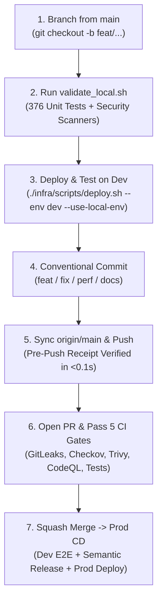

# 🛠️ CricScore Contributing & Developer Workflow Tutorial

Direct pushes to `main` are blocked by GitHub Branch Protection. Every code or documentation change follows a 7-step **Feature Branch → Local Validation → Dev Cloud Verification → Pull Request → Automated Release** workflow across CricScore (`~$1/month` AWS + Aiven footprint, **XGBoost `v2.2.0`** in `xgboost-cpu ~309 MB` with ECR `countNumber = 1`, **`376` unit tests**, and **`15` Playwright E2E tests**).

---

## 🔄 End-to-End Contribution Pipeline



---

## 📋 Step-by-Step Developer Tutorial

| Step  | Goal                                 | Command / Action                                                                      |
| :---: | :----------------------------------- | :------------------------------------------------------------------------------------ |
| **1** | **Sync `main` & create branch**      | `git checkout main && git pull origin main && git checkout -b feat/my-change`         |
| **2** | **Run local verification gate**      | `./infra/scripts/validate_local.sh --fast`                                            |
| **3** | **Deploy & verify on `dev` cloud**   | `./infra/scripts/deploy.sh --env dev --use-local-env`                                 |
| **4** | **Commit with Conventional Commits** | `git add . && git commit -m "feat(scope): concise summary"`                           |
| **5** | **Sync `origin/main` & push**        | `git fetch origin main && git merge origin/main --no-edit && git push -u origin HEAD` |
| **6** | **Open PR & verify status checks**   | `gh pr create --base main` and `gh pr checks`                                         |
| **7** | **Squash & merge into `main`**       | Merge on GitHub once all status checks pass                                           |

---

### Step 1: Sync `main` & Create a Feature Branch

```bash
git checkout main
git pull origin main
git checkout -b feat/your-feature-name
```

### Step 2: Run the Local Validation Gate (`376` Unit Tests + 6 Security Scanners)

`./infra/scripts/validate_local.sh` runs the exact same checks enforced by GitHub Actions CI:

| Check                     | Runner / Tool                      |          Scope / Count          |
| :------------------------ | :--------------------------------- | :-----------------------------: |
| **Frontend Lint & Build** | ESLint, `tsc -b`, Vite Build       |       Zero TS/Lint errors       |
| **Frontend Unit Tests**   | Vitest (`apps/frontend`)           |  **`151` tests** (`23` suites)  |
| **Backend Unit Tests**    | Vitest (`apps/backend`)            |  **`121` tests** (`12` suites)  |
| **Python AI & ML Tests**  | Pytest (`ai-service`, `ml-engine`) |   **`75` AI + `29` ML tests**   |
| **IaC & Secret Scans**    | Terraform, Checkov, GitLeaks       |   HCL policies & git history    |
| **CVE & Supply Chain**    | `npm audit`, Trivy FS, Syft SBOM   | Zero critical/high fixable CVEs |

#### What Each Local Check Verifies

- **1. Frontend Lint, Unit Tests (`151`) & Production Build:**
  - Runs `tsc -b`, ESLint, `151` Vitest component/hook/DLS/POTM tests, and a clean Vite production bundle.
- **2. Backend Lambda Unit Tests (`121`):**
  - Verifies `match-api`, `score-update`, `storage-worker`, `broadcaster`, `cognito-presignup`, and `chat-api` MCP/SQL guardrails.
- **3. Python AI Service (`75`) & ML Engine (`29`) Pytest Suites:**
  - Verifies the 4-agent LangGraph/MCP router (`75` tests) and hybrid **XGBoost `v2.2.0`** + Markov DP + DLS win probability (`29` tests).
- **4. IaC, Secret & Supply-Chain Security:**
  - Runs `terraform fmt -check`, `terraform validate`, Checkov, GitLeaks, `npm audit`, Trivy filesystem scans, and Syft SPDX SBOM generation.

```bash
# Fast pre-push validation (~25s, stamps .git/.local_validation_receipt)
./infra/scripts/validate_local.sh --fast

# Full validation including live 15-test Playwright E2E suite against Dev
./infra/scripts/validate_local.sh
```

### Step 3: Deploy & Test in the `dev` Cloud Sandbox

Because CricScore is 100% serverless (`~$1/month` combined Dev + Prod cost), always verify full-stack changes against the live **`dev`** environment (`https://cricscoredev.venkateshsingamsetty.com`) before merging:

```bash
# Pre-flight check + deploy to dev (add --migrate if SQL migrations changed)
./infra/scripts/deploy.sh --env dev --use-local-env --check
./infra/scripts/deploy.sh --env dev --use-local-env

# Run the 15 Playwright E2E tests against dev when UI or API flows change
npm run test:e2e:dev
```

### Step 4: Commit Using Conventional Commits

Semantic Release parses commit prefixes on `main` to calculate the next `v*` version tag and update `docs/changelog.md`:

| Prefix                                             | Purpose                                       | Version Bump on `main` |
| :------------------------------------------------- | :-------------------------------------------- | :--------------------: |
| `feat:`                                            | New user-facing or architectural feature      |  **Minor** (`v1.X.0`)  |
| `fix:`                                             | Bug fix or race-condition resolution          |  **Patch** (`v1.0.X`)  |
| `perf:`                                            | Performance or cloud cost optimization        |  **Patch** (`v1.0.X`)  |
| `docs:` / `chore:` / `refactor:` / `test:` / `ci:` | Documentation, dependencies, tests, workflows |  **Patch** (`v1.0.X`)  |

```bash
git add .
git commit -m "feat(summary): unify deterministic Player of the Match across scorer and viewer"
```

### Step 5: Sync with `origin/main` & Push

```bash
git fetch origin main && git merge origin/main --no-edit
git push -u origin HEAD
```

### Step 6: Open a Pull Request & Verify Required Status Checks

| Required CI / Security Job                                | Workflow                                             | Must Pass Before Merge |
| :-------------------------------------------------------- | :--------------------------------------------------- | :--------------------: |
| `Infrastructure & Secrets Security` (`validate_security`) | `ci.yml` (GitLeaks + Checkov)                        |         ✅ Yes         |
| `Lint & Test` (`validate_frontend`)                       | `ci.yml` (Trivy + ESLint + 151 Vitest + Build)       |         ✅ Yes         |
| `Backend & Terraform Validation` (`validate_backend`)     | `ci.yml` (121 Vitest + Trivy + `terraform validate`) |         ✅ Yes         |
| `Python AI & ML Validation` (`validate_python`)           | `ci.yml` (75 AI + 29 ML Pytest + Trivy)              |         ✅ Yes         |
| `Analyze (javascript-typescript)` & `Analyze (python)`    | `codeql.yml` (GitHub CodeQL SAST)                    |         ✅ Yes         |

```bash
gh pr create --title "feat(summary): unify deterministic Player of the Match" \
             --body "Summary of changes, root cause, and validation results." \
             --base main

gh pr checks
gh api repos/venkatesh-singamsetty/cricscore/pulls/<PR_NUMBER>/comments
```

### Step 7: Squash Merge & Automated Production Release

Once all required PR checks are green, squash-merge into `main`. GitHub Actions automatically executes:

- **`CI` (`deploy_and_test_dev`)**: Deploys `dev`, runs DB migrations, AI evaluation, **`15` Playwright E2E tests**, and OWASP ZAP DAST.
- **`Semantic Release` (`release.yml`)**: Cuts the next `v*` tag, updates `docs/changelog.md`, and publishes enriched GitHub Release notes.
- **`CD` (`cd.yml`)**: Deploys the tagged release to `prod` (`https://cricscore.venkateshsingamsetty.com`), runs Playwright E2E, and runs OWASP ZAP against `prod`.

---

## 🛡️ Governance Rules Summary

| Rule                                           | Policy                                                                      |
| :--------------------------------------------- | :-------------------------------------------------------------------------- |
| **Direct pushes to `main`**                    | ❌ Blocked by GitHub Branch Protection                                      |
| **Merging with failing CI / CodeQL checks**    | ❌ Blocked by Required Status Checks                                        |
| **Local deployment without `--use-local-env`** | ❌ Prohibited (`./infra/scripts/deploy.sh --env dev --use-local-env`)       |
| **Leaving open Dependabot PRs behind**         | ❌ Consolidate with `./infra/scripts/consolidate_dependabot_prs.sh --merge` |
| **Updating tests & docs with code changes**    | ✅ Mandatory in the same PR                                                 |
