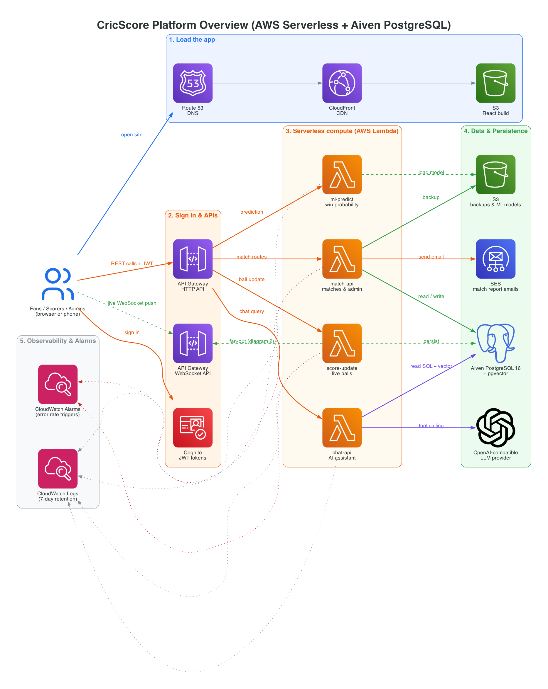
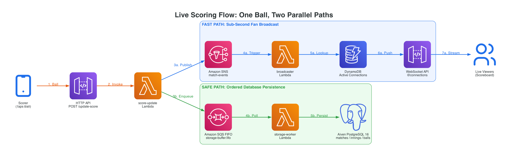
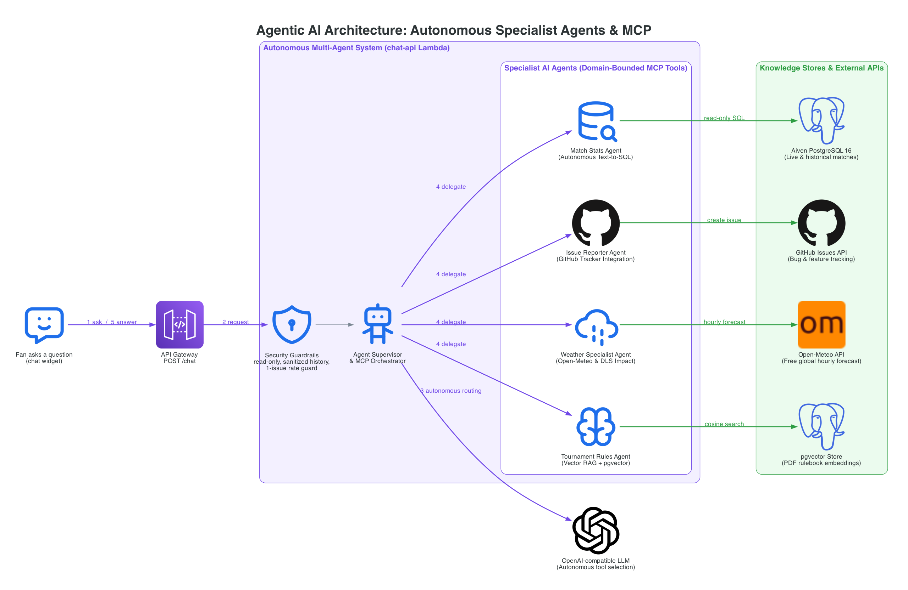
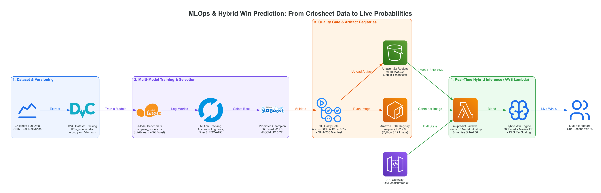

# 🏏 CricScore: Real-Time Cricket Match Engine

🚀 **Production Environment:** **https://cricscore.venkateshsingamsetty.com**

🧪 **Development Environment:** **https://cricscoredev.venkateshsingamsetty.com**

👉 **Deployment Details:** **[Full Deployment Guide](./docs/deployment.md)**

⚡ **Quick Commands:** **[Developer Cheatsheet](./CHEATSHEET.md)**

🛠️ **Developer Workflow:** **[Contributing & PR Guide](./CONTRIBUTING.md)**

---

## 🎯 Project Vision

CricScore demonstrates how a high-performance, real-time sports platform can be designed using modern **Multi-Cloud**, **Serverless**, and **Event-Driven** architecture. By combining AWS services with Aiven managed databases, the project maintains an enterprise-grade, cost-optimized footprint.

The project models a live cricket platform featuring:

- **Serverless Compute**: Fully managed AWS Lambda backends.
- **Event-Driven Architecture**: Fan-out messaging via SNS and SQS for fault-tolerant state processing.
- **AI Chat**: Retrieval-augmented answers with Text-to-SQL and vector search.
- **Live MLOps**: On-demand win-probability inference using an AWS Lambda container image with versioned model artifacts (`v2.2.0-xgboost`) stored in S3 and ECR.
- **Multi-Cloud Infrastructure**: Terraform-managed deployments bridging AWS and Aiven PostgreSQL.
- **Real-Time Streaming**: WebSocket API Gateway for instant, low-latency score updates.
- **DevSecOps Governance**: End-to-end CI/CD automation with automated security and compliance scanning.

This repository serves as a practical, production-style reference implementation for modern cloud engineering, AI integration, and rigorous operational discipline.

---

## 🗺️ Architecture at a Glance

Four pictures explain the whole platform. Each uses official AWS icons, and the coloured boxes group the steps in order. Prefer text? The editable Mermaid versions and sequence diagrams are in **[docs/architecture.md](./docs/architecture.md)**.

### ☁️ 1. Platform Overview

- **Load the app**: Route 53 → CloudFront → S3 serves the React build.
- **Sign in & call APIs**: Cognito issues JWTs; API Gateway (HTTP + WebSocket) is the only way in.
- **Compute**: Four Lambda functions handle matches, live balls, AI chat, and win prediction.
- **Data**: Aiven PostgreSQL 16 + pgvector stores everything; S3 keeps backups; SES emails match reports.

### ⚡ 2. Live Scoring: One Ball, Two Paths

- **Fast path (blue)**: SNS → broadcaster Lambda → WebSocket push, so fans see the ball in under a second.
- **Safe path (green)**: SQS → storage-worker Lambda → PostgreSQL, so no ball is lost if the database is slow.

### 🤖 3. AI Assistant

- The `chat-api` Lambda runs an in-memory **MCP server**; the LLM only chooses tools, it never touches the database directly.
- SQL is **SELECT-only**, rulebook answers come from **pgvector** search, and at most **one GitHub issue** can be filed per message.
- A Python **LangGraph** supervisor (`apps/ai-service`) is being built as the next-generation agent; see [AI Architecture](./docs/ai_architecture.md).

### 🧠 4. MLOps & Live Win Probability

- **Data → Train**: DVC versions Cricsheet ball-by-ball data; eight models are compared in MLflow.
- **Gate → Publish**: GitHub Actions promotes the XGBoost champion only if accuracy and ROC-AUC pass, with a SHA-256 manifest.
- **Serve**: The `ml-predict` container Lambda verifies the checksum and blends XGBoost with a DP chase simulation and DLS.

> 🔁 **Regenerate the images** after an architecture change: see [`docs/diagrams/README.md`](./docs/diagrams/README.md).

---

## 🛠️ Technology Stack

### Frontend

| Technology   | Purpose                                       |
| ------------ | --------------------------------------------- |
| React        | User interface framework                      |
| TypeScript   | Type-safe application development             |
| Vite         | Frontend build tooling and development server |
| HTML5 / CSS3 | UI structure and styling                      |

### Backend & APIs

| Technology                  | Purpose                              |
| --------------------------- | ------------------------------------ |
| AWS Lambda                  | Serverless backend execution         |
| Amazon API Gateway          | REST API and WebSocket communication |
| AWS Cognito                 | Identity management and JWT auth     |
| AWS Amplify Auth            | Frontend auth SDK (sign-up/sign-in)  |
| Amazon SNS                  | Event fan-out messaging              |
| Amazon SQS                  | Asynchronous worker queues           |
| Node.js 24.x                | High performance runtime             |
| OpenAI-compatible providers | Foundation models for RAG            |
| MCP SDK                     | Model Context Protocol architecture  |

### Database

| Technology       | Purpose                                              |
| ---------------- | ---------------------------------------------------- |
| Aiven PostgreSQL | Managed relational database                          |
| PostgreSQL       | Match, player, score, and tournament persistence     |
| pgvector         | Vector similarity search extension for RAG           |
| HNSW Index       | High-performance approximate nearest-neighbor search |
| DynamoDB         | NoSQL active connections registry for WebSockets     |

### Machine Learning & MLOps

| Technology         | Purpose                                                                       |
| ------------------ | ----------------------------------------------------------------------------- |
| Python 3.12        | MLOps workflow and ML Lambda container runtime                                |
| XGBoost (`v2.2.0`) | Promoted champion gradient boosting model for live win probability            |
| Scikit-Learn       | Multi-algorithm benchmarking (8 classification + 5 regression + 2 clustering) |
| Pandas / NumPy     | High-performance data manipulation and matrices                               |
| AWS S3 + ECR       | Versioned S3 model registry (`models/<tag>/`) & tagged ECR images             |
| Joblib + DVC       | Model serialization, SHA-256 checksum verification & data tracking            |

### Infrastructure & Cloud

| Technology | Purpose                        |
| ---------- | ------------------------------ |
| Terraform  | Infrastructure as Code         |
| AWS Cloud  | Cloud infrastructure platform  |
| CloudFront | Global content delivery        |
| S3         | Static website hosting         |
| Route53    | DNS management                 |
| ACM        | SSL/TLS certificate management |
| SES        | Simple Email Service reports   |
| CloudWatch | Logging, Metrics, and Alarms   |
| AWS X-Ray  | Distributed request tracing    |
| Budgets    | Automated billing alerts       |

### DevSecOps & Security

| Tool            | Purpose                               |
| --------------- | ------------------------------------- |
| GitHub Actions  | CI/CD automation                      |
| Checkov         | Terraform security scanning           |
| GitLeaks        | Secret detection                      |
| Trivy           | Dependency and vulnerability scanning |
| OWASP ZAP       | Dynamic application security testing  |
| Dependabot      | Dependency vulnerability monitoring   |
| SBOM Generation | Software supply chain visibility      |

### Testing

| Tool                  | Purpose                           |
| --------------------- | --------------------------------- |
| Vitest                | JavaScript/TypeScript test runner |
| Pytest                | Python ML Engine testing          |
| React Testing Library | Frontend component testing        |
| Playwright            | End-to-end browser automation     |

---

## 🏢 Engineering Practices & Technical Documentation

CricScore is structured to demonstrate production-oriented engineering practices across the nine areas below. The linked guides provide additional technical details and tradeoffs.

### 1. 🛡️ DevSecOps & Security

**Identity & Automated Scanning**
Authenticated HTTP API routes use **AWS Cognito JWT authorization**. CI runs GitLeaks, Checkov, Trivy filesystem scans, and application and infrastructure validation; a separate CodeQL workflow analyzes code. CI does not run `npm audit`. OWASP ZAP scans deployed environments, but its configured action does not fail the workflow on findings.

- 📖 **[Authentication & Authorization](./docs/auth.md)**: Cognito SSO flows, guest mode, admin user management, JWT validation, and cross-session identity guard.
- 📖 **[Security Posture & Tradeoffs](./docs/security_posture.md)**: Defense in depth strategy, multi-tenant isolation, and encryption layers.
- 📖 **[Branch Protection & Governance](./docs/branch_protection.md)**: Branch protection rules and repository governance guidance.
- 📖 **[Contributing & Developer Workflow](./CONTRIBUTING.md)**: Branch workflow, Git hooks, and local validation commands.

### 2. 🔭 Observability & Logging

**System Visibility**
Lambda logs are sent to CloudWatch Logs. AWS X-Ray sampling is configured with a 5% fixed sampling rate and a one-request-per-second reservoir. CloudWatch alarms send SNS email alerts for errors from the match API and score-update Lambdas.

- 📖 **[Observability Suite](./docs/observability.md)**: CloudWatch Logs, X-Ray tracing, CloudWatch alarms and SNS alerts, plus optional Sentry/Uptime setup.
- 📖 **[Cost & Performance](./docs/cost_management.md)**: Cost monitoring guidance and architecture scale limits.
- 📖 **[Central Platform & Artifacts Dashboard](./docs/platform_dashboard.md)**: Automated single-pane-of-glass directory featuring GitHub repository resources, workflows, variables, secrets inventory, live Dev & Prod AWS console deep links, ECR container images, XGBoost ML artifacts, Aiven PostgreSQL vector schemas, and security scan reports.

### 3. ✅ Rigorous Testing

**Multi-Layer Testing**
Vitest tests cover frontend and backend code, and the ML engine has Pytest coverage. Playwright end-to-end tests run against the deployed development environment on main-branch deployments and against Production during production deployment; pull requests do not run the deployed-site E2E suite.

- 📖 **[Testing Guide](./docs/testing.md)**: Vitest and Playwright test commands, Availability Testing (Chaos/DR), and E2E structures.
- 📖 **[Toolchain & Security Stack](./docs/tools.md)**: Master list of all CI/CD, IaC, and AppSec tools used in the pipeline.

### 4. ♾️ Event-Driven Processing

**Event-Driven Design**
The score-update flow uses SNS fan-out: updates are broadcast to connected clients and buffered in a FIFO SQS queue for database persistence. The configured queue retains messages for up to one day. A dead-letter queue is not configured in the current Terraform.

- 📖 **[Detailed Architecture](./docs/architecture.md)**: System design, sequence flows, and EDA logic.
- 📖 **[API Guide](./docs/api.md)**: REST & WebSocket contract specifications.
- 📖 **[Aiven Managed Services](./docs/aiven.md)**: PostgreSQL database configuration and keep-alive strategy.
- 📖 **[Node.js Guide](./docs/nodejs_guide.md)**: ESM vs CommonJS standardizations and dependency security.

### 5. 🏗️ Infrastructure as Code (IaC)

**Versioned & Repeatable Environments**
The AWS infrastructure is codified in Terraform. Changes can be planned, scanned for infrastructure security issues by Checkov, and applied through GitHub Actions or the local deploy script, reducing manual infrastructure changes.

- 📖 **[Full Deployment & Infrastructure](./docs/deployment.md)**: Step-by-step setup of accounts, tools, AWS, Aiven and OpenAI, then Dev and Prod deploys.
- 📖 **[Troubleshooting](./docs/troubleshooting.md)**: Setup fixes and identity verification help.

### 6. 🚀 CI/CD Automation

**Pull Request Validation & Tagged Releases**
Pull requests to `main` run validation jobs; deployed-site E2E tests are not part of the pull-request run. A successful CI run on `main` can create a semantic-versioned release when the commits meet the configured release rules. The development workflow deploys and tests Dev on `main`; the separate production workflow deploys on version tags or can be manually dispatched with a selected tag. Redeploying an older tag is possible, but is not an instant rollback and should account for database/schema compatibility.

- 📖 **[GitHub Actions Architecture](./docs/github_actions.md)**: CI/CD Directory structure constraints and pipeline organization.
- 📖 **[Automated Releases](./docs/release_process.md)**: Semantic release and Conventional Commit specifications.
- 📖 **[Full Project Log](./docs/changelog.md)**: Release records and development timeline.

### 7. 🤖 Agentic AI & RAG

**AI Chat with Retrieval-Augmented Generation**
CricScore includes an **AI Chat Assistant** that uses an OpenAI-compatible API; its default inference and embedding model names are `gpt-4o-mini` and `text-embedding-3-small`, and provider/model settings can be configured. MCP tools handle database operations so database credentials are not passed to the model provider. Retrieval uses up to eight pgvector chunks, and responses include cricket rulebook guidance. Model availability, output quality, and request cost depend on the configured provider and settings.

- 📖 **[AI Architecture](./docs/ai_architecture.md)**: RAG design, MCP architecture, provider configuration, quality tuning, and example prompts.

### 8. 🧠 Serverless MLOps & Live Prediction

**Win Probability Inference & S3 Model Registry**
CricScore includes a multi-algorithm model-training benchmark (`compare_models.py`) and a real-time win-probability inference Lambda (`ml-predict`, 1024 MB, lazy-loaded libraries for <70ms init). The promoted **XGBoost (`v2.2.0`)** champion model is stored in a versioned **Amazon S3 Model Registry** (`s3://<bucket>/models/<version>/`) and tagged in **Amazon ECR** (`:v2.2.0` + `:latest`) with automated ECR lifecycle cleanup to expire untagged layers after 1 day. At runtime, Lambda downloads and caches the versioned model in `/tmp`, verifies its SHA-256 checksum against `model_manifest.json`, and blends it with Markov Dynamic Programming (`win_probability.py`) and DLS resource par. Deploying or rolling back a model version is a single command (`./infra/scripts/deploy.sh --env prod --use-local-env --model-version v2.2.0`).

- 📖 **[MLOps & Prediction Guide](./docs/mlops_tutorial.md)**: Training workflow, S3 versioned model registry, tag-based rollback, [Win Prediction Specification](./docs/mlops_tutorial.md#-8-win-prediction-engine-specification), and [DLS Method](./docs/mlops_tutorial.md#️-9-duckworth-lewis-stern-dls-method).
- 📖 **[Classical ML Models & Interview Handbook](./docs/ml_models_handbook.md)**: Mathematical formulas, cricket domain mappings, empirical benchmarks, and revision cheat sheets across all 14 classical ML models (8 classification, 5 regression, 2 clustering).

### 9. 🤖 AI Agent Governance & Skills

CricScore includes repository-specific instructions and an **AI Skills Library** to guide coding assistants. The tools' support for automatically loading these files varies.

The `.agents/skills/` directory contains focused, on-demand guidance for:

- Pull-request code review and review findings
- Secure implementation and validation
- Branch, PR, CI/CD, and developer-command workflows
- AWS cost and Terraform/infrastructure changes
- Frontend, backend, and AI/RAG architecture
- Node.js, browser, and ML testing
- ML training and inference compatibility
- PostgreSQL schema changes and migrations

### 🔌 Agent Guidance Integration

These skills are Markdown files; an agent can use them when its host is configured to load or access repository files. Markdown format alone does not make them load automatically in every AI tool:

- **Cursor**: The repository includes a `.cursorrules` guidance file.
- **GitHub Copilot**: The repository includes `.github/copilot-instructions.md` guidance.
- **MCP clients**: An agent with an appropriate filesystem tool can read the files; MCP compatibility by itself does not load or follow them.
