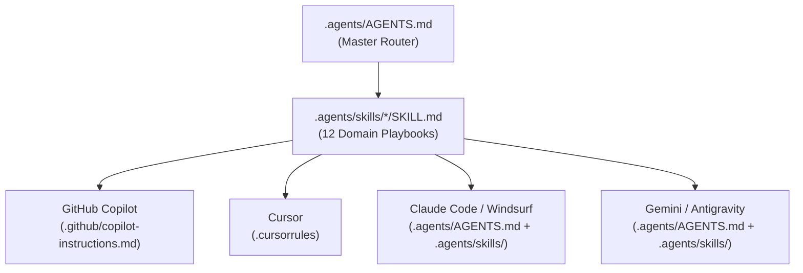

# 🏏 CricScore: Real-Time Cricket Match Engine

[](https://github.com/venkatesh-singamsetty/cricscore/actions/workflows/ci.yml)
[](https://github.com/venkatesh-singamsetty/cricscore/releases)
[](./docs/testing.md)
[](https://www.typescriptlang.org/)
[](https://www.python.org/)
[](https://www.terraform.io/)
[](./docs/cost_management.md)
[](https://opensource.org/licenses/MIT)

- 🚀 **Production Environment:** [https://cricscore.venkateshsingamsetty.com](https://cricscore.venkateshsingamsetty.com)
- 🧪 **Development Environment:** [https://cricscoredev.venkateshsingamsetty.com](https://cricscoredev.venkateshsingamsetty.com)
- 📖 **Full Self-Deployment Guide:** [docs/deployment.md](./docs/deployment.md)
- ⚡ **Developer Command Cheatsheet:** [CHEATSHEET.md](./CHEATSHEET.md)
- 🛠️ **Contributing & PR Workflow:** [CONTRIBUTING.md](./CONTRIBUTING.md)
- 🏆 **Engineering Milestones & Key PRs:** [docs/engineering_milestones.md](./docs/engineering_milestones.md)

---

## 🎯 Project Overview

CricScore is a cloud-native, real-time cricket scoring and match analytics platform built with **AWS Serverless**, **Aiven PostgreSQL 16 (`pgvector`)**, **Agentic AI (MCP + RAG)**, and **Serverless MLOps (XGBoost + Markov DP + DLS)**. Engineered around intentional architectural **trade-offs** (serverless scale-to-zero, AWS-managed encryption, 7-day log retention, and S3/ECR lifecycle rules), it runs both **Dev** and **Prod** environments for **~$1/month** on AWS.

- **👀 Fans & Viewers (Live Match Experience):**
  - Sub-second ball-by-ball scoreboard updates via WebSocket fan-out (`SNS` → `broadcaster` → `API Gateway WS`) with a 3-second polling recency guard (`lastWsUpdateRef`).
  - Live win-probability progress bar on every delivery and interactive AI match assistant chat.
- **✍️ Scorers (Real-Time Match Control):**
  - **Register**, **Sign In**, or **Continue as Guest** with full match setup (teams, squads, custom overs `1`–`20`, toss winner, and Bat/Bowl decision).
  - 1-tap ball, wicket (including MCC Law 25.4 `Retired Hurt` / `Retired Out`), and extra scoring with instant **Undo**, optimistic UI updates, and ordered `SQS FIFO` persistence.
  - Live DLS par targets, CRR/RRR chase equations, AI match summary, and deterministic **Player of the Match** (`computePlayerOfTheMatch`) consistent across Scorer, Viewer, DB, SES Email, and S3 Backups.
- **🤖 AI Assistant (Autonomous Multi-Agent MCP):**
  - One-click starter prompts and free-form cricket Q&A for live match stats, historical player records, tournament PDF rulebooks (`pgvector` citations), hourly weather, and GitHub issue filing.
  - Powered by in-memory Model Context Protocol (`InMemoryTransport`) that isolates database and API credentials from the LLM, protected by `5 rps` `/chat` route throttling.
- **🛡️ Admins (Governance & Operations):**
  - Role-Based Access Control (RBAC) via AWS Cognito `Admin` group JWT validation (`isAdminClaims`).
  - Tournament rulebook PDF upload for `pgvector` RAG, confirmed cleanup controls for guest/test matches, automated Amazon SES HTML scorecard emails, and S3 JSON match backups (`backups/`).

---

## 🗺️ Architecture at a Glance

Editable Mermaid diagrams live in **[docs/architecture.md](./docs/architecture.md)**, and diagram generator scripts live in **[docs/diagrams/README.md](./docs/diagrams/README.md)**.

### ☁️ 1. Platform Overview


- **1. Edge & CDN (`Route 53` + `ACM` + `CloudFront OAC` + `S3`):**
  - Resolves custom domains (`cricscore`, `api.`, `ws.`) with free DNS-validated TLS 1.3 certificates.
  - Serves the React 19 SPA globally with 7-day noncurrent version and 30-day access-log expiration.
- **2. Auth & API Edge (`Amplify Auth` + `Cognito` + `API Gateway HTTP/WS` + `IAM`):**
  - Handles Sign Up, Sign In, and **Continue as Guest** (`cognito-presignup` Lambda) with RS256 JWT validation at the API Gateway edge.
  - Enforces `50 rps` stage limits, `5 rps` `/chat` route throttling, and least-privilege IAM execution policies.
- **3. Serverless Compute (`9 AWS Lambdas`):**
  - `score-update` (ball ingestion & SNS/SQS fan-out), `broadcaster`, `onconnect`, `ondisconnect`, and `storage-worker` (FIFO persistence).
  - `match-api` (CRUD, Admin RBAC, SES email & S3 backups), `chat-api` (Agentic AI MCP supervisor & deterministic POTM), and `ml-predict` (win-probability container).
- **4. Data & Registries (`Aiven PostgreSQL 16 + pgvector` + `DynamoDB` + `SES` + `S3` + `ECR`):**
  - Schema-isolated (`dev` / `prod`) relational match records and 1536-dimensional `pgvector` HNSW rulebook embeddings.
  - Stores S3 match backups (180-day lifecycle), S3 ML models (`models/v2.2.0/`), and a single `~309 MB` `xgboost-cpu` image in ECR (`countNumber = 1`).
- **5. Observability & Cost Guardrails (`CloudWatch 7d` + `X-Ray 5%` + `SNS Alarms` + `AWS Budgets`):**
  - Enforces 7-day log retention across all Lambda/API log groups, 5% X-Ray trace sampling, real-time error alert emails, and `~$1/month` budget alarms.

### ⚡ 2. Live Scoring: One Ball, Two Parallel Paths


- **🔵 Fast Path (`< 1s` Live Broadcast):** `score-update` → **Amazon SNS (`match-events`)** → `broadcaster` Lambda → **DynamoDB (`PAY_PER_REQUEST` connection registry)** → **API Gateway WebSocket** pushes every delivery to connected viewers in under a second without waiting on database writes.
- **🟢 Safe Path (Ordered ACID Persistence):** `score-update` → **Amazon SQS FIFO (`storage-buffer.fifo`, `MessageGroupId = matchId`)** → `storage-worker` Lambda (`batch_size = 1`) → **Aiven PostgreSQL 16** commits balls, player snapshots, and undo rollbacks in strict chronological order per match.

### 🤖 3. AI Assistant (Autonomous Multi-Agent System via MCP)


- **📊 Match Stats Agent (`execute_sql` → Aiven PostgreSQL 16):**
  - Executes parameterized `SELECT`/`WITH` queries inside a `BEGIN READ ONLY` transaction with a `3s` timeout and automatic `scorer_email` PII stripping.
- **📖 Tournament Rules Agent (`search_tournament_rules` → PostgreSQL `pgvector`):**
  - Performs HNSW cosine similarity search using `text-embedding-3-small` across uploaded tournament PDFs with mandatory `[Source: document_name]` citations.
- **🌦️ Weather Specialist Agent (`get_match_weather` → Open-Meteo API):**
  - Fetches live hourly temperature, rain probability %, and wind speed (keyless API) to generate automated Cricket & DLS interruption advisories.
- **🐛 GitHub Issue Agent (`create_github_issue` → GitHub REST API):**
  - Files structured bug reports and feature requests on `venkatesh-singamsetty/cricscore` after a mandatory 2-step user confirmation (`1` issue/turn rate guard).

### 🧠 4. MLOps & Live Win Probability


- **1. Dataset & DVC Tracking (`cricket-data/t20s_json.zip.dvc`, `dvc.yaml`):**
  - Tracks raw Cricsheet T20 archives (`~22.7 MB`, `786K+` deliveries) by MD5 hash outside Git and pins reproducible pipeline stages.
- **2. 8-Model MLflow Benchmark (`compare_models.py`):**
  - Evaluates 7 Scikit-Learn baselines + **XGBoost** on leakage-free match-grouped splits (`70/15/15`), promoting **XGBoost (`v2.2.0`)** (`Val ROC-AUC = 0.7723`, `Test ROC-AUC = 0.7529`).
- **3. Dual S3 + ECR Registries (`mlops-pipeline.yml`):**
  - Enforces CI quality gates (`Accuracy >= 60%`, `ROC-AUC >= 65%`), uploads `.joblib` (`~227 KB`) + SHA-256 `model_manifest.json` to S3 (`models/v2.2.0/`), and retains a single `~309 MB` `xgboost-cpu` image in ECR (`countNumber = 1`, `~$0.01/mo`).
- **4. Hybrid Lambda Inference (`ml-predict` → `predict.py` + `win_probability.py`):**
  - Cold-start caches the S3 model in `/tmp` with SHA-256 verification (enabling 5-second `--model-version` rollbacks) and blends **XGBoost `v2.2.0`** + **Markov Chain DP** + **DLS Par** on every ball.

### 🧩 5. Multi-Host AI Coding Agent Skills (`.agents/skills/`)

CricScore ships with a vendor-neutral **Agent Skills** system ([`.agents/skills/`](./.agents/skills)) that gives **Claude Code**, **GitHub Copilot**, **Cursor**, **Windsurf**, and **Gemini / Antigravity** progressive, domain-specific engineering rules. See **[docs/agent_skills.md](./docs/agent_skills.md)** for full details.



- **GitHub Copilot (`.github/copilot-instructions.md` + `.agents/skills/*`):**
  - Auto-injects repository rules into Copilot Chat, inline edits, and PR reviews while routing domain tasks to `.agents/skills/*/SKILL.md`.
- **Cursor (`.cursorrules` + `.agents/AGENTS.md`):**
  - Auto-loads `.cursorrules` and reads targeted `.agents/skills/*/SKILL.md` playbooks before editing matching paths.
- **Claude Code, Windsurf, Gemini & Antigravity (`.agents/AGENTS.md` + `.agents/skills/*/SKILL.md`):**
  - Natively discovers `.agents/AGENTS.md` and YAML frontmatter (`name`, `description`) across all **12 Domain Skill Playbooks**:
    - **Frontend, Backend & DB:** `cricscore-frontend-architecture`, `cricscore-backend-architecture`, `cricscore-database-migrations`
    - **AI, RAG & MLOps:** `cricscore-agentic-rag-architecture`, `cricscore-mlops-standards`
    - **Infra, Cost & Security:** `cricscore-infrastructure-standards`, `cricscore-cost-governance`, `cricscore-security-standards`
    - **Testing, PRs & Reviews:** `cricscore-testing-standards`, `cricscore-pr-and-workflow`, `cricscore-dependabot-consolidation`, `cricscore-code-review-standards`

---

## 📂 Monorepo Structure & Technology Stack

```text
cricscore/
├── apps/
│   ├── frontend/        # React 19, TypeScript, Vite, Tailwind CSS & AWS Amplify Auth SPA
│   ├── backend/         # 8 Node.js 24 AWS Lambda microservices + idempotent PostgreSQL migrations
│   ├── ai-service/      # Python LangGraph multi-agent orchestration & prompt evaluation suite
│   ├── ml-engine/       # XGBoost v2.2.0 + Markov DP + DLS win-probability container Lambda & DVC/MLflow
│   └── e2e/             # Playwright cross-browser & multi-window live WebSocket sync E2E suite
├── infra/
│   ├── terraform/       # Single root Terraform module (Route 53, CloudFront, API GW, Lambda, S3, ECR)
│   └── scripts/         # Automated validation, deployment, DB migration & ML model promotion scripts
├── .agents/             # Multi-host AI coding agent router (AGENTS.md) & 12 domain SKILL.md playbooks
└── docs/                # 30+ living architecture guides, MLOps/RAG tutorials & diagram generators
```

- **Frontend (`apps/frontend`):** React 19, TypeScript, Vite, Tailwind CSS, and AWS Amplify Auth SDK & UI (`aws-amplify`, `@aws-amplify/ui-react`).
- **Backend & Messaging (`apps/backend`):** Node.js 24.x on AWS Lambda (8 ZIP functions), API Gateway (HTTP + WebSocket), Amazon SNS (`match-events`), Amazon SQS FIFO (`storage-buffer.fifo`), and Amazon SES.
- **AI & Agentic RAG (`apps/backend/lambdas/chat-api` & `apps/ai-service`):** OpenAI (`gpt-4o-mini`, `text-embedding-3-small`), Model Context Protocol (`@modelcontextprotocol/sdk` `InMemoryTransport`), PostgreSQL `pgvector` (HNSW cosine index), and LangGraph.
- **MLOps & Win Prediction (`apps/ml-engine`):** Python 3.12 on AWS Lambda Container (`ml-predict`), `xgboost-cpu` (`v2.2.0`), Scikit-Learn, MLflow, DVC, S3 Model Registry (`models/v2.2.0/`), and ECR (`~309 MB`, `countNumber = 1`).
- **Data & Identity:** Aiven PostgreSQL 16 (`dev` & `prod` isolated schemas), Amazon DynamoDB (`PAY_PER_REQUEST`), and AWS Cognito User Pool (RS256 JWT + `Admin` RBAC).
- **Cloud & IaC (`infra/terraform`):** Terraform (`>= 1.10`, `hashicorp/aws ~> 6.0`), Route 53, ACM, CloudFront (OAC), S3, CloudWatch Logs (`7d`), X-Ray (`5%`), and AWS Budgets (`~$1/mo`).
- **CI/CD, DevSecOps & Testing:** GitHub Actions (`ci.yml`, `cd.yml`, `release.yml`, `mlops-pipeline.yml`, `drift.yml`), GitLeaks, CodeQL, Trivy, Checkov, OWASP ZAP, Dependabot, Syft SBOM, **376 Unit/Integration Tests** (`151` FE + `121` BE + `75` AI + `29` ML), and **15 Playwright E2E Tests**.

---

## ⚡ Essential Commands Quickstart

```bash
# 1. Install prerequisites & dependencies
./infra/scripts/setup.sh && npm install

# 2. Run local validation (Lint, 376 Unit Tests, Build, Terraform Validate, Checkov, GitLeaks, Trivy, Syft)
./infra/scripts/validate_local.sh --skip-e2e

# 3. Deploy full stack to Dev or Prod (using .env.local)
./infra/scripts/deploy.sh --env dev --use-local-env
./infra/scripts/deploy.sh --env prod --use-local-env
```

---

## 📚 Living Documentation & Tutorials Index

- **🚀 Deployment, IaC & Release Operations:**
  - [Full Step-by-Step Deployment Guide](./docs/deployment.md) · [Terraform Infrastructure Guide](./docs/terraform_guide.md)
  - [GitHub Actions CI/CD Reference](./docs/github_actions.md) · [Release & Rollback Process](./docs/release_process.md) · [Aiven PostgreSQL Setup](./docs/aiven.md)
- **⚡ System Architecture & Real-Time APIs:**
  - [Detailed System Architecture](./docs/architecture.md) · [Real-Time WebSocket Fan-Out Tutorial](./docs/websocket_tutorial.md)
  - [HTTP & WebSocket API Reference](./docs/api.md) · [Node.js 24 Lambda Guide](./docs/nodejs_guide.md) · [Architecture Diagrams Guide](./docs/diagrams/README.md)
- **🤖 Agentic AI, MCP & Serverless MLOps:**
  - [AI & RAG Architecture (MCP + POTM)](./docs/ai_architecture.md) · [Architecture & AI/MLOps FAQ](./docs/architecture_faq.md)
  - [Serverless MLOps & DLS Tutorial](./docs/mlops_tutorial.md) · [ML Models Benchmark Handbook](./docs/ml_models_handbook.md)
  - [Weather Specialist Agent](./docs/weather_report_agent.md) · [GitHub Issue Specialist Agent](./docs/github_issue_agent.md) · [Agent Skills Guide](./docs/agent_skills.md)
- **🛡️ Security, Auth, Observability & `~$1/Month` Cost:**
  - [Cloud Cost & Trade-Offs (`~$1/mo`)](./docs/cost_management.md) · [Security Posture & DevSecOps](./docs/security_posture.md) · [Authentication & RBAC](./docs/auth.md)
  - [Branch Protection Rules](./docs/branch_protection.md) · [Observability & X-Ray Tracing](./docs/observability.md) · [DevSecOps Toolchain](./docs/tools.md)
- **✅ Automated Testing, Milestones & Operations:**
  - [Automated Testing Tutorial (376 Unit + 15 E2E)](./docs/testing.md) · [Engineering Milestones & Key PRs](./docs/engineering_milestones.md)
  - [Troubleshooting & RCA Log](./docs/troubleshooting.md) · [Central Platform Dashboard](./docs/platform_dashboard.md) · [Full Changelog](./docs/changelog.md)
