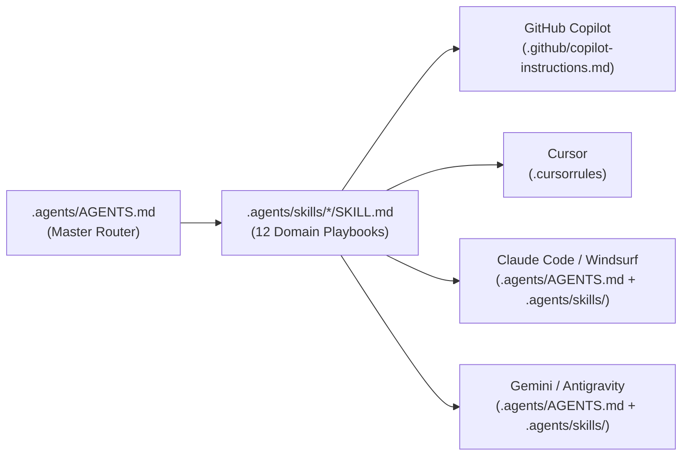

# 🏏 CricScore: Real-Time Cricket Match Engine

[](https://github.com/venkatesh-singamsetty/cricscore/actions/workflows/ci.yml)
[](https://github.com/venkatesh-singamsetty/cricscore/releases)
[](./docs/testing.md)
[](https://www.typescriptlang.org/)
[](https://www.python.org/)
[](https://www.terraform.io/)
[](./docs/cost_management.md)
[](https://opensource.org/licenses/MIT)

- 🚀 **Production Environment:** [https://cricscore.venkateshsingamsetty.com](https://cricscore.venkateshsingamsetty.com)
- 🧪 **Development Environment:** [https://cricscoredev.venkateshsingamsetty.com](https://cricscoredev.venkateshsingamsetty.com)
- 📖 **Full Self-Deployment Guide:** [docs/deployment.md](./docs/deployment.md)
- ⚡ **Developer Command Cheatsheet:** [CHEATSHEET.md](./CHEATSHEET.md)
- 🛠️ **Contributing & PR Workflow:** [CONTRIBUTING.md](./CONTRIBUTING.md)
- 🏆 **Engineering Milestones & Key PRs:** [docs/engineering_milestones.md](./docs/engineering_milestones.md)

---

## 🎯 Project Overview

CricScore is a cloud-native, real-time cricket scoring and match analytics platform built with **AWS Serverless**, **Aiven PostgreSQL 16 (`pgvector`)**, **Agentic AI (MCP + RAG)**, and **Serverless MLOps (XGBoost + Markov DP + DLS)**. Engineered around intentional architectural **trade-offs** (serverless scale-to-zero, AWS-managed encryption, 7-day log retention, and S3/ECR lifecycle rules), it runs both **Dev** and **Prod** environments for **~$1/month** on AWS.

| Persona                              | Core Capabilities                                                                                                                                                                                                                                                                           | Key Engineering & Safeguards                                                                                                                                                                          |
| :----------------------------------- | :------------------------------------------------------------------------------------------------------------------------------------------------------------------------------------------------------------------------------------------------------------------------------------------ | :---------------------------------------------------------------------------------------------------------------------------------------------------------------------------------------------------- |
| **👀&nbsp;Fans&nbsp;&&nbsp;Viewers** | • Sub-second live ball-by-ball scoreboard updates<br/>• Live win-probability bar on every delivery<br/>• Interactive AI match assistant chat                                                                                                                                                | • WebSocket fan-out (`SNS` → `broadcaster` → `API Gateway WS`)<br/>• 3-second polling recency guard (`lastWsUpdateRef`)                                                                               |
| **✍️&nbsp;Scorers**                  | • **Register**, **Sign In**, or **Continue as Guest**<br/>• Full match setup (teams, squads, custom overs, toss & Bat/Bowl)<br/>• 1-tap ball, wicket & extra scoring with instant **Undo**<br/>• Live DLS, CRR & RRR chase equations<br/>• AI match summary & **Player of the Match** award | • Optimistic UI with ordered `SQS FIFO` persistence<br/>• Deterministic Cricket MVP Impact Engine (`computePlayerOfTheMatch`)<br/>• 100% consistent POTM across Scorer, Viewer, DB, Email & S3 Backup |
| **🤖&nbsp;AI&nbsp;Assistant**        | • One-click starter prompts & free-form cricket Q&A<br/>• Live match & historical player statistics<br/>• Uploaded tournament PDF rulebook search with citations<br/>• Hourly match weather & GitHub issue reporting                                                                        | • In-memory Model Context Protocol (`InMemoryTransport`)<br/>• Isolates DB & API credentials from the LLM<br/>• `5 rps` API Gateway route throttling on `/chat`                                       |
| **🛡️&nbsp;Admins**                   | • Role-Based Access Control (RBAC) & user management<br/>• Tournament rulebook PDF upload for `pgvector` RAG<br/>• Confirmed cleanup controls for guest & test matches<br/>• Automated post-match HTML scorecard emails                                                                     | • AWS Cognito `Admin` group JWT check (`isAdminClaims`)<br/>• Amazon SES HTML scorecard delivery<br/>• Automated S3 JSON match backups (`backups/`)                                                   |

---

## 🗺️ Architecture at a Glance

Editable Mermaid diagrams live in **[docs/architecture.md](./docs/architecture.md)**, and diagram generator scripts live in **[docs/diagrams/README.md](./docs/diagrams/README.md)**.

### ☁️ 1. Platform Overview


| Tier                                    | AWS & Managed Services                                                                                                                                      | Architectural Role & Cost Guardrails                                                                                                                                                                                                                                                    |
| :-------------------------------------- | :---------------------------------------------------------------------------------------------------------------------------------------------------------- | :-------------------------------------------------------------------------------------------------------------------------------------------------------------------------------------------------------------------------------------------------------------------------------------- |
| **1.&nbsp;Edge&nbsp;&&nbsp;CDN**        | • **Amazon Route 53**<br/>• **AWS Certificate Manager (ACM)**<br/>• **Amazon CloudFront (OAC)**<br/>• **Amazon S3 (Static SPA & Logs)**                     | • Resolves custom domains (`cricscore`, `api.`, `ws.`)<br/>• Free DNS-validated TLS 1.3 certificates<br/>• Serves React 19 SPA with 7-day version & 30-day access-log expiration                                                                                                        |
| **2.&nbsp;Auth&nbsp;&&nbsp;API**        | • **AWS Amplify Auth SDK & UI**<br/>• **AWS Cognito User Pool**<br/>• `cognito-presignup` Lambda<br/>• **API Gateway (HTTP + WebSocket)**<br/>• **AWS IAM** | • Handles Sign Up, Sign In & **Continue as Guest** sessions<br/>• Validates RS256 JWTs at the API Gateway edge<br/>• Enforces `50 rps` stage & `5 rps` `/chat` route throttling<br/>• Least-privilege IAM execution policies                                                            |
| **3.&nbsp;Compute**                     | • `score-update` Lambda<br/>• `chat-api` Lambda<br/>• `match-api` Lambda<br/>• `ml-predict` Lambda                                                          | • Ball ingestion & parallel SNS/SQS fan-out (Diagram 2)<br/>• Agentic AI supervisor & deterministic POTM (Diagram 3)<br/>• Match CRUD, Admin RBAC, SES email & S3 backup ops<br/>• Hybrid win-probability container inference (Diagram 4)                                               |
| **4.&nbsp;Data&nbsp;&&nbsp;Registries** | • **Aiven PostgreSQL 16 + `pgvector`**<br/>• **Amazon SES**<br/>• **Amazon S3 (Backups & ML Models)**<br/>• **Amazon ECR**                                  | • Schema-isolated (`dev` / `prod`) relational data & 1536-d rulebook vectors<br/>• Sends post-match HTML scorecard reports<br/>• Stores match backups (180d lifecycle), S3 ML models (`models/v2.2.0/`) & TF state<br/>• Hosts single `~309 MB` `xgboost-cpu` image (`countNumber = 1`) |
| **5.&nbsp;Observability**               | • **CloudWatch Logs (`7d`)**<br/>• **AWS X-Ray (`5%`)**<br/>• **CloudWatch Alarms + SNS**<br/>• **AWS Budgets**                                             | • Enforces 7-day log retention across all Lambda & API Gateway log groups<br/>• Traces distributed requests at a 5% sampling rate<br/>• Emails real-time error alerts & monitors the `~$1/month` AWS spend                                                                              |

### ⚡ 2. Live Scoring: One Ball, Two Parallel Paths


| Execution Path                  | Service Pipeline                                                                                                                                  | Latency & Reliability Guarantee                                                             |
| :------------------------------ | :------------------------------------------------------------------------------------------------------------------------------------------------ | :------------------------------------------------------------------------------------------ |
| **Fast&nbsp;Path&nbsp;(Blue)**  | `score-update` → **SNS (`match-events`)** → `broadcaster` Lambda → **DynamoDB (`PAY_PER_REQUEST`)** → **API Gateway WebSocket**                   | • **`< 1s` real-time push** to all connected viewers<br/>• Never blocks on database writes  |
| **Safe&nbsp;Path&nbsp;(Green)** | `score-update` → **SQS FIFO (`storage-buffer.fifo`, `MessageGroupId = matchId`)** → `storage-worker` (`batch_size = 1`) → **Aiven PostgreSQL 16** | • **Strict ball-by-ball ordering** per match<br/>• ACID transactional commits to PostgreSQL |

### 🤖 3. AI Assistant (Autonomous Multi-Agent System via MCP)


| Specialist Agent                               | MCP Tool                  | Backing Service & Security Guardrails                                                                                                                                                |
| :--------------------------------------------- | :------------------------ | :----------------------------------------------------------------------------------------------------------------------------------------------------------------------------------- |
| **📊&nbsp;Match&nbsp;Stats&nbsp;Agent**        | `execute_sql`             | • **Aiven PostgreSQL 16**<br/>• `BEGIN READ ONLY` transaction & single-statement `SELECT`/`WITH` check<br/>• `3s` query timeout & `scorer_email` PII stripping                       |
| **📖&nbsp;Tournament&nbsp;Rules&nbsp;Agent**   | `search_tournament_rules` | • **PostgreSQL `pgvector` (HNSW cosine index)**<br/>• `text-embedding-3-small` semantic search across uploaded PDFs<br/>• Mandatory `[Source: document_name]` citations              |
| **🌦️&nbsp;Weather&nbsp;Specialist&nbsp;Agent** | `get_match_weather`       | • **Open-Meteo Geocoding & Forecast API** (no API key required)<br/>• Live hourly temperature, rain probability % & wind speed<br/>• Automated Cricket & DLS interruption advisories |
| **🐛&nbsp;GitHub&nbsp;Issue&nbsp;Agent**       | `create_github_issue`     | • **GitHub Issues REST API** (`venkatesh-singamsetty/cricscore`)<br/>• 2-step conversational user confirmation before filing<br/>• Server-side rate guard of `1` issue per message   |

### 🧠 4. MLOps & Live Win Probability


| Pipeline Stage                                 | Artifact / Component                                                             | Implementation & Cost Optimization                                                                                                                                                                                                                                                                           |
| :--------------------------------------------- | :------------------------------------------------------------------------------- | :----------------------------------------------------------------------------------------------------------------------------------------------------------------------------------------------------------------------------------------------------------------------------------------------------------- |
| **1.&nbsp;Dataset&nbsp;&&nbsp;DVC**            | • `cricket-data/t20s_json.zip.dvc`<br/>• `dvc.yaml` & `dvc.lock`                 | • Tracks raw Cricsheet T20 archives (`~22.7 MB`, `786K+` deliveries) by MD5 hash outside Git<br/>• Pins reproducible data preparation & training stages                                                                                                                                                      |
| **2.&nbsp;8-Model&nbsp;Benchmark**             | • `compare_models.py`<br/>• **MLflow (`mlruns/`)**                               | • Evaluates 7 Scikit-Learn baselines + **XGBoost** on leakage-free match-grouped splits (`70/15/15`)<br/>• Promotes **XGBoost (`v2.2.0`)** (`Val ROC-AUC = 0.7723`, `Test ROC-AUC = 0.7529`)                                                                                                                 |
| **3.&nbsp;S3&nbsp;+&nbsp;ECR&nbsp;Registries** | • `mlops-pipeline.yml`<br/>• **S3 (`models/v2.2.0/`)**<br/>• **ECR (`:v2.2.0`)** | • CI quality gate enforces `Accuracy >= 60%` & `ROC-AUC >= 65%`<br/>• Uploads `.joblib` (`~227 KB`) & SHA-256 `model_manifest.json` to S3<br/>• Builds `~309 MB` `xgboost-cpu` image in private ECR (required by Lambda) with `countNumber = 1` single-image retention (`~$0.01/mo` beyond 500 MB free tier) |
| **4.&nbsp;Hybrid&nbsp;Inference**              | • `ml-predict` Lambda<br/>• `predict.py` & `win_probability.py`                  | • Cold-start caches S3 model in `/tmp` & verifies SHA-256 checksum (enabling 5s `--model-version` rollbacks)<br/>• Blends **XGBoost `v2.2.0`** + **Markov Chain DP** + **DLS Par** on every ball                                                                                                             |

### 🧩 5. Multi-Host AI Coding Agent Skills (`.agents/skills/`)

CricScore ships with a vendor-neutral **Agent Skills** system ([`.agents/skills/`](./.agents/skills)) that gives **Claude Code**, **GitHub Copilot**, **Cursor**, **Windsurf**, and **Gemini / Antigravity** progressive, domain-specific engineering rules. See **[docs/agent_skills.md](./docs/agent_skills.md)** for full details.



| AI Coding Assistant / IDE                            | Repository Files Used                                        | How It Discovers & Uses CricScore Skills                                                                                                                        |
| :--------------------------------------------------- | :----------------------------------------------------------- | :-------------------------------------------------------------------------------------------------------------------------------------------------------------- |
| **GitHub&nbsp;Copilot**                              | • `.github/copilot-instructions.md`<br/>• `.agents/skills/*` | • Auto-injects `.github/copilot-instructions.md` into Copilot Chat, inline edits & PR reviews<br/>• Routes domain tasks to `.agents/skills/*/SKILL.md`          |
| **Cursor**                                           | • `.cursorrules`<br/>• `.agents/AGENTS.md`                   | • Auto-loads `.cursorrules` and routes to `.agents/AGENTS.md`<br/>• Reads targeted `.agents/skills/*/SKILL.md` playbooks before editing matching paths          |
| **Claude&nbsp;Code&nbsp;&&nbsp;Windsurf**            | • `.agents/AGENTS.md`<br/>• `.agents/skills/*/SKILL.md`      | • Reads `.agents/AGENTS.md` (or via `@.agents/AGENTS.md` / `.cursorrules`)<br/>• Progressively loads matching `.agents/skills/<skill-name>/SKILL.md` on demand  |
| **Gemini&nbsp;/&nbsp;Antigravity&nbsp;/&nbsp;Codex** | • `.agents/AGENTS.md`<br/>• `.agents/skills/*/SKILL.md`      | • Native discovery of `.agents/AGENTS.md` and `.agents/skills/*/SKILL.md` YAML frontmatter (`name`, `description`)<br/>• Enforces PR, security & `~$1/mo` rules |

| Skill Category                            | Included Skills (`.agents/skills/`)                                                                                                                  | Core Guardrails Enforced                                                                                                                                      |
| :---------------------------------------- | :--------------------------------------------------------------------------------------------------------------------------------------------------- | :------------------------------------------------------------------------------------------------------------------------------------------------------------ |
| **Frontend,&nbsp;Backend&nbsp;&&nbsp;DB** | • `cricscore-frontend-architecture`<br/>• `cricscore-backend-architecture`<br/>• `cricscore-database-migrations`                                     | • React 19 optimistic WebSocket sync (`lastWsUpdateRef` / `lastWsUndoAtRef`)<br/>• Node.js 24 Lambda `pg.Pool` reuse & idempotent SQL migrations              |
| **AI,&nbsp;RAG&nbsp;&&nbsp;MLOps**        | • `cricscore-agentic-rag-architecture`<br/>• `cricscore-mlops-standards`                                                                             | • In-memory MCP credential isolation & deterministic POTM (`computePlayerOfTheMatch`)<br/>• Leakage-free 8-model MLflow benchmark & `xgboost-cpu` (`~309 MB`) |
| **Infra,&nbsp;Cost&nbsp;&&nbsp;Security** | • `cricscore-infrastructure-standards`<br/>• `cricscore-cost-governance`<br/>• `cricscore-security-standards`                                        | • `~$1/month` AWS ceiling, 7-day log retention & single-image ECR (`countNumber = 1`)<br/>• Strict `isAdminClaims` JWT RBAC & 7-scanner DevSecOps gate        |
| **Testing,&nbsp;PRs&nbsp;&&nbsp;Reviews** | • `cricscore-testing-standards`<br/>• `cricscore-pr-and-workflow`<br/>• `cricscore-dependabot-consolidation`<br/>• `cricscore-code-review-standards` | • 376 unit tests + Playwright E2E parity across `dev` & `prod`<br/>• Raise PR & verify status checks (never auto-merge without owner approval)                |

---

## 🛠️ Technology Stack Summary

| Layer                               | Technologies Used                                                                                                                                                                                                            |
| :---------------------------------- | :--------------------------------------------------------------------------------------------------------------------------------------------------------------------------------------------------------------------------- |
| **Frontend**                        | • React 19, TypeScript, Vite & Tailwind CSS<br/>• AWS Amplify Auth SDK & UI (`aws-amplify`, `@aws-amplify/ui-react`)                                                                                                         |
| **Backend&nbsp;&&nbsp;Messaging**   | • Node.js 24.x on AWS Lambda (8 ZIP functions)<br/>• Amazon API Gateway (HTTP REST + WebSocket APIs)<br/>• Amazon SNS (`match-events`), Amazon SQS FIFO (`storage-buffer.fifo`) & Amazon SES                                 |
| **AI&nbsp;&&nbsp;Agentic&nbsp;RAG** | • OpenAI (`gpt-4o-mini`, `text-embedding-3-small`)<br/>• Model Context Protocol (`@modelcontextprotocol/sdk` `InMemoryTransport`)<br/>• PostgreSQL `pgvector` (HNSW cosine index) & LangGraph (`apps/ai-service`)            |
| **MLOps&nbsp;&&nbsp;Prediction**    | • Python 3.12 on AWS Lambda Container (`ml-predict`)<br/>• `xgboost-cpu` (`v2.2.0`), Scikit-Learn, Pandas, NumPy, MLflow & DVC<br/>• Amazon S3 Model Registry (`models/v2.2.0/`) & Amazon ECR (`~309 MB`, `countNumber = 1`) |
| **Data&nbsp;&&nbsp;Identity**       | • Aiven PostgreSQL 16 (`dev` & `prod` isolated schemas)<br/>• Amazon DynamoDB (`PAY_PER_REQUEST`)<br/>• AWS Cognito User Pool (RS256 JWT + `Admin` RBAC)                                                                     |
| **Cloud&nbsp;&&nbsp;IaC**           | • Terraform (`>= 1.10`, `hashicorp/aws ~> 6.0`)<br/>• Amazon Route 53, AWS Certificate Manager (ACM), CloudFront (OAC) & S3<br/>• CloudWatch Logs (`7d`) & Alarms, AWS X-Ray (`5%`) & AWS Budgets (`~$1/mo`)                 |
| **CI/CD&nbsp;&&nbsp;DevSecOps**     | • GitHub Actions (`ci.yml`, `cd.yml`, `release.yml`, `mlops-pipeline.yml`, `drift.yml`)<br/>• GitLeaks, CodeQL (SAST), Trivy, Checkov, OWASP ZAP (DAST), Dependabot & Syft SPDX SBOM                                         |
| **Automated&nbsp;Testing**          | • **376 Unit/Integration Tests** (`151` Frontend Vitest + `121` Backend Vitest + `75` AI Pytest + `29` ML Pytest)<br/>• **Playwright** Cross-Browser & Multi-Window Live Sync E2E                                            |

---

## ⚡ Essential Commands Quickstart

```bash
# 1. Install prerequisites & dependencies
./infra/scripts/setup.sh && npm install

# 2. Run local validation (Lint, 376 Unit Tests, Build, Terraform Validate, Checkov, GitLeaks, Trivy, Syft)
./infra/scripts/validate_local.sh --skip-e2e

# 3. Deploy full stack to Dev or Prod (using .env.local)
./infra/scripts/deploy.sh --env dev --use-local-env
./infra/scripts/deploy.sh --env prod --use-local-env
```

---

## 📚 Living Documentation & Tutorials Index

| Domain                                        | Core Practices Covered                                                                                                               | Step-by-Step Tutorials & Reference Guides                                                                                                                                                                                                                                                                                                                                                      |
| :-------------------------------------------- | :----------------------------------------------------------------------------------------------------------------------------------- | :--------------------------------------------------------------------------------------------------------------------------------------------------------------------------------------------------------------------------------------------------------------------------------------------------------------------------------------------------------------------------------------------- |
| **🚀&nbsp;Deployment&nbsp;&&nbsp;IaC**        | • Self-deployment from scratch<br/>• Terraform state locking<br/>• GitHub Actions CI/CD<br/>• Semantic Release                       | • [Full Deployment Guide](./docs/deployment.md)<br/>• [Terraform Infrastructure Guide](./docs/terraform_guide.md)<br/>• [GitHub Actions CI/CD](./docs/github_actions.md)<br/>• [Release & Rollback Process](./docs/release_process.md)<br/>• [Aiven PostgreSQL Setup](./docs/aiven.md)                                                                                                         |
| **⚡&nbsp;Architecture&nbsp;&&nbsp;APIs**     | • Event-driven SNS/SQS fan-out<br/>• WebSocket connection registry<br/>• Node.js 24 Lambda patterns<br/>• HTTP & WebSocket API spec  | • [Detailed Architecture](./docs/architecture.md)<br/>• [Real-Time WebSocket Tutorial](./docs/websocket_tutorial.md)<br/>• [HTTP & WebSocket API Reference](./docs/api.md)<br/>• [Node.js 24 Lambda Guide](./docs/nodejs_guide.md)<br/>• [Architecture Diagrams Guide](./docs/diagrams/README.md)                                                                                              |
| **🤖&nbsp;Agentic&nbsp;AI&nbsp;&&nbsp;MLOps** | • MCP credential isolation<br/>• `pgvector` rulebook RAG<br/>• Deterministic POTM engine<br/>• 8-model MLflow benchmark & DLS math   | • [AI & RAG Architecture](./docs/ai_architecture.md)<br/>• [Architecture & AI/MLOps FAQ](./docs/architecture_faq.md)<br/>• [Serverless MLOps & DLS Tutorial](./docs/mlops_tutorial.md)<br/>• [ML Models Benchmark Handbook](./docs/ml_models_handbook.md)<br/>• [Weather Specialist Agent](./docs/weather_report_agent.md)<br/>• [GitHub Issue Specialist Agent](./docs/github_issue_agent.md) |
| **🛡️&nbsp;Security&nbsp;&&nbsp;Cost**         | • Branch protection & PR checks<br/>• Cognito RBAC (`isAdminClaims`)<br/>• 7-scanner DevSecOps gate<br/>• `~$1/month` AWS trade-offs | • [Cloud Cost & Trade-Offs (`~$1/mo`)](./docs/cost_management.md)<br/>• [Security Posture & DevSecOps](./docs/security_posture.md)<br/>• [Authentication & RBAC](./docs/auth.md)<br/>• [Branch Protection Rules](./docs/branch_protection.md)<br/>• [Observability & X-Ray Tracing](./docs/observability.md)<br/>• [DevSecOps Toolchain](./docs/tools.md)                                      |
| **✅&nbsp;Testing&nbsp;&&nbsp;Ops**           | • 376 unit tests + Playwright E2E<br/>• Production bug RCAs<br/>• Engineering milestones & PRs<br/>• Live resource dashboards        | • [Automated Testing Tutorial](./docs/testing.md)<br/>• [Engineering Milestones & Key PRs](./docs/engineering_milestones.md)<br/>• [Troubleshooting & RCA Log](./docs/troubleshooting.md)<br/>• [Central Platform Dashboard](./docs/platform_dashboard.md)<br/>• [Full Changelog](./docs/changelog.md)                                                                                         |
