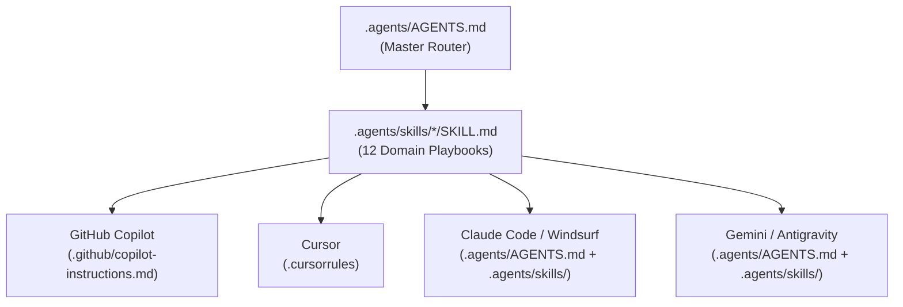

# 🏏 CricScore: Real-Time Cricket Match Engine

[](https://github.com/venkatesh-singamsetty/cricscore/actions/workflows/ci.yml)
[](https://github.com/venkatesh-singamsetty/cricscore/releases)
[](./docs/testing.md)
[](https://www.typescriptlang.org/)
[](https://www.python.org/)
[](https://www.terraform.io/)
[](./docs/cost_management.md)
[](https://opensource.org/licenses/MIT)

- 🚀 **Production Environment:** https://cricscore.venkateshsingamsetty.com
- 🧪 **Development Environment:** https://cricscoredev.venkateshsingamsetty.com
- 📖 **Full Self-Deployment Guide:** [docs/deployment.md](https://github.com/venkatesh-singamsetty/cricscore/blob/feat/scoring-ui-and-docs-polish/docs/deployment.md)
- ⚡ **Developer Command Cheatsheet:** [CHEATSHEET.md](https://github.com/venkatesh-singamsetty/cricscore/blob/feat/scoring-ui-and-docs-polish/CHEATSHEET.md)
- 📊 **Platform & Infrastructure Dashboard:** [docs/platform_dashboard.md](https://github.com/venkatesh-singamsetty/cricscore/blob/feat/scoring-ui-and-docs-polish/docs/platform_dashboard.md)

---

## 🎯 Project Overview

CricScore is a cloud-native, real-time cricket scoring and match analytics platform built with **AWS Serverless**, **Aiven PostgreSQL 16 (`pgvector`)**, **Agentic AI (MCP + RAG)**, and **Serverless MLOps (XGBoost + Markov DP + DLS)**. Engineered around intentional architectural **trade-offs** (serverless scale-to-zero, AWS-managed encryption, 7-day log retention, and S3/ECR lifecycle rules), it runs both **Dev** and **Prod** environments for **~$1/month** on AWS.

- **👀 Fans & Viewers (Live Match Experience):**
  - Sub-second ball-by-ball scoreboard updates via WebSocket fan-out (`SNS` → `broadcaster` → `API Gateway WS`) with a 3-second polling recency guard (`lastWsUpdateRef`).
  - Live win-probability progress bar on every delivery and interactive AI match assistant chat.
- **✍️ Scorers (Real-Time Match Control):**
  - **Register**, **Sign In**, or **Continue as Guest** with full match setup (teams, squads, custom overs `1`–`20`, toss winner, and Bat/Bowl decision).
  - 1-tap ball, wicket (including MCC Law 25.4 `Retired Hurt` / `Retired Out`), and extra scoring with instant **Undo**, optimistic UI updates, and ordered `SQS FIFO` persistence.
  - Live DLS par targets, CRR/RRR chase equations, AI match summary, and deterministic **Player of the Match** (`computePlayerOfTheMatch`) consistent across Scorer, Viewer, DB, SES Email, and S3 Backups.
- **🤖 AI Assistant (Autonomous Multi-Agent MCP):**
  - One-click starter prompts and free-form cricket Q&A for live match stats, historical player records, tournament PDF rulebooks (`pgvector` citations), hourly weather, and GitHub issue filing.
  - Powered by in-memory Model Context Protocol (`InMemoryTransport`) that isolates database and API credentials from the LLM, protected by `5 rps` `/chat` route throttling.
- **🛡️ Admins (Governance & Operations):**
  - Role-Based Access Control (RBAC) via AWS Cognito `Admin` group JWT validation (`isAdminClaims`).
  - Tournament rulebook PDF upload for `pgvector` RAG, confirmed cleanup controls for guest/test matches, automated Amazon SES HTML scorecard emails, and S3 JSON match backups (`backups/`).

---

## 🗺️ Architecture at a Glance

Editable Mermaid diagrams live in **[docs/architecture.md](./docs/architecture.md)**, and diagram generator scripts live in **[docs/diagrams/README.md](./docs/diagrams/README.md)**.

### ☁️ 1. Platform Overview


- **1. Edge & CDN (`Route 53` + `ACM` + `CloudFront OAC` + `S3`):**
  - Resolves custom domains (`cricscore`, `api.`, `ws.`) with free DNS-validated TLS 1.3 certificates.
  - Serves the React 19 SPA globally with 7-day noncurrent version and 30-day access-log expiration.
- **2. Auth & API Edge (`Amplify Auth` + `Cognito` + `API Gateway HTTP/WS` + `IAM`):**
  - Handles Sign Up, Sign In, and **Continue as Guest** (`cognito-presignup` Lambda) with RS256 JWT validation at the API Gateway edge.
  - Enforces `50 rps` stage limits, `5 rps` `/chat` route throttling, and least-privilege IAM execution policies.
- **3. Serverless Compute (`9 AWS Lambdas`):**
  - `score-update` (ball ingestion & SNS/SQS fan-out), `broadcaster`, `onconnect`, `ondisconnect`, and `storage-worker` (FIFO persistence).
  - `match-api` (CRUD, Admin RBAC, SES email & S3 backups), `chat-api` (Agentic AI MCP supervisor & deterministic POTM), and `ml-predict` (win-probability container).
- **4. Data & Registries (`Aiven PostgreSQL 16 + pgvector` + `DynamoDB` + `SES` + `S3` + `ECR`):**
  - Schema-isolated (`dev` / `prod`) relational match records and 1536-dimensional `pgvector` HNSW rulebook embeddings.
  - Stores S3 match backups (180-day lifecycle), S3 ML models (`models/v2.2.0/`), and a single `~309 MB` `xgboost-cpu` image in ECR (`countNumber = 1`).
- **5. Observability & Cost Guardrails (`CloudWatch 7d` + `X-Ray 5%` + `SNS Alarms` + `AWS Budgets`):**
  - Enforces 7-day log retention across all Lambda/API log groups, 5% X-Ray trace sampling, real-time error alert emails, and `~$1/month` budget alarms.

- **🔄 Step-by-Step Platform Request & Data Flow (What the Arrows Mean):**
  - **Static Asset Delivery (`Client ➔ Route 53 ➔ ACM ➔ CloudFront ➔ S3`):** Resolves custom domains, terminates TLS 1.3, and serves the static React 19 SPA cached globally at edge points of presence.
  - **Identity & Access (`Client ➔ Amplify ➔ Cognito ➔ API Gateway`):** Authenticates users via SRP or auto-confirms guest scorers (`cognito-presignup`), attaching RS256 JWTs validated at the API Gateway edge.
  - **API Ingress & Compute Routing (`API Gateway HTTP ➔ Lambdas`):** Routes authenticated REST calls to the targeted serverless Lambda (`match-api` for match CRUD, `score-update` for ball scoring, `chat-api` for AI assistant, and `ml-predict` for win probabilities).
  - **Live WebSocket Ingress & Egress (`Client ⮂ API Gateway WebSocket ⮂ Lambdas`):** Handles connection handshakes via `onconnect` / `ondisconnect` (persisting active connection IDs to DynamoDB) and streams live score frames back to fans.
  - **Multi-Cloud Persistence & Delivery (`Lambdas ➔ PostgreSQL, DynamoDB, S3, SES, ECR`):** Commits transactional data to Aiven PostgreSQL 16, sends automated HTML scorecards via SES, backs up match JSON snapshots to S3, and loads versioned ML models from S3 and ECR.
  - **Observability & Cost Telemetry (`Lambdas ➔ CloudWatch, X-Ray, Budgets`):** Emits structured logs with 7-day expiration, samples 5% of traces for AWS X-Ray, triggers SNS email alerts on function errors, and monitors the `~$1/month` budget ceiling.

### ⚡ 2. Live Scoring: One Ball, Two Parallel Paths


When a scorer taps a ball, CricScore decouples **live broadcast speed** from **database persistence** into two independent, parallel paths:

- **🔵 Fast Path (Ephemeral `< 1s` Live Broadcast to Viewers):**
  - `score-update` → **Amazon SNS (`match-events`)** → `broadcaster` Lambda → scans active connections in **DynamoDB (`PAY_PER_REQUEST`)** → pushes live frame via **API Gateway WebSocket** directly to fan browsers.
  - **Why it exists:** Bypasses database writes entirely so viewers see boundaries and wickets in under 1 second without waiting on SQL locks or connection pools.
- **🟢 Safe Path (Guaranteed Ordered ACID Persistence to Database):**
  - `score-update` → **Amazon SQS FIFO (`storage-buffer.fifo`, `MessageGroupId = matchId`)** → `storage-worker` Lambda (`batch_size = 1`) → commits delivery, player stats, and undo rollbacks to **Aiven PostgreSQL 16**.
  - **Why it exists:** Ensures strict chronological ordering (one ball at a time per match) and durable ACID history so browser refreshes, scorecards, and player career averages are never corrupted.

- **🔢 Step-by-Step Data Flow (What Arrows 1 to 7 Mean):**
  - **Arrow `1. Ball` (`Scorer ➔ HTTP API`):** Scorer taps a delivery (runs, extras, wicket, or undo) on the web/mobile UI.
  - **Arrow `2. Invoke` (`HTTP API ➔ score-update`):** API Gateway validates the JWT, checks route throttling, and invokes the `score-update` Lambda.
  - **Arrow `3a. Publish` (`score-update ➔ SNS` — Fast Path):** `score-update` immediately publishes the delivery event payload to the Amazon SNS `match-events` topic in memory (`~15ms`).
  - **Arrow `4a. Trigger` (`SNS ➔ broadcaster` — Fast Path):** Amazon SNS synchronously triggers the `broadcaster` Lambda with zero queue lag.
  - **Arrow `5a. Lookup` (`broadcaster ➔ DynamoDB` — Fast Path):** `broadcaster` queries the DynamoDB connection registry for active spectators subscribed to this `matchId`.
  - **Arrow `6a. Push` (`broadcaster ➔ WebSocket API` — Fast Path):** `broadcaster` calls API Gateway's `@connections` endpoint in parallel for all active sockets.
  - **Arrow `7a. Stream` (`WebSocket API ➔ Live Viewers` — Fast Path):** API Gateway flushes live delivery frames directly to viewer screens in under 1 second.
  - **Arrow `3b. Enqueue` (`score-update ➔ SQS FIFO` — Safe Path):** Simultaneously with step 3a, `score-update` enqueues the exact same ball payload into Amazon SQS FIFO (`storage-buffer.fifo`).
  - **Arrow `4b. Poll` (`SQS FIFO ➔ storage-worker` — Safe Path):** SQS FIFO triggers `storage-worker` with `batch_size = 1` and `MessageGroupId = matchId`, strictly guaranteeing one delivery at a time in chronological order.
  - **Arrow `5b. Persist` (`storage-worker ➔ Aiven PostgreSQL 16` — Safe Path):** `storage-worker` opens an ACID transaction, saves the ball record, updates player/bowler/match statistics, and safely handles undo events.

- **💡 Why Two Paths Instead of One? (Why They Diverge at Step 3a & 3b):**
  - **They look similar because they handle the same ball data, but their targets and latency requirements are completely opposite:**
    - **Fast Path (Blue, Steps 3a–7a) is ephemeral memory-to-screen fan-out:** It bypasses database disk I/O entirely so live spectators see boundaries and wickets instantly (`< 1s`) without waiting on relational database lock queues or connection pools.
    - **Safe Path (Green, Steps 3b–5b) is permanent disk persistence:** It serializes writes through SQS FIFO to guarantee strict chronological ordering and durable ACID transactions in Aiven PostgreSQL 16, ensuring career averages, scorecards, and undos are never corrupted.
  - Decoupling them is what allows `score-update` to return `HTTP 200` to the scorer in `~30ms` while providing both sub-second live streaming and 100% data integrity.

### 🤖 3. AI Assistant (Autonomous Multi-Agent System via MCP)


- **📊 Match Stats Agent (`execute_sql` → Aiven PostgreSQL 16):**
  - Executes parameterized `SELECT`/`WITH` queries inside a `BEGIN READ ONLY` transaction with a `3s` timeout and automatic `scorer_email` PII stripping.
- **📖 Tournament Rules Agent (`search_tournament_rules` → PostgreSQL `pgvector`):**
  - Performs HNSW cosine similarity search using `text-embedding-3-small` across uploaded tournament PDFs with mandatory `[Source: document_name]` citations.
- **🌦️ Weather Specialist Agent (`get_match_weather` → Open-Meteo API):**
  - Fetches live hourly temperature, rain probability %, and wind speed (keyless API) to generate automated Cricket & DLS interruption advisories.
- **🐛 GitHub Issue Agent (`create_github_issue` → GitHub REST API):**
  - Files structured bug reports and feature requests on `venkatesh-singamsetty/cricscore` after a mandatory 2-step user confirmation (`1` issue/turn rate guard).

- **🔄 Step-by-Step AI Request & Synthesis Flow (What the Arrows Mean):**
  - **`Fan ➔ Ask ➔ API Gateway ➔ Invoke ➔ chat-api`:** Viewer sends a natural language question via the React chat widget. API Gateway throttles requests (`5 rps`) and invokes `chat-api`.
  - **`chat-api ➔ Enforce ➔ Security Guardrails`:** Strips any PII (such as scorer emails), checks rate limits (`max 1 GitHub issue/turn`), enforces read-only SQL patterns, and formats conversation history.
  - **`Guardrails ➔ Context ➔ Agent Supervisor`:** Injects live match telemetry (current score, overs, run rate, target, and active batter/bowler) into the system prompt.
  - **`Supervisor ⮂ Reason & Synthesize ⮂ OpenAI LLM`:** Supervisor exchanges messages with `gpt-4o-mini` to determine user intent, select specialist tools, or format the final response.
  - **`Supervisor ➔ Dispatch Tool ➔ In-Memory MCP Hub`:** Decouples reasoning from tool execution. The supervisor dispatches tool calls across `InMemoryTransport`, keeping database passwords and GitHub tokens isolated from LLM context.
  - **`MCP Hub ➔ Specialist Agents ➔ Backing Stores`:**
    - **`SQL Tool ➔ Match Stats Agent ➔ 3s Read-Only Txn ➔ PostgreSQL`:** Runs parameterized `SELECT` queries with a `3s` timeout to answer player/match record queries.
    - **`RAG Tool ➔ Rules Agent ➔ Top-K Chunks ➔ pgvector`:** Generates `text-embedding-3-small` embeddings and performs HNSW cosine search (`<=>`) across tournament rulebook PDFs with mandatory `[Source: document]` citations.
    - **`Weather Tool ➔ Weather Agent ➔ Hourly Weather ➔ Open-Meteo`:** Geocodes the match venue and fetches hourly rain %, wind speed, and temperature to calculate Cricket & DLS rain delay probabilities.
    - **`Issue Tool ➔ GitHub Issue Agent ➔ File Issue ➔ GitHub REST API`:** Files structured bug reports or feature requests on GitHub after mandatory 2-step user confirmation.
  - **`Supervisor ➔ Return Response ➔ Viewer`:** Synthesizes tool evidence into clear markdown with citations and returns it to the user's chat interface.

### 🧠 4. MLOps & Live Win Probability


- **1. Dataset & DVC Tracking (`cricket-data/t20s_json.zip.dvc`, `dvc.yaml`):**
  - Tracks raw Cricsheet T20 archives (`~22.7 MB`, `786K+` deliveries) by MD5 hash outside Git and pins reproducible pipeline stages.
- **2. 8-Model MLflow Benchmark (`compare_models.py`):**
  - Evaluates 7 Scikit-Learn baselines + **XGBoost** on leakage-free match-grouped splits (`70/15/15`), promoting **XGBoost (`v2.2.0`)** (`Val ROC-AUC = 0.7723`, `Test ROC-AUC = 0.7529`).
- **3. Dual S3 + ECR Registries (`mlops-pipeline.yml`):**
  - Enforces CI quality gates (`Accuracy >= 60%`, `ROC-AUC >= 65%`), uploads `.joblib` (`~227 KB`) + SHA-256 `model_manifest.json` to S3 (`models/v2.2.0/`), and retains a single `~309 MB` `xgboost-cpu` image in ECR (`countNumber = 1`, `~$0.01/mo`).
- **4. Hybrid Lambda Inference (`ml-predict` → `predict.py` + `win_probability.py`):**
  - Cold-start caches the S3 model in `/tmp` with SHA-256 verification (enabling 5-second `--model-version` rollbacks) and blends **XGBoost `v2.2.0`** + **Markov Chain DP** + **DLS Par** on every ball.

- **🔄 Step-by-Step MLOps Pipeline & Serving Flow (What the Arrows Mean):**
  - **`Cricsheet Data ➔ Extract ➔ DVC Tracking` (Phase 1):** Extracts `786K+` ball deliveries from Cricsheet archives into `live_data.csv`, tracked by MD5 hash via `t20s_json.zip.dvc` outside Git.
  - **`DVC Tracking ➔ Train 8 Models ➔ 8-Model Benchmark` (Phase 2):** Runs match-grouped `70/15/15` train/val/test splits (zero data leakage) across 7 Scikit-Learn baselines and XGBoost.
  - **`Benchmark ➔ Log Metrics ➔ MLflow Tracking ➔ Select Best ➔ Champion XGBoost v2.2.0`:** Tracks ROC-AUC, Log Loss, and Brier Score, promoting **XGBoost `v2.2.0`** (`Val ROC-AUC = 0.7723`, `Test ROC-AUC = 0.7529`).
  - **`Champion XGBoost ➔ Validate ➔ CI Quality Gate` (Phase 3):** GitHub Actions (`mlops-pipeline.yml`) validates candidate model against strict performance thresholds (`Accuracy >= 60%`, `ROC-AUC >= 65%`).
  - **`Quality Gate ➔ Upload Artifact ➔ Amazon S3 Registry`:** Serialized `.joblib` model (`~227 KB`) and SHA-256 `model_manifest.json` are uploaded to S3 (`models/v2.2.0/`).
  - **`Quality Gate ➔ Push Image ➔ Amazon ECR Registry`:** Builds and pushes the lightweight `xgboost-cpu` image (`~309 MB`, `countNumber = 1` lifecycle policy keeping ECR cost at `~$0.01/mo`).
  - **`Viewer UI ➔ API Gateway ➔ Ball State ➔ ml-predict Lambda` (Phase 4):** On every delivery, the frontend posts live match state (`runs`, `wickets`, `overs`, `target`, `CRR`, `RRR`) to `POST /match/predict`.
  - **`S3 Registry ➔ Fetch + SHA-256 ➔ ml-predict Lambda`:** On cold start, the Lambda downloads the versioned model into `/tmp`, verifies its SHA-256 hash, and caches it in memory for subsequent balls (enabling 5-second zero-downtime rollbacks via `--model-version`).
  - **`ECR Registry ➔ Container Image ➔ ml-predict Lambda`:** Provides the containerized Python 3.12 runtime with XGBoost and Scikit-Learn binaries.
  - **`ml-predict Lambda ➔ Blend ➔ Hybrid Win Engine ➔ Live Win % ➔ Live Viewers`:** Evaluates XGBoost predictions, validates against dynamic programming transition matrices (Markov Chain DP) and DLS par target curves, and returns calibrated win percentages to the live scoreboard.

### 🧩 5. Multi-Host AI Coding Agent Skills (`.agents/skills/`)

CricScore ships with a vendor-neutral **Agent Skills** system ([`.agents/skills/`](./.agents/skills)) that gives **Claude Code**, **GitHub Copilot**, **Cursor**, **Windsurf**, and **Gemini / Antigravity** progressive, domain-specific engineering rules. See **[docs/agent_skills.md](./docs/agent_skills.md)** for full details.



- **GitHub Copilot (`.github/copilot-instructions.md` + `.agents/skills/*`):**
  - Auto-injects repository rules into Copilot Chat, inline edits, and PR reviews while routing domain tasks to `.agents/skills/*/SKILL.md`.
- **Cursor (`.cursorrules` + `.agents/AGENTS.md`):**
  - Auto-loads `.cursorrules` and reads targeted `.agents/skills/*/SKILL.md` playbooks before editing matching paths.
- **Claude Code, Windsurf, Gemini & Antigravity (`.agents/AGENTS.md` + `.agents/skills/*/SKILL.md`):**
  - Natively discovers `.agents/AGENTS.md` and YAML frontmatter (`name`, `description`) across all **12 Domain Skill Playbooks**:
    - `cricscore-frontend-architecture` — React 19, Vite, Tailwind CSS, Guest Auth, and optimistic WebSocket state rules.
    - `cricscore-backend-architecture` — Node.js 24 Lambda handlers, SNS/SQS FIFO fan-out, and connection pooling patterns.
    - `cricscore-database-migrations` — Idempotent `CREATE TABLE IF NOT EXISTS` and `pgvector` schema migration rules.
    - `cricscore-agentic-rag-architecture` — In-memory MCP tools, read-only SQL guardrails, and deterministic POTM engine.
    - `cricscore-mlops-standards` — 8-model MLflow benchmark, S3 `/tmp` model caching, and `~309 MB` CPU container rules.
    - `cricscore-infrastructure-standards` — Single-root Terraform module, S3 state locking, and environment isolation.
    - `cricscore-cost-governance` — Enforces `~$1/month` AWS guardrails (`7d` logs, `5%` X-Ray, `countNumber = 1` ECR).
    - `cricscore-security-standards` — Cognito RBAC (`isAdminClaims`), route throttling, and 7-scanner DevSecOps gates.
    - `cricscore-testing-standards` — Mandatory coverage across `376` unit tests and `15` Playwright E2E tests.
    - `cricscore-pr-and-workflow` — Conventional Commits, feature branch validation, and CI/CD release gates.
    - `cricscore-dependabot-consolidation` — Safe batching and verification of weekly Dependabot security PRs.
    - `cricscore-code-review-standards` — Architectural, security, and cost checklist for reviewing every Pull Request.

---

## 📂 Monorepo Structure & Technology Stack

```text
cricscore/
├── apps/
│   ├── frontend/        # React 19, TypeScript, Vite, Tailwind CSS & AWS Amplify Auth SPA
│   ├── backend/         # 8 Node.js 24 AWS Lambda microservices + idempotent PostgreSQL migrations
│   ├── ai-service/      # Python LangGraph multi-agent orchestration & prompt evaluation suite
│   ├── ml-engine/       # XGBoost v2.2.0 + Markov DP + DLS win-probability container Lambda & DVC/MLflow
│   └── e2e/             # Playwright cross-browser & multi-window live WebSocket sync E2E suite
├── infra/
│   ├── terraform/       # Single root Terraform module (Route 53, CloudFront, API GW, Lambda, S3, ECR)
│   └── scripts/         # Automated validation, deployment, DB migration & ML model promotion scripts
├── .agents/             # Multi-host AI coding agent router (AGENTS.md) & 12 domain SKILL.md playbooks
└── docs/                # 30+ living architecture guides, MLOps/RAG tutorials & diagram generators
```

- **Frontend (`apps/frontend`):** React 19, TypeScript, Vite, Tailwind CSS, and AWS Amplify Auth SDK & UI (`aws-amplify`, `@aws-amplify/ui-react`).
- **Backend & Messaging (`apps/backend`):** Node.js 24.x on AWS Lambda (8 ZIP functions), API Gateway (HTTP + WebSocket), Amazon SNS (`match-events`), Amazon SQS FIFO (`storage-buffer.fifo`), and Amazon SES.
- **AI & Agentic RAG (`apps/backend/lambdas/chat-api` & `apps/ai-service`):** OpenAI (`gpt-4o-mini`, `text-embedding-3-small`), Model Context Protocol (`@modelcontextprotocol/sdk` `InMemoryTransport`), PostgreSQL `pgvector` (HNSW cosine index), and LangGraph.
- **MLOps & Win Prediction (`apps/ml-engine`):** Python 3.12 on AWS Lambda Container (`ml-predict`), `xgboost-cpu` (`v2.2.0`), Scikit-Learn, MLflow, DVC, S3 Model Registry (`models/v2.2.0/`), and ECR (`~309 MB`, `countNumber = 1`).
- **Data & Identity:** Aiven PostgreSQL 16 (`dev` & `prod` isolated schemas), Amazon DynamoDB (`PAY_PER_REQUEST`), and AWS Cognito User Pool (RS256 JWT + `Admin` RBAC).
- **Cloud & IaC (`infra/terraform`):** Terraform (`>= 1.10`, `hashicorp/aws ~> 6.0`), Route 53, ACM, CloudFront (OAC), S3, CloudWatch Logs (`7d`), X-Ray (`5%`), and AWS Budgets (`~$1/mo`).
- **CI/CD, DevSecOps & Testing:** GitHub Actions (`ci.yml`, `cd.yml`, `release.yml`, `mlops-pipeline.yml`, `drift.yml`, `keepalive.yml`), GitLeaks, CodeQL, Trivy, Checkov, OWASP ZAP, Dependabot, Syft SBOM, **376 Unit/Integration Tests** (`151` FE + `121` BE + `75` AI + `29` ML), and **15 Playwright E2E Tests**.

---

## ⚡ Essential Commands Quickstart

```bash
# 1. Install prerequisites & dependencies
./infra/scripts/setup.sh && npm install

# 2. Run local validation (Lint, 376 Unit Tests, Build, Terraform Validate, Checkov, GitLeaks, Trivy, Syft)
./infra/scripts/validate_local.sh --skip-e2e

# 3. Deploy full stack to Dev or Prod (using .env.local)
./infra/scripts/deploy.sh --env dev --use-local-env
./infra/scripts/deploy.sh --env prod --use-local-env
```

---

## 📚 Living Documentation & Tutorials Index

- **🚀 Deployment, IaC & Release Operations:**
  - [Full Step-by-Step Deployment Guide](./docs/deployment.md) — End-to-end tutorial to deploy your own `dev` and `prod` stack from scratch in ~30 minutes.
  - [Terraform Infrastructure Guide](./docs/terraform_guide.md) — Deep dive into the single-root Terraform module, S3 state locking, and environment isolation.
  - [GitHub Actions CI/CD Reference](./docs/github_actions.md) — Breakdown of all 10 automated workflows, secrets, variables, and daily Prod E2E keep-alive jobs.
  - [Release & Rollback Process](./docs/release_process.md) — How Conventional Commits trigger `semantic-release`, immutable tags, and 5-second rollbacks.
  - [Aiven PostgreSQL Setup](./docs/aiven.md) — Setting up managed PostgreSQL 16 + `pgvector` (`dev`/`prod` schemas) and daily E2E WAL keep-alive.
  - [Domain Migration Runbook](./docs/domain_migration.md) — Zero-downtime guide for migrating custom domains across Route 53, ACM, and CloudFront.
- **⚡ System Architecture & Real-Time APIs:**
  - [Detailed System Architecture](./docs/architecture.md) — Editable Mermaid diagrams and component breakdowns across all 5 serverless tiers.
  - [Real-Time WebSocket Fan-Out Tutorial](./docs/websocket_tutorial.md) — How SNS broadcast and SQS FIFO persistence deliver sub-second updates with zero lost balls.
  - [HTTP & WebSocket API Reference](./docs/api.md) — Request/response schemas, auth requirements, and throttling rules for every REST and WebSocket route.
  - [Node.js 24 Lambda Guide](./docs/nodejs_guide.md) — Packaging, cold-start optimization, and connection-pooling patterns across the 8 Node.js Lambdas.
  - [Local Frontend Quickstart](./docs/local_frontend_quickstart.md) — Running the React 19 Vite SPA locally against the cloud `dev` backend in 2 minutes.
  - [UI/UX Refinement Checklist](./docs/ui_ux_refinement_checklist.md) — Mobile-first design tokens, responsive layout rules, and accessibility standards.
  - [Architecture Diagrams Guide](./docs/diagrams/README.md) — Regenerating the 4 high-resolution PNG architecture diagrams from Python code.
- **🤖 Agentic AI, MCP & Serverless MLOps:**
  - [AI & RAG Architecture (MCP + POTM)](./docs/ai_architecture.md) — In-memory MCP server design, `pgvector` rulebook RAG, deterministic POTM math, and 18 production fixes.
  - [Architecture & AI/MLOps FAQ](./docs/architecture_faq.md) — Deep-dive Q&A on supervisor routing, S3 `/tmp` model caching, and hybrid win-probability math.
  - [Serverless MLOps & DLS Tutorial](./docs/mlops_tutorial.md) — Complete tutorial on Cricsheet DVC pipelines, MLflow tracking, DLS math, and `~309 MB` CPU containers.
  - [ML Models Benchmark Handbook](./docs/ml_models_handbook.md) — Side-by-side mathematical and empirical comparison of all 8 candidate models (`XGBoost v2.2.0` champion).
  - [Weather Specialist Agent](./docs/weather_report_agent.md) — Open-Meteo geocoding/forecast MCP tool and automated Cricket/DLS rain interruption advisories.
  - [GitHub Issue Specialist Agent](./docs/github_issue_agent.md) — Conversational 2-step bug/feature issue filing with server-side rate limiting.
  - [Agent Skills Guide](./docs/agent_skills.md) — How `.agents/AGENTS.md` and the 12 domain `SKILL.md` playbooks work across Copilot, Cursor, Claude, and Gemini.
- **🛡️ Security, Auth, Observability & `~$1/Month` Cost:**
  - [Cloud Cost & Trade-Offs (`~$1/mo`)](./docs/cost_management.md) — Service-by-service cost breakdown and intentional architectural trade-offs keeping AWS spend at `~$1/month`.
  - [Security Posture & DevSecOps](./docs/security_posture.md) — Defense-in-depth controls across CloudFront, API Gateway, Cognito, MCP SQL guards, and 7 CI scanners.
  - [Security Fixes & Remediation Log](./docs/security_fixes.md) — Case studies of remediated vulnerabilities (JWT group spoofing, SQL injection, SSRF, and throttling).
  - [Authentication & RBAC](./docs/auth.md) — Cognito User Pools, Guest Scorer shadow accounts (`cognito-presignup`), and `Admin` group authorization.
  - [Branch Protection Rules](./docs/branch_protection.md) — Required PR status checks, CodeQL gates, and linear history enforcement on `main`.
  - [Observability & X-Ray Tracing](./docs/observability.md) — 7-day CloudWatch log retention, 5% X-Ray distributed tracing, and SNS error/budget alarms.
  - [DevSecOps Toolchain](./docs/tools.md) — Reference guide to every runtime, testing framework, and security scanner used in CricScore.
- **✅ Automated Testing, Milestones & Operations:**
  - [Automated Testing Tutorial (376 Unit + 15 E2E)](./docs/testing.md) — Running Vitest (`151` FE + `121` BE), Pytest (`75` AI + `29` ML), and Playwright multi-browser E2E suites.
  - [Engineering Milestones & Key PRs](./docs/engineering_milestones.md) — Chronological engineering log of major architectural upgrades and production optimizations.
  - [Troubleshooting & RCA Log](./docs/troubleshooting.md) — Root-cause analyses and exact fixes for 54 real-world cloud, database, WebSocket, and CI/CD incidents.
  - [Central Platform Dashboard](./docs/platform_dashboard.md) — Auto-generated live inventory of `dev` and `prod` AWS resources, Lambdas, S3 buckets, and ML artifacts.
  - [Full Changelog](./docs/changelog.md) — Automated semantic-release version history and release notes.
