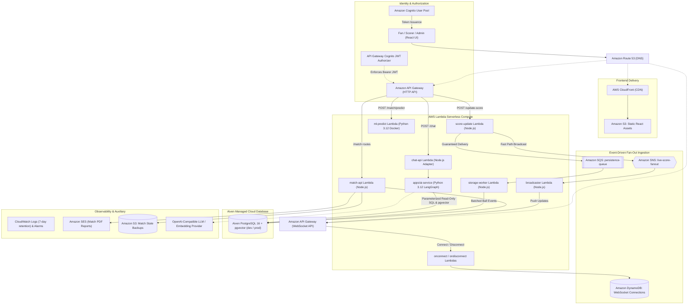
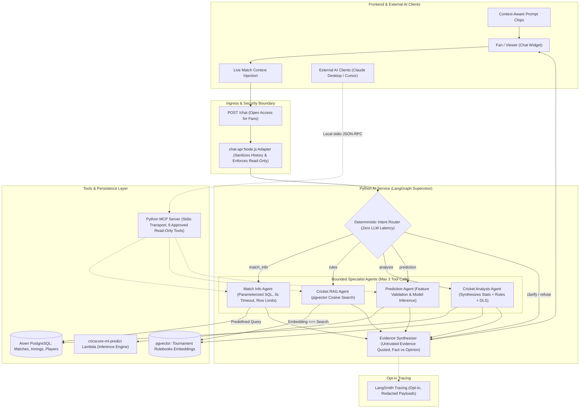
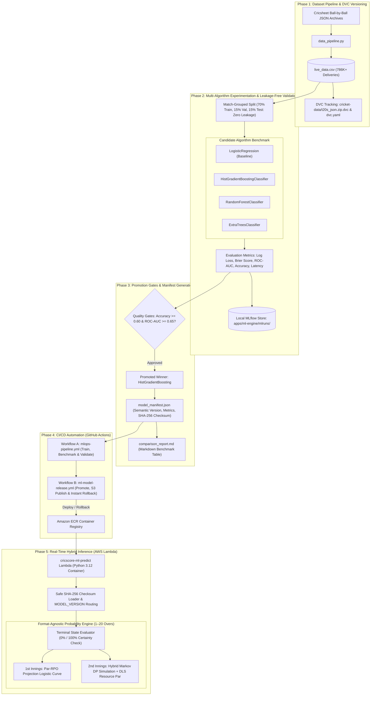

# 🏏 CricScore: Real-Time Cricket Match Engine

🚀 **Production Environment:** **https://cricscore.venkateshsingamsetty.com**

🧪 **Development Environment:** **https://cricscoredev.venkateshsingamsetty.com**

👉 **Deployment Details:** **[Full Deployment Guide](./docs/deployment.md)**

⚡ **Quick Commands:** **[Developer Cheatsheet](./CHEATSHEET.md)**

🛠️ **Developer Workflow:** **[Contributing & PR Guide](./CONTRIBUTING.md)**

---

## 🎯 Project Vision

CricScore demonstrates how a high-performance, real-time sports platform can be designed using modern **Multi-Cloud**, **Serverless**, and **Event-Driven** architecture. By combining AWS services with Aiven managed databases, the project maintains an enterprise-grade, cost-optimized footprint.

The project models a live cricket platform featuring:

- **Serverless Compute**: Fully managed AWS Lambda backends.
- **Event-Driven Architecture**: Fan-out messaging via SNS and SQS for fault-tolerant state processing.
- **AI Chat**: Retrieval-augmented answers with Text-to-SQL and vector search.
- **Live MLOps**: On-demand win-probability inference using an AWS Lambda container image stored in ECR.
- **Multi-Cloud Infrastructure**: Terraform-managed deployments bridging AWS and Aiven PostgreSQL.
- **Real-Time Streaming**: WebSocket API Gateway for instant, low-latency score updates.
- **DevSecOps Governance**: End-to-end CI/CD automation with automated security and compliance scanning.

This repository serves as a practical, production-style reference implementation for modern cloud engineering, AI integration, and rigorous operational discipline.

---

## ☁️ 1. Multi-Cloud System Architecture: AWS Serverless & Aiven PostgreSQL

The core application platform leverages a serverless, event-driven multi-cloud design separating high-speed real-time ingestion from relational persistence.

---

## 🤖 2. Agentic AI, LangGraph Supervisor, RAG & MCP Architecture

CricScore implements a modular Agentic AI platform built on **LangGraph**, **LangChain**, and the **Model Context Protocol (MCP)** with strict read-only security boundaries:

---

## 🧠 3. Serverless MLOps & Hybrid Win Prediction Architecture

The prediction platform integrates a reproducible **MLOps lifecycle** (DVC + MLflow + GitHub Actions) with a hybrid **Dynamic Programming (DP) + DLS win probability engine**:

---

## 🛠️ Technology Stack

### Frontend

| Technology   | Purpose                                       |
| ------------ | --------------------------------------------- |
| React        | User interface framework                      |
| TypeScript   | Type-safe application development             |
| Vite         | Frontend build tooling and development server |
| HTML5 / CSS3 | UI structure and styling                      |

### Backend & APIs

| Technology                  | Purpose                              |
| --------------------------- | ------------------------------------ |
| AWS Lambda                  | Serverless backend execution         |
| Amazon API Gateway          | REST API and WebSocket communication |
| AWS Cognito                 | Identity management and JWT auth     |
| AWS Amplify Auth            | Frontend auth SDK (sign-up/sign-in)  |
| Amazon SNS                  | Event fan-out messaging              |
| Amazon SQS                  | Asynchronous worker queues           |
| Node.js 24.x                | High performance runtime             |
| OpenAI-compatible providers | Foundation models for RAG            |
| MCP SDK                     | Model Context Protocol architecture  |

### Database

| Technology       | Purpose                                              |
| ---------------- | ---------------------------------------------------- |
| Aiven PostgreSQL | Managed relational database                          |
| PostgreSQL       | Match, player, score, and tournament persistence     |
| pgvector         | Vector similarity search extension for RAG           |
| HNSW Index       | High-performance approximate nearest-neighbor search |
| DynamoDB         | NoSQL active connections registry for WebSockets     |

### Machine Learning & MLOps

| Technology     | Purpose                                         |
| -------------- | ----------------------------------------------- |
| Python 3.10    | MLOps workflow and ML Lambda container runtime  |
| Scikit-Learn   | Logistic Regression model for win probability   |
| Pandas / NumPy | High-performance data manipulation and matrices |
| AWS ECR        | Docker container registry for Serverless ML     |
| Joblib         | Model serialization and artifact packaging      |

### Infrastructure & Cloud

| Technology | Purpose                        |
| ---------- | ------------------------------ |
| Terraform  | Infrastructure as Code         |
| AWS Cloud  | Cloud infrastructure platform  |
| CloudFront | Global content delivery        |
| S3         | Static website hosting         |
| Route53    | DNS management                 |
| ACM        | SSL/TLS certificate management |
| SES        | Simple Email Service reports   |
| CloudWatch | Logging, Metrics, and Alarms   |
| AWS X-Ray  | Distributed request tracing    |
| Budgets    | Automated billing alerts       |

### DevSecOps & Security

| Tool            | Purpose                               |
| --------------- | ------------------------------------- |
| GitHub Actions  | CI/CD automation                      |
| Checkov         | Terraform security scanning           |
| GitLeaks        | Secret detection                      |
| Trivy           | Dependency and vulnerability scanning |
| OWASP ZAP       | Dynamic application security testing  |
| Dependabot      | Dependency vulnerability monitoring   |
| SBOM Generation | Software supply chain visibility      |

### Testing

| Tool                  | Purpose                           |
| --------------------- | --------------------------------- |
| Vitest                | JavaScript/TypeScript test runner |
| Pytest                | Python ML Engine testing          |
| React Testing Library | Frontend component testing        |
| Playwright            | End-to-end browser automation     |

---

## 🏢 Engineering Practices & Technical Documentation

CricScore is structured to demonstrate production-oriented engineering practices across the nine areas below. The linked guides provide additional technical details and tradeoffs.

### 1. 🛡️ DevSecOps & Security

**Identity & Automated Scanning**
Authenticated HTTP API routes use **AWS Cognito JWT authorization**. CI runs GitLeaks, Checkov, Trivy filesystem scans, and application and infrastructure validation; a separate CodeQL workflow analyzes code. CI does not run `npm audit`. OWASP ZAP scans deployed environments, but its configured action does not fail the workflow on findings.

- 📖 **[Authentication & Authorization](./docs/auth.md)**: Cognito SSO flows, guest mode, admin user management, JWT validation, and cross-session identity guard.
- 📖 **[Security Posture & Tradeoffs](./docs/security_posture.md)**: Defense in depth strategy, multi-tenant isolation, and encryption layers.
- 📖 **[Branch Protection & Governance](./docs/branch_protection.md)**: Branch protection rules and repository governance guidance.
- 📖 **[Contributing & Developer Workflow](./CONTRIBUTING.md)**: Branch workflow, Git hooks, and local validation commands.

### 2. 🔭 Observability & Logging

**System Visibility**
Lambda logs are sent to CloudWatch Logs. AWS X-Ray sampling is configured with a 5% fixed sampling rate and a one-request-per-second reservoir. CloudWatch alarms send SNS email alerts for errors from the match API and score-update Lambdas.

- 📖 **[Observability Suite](./docs/observability.md)**: CloudWatch Logs, X-Ray tracing, CloudWatch alarms and SNS alerts, plus optional Sentry/Uptime setup.
- 📖 **[Cost & Performance](./docs/cost_management.md)**: Cost monitoring guidance and architecture scale limits.
- 📖 **[Central Resources & Artifacts Dashboard](./docs/aws_resources_dashboard.md)**: Automated single-pane-of-glass directory featuring live Dev & Prod AWS console deep links, ECR container images, XGBoost ML artifacts, Aiven PostgreSQL vector schemas, and security scan reports.

### 3. ✅ Rigorous Testing

**Multi-Layer Testing**
Vitest tests cover frontend and backend code, and the ML engine has Pytest coverage. Playwright end-to-end tests run against the deployed development environment on main-branch deployments and against Production during production deployment; pull requests do not run the deployed-site E2E suite.

- 📖 **[Testing Guide](./docs/testing.md)**: Vitest and Playwright test commands, Availability Testing (Chaos/DR), and E2E structures.
- 📖 **[Toolchain & Security Stack](./docs/tools.md)**: Master list of all CI/CD, IaC, and AppSec tools used in the pipeline.

### 4. ♾️ Event-Driven Processing

**Event-Driven Design**
The score-update flow uses SNS fan-out: updates are broadcast to connected clients and buffered in a FIFO SQS queue for database persistence. The configured queue retains messages for up to one day. A dead-letter queue is not configured in the current Terraform.

- 📖 **[Detailed Architecture](./docs/architecture.md)**: System design, sequence flows, and EDA logic.
- 📖 **[API Guide](./docs/api.md)**: REST & WebSocket contract specifications.
- 📖 **[Aiven Managed Services](./docs/aiven.md)**: PostgreSQL database configuration and keep-alive strategy.
- 📖 **[Node.js Guide](./docs/nodejs_guide.md)**: ESM vs CommonJS standardizations and dependency security.

### 5. 🏗️ Infrastructure as Code (IaC)

**Versioned & Repeatable Environments**
The AWS infrastructure is codified in Terraform. Changes can be planned, scanned for infrastructure security issues by Checkov, and applied through GitHub Actions or the local deploy script, reducing manual infrastructure changes.

- 📖 **[Full Deployment & Infrastructure](./docs/deployment.md)**: Step-by-step setup of accounts, tools, AWS, Aiven and OpenAI, then Dev and Prod deploys.
- 📖 **[Troubleshooting](./docs/troubleshooting.md)**: Setup fixes and identity verification help.

### 6. 🚀 CI/CD Automation

**Pull Request Validation & Tagged Releases**
Pull requests to `main` run validation jobs; deployed-site E2E tests are not part of the pull-request run. A successful CI run on `main` can create a semantic-versioned release when the commits meet the configured release rules. The development workflow deploys and tests Dev on `main`; the separate production workflow deploys on version tags or can be manually dispatched with a selected tag. Redeploying an older tag is possible, but is not an instant rollback and should account for database/schema compatibility.

- 📖 **[GitHub Actions Architecture](./docs/github_actions.md)**: CI/CD Directory structure constraints and pipeline organization.
- 📖 **[Automated Releases](./docs/release_process.md)**: Semantic release and Conventional Commit specifications.
- 📖 **[Full Project Log](./docs/changelog.md)**: Release records and development timeline.

### 7. 🤖 Agentic AI & RAG

**AI Chat with Retrieval-Augmented Generation**
CricScore includes an **AI Chat Assistant** that uses an OpenAI-compatible API; its default inference and embedding model names are `gpt-4o-mini` and `text-embedding-3-small`, and provider/model settings can be configured. MCP tools handle database operations so database credentials are not passed to the model provider. Retrieval uses up to eight pgvector chunks, and responses include cricket rulebook guidance. Model availability, output quality, and request cost depend on the configured provider and settings.

- 📖 **[AI Architecture](./docs/ai_architecture.md)**: RAG design, MCP architecture, provider configuration, quality tuning, and example prompts.

### 8. 🧠 Serverless MLOps & Live Prediction

**Win Probability Inference**
CricScore includes a model-training workflow and a win-probability inference Lambda. The inference model evaluates match-state features such as runs, wickets, target score, and balls remaining. Terraform builds and pushes the inference Lambda's Docker image to **AWS ECR**; the GitHub MLOps workflow separately tests, trains, evaluates, and uploads model artifacts. On-demand Lambda execution avoids an always-on inference server, but AWS usage and ECR storage may still incur costs.

- 📖 **[MLOps & Prediction Guide](./docs/mlops_tutorial.md)**: Training workflow and inference deployment, [Win Prediction Specification](./docs/mlops_tutorial.md#-8-win-prediction-engine-specification) (par-RPO scaling, RRR caps, wicket sensitivity), and [DLS Method](./docs/mlops_tutorial.md#️-9-duckworth-lewis-stern-dls-method) (ICC resource decay, par-score calculations).

### 9. 🤖 AI Agent Governance & Skills

CricScore includes repository-specific instructions and an **AI Skills Library** to guide coding assistants. The tools' support for automatically loading these files varies.

The `.agents/skills/` directory contains focused, on-demand guidance for:

- Pull-request code review and review findings
- Secure implementation and validation
- Branch, PR, CI/CD, and developer-command workflows
- AWS cost and Terraform/infrastructure changes
- Frontend, backend, and AI/RAG architecture
- Node.js, browser, and ML testing
- ML training and inference compatibility
- PostgreSQL schema changes and migrations

### 🔌 Agent Guidance Integration

These skills are Markdown files; an agent can use them when its host is configured to load or access repository files. Markdown format alone does not make them load automatically in every AI tool:

- **Cursor**: The repository includes a `.cursorrules` guidance file.
- **GitHub Copilot**: The repository includes `.github/copilot-instructions.md` guidance.
- **MCP clients**: An agent with an appropriate filesystem tool can read the files; MCP compatibility by itself does not load or follow them.
