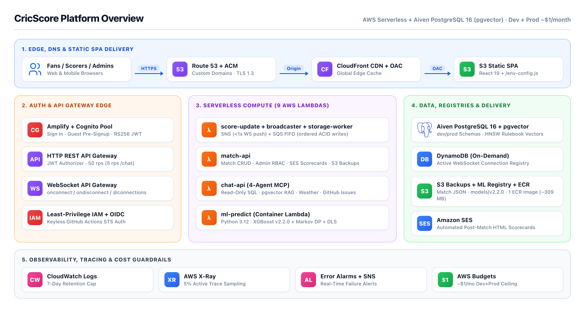
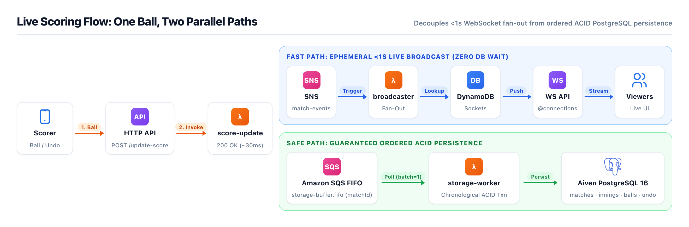
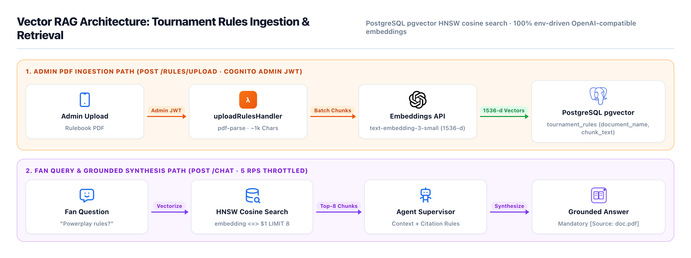
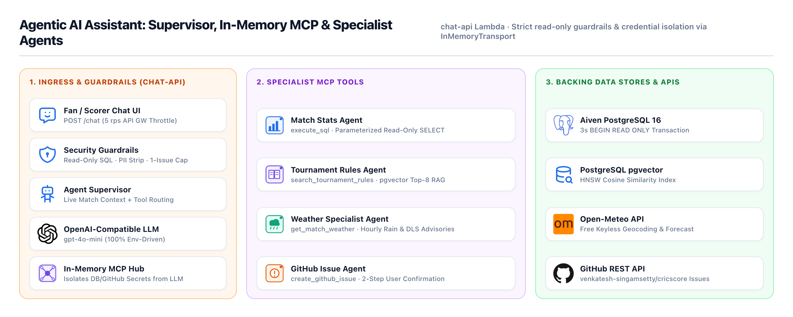
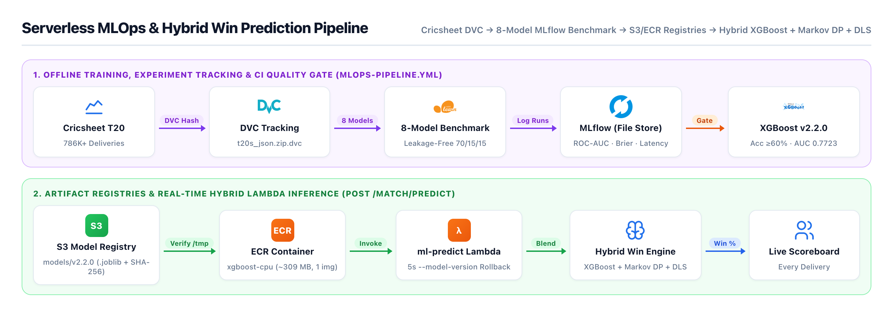
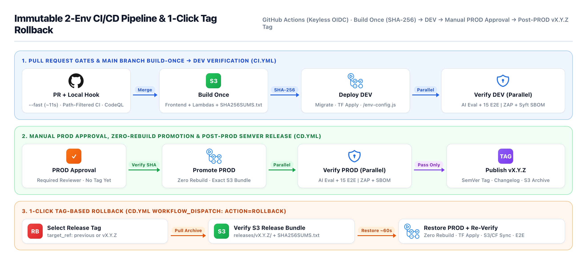

# 🏏 CricScore: Real-Time Cricket Match Engine

[](https://github.com/venkatesh-singamsetty/cricscore/actions/workflows/ci.yml)
[](https://github.com/venkatesh-singamsetty/cricscore/releases)
[](./docs/testing.md)
[](https://www.typescriptlang.org/)
[](https://www.python.org/)
[](https://www.terraform.io/)
[](./docs/security_posture.md)
[](./docs/cost_management.md)
[](https://opensource.org/licenses/MIT)

- 🚀 **Production:** https://cricscore.venkateshsingamsetty.com
- 🧪 **Development:** https://cricscoredev.venkateshsingamsetty.com
- 📖 **Self-Deployment Guide:** [docs/deployment.md](./docs/deployment.md)
- ⚡ **Developer Cheatsheet:** [CHEATSHEET.md](./CHEATSHEET.md)
- 📊 **Live Resource Dashboard:** [docs/platform_dashboard.md](./docs/platform_dashboard.md)

---

## 🎯 Overview

CricScore is a cloud-native, real-time cricket scoring and match analytics platform built with **AWS Serverless**, **Aiven PostgreSQL 16 (`pgvector`)**, **Agentic AI (MCP + RAG)**, and **Serverless MLOps (XGBoost + Markov DP + DLS)**. Engineered around intentional serverless trade-offs (scale-to-zero compute, 7-day log retention, single-image ECR lifecycle, and keyless OIDC), it runs both **Dev** and **Prod** for **~$1/month** on AWS.

- **👀 Fans & Viewers:** Sub-second live WebSocket scoreboards (`SNS` → `broadcaster` → `API Gateway WS`), live win-probability bars, and interactive AI match chat.
- **✍️ Scorers:** Sign In or **Continue as Guest**, 1–20 over setup, 1-tap ball/extra/wicket/retire scoring with refresh-safe **Undo**, DLS par targets, and deterministic **Player of the Match** across UI, DB, SES email, and S3 backups.
- **🤖 AI Assistant (4-Agent MCP):** Live match stats (`execute_sql`), tournament rulebook RAG (`pgvector` with `[Source: ...]` citations), hourly match weather & DLS advisories (Open-Meteo), and 2-step GitHub issue filing.
- **🛡️ Admins:** AWS Cognito `Admin` group RBAC, tournament PDF rulebook uploads, match cleanup controls, and automated Amazon SES HTML scorecards.

---

## 🗺️ Architecture at a Glance

> Full Mermaid diagrams and deep dives live in **[docs/architecture.md](./docs/architecture.md)** (diagram generators in **[docs/diagrams/README.md](./docs/diagrams/README.md)**).

### ☁️ 1. Platform Overview



- **Edge & Auth:** Route 53 + ACM TLS 1.3 + CloudFront OAC + S3 (React 19 SPA with runtime `/env-config.js`) and Cognito RS256 JWT validation with `50 rps` stage / `5 rps` `/chat` throttling.
- **Serverless Compute (9 Lambdas):** `score-update`, `broadcaster`, `onconnect`, `ondisconnect`, `storage-worker`, `match-api`, `chat-api`, `cognito-presignup`, and containerized `ml-predict`.
- **Data & Guardrails:** Schema-isolated (`dev`/`prod`) Aiven PostgreSQL 16 + `pgvector`, DynamoDB (`PAY_PER_REQUEST`), S3 backups/models, single-image ECR (`~309 MB`), 7-day CloudWatch logs, 5% X-Ray tracing, and AWS Budgets.

### ⚡ 2. Live Scoring: Dual Parallel Fan-Out



- **🔵 Fast Path (`< 1s` Live Broadcast):** `score-update` → **SNS (`match-events`)** → `broadcaster` → DynamoDB socket lookup → **API Gateway WebSocket** pushes directly to viewer browsers without waiting on SQL I/O.
- **🟢 Safe Path (Ordered ACID Persistence):** Simultaneously enqueues to **SQS FIFO (`storage-buffer.fifo`, `MessageGroupId = matchId`)** → `storage-worker` (`batch_size = 1`) → **Aiven PostgreSQL 16**, guaranteeing chronological order and crash-safe undo.

### 📚 3. Vector RAG: Tournament Rules Retrieval



- **Ingestion (`POST /rules/upload`):** Admin-only PDF upload → `pdf-parse` paragraph chunking (`~1,000` chars) → batched `1536-d` embeddings (env-driven OpenAI/Gemini-compatible) → `pgvector` HNSW cosine index (`<=>`) inside PostgreSQL.
- **Retrieval:** Vectorizes fan queries, fetches Top-8 rule chunks in `< 10ms`, and enforces mandatory `[Source: document_name]` citations to eliminate hallucinations.

### 🤖 4. Agentic AI Assistant (In-Memory MCP)



- **In-Memory MCP Isolation:** Dispatches tool calls across `InMemoryTransport` so DB credentials and GitHub tokens stay isolated from LLM prompts, with strict read-only `3s` SQL transactions and PII redaction.
- **4 Specialist Tools:** `execute_sql` (Match Stats), `search_tournament_rules` (RAG), `get_match_weather` (Open-Meteo hourly forecast + DLS advisories), and `create_github_issue` (2-step confirmed bug/feature filing).

### 🧠 5. Serverless MLOps & Live Win Probability



- **Training & Quality Gates:** Cricsheet T20 archives (`786K+` balls, DVC-tracked) → 8-model MLflow benchmark on leakage-free match splits → **XGBoost `v2.2.0`** (`Val ROC-AUC = 0.7723`) gated by CI (`Accuracy >= 60%`, `ROC-AUC >= 65%`).
- **Serving:** `ml-predict` container Lambda caches the SHA-256-verified `.joblib` model from S3 in `/tmp` (5-second `--model-version` rollbacks) and blends **XGBoost + Markov Chain DP + DLS Par** on every delivery.

### 🚀 6. Immutable CI/CD Pipeline & 1-Click Tag Rollback



- **Build Once, Promote Everywhere:** Merging to `main` packages frontend + hydrated Lambdas once with `SHA256SUMS.txt` into S3, verifies `dev` in parallel (E2E/AI + ZAP/SBOM), and pauses at the `prod` required-reviewer gate **before any Git tag is created**.
- **Post-PROD Release & Tag Rollback:** `prod` deploys the exact SHA-256-verified bundle (zero rebuild, runtime `/env-config.js`), cuts a single clean `vX.Y.Z` tag only after `prod` passes, and archives `releases/vX.Y.Z/` in S3 for ~60-second `action=rollback` recovery.

---

## 📂 Monorepo & Tech Stack

```text
cricscore/
├── apps/
│   ├── frontend/        # React 19, TypeScript, Vite, Tailwind CSS & AWS Amplify Auth SPA
│   ├── backend/         # 8 Node.js 24 AWS Lambda microservices + idempotent PostgreSQL migrations
│   ├── ai-service/      # Python LangGraph multi-agent orchestration & prompt evaluation suite
│   ├── ml-engine/       # XGBoost v2.2.0 + Markov DP + DLS win-probability Lambda & DVC/MLflow
│   └── e2e/             # Playwright cross-browser & multi-window live WebSocket sync E2E suite
├── infra/
│   ├── terraform/       # Single-root Terraform module (Route 53, CloudFront, API GW, Lambda, S3, ECR)
│   └── scripts/         # Validation, local deployment, DB migration & ML model promotion scripts
├── .agents/             # Multi-host AI coding agent router (AGENTS.md) & 12 domain SKILL.md playbooks
└── docs/                # Living architecture guides, MLOps/RAG tutorials & diagram generators
```

| Layer                   | Technologies                                                                                                                                                                |
| :---------------------- | :-------------------------------------------------------------------------------------------------------------------------------------------------------------------------- |
| **Frontend**            | React 19, TypeScript, Vite, Tailwind CSS, AWS Amplify Auth, runtime `/env-config.js`                                                                                        |
| **Backend & Messaging** | Node.js 24 AWS Lambdas, API Gateway (HTTP + WebSocket), SNS, SQS FIFO, SES                                                                                                  |
| **AI & MLOps**          | OpenAI-compatible LLM/Embeddings (100% env-driven), MCP SDK, `pgvector` HNSW, LangGraph, XGBoost `v2.2.0`, MLflow, DVC                                                      |
| **Data & Cloud IaC**    | Aiven PostgreSQL 16 (Root CA TLS), DynamoDB, Cognito, Terraform `>= 1.10`, CloudFront OAC, Keyless GitHub OIDC                                                              |
| **CI/CD & DevSecOps**   | Immutable build-once `dev` → `prod` promotion, post-prod SemVer tagging & tag rollback, GitLeaks, CodeQL, Trivy, Checkov, OWASP ZAP, Syft SBOM, **397 Unit + 15 E2E Tests** |
| **AI Coding Skills**    | Vendor-neutral [`.agents/AGENTS.md`](./.agents/AGENTS.md) + 12 domain playbooks for Copilot, Cursor, Claude, and Gemini ([guide](./docs/agent_skills.md))                   |

---

## ⚡ Quickstart

```bash
# 1. Install prerequisites & dependencies
./infra/scripts/setup.sh && npm install

# 2. Run local validation (changed-areas --fast ~11s, or full --skip-e2e)
./infra/scripts/validate_local.sh --fast

# 3. Deploy full stack to Dev or Prod (using .env.local)
./infra/scripts/deploy.sh --env dev --use-local-env
./infra/scripts/deploy.sh --env prod --use-local-env
```

---

## 📚 Documentation Index

- **🚀 Deployment, IaC & CI/CD**
  - [Full Self-Deployment Guide](./docs/deployment.md) — End-to-end setup for `dev` and `prod`
  - [Terraform Infrastructure Guide](./docs/terraform_guide.md) — Single-root module, S3 locking, and env isolation
  - [GitHub Actions CI/CD Reference](./docs/github_actions.md) — Immutable build-once promotion, drift, keep-alive, and MLOps workflows
  - [Release & Rollback Process](./docs/release_process.md) — Post-prod SemVer tagging and 1-click tag rollback
  - [Aiven PostgreSQL Setup](./docs/aiven.md) — Managed PostgreSQL 16 + `pgvector` (`dev`/`prod` schemas)
  - [Domain Migration Runbook](./docs/domain_migration.md) — Zero-downtime Route 53, ACM, and CloudFront migration
- **⚡ System Architecture & APIs**
  - [Detailed System Architecture](./docs/architecture.md) — Editable Mermaid diagrams across all 5 serverless tiers
  - [WebSocket Fan-Out Tutorial](./docs/websocket_tutorial.md) — SNS live broadcast + SQS FIFO ordered persistence
  - [HTTP & WebSocket API Reference](./docs/api.md) — Route schemas, JWT auth, and throttling
  - [Node.js 24 Lambda Guide](./docs/nodejs_guide.md) — Packaging, cold starts, and `pg.Pool` reuse
  - [Local Frontend Quickstart](./docs/local_frontend_quickstart.md) — Running the React 19 SPA locally against `dev`
  - [UI/UX Refinement Checklist](./docs/ui_ux_refinement_checklist.md) — Mobile-first viewport and accessibility standards
  - [Architecture Diagram Generators](./docs/diagrams/README.md) — Regenerating the 5 PNG diagrams from Python
- **🤖 Agentic AI & Serverless MLOps**
  - [AI & RAG Architecture (MCP + POTM)](./docs/ai_architecture.md) — In-memory MCP server, `pgvector` RAG, and deterministic POTM
  - [Architecture & AI/MLOps FAQ](./docs/architecture_faq.md) — Supervisor routing, S3 model caching, and win-probability math
  - [Serverless MLOps & DLS Tutorial](./docs/mlops_tutorial.md) — Cricsheet DVC pipelines, MLflow, DLS, and `~309 MB` CPU container
  - [ML Models Benchmark Handbook](./docs/ml_models_handbook.md) — 8-model comparison (`XGBoost v2.2.0` champion)
  - [Weather Specialist Agent](./docs/weather_report_agent.md) — Open-Meteo hourly forecast and DLS rain advisories
  - [GitHub Issue Specialist Agent](./docs/github_issue_agent.md) — 2-step confirmed bug/feature issue filing
  - [Agent Skills Guide](./docs/agent_skills.md) — Multi-host `.agents/AGENTS.md` and 12 domain playbooks
- **🛡️ Security, Auth, Observability & Cost**
  - [Cloud Cost Management (~$1/mo)](./docs/cost_management.md) — Service-by-service breakdown and cost trade-offs
  - [S3 Storage Lifecycle & Quotas](./docs/s3_storage_lifecycle.md) — Retention rules, Free Tier alarms, and artifact runbooks
  - [Security Posture & DevSecOps](./docs/security_posture.md) — Keyless OIDC, Root CA TLS, and scanner gates
  - [Security Fixes & Remediation Log](./docs/security_fixes.md) — Remediated vulnerability case studies
  - [Authentication & RBAC](./docs/auth.md) — Cognito User Pools, Guest Scorer flow, and `Admin` RBAC
  - [Branch Protection Rules](./docs/branch_protection.md) — Required PR checks and CodeQL gates on `main`
  - [Observability & X-Ray Tracing](./docs/observability.md) — 7-day logs, 5% X-Ray tracing, and SNS alarms
  - [DevSecOps Toolchain](./docs/tools.md) — Runtimes, test runners, and security scanners
- **✅ Testing & Operations**
  - [Testing Strategy (397 Unit + 15 E2E)](./docs/testing.md) — Vitest, Pytest, AI evals, and Playwright E2E
  - [Engineering Milestones](./docs/engineering_milestones.md) — Major architectural upgrades and PR log
  - [Troubleshooting & RCA Log](./docs/troubleshooting.md) — Root-cause analyses and fixes for production incidents
  - [Central Platform Dashboard](./docs/platform_dashboard.md) — Auto-generated live inventory of AWS resources
  - [Full Changelog](./docs/changelog.md) — Automated semantic-release version history
