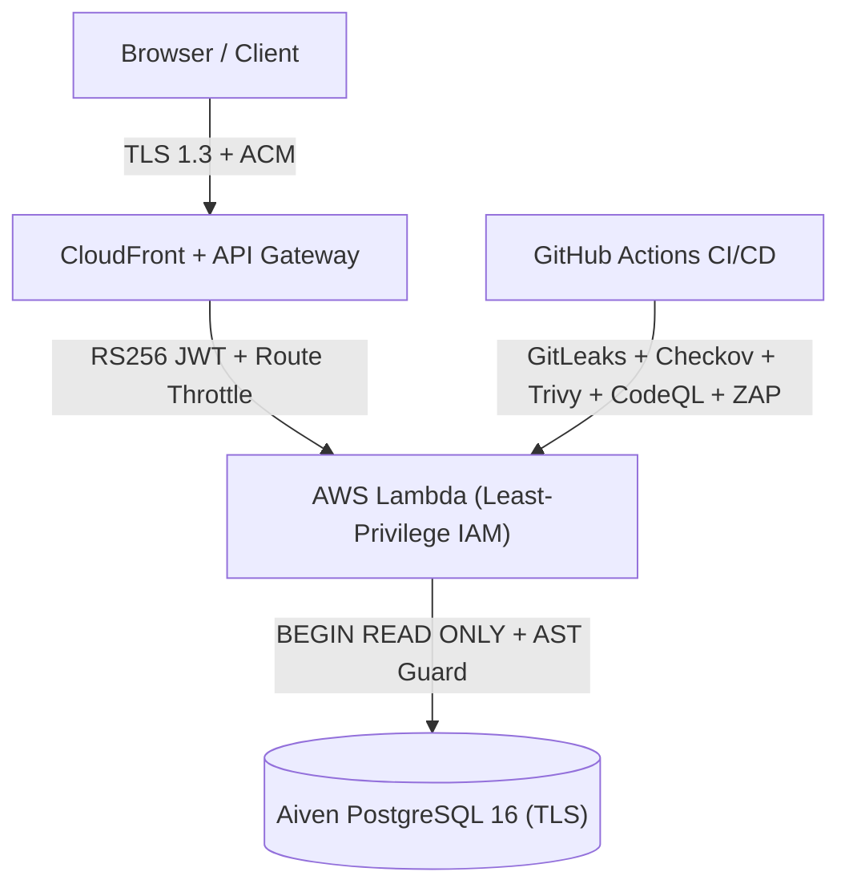

# 🛡️ Security Policy & Vulnerability Reporting

## 📬 Reporting a Vulnerability

Please **do not** report security vulnerabilities in public GitHub issues. Send a private disclosure report to:

- **Security Contact:** [venkatesh.singamsetty@gmail.com](mailto:venkatesh.singamsetty@gmail.com)
- **Response SLA:** Acknowledgment within **24 hours**; triage and remediation plan within **72 hours**.
- **What to Include:** Affected endpoint or component, step-by-step reproduction instructions, and proof-of-concept payload with impact assessment.

---

## 🔒 Defense-in-Depth Architecture



- **Identity & Auth (`apps/backend/lambdas/match-api/index.js`):**
  - AWS Cognito User Pools (RS256 JWTs) with exact `Admin` group claim validation (`isAdminClaims`).
- **API Gateway Edge (`infra/terraform/apigateway_http.tf`):**
  - Cognito JWT Authorizer on write/admin routes plus `5 rps` (burst `10`) throttling on `/chat` and `/chat/summary`.
- **AI & MCP Guardrails (`apps/backend/lambdas/chat-api/mcp/`):**
  - In-memory MCP transport (`InMemoryTransport`), `BEGIN READ ONLY` SQL transactions, single-statement `SELECT`/`WITH` validation, `3s` query timeout, `scorer_email` PII stripping, and a 1-issue/turn GitHub rate limit.
- **Secrets Management (`gitleaks detect -v`):**
  - Zero hardcoded credentials in source code; injected exclusively via GitHub Environment Secrets and `.env.local` (`TF_VAR_*`).
- **Static Analysis SAST (`.github/workflows/codeql.yml`):**
  - GitHub CodeQL (`javascript-typescript` & `python`) runs on every PR and push to `main`.
- **IaC & Supply Chain Security (`./infra/scripts/validate_local.sh --skip-e2e`):**
  - Checkov Terraform scanning on `infra/terraform/`, `npm audit`, Trivy filesystem/container scanning (`HIGH,CRITICAL`), Dependabot alerts, and Syft SPDX SBOM generation.
- **Dynamic Application Security Testing (`.github/workflows/ci.yml` & `cd.yml`):**
  - Automated OWASP ZAP baseline scan against live `dev` and `prod` endpoints.
- **Data & Encryption ([docs/security_posture.md](./docs/security_posture.md)):**
  - `SSE-S3 (AES256)` on all S3, ECR, SNS, and SQS stores plus schema-isolated (`dev` / `prod`) TLS PostgreSQL.

---

## 🧪 Run Local Security Audit

```bash
# Run all security scanners locally before pushing
./infra/scripts/validate_local.sh --skip-e2e
```

- 📖 **[Security Posture & Trade-Offs](./docs/security_posture.md)** — Complete defense-in-depth architecture, active controls inventory, and intentional `~$1/month` security trade-offs.
- 📖 **[Security Fixes Log](./docs/security_fixes.md)** — Detailed root-cause analyses and code-level remediations for all resolved security findings.
