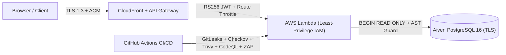

# 🛡️ Security Policy & Vulnerability Reporting

## 📬 Reporting a Vulnerability

Please **do not** report security vulnerabilities in public GitHub issues. Send a private disclosure report to:

| Channel              | Details                                                                                          |
| :------------------- | :----------------------------------------------------------------------------------------------- |
| **Security Contact** | [venkatesh.singamsetty@gmail.com](mailto:venkatesh.singamsetty@gmail.com)                        |
| **Response SLA**     | Acknowledgment within **24 hours**; triage & remediation plan within **72 hours**                |
| **What to Include**  | Affected endpoint/component, reproduction steps, proof-of-concept payload, and impact assessment |

---

## 🔒 Defense-in-Depth Architecture



| Security Layer                   | Control Implemented in CricScore                                                                                                                                                                                   | Verification Command / Location                        |
| :------------------------------- | :----------------------------------------------------------------------------------------------------------------------------------------------------------------------------------------------------------------- | :----------------------------------------------------- |
| **Identity & Auth**              | AWS Cognito User Pools (RS256 JWTs) + exact `Admin` group claim validation (`isAdminClaims`)                                                                                                                       | `apps/backend/lambdas/match-api/index.js`              |
| **API Gateway Edge**             | Cognito JWT Authorizer on write/admin routes + `5 rps` (burst `10`) throttle on `/chat` & `/chat/summary`                                                                                                          | `infra/terraform/apigateway_http.tf`                   |
| **AI & MCP Guardrails**          | In-memory MCP transport (`InMemoryTransport`), `BEGIN READ ONLY` SQL transactions, single-statement `SELECT`/`WITH` AST validation, `3s` timeout, `scorer_email` PII stripping, and 1-issue/turn GitHub rate limit | `apps/backend/lambdas/chat-api/mcp/`                   |
| **Secrets Management**           | Zero hardcoded credentials; injected via GitHub Environment Secrets and `.env.local` (`TF_VAR_*`)                                                                                                                  | `gitleaks detect -v`                                   |
| **Static Analysis (SAST)**       | GitHub CodeQL (`javascript-typescript` & `python`) on every PR and push to `main`                                                                                                                                  | `.github/workflows/codeql.yml`                         |
| **IaC Security**                 | Checkov Terraform scanning on `infra/terraform/`                                                                                                                                                                   | `checkov -d infra/terraform/`                          |
| **Vulnerability & Supply Chain** | `npm audit`, Trivy filesystem/container scanning (`HIGH,CRITICAL`), Dependabot, and Syft SPDX SBOM generation                                                                                                      | `./infra/scripts/validate_local.sh --skip-e2e`         |
| **Dynamic Scanning (DAST)**      | Automated OWASP ZAP baseline scan against live `dev` and `prod` deployments                                                                                                                                        | `.github/workflows/ci.yml` & `cd.yml`                  |
| **Data Isolation & Encryption**  | `SSE-S3 (AES256)` on all S3/ECR/SNS/SQS stores + schema-isolated (`dev` / `prod`) TLS PostgreSQL                                                                                                                   | [docs/security_posture.md](./docs/security_posture.md) |

---

## 🧪 Run Local Security Audit

```bash
# Run all security scanners locally before pushing
./infra/scripts/validate_local.sh --skip-e2e
```

For full architectural trade-offs and remediation history, see **[Security Posture](./docs/security_posture.md)** and **[Security Fixes Log](./docs/security_fixes.md)**.
