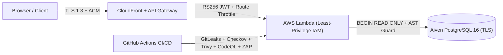

# 🛡️ Security Policy & Vulnerability Reporting

## 📬 Reporting a Vulnerability

Please **do not** report security vulnerabilities in public GitHub issues. Send a private disclosure report to:

| Channel                       | Details                                                                                                                          |
| :---------------------------- | :------------------------------------------------------------------------------------------------------------------------------- |
| **Security&nbsp;Contact**     | [venkatesh.singamsetty@gmail.com](mailto:venkatesh.singamsetty@gmail.com)                                                        |
| **Response&nbsp;SLA**         | • Acknowledgment within **24 hours**<br/>• Triage & remediation plan within **72 hours**                                         |
| **What&nbsp;to&nbsp;Include** | • Affected endpoint or component<br/>• Step-by-step reproduction instructions<br/>• Proof-of-concept payload & impact assessment |

---

## 🔒 Defense-in-Depth Architecture



| Security Layer                         | Control Implemented in CricScore                                                                                                                                                                                               | Verification Command / Location                           |
| :------------------------------------- | :----------------------------------------------------------------------------------------------------------------------------------------------------------------------------------------------------------------------------- | :-------------------------------------------------------- |
| **Identity&nbsp;&&nbsp;Auth**          | • AWS Cognito User Pools (RS256 JWTs)<br/>• Exact `Admin` group claim validation (`isAdminClaims`)                                                                                                                             | `apps/backend/lambdas/match-api/index.js`                 |
| **API&nbsp;Gateway&nbsp;Edge**         | • Cognito JWT Authorizer on write & admin routes<br/>• `5 rps` (burst `10`) throttle on `/chat` & `/chat/summary`                                                                                                              | `infra/terraform/apigateway_http.tf`                      |
| **AI&nbsp;&&nbsp;MCP&nbsp;Guardrails** | • In-memory MCP transport (`InMemoryTransport`)<br/>• `BEGIN READ ONLY` SQL transactions & single-statement `SELECT`/`WITH` check<br/>• `3s` query timeout & `scorer_email` PII stripping<br/>• 1-issue/turn GitHub rate limit | `apps/backend/lambdas/chat-api/mcp/`                      |
| **Secrets&nbsp;Management**            | • Zero hardcoded credentials in source code<br/>• Injected via GitHub Environment Secrets & `.env.local` (`TF_VAR_*`)                                                                                                          | `gitleaks detect -v`                                      |
| **Static&nbsp;Analysis&nbsp;(SAST)**   | • GitHub CodeQL (`javascript-typescript` & `python`)<br/>• Runs on every PR and push to `main`                                                                                                                                 | `.github/workflows/codeql.yml`                            |
| **IaC&nbsp;Security**                  | • Checkov Terraform scanning on `infra/terraform/`                                                                                                                                                                             | `checkov -d infra/terraform/`                             |
| **Supply&nbsp;Chain&nbsp;&&nbsp;CVEs** | • `npm audit` & Trivy filesystem/container scanning (`HIGH,CRITICAL`)<br/>• Dependabot alerts & Syft SPDX SBOM generation                                                                                                      | `./infra/scripts/validate_local.sh --skip-e2e`            |
| **Dynamic&nbsp;Scan&nbsp;(DAST)**      | • Automated OWASP ZAP baseline scan against live `dev` & `prod`                                                                                                                                                                | `.github/workflows/ci.yml`<br/>`.github/workflows/cd.yml` |
| **Data&nbsp;&&nbsp;Encryption**        | • `SSE-S3 (AES256)` on all S3, ECR, SNS & SQS stores<br/>• Schema-isolated (`dev` / `prod`) TLS PostgreSQL                                                                                                                     | [docs/security_posture.md](./docs/security_posture.md)    |

---

## 🧪 Run Local Security Audit

```bash
# Run all security scanners locally before pushing
./infra/scripts/validate_local.sh --skip-e2e
```

- 📖 **[Security Posture & Trade-Offs](./docs/security_posture.md)**
- 📖 **[Security Fixes Log](./docs/security_fixes.md)**
