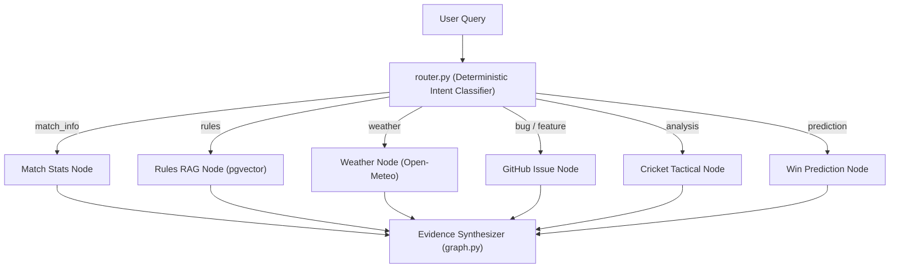

# 🤖 CricScore AI Service — Python LangGraph + Stdio MCP (`apps/ai-service`)

Python 3.12 multi-agent supervisor (`LangGraph`) and standalone stdio Model Context Protocol (`MCPServer`) toolkit with **75 Pytest unit tests**.

---

## 🗺️ LangGraph Supervisor Architecture



---

## 📁 Module Inventory

- **`cricscore_ai/router.py`:** Zero-latency deterministic intent classifier (`match_info`, `rules`, `weather`, `github_issue`, `analysis`, `prediction`, `clarify`, `refuse`).
- **`cricscore_ai/graph.py`:** Acyclic LangGraph supervisor (`classify → specialist → synthesize`) enforcing max 3 tool calls and recursion limit 12.
- **`cricscore_ai/tools.py`:** Parameterized PostgreSQL queries, `pgvector` cosine search, Open-Meteo weather, GitHub issue filing, and win-prediction validation.
- **`cricscore_ai/repository.py`:** Read-only PostgreSQL access (`BEGIN READ ONLY`, `3s` timeout, row limits) with automatic `scorer_email` PII stripping.
- **`cricscore_ai/mcp_server.py`:** Local stdio MCP 2.x (`MCPServer`) exposing read-only tools for Claude Desktop, Cursor, and MCP Inspector.
- **`cricscore_ai/providers.py` & `tracing.py`:** OpenAI-compatible chat/embedding client, `ml-predict` Lambda client, and opt-in LangSmith tracing (`LANGSMITH_TRACING=true`).
- **`cricscore_ai/handler.py`:** AWS Lambda invoke entrypoint.

---

## 🧪 Commands Tutorial

```bash
cd apps/ai-service

# 1. Create virtualenv & install dependencies
python3.12 -m venv .venv && .venv/bin/pip install -r requirements-dev.txt

# 2. Run all 75 unit tests
.venv/bin/pytest -q

# 3. Run local stdio MCP server or inspect interactively
.venv/bin/python -m cricscore_ai.mcp_server
npx @modelcontextprotocol/inspector .venv/bin/python -m cricscore_ai.mcp_server
```
