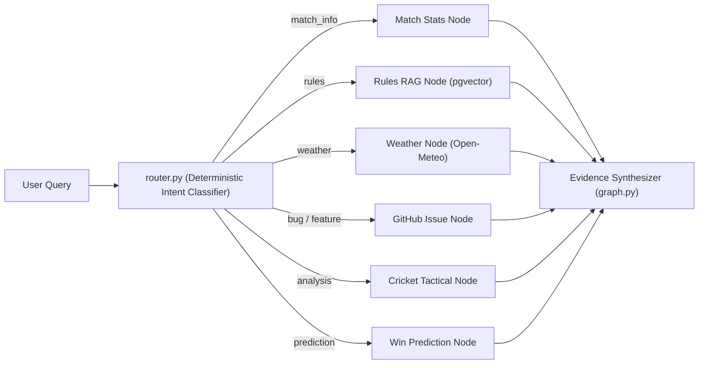

# 🤖 CricScore AI Service — Python LangGraph + Stdio MCP (`apps/ai-service`)

Python 3.12 multi-agent supervisor (`LangGraph`) and standalone stdio Model Context Protocol (`MCPServer`) toolkit with **75 Pytest unit tests**.

---

## 🗺️ LangGraph Supervisor Architecture



---

## 📁 Module Inventory

| File                         | Responsibility                                                                                                                                 |
| :--------------------------- | :--------------------------------------------------------------------------------------------------------------------------------------------- |
| `cricscore_ai/router.py`     | Zero-latency deterministic intent classifier (`match_info`, `rules`, `weather`, `github_issue`, `analysis`, `prediction`, `clarify`, `refuse`) |
| `cricscore_ai/graph.py`      | Acyclic LangGraph supervisor (`classify → specialist → synthesize`, max 3 tool calls, recursion limit 12)                                      |
| `cricscore_ai/tools.py`      | Parameterized PostgreSQL queries, `pgvector` cosine search, Open-Meteo weather, GitHub issue filing, and win-prediction feature validation     |
| `cricscore_ai/repository.py` | Read-only PostgreSQL access (`BEGIN READ ONLY`, `3s` statement timeout, row limits, `scorer_email` PII stripping)                              |
| `cricscore_ai/mcp_server.py` | Local stdio MCP 2.x (`MCPServer`) exposing read-only tools for Claude Desktop, Cursor, and MCP Inspector                                       |
| `cricscore_ai/providers.py`  | OpenAI-compatible chat/embedding client and `ml-predict` Lambda client                                                                         |
| `cricscore_ai/tracing.py`    | Opt-in LangSmith tracing (`LANGSMITH_TRACING=true`) with redacted payloads                                                                     |
| `cricscore_ai/handler.py`    | AWS Lambda invoke entrypoint                                                                                                                   |

---

## 🧪 Commands Tutorial

| Action                               | Command                                                                           |
| :----------------------------------- | :-------------------------------------------------------------------------------- |
| **Create virtualenv & install deps** | `python3.12 -m venv .venv && .venv/bin/pip install -r requirements-dev.txt`       |
| **Run all 75 unit tests**            | `.venv/bin/pytest -q`                                                             |
| **Run local stdio MCP server**       | `.venv/bin/python -m cricscore_ai.mcp_server`                                     |
| **Inspect MCP tools interactively**  | `npx @modelcontextprotocol/inspector .venv/bin/python -m cricscore_ai.mcp_server` |

```bash
cd apps/ai-service
python3.12 -m venv .venv && .venv/bin/pip install -r requirements-dev.txt
.venv/bin/pytest -q
```
