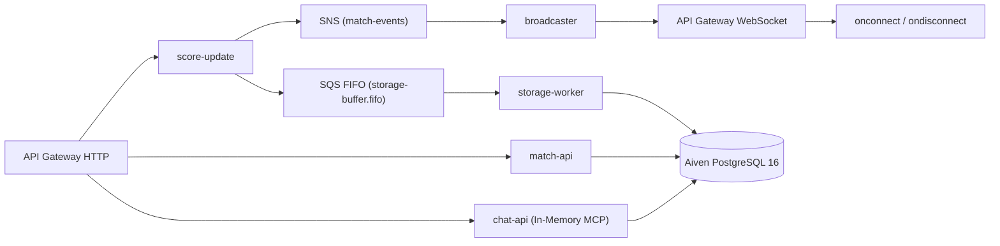

# ⚡ CricScore Backend — AWS Serverless Node.js 24 Lambdas

Contains the 8 Node.js 24.x ZIP Lambda functions and shared **121-test Vitest suite** powering CricScore's real-time scoring, WebSocket fan-out, match management, and Agentic AI MCP assistant.

---

## 🗺️ Lambda Architecture & Routing



---

## 📋 Lambda Inventory (`apps/backend/lambdas/`)

| Lambda Folder                                       | Memory / Timeout  | Trigger                   | Primary Responsibilities                                                                                                                                                              |
| :-------------------------------------------------- | :---------------: | :------------------------ | :------------------------------------------------------------------------------------------------------------------------------------------------------------------------------------ |
| [`match-api/`](./lambdas/match-api)                 | `128 MB` / `30s`  | API Gateway HTTP          | • Match CRUD & deep-link hydration<br/>• Synchronous completion stats flush<br/>• SES HTML scorecard email & S3 backup JSON<br/>• Admin RBAC operations                               |
| [`score-update/`](./lambdas/score-update)           | `256 MB` / `30s`  | API Gateway HTTP          | • Validates ball events<br/>• Fans out in parallel to SNS (`match-events`) and SQS FIFO (`storage-buffer.fifo`)                                                                       |
| [`storage-worker/`](./lambdas/storage-worker)       | `256 MB` / `30s`  | SQS FIFO (`batch_size=1`) | • Ordered ACID persistence of deliveries, innings, batters, and bowlers into Aiven PostgreSQL 16                                                                                      |
| [`broadcaster/`](./lambdas/broadcaster)             |  `128 MB` / `3s`  | SNS + Direct Invoke       | • Scans active `connectionId`s in DynamoDB<br/>• Pushes live frames (`LIVE_SCORE_UPDATE`, `HUB_UPDATE`) via WebSocket API                                                             |
| [`onconnect/`](./lambdas/onconnect)                 |  `128 MB` / `3s`  | WebSocket `$connect`      | • Registers viewer WebSocket `connectionId` in DynamoDB (`PAY_PER_REQUEST`)                                                                                                           |
| [`ondisconnect/`](./lambdas/ondisconnect)           |  `128 MB` / `3s`  | WebSocket `$disconnect`   | • Removes disconnected `connectionId` from DynamoDB                                                                                                                                   |
| [`cognito-presignup/`](./lambdas/cognito-presignup) |  `128 MB` / `3s`  | Cognito Pre-SignUp        | • Auto-confirms shadow guest accounts (`guest-*@cricscore.local`)                                                                                                                     |
| [`chat-api/`](./lambdas/chat-api)                   | `1024 MB` / `30s` | API Gateway HTTP          | • Agentic AI supervisor (`InMemoryTransport` MCP) with 4 specialist tools<br/>• `pgvector` rulebook ingestion<br/>• Deterministic **Player of the Match** (`computePlayerOfTheMatch`) |

---

## 🧪 Commands Tutorial

```bash
# Install dependencies across all Lambda packages
cd apps/backend && npm install
for d in lambdas/*; do [ -f "$d/package.json" ] && (cd "$d" && npm install); done

# Run all 121 backend unit tests
npm test
```

See **[API Reference](../../docs/api.md)** and **[Node.js Lambda Guide](../../docs/nodejs_guide.md)** for full details.
