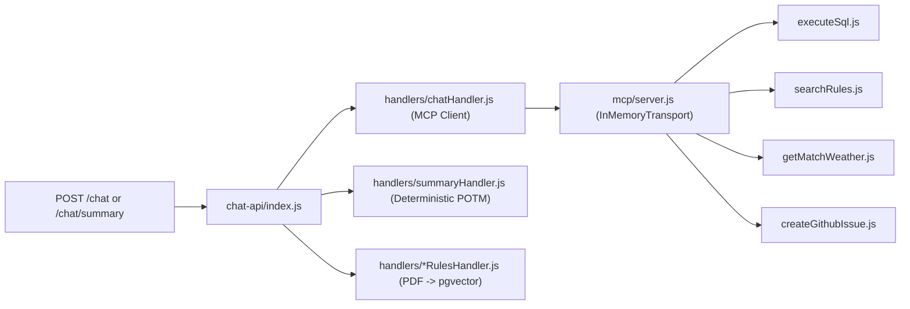

# ⚡ AWS Lambda Packages (`apps/backend/lambdas/`)

Each subdirectory is an independent Node.js 24.x AWS Lambda package archived by Terraform (`data.archive_file`) during deployment.

---

## 📋 Function & Route Matrix

| Lambda Package          | Trigger / Routes                                                                                                                                                       | Backing Stores & Services                                                                        |
| :---------------------- | :--------------------------------------------------------------------------------------------------------------------------------------------------------------------- | :----------------------------------------------------------------------------------------------- |
| **`match-api`**         | `GET/POST/DELETE /matches`, `POST /match`, `GET/PATCH/DELETE /match/{id}`, `GET /match/{id}/details`, `POST /match/{id}/innings`, `POST /match/{id}/email`, `/admin/*` | Aiven PostgreSQL 16, Amazon SES, Amazon S3 (`backups/`), Cognito Admin API, `broadcaster` Lambda |
| **`score-update`**      | `POST /update-score`, `POST /match/{id}/score`                                                                                                                         | Amazon SNS (`match-events`), Amazon SQS FIFO (`storage-buffer.fifo`)                             |
| **`storage-worker`**    | SQS FIFO trigger (`batch_size = 1`)                                                                                                                                    | Aiven PostgreSQL 16 (`matches`, `innings`, `players`, `bowlers`, `balls`)                        |
| **`broadcaster`**       | SNS subscription + direct Lambda invoke                                                                                                                                | Amazon DynamoDB (`<project>-connections`), API Gateway WebSocket `@connections`                  |
| **`onconnect`**         | WebSocket `$connect`                                                                                                                                                   | Amazon DynamoDB (`<project>-connections`)                                                        |
| **`ondisconnect`**      | WebSocket `$disconnect`                                                                                                                                                | Amazon DynamoDB (`<project>-connections`)                                                        |
| **`cognito-presignup`** | Cognito `PreSignUp` trigger                                                                                                                                            | AWS Cognito User Pool                                                                            |
| **`chat-api`**          | `POST /chat`, `POST /chat/summary`, `GET/POST/DELETE /rules`                                                                                                           | Aiven PostgreSQL 16 + `pgvector`, OpenAI API, Open-Meteo API, GitHub Issues REST API             |

---

## 🤖 `chat-api` Internal Structure



| `chat-api` Environment Variable  | Purpose                                                                         |
| :------------------------------- | :------------------------------------------------------------------------------ |
| `DATABASE_URL`                   | Aiven PostgreSQL 16 connection URI (`sslmode=require`)                          |
| `DB_SCHEMA`                      | `dev` or `prod` schema isolation                                                |
| `OPENAI_API_KEY` / `LLM_API_KEY` | API key for `gpt-4o-mini` and `text-embedding-3-small`                          |
| `LLM_BASE_URL` / `LLM_MODEL`     | OpenAI-compatible base URL and model override                                   |
| `GITHUB_TOKEN`                   | Server-side token for `create_github_issue` (`venkatesh-singamsetty/cricscore`) |

---

## 🧪 Install & Test Commands

```bash
# Hydrate all Lambda node_modules
for d in apps/backend/lambdas/*; do
  [ -f "$d/package.json" ] && (cd "$d" && npm install)
done

# Run 121 backend unit tests
cd apps/backend && npm test
```
