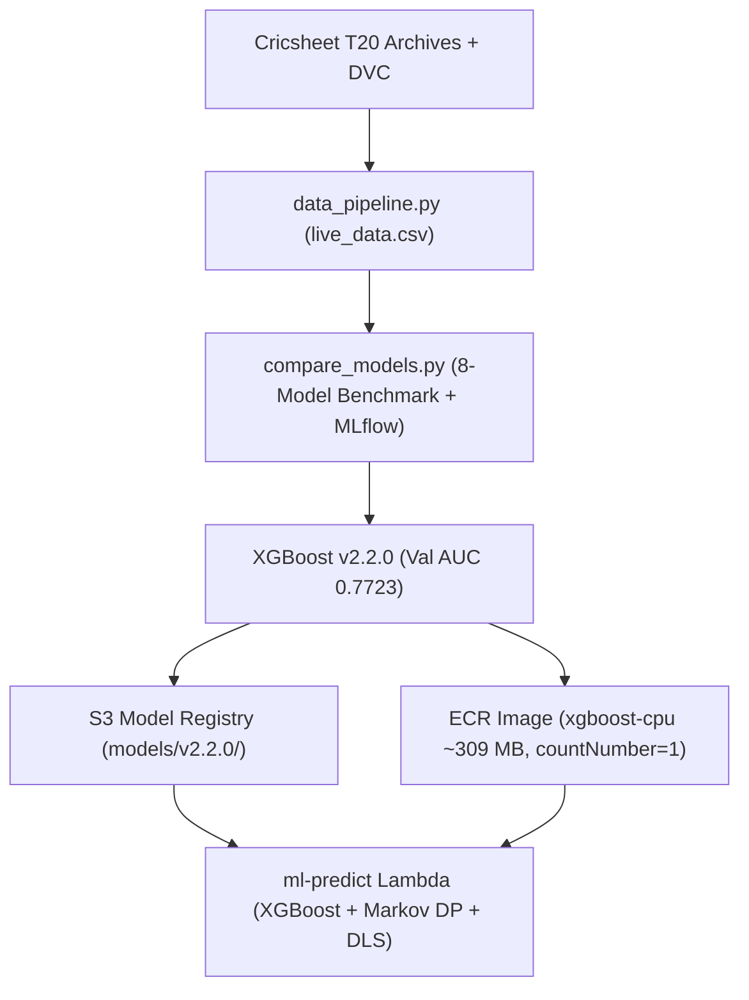

# 🧠 CricScore ML Engine (Serverless MLOps & Hybrid Win Predictor)

Serverless Machine Learning & Dynamic Programming inference engine powering real-time ball-by-ball win probability (`POST /match/predict`), running within the platform's **~$1/month** AWS footprint.

---

## 🗺️ Pipeline Architecture



---

## 📁 Directory Inventory

- **`data_pipeline.py` & `data/`:** Extracts `786K+` ball-by-ball match states from `cricket-data/t20s_json.zip` into `data/live_data.csv` (tracked via DVC).
- **`compare_models.py`:** Leakage-free 8-model benchmark (7 Scikit-Learn classifiers + **XGBoost**), MLflow logger, quality gate validator, and `model_manifest.json` generator.
- **`predict.py`:** AWS Lambda container entrypoint with S3 `/tmp` caching, SHA-256 verification, and hybrid **XGBoost + Markov DP + DLS** inference.
- **`win_probability.py`:** Format-agnostic (`1`–`20` overs) Markov Chain Dynamic Programming chase simulator and DLS Standard Edition resource par calculator.
- **`projected_score_regression.py` & `match_clustering.py`:** 1st-innings projected score regression benchmark and unsupervised pitch/match condition clustering benchmark.
- **`model_manifest.json` & `comparison_report.md`:** Immutable release manifest (`v2.2.0`, `XGBoost`, evaluation metrics & SHA-256 hash) and 8-model Markdown benchmark table.
- **`Dockerfile` & `test_predict.py`:** Builds the CPU-only (`xgboost-cpu`, `~309 MB`) Python 3.12 Lambda container image, validated by **29** Pytest unit tests.

---

## 🚀 Quickstart Commands

```bash
cd apps/ml-engine

# 1. Create training virtualenv & install dependencies
python3 -m venv .venv-train && source .venv-train/bin/activate
pip install -r requirements-train.txt

# 2. Extract Cricsheet dataset & run 8-model MLflow benchmark
python data_pipeline.py
python compare_models.py v2.2.0

# 3. Run 29 unit tests
pytest test_predict.py -v

# 4. Build CPU Docker image (~309 MB)
docker build --platform linux/amd64 --provenance=false -t cricscore-ml-predict:v2.2.0 .
```

---

## 📖 Deep-Dive Tutorials

- **[Serverless MLOps & DLS Tutorial](../../docs/mlops_tutorial.md)**
- **[ML Models Benchmark Handbook](../../docs/ml_models_handbook.md)**
