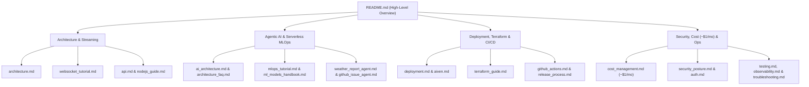

# 📚 CricScore Documentation & Tutorials Hub

Complete index of architectural guides, step-by-step tutorials, operational runbooks, and security references for CricScore.

---

## 🗺️ Documentation Map

---

## 1. 🏗️ Architecture, APIs & Real-Time Streaming

| Guide / Tutorial                                                       | What You Will Learn                                                                                                        |
| :--------------------------------------------------------------------- | :------------------------------------------------------------------------------------------------------------------------- |
| **[Architecture Overview](./architecture.md)**                         | • End-to-end multi-cloud system design & Mermaid diagrams • SNS/SQS fan-out sequence flows & component specifications  |
| **[Architecture Diagram Generator](./diagrams/README.md)**             | • How to regenerate the 4 high-resolution PNG diagrams (`01`–`04`) • Uses Python `diagrams` & Graphviz                 |
| **[Real-Time WebSockets & Fan-Out Tutorial](./websocket_tutorial.md)** | • Dual-path ball ingestion (`SNS` fast path + `SQS FIFO` safe path) • DynamoDB connection tracking & `HUB_UPDATE` sync |
| **[HTTP & WebSocket API Reference](./api.md)**                         | • Complete endpoint matrix (Method, Route, Auth, Lambda handler) • Request/response schemas & runnable `curl` examples |
| **[Node.js 24 Lambda Engineering Guide](./nodejs_guide.md)**           | • Serverless connection pooling (`pg.Pool`) & structured logging • ES module ZIP packaging & memory/timeout tuning     |

---

## 2. 🤖 Agentic AI (MCP + RAG) & Serverless MLOps

| Guide / Tutorial                                             | What You Will Learn                                                                                                                                          |
| :----------------------------------------------------------- | :----------------------------------------------------------------------------------------------------------------------------------------------------------- |
| **[Agentic AI & RAG Architecture](./ai_architecture.md)**    | • In-memory MCP (`InMemoryTransport`), read-only Text-to-SQL & `pgvector` RAG • Deterministic **Player of the Match** engine (`computePlayerOfTheMatch`) |
| **[Architecture & AI/MLOps FAQ](./architecture_faq.md)**     | • Agent Supervisor vs. LLM decision boundary & Cricket Tactical Agent • S3 Model Registry vs. ECR container decoupling & full 6-agent inventory          |
| **[Serverless MLOps & DLS Tutorial](./mlops_tutorial.md)**   | • Cricsheet + DVC pipeline & 8-model MLflow benchmark (`XGBoost v2.2.0`) • Markov Chain DP chase simulation & DLS Standard Edition math                  |
| **[ML Models Benchmark Handbook](./ml_models_handbook.md)**  | • Leakage-free match-grouped validation across 14 algorithms • Side-by-side metrics for all 8 classifiers & `xgboost-cpu` optimization                   |
| **[Cricket Match Weather Agent](./weather_report_agent.md)** | • Open-Meteo geocoding + hourly rain/wind forecast integration • Automated Cricket & DLS interruption advisories (`get_match_weather`)                   |
| **[GitHub Issue Specialist Agent](./github_issue_agent.md)** | • 2-step conversational issue filing (`create_github_issue`) • Server-side `GITHUB_TOKEN` isolation & 1-issue/turn rate guard                            |

---

## 3. 🚀 Self-Deployment, Terraform & CI/CD

| Guide / Tutorial                                                | What You Will Learn                                                                                                                                      |
| :-------------------------------------------------------------- | :------------------------------------------------------------------------------------------------------------------------------------------------------- |
| **[Step-by-Step Deployment Guide](./deployment.md)**            | • Deploy your own instance of CricScore to AWS (`dev` & `prod`) from scratch • Complete `.env.local` & Route 53 / SES bootstrap checklist            |
| **[Terraform Infrastructure Tutorial](./terraform_guide.md)**   | • HCL file layout, S3 remote state locking & `dev.tfvars` / `prod.tfvars` isolation • Step-by-step `terraform plan`, `apply` & state unlock commands |
| **[Aiven PostgreSQL 16 + `pgvector` Setup](./aiven.md)**        | • Provisioning the free-tier managed PostgreSQL database • Enabling `vector` extension & running schema migrations                                   |
| **[Local Frontend Quickstart](./local_frontend_quickstart.md)** | • Running the React 19 Vite app on `localhost:3000` / `5173` • Connecting locally to live `dev` cloud APIs & Cognito                                 |
| **[GitHub Actions CI/CD Reference](./github_actions.md)**       | • Triggers, jobs & required secrets/variables for all 10 workflows • Runnable `gh workflow run` CLI commands                                         |
| **[Semantic Release & Rollback Process](./release_process.md)** | • Automated `v*` versioning, changelog generation & production CD • 5-second ML model rollbacks via `--model-version`                                |
| **[Domain Migration Log](./domain_migration.md)**               | • Step-by-step runbook for migrating Route 53 hosted zones, ACM certs & SES DKIM                                                                         |

---

## 4. 🛡️ Security, Cloud Cost (`~$1/mo`), Testing & Operations

| Guide / Tutorial                                                             | What You Will Learn                                                                                                                                               |
| :--------------------------------------------------------------------------- | :---------------------------------------------------------------------------------------------------------------------------------------------------------------- |
| **[Cloud Cost Management (`~$1/Month`)](./cost_management.md)**              | • Service-by-service AWS cost breakdown & intentional architectural trade-offs • `xgboost-cpu` (`~309 MB`) single-image ECR policy & S3/CloudWatch lifecycles |
| **[Authentication & Authorization (`Cognito`)](./auth.md)**                  | • 4-tier RBAC (`Viewer`, `Guest`, `Scorer`, `Admin`) & Amplify token flow • Exact `isAdminClaims` / `requireAdmin` backend verification                       |
| **[Security Posture & DevSecOps](./security_posture.md)**                    | • 7-scanner shift-left security gate (GitLeaks, Checkov, Trivy, CodeQL, `npm audit`, ZAP, Syft)                                                                   |
| **[Security Audit & Remediation Log](./security_fixes.md)**                  | • Historical security findings & exact code/infrastructure fixes                                                                                                  |
| **[Branch Protection Rules](./branch_protection.md)**                        | • Required PR status checks & GitHub repository ruleset configuration                                                                                             |
| **[Observability & AWS X-Ray Tracing](./observability.md)**                  | • 7-day CloudWatch log groups, Logs Insights queries, 5% X-Ray sampling & SNS alarms                                                                              |
| **[Automated Testing Tutorial (`376` Unit + E2E)](./testing.md)**            | • Running Vitest (`151` FE + `121` BE), Pytest (`75` AI + `29` ML) & Playwright E2E suites                                                                        |
| **[Troubleshooting & Root-Cause Analysis Log](./troubleshooting.md)**        | • Quick Symptom-to-Fix navigation table & 54 engineering post-mortems                                                                                             |
| **[Featured Engineering Milestones & Key PRs](./engineering_milestones.md)** | • Curated table of major pull requests & architectural milestones                                                                                                 |
| **[DevSecOps Toolchain Installation](./tools.md)**                           | • Installing and running Terraform, AWS CLI, Trivy, Checkov, GitLeaks & Syft locally                                                                              |
| **[UI/UX Refinement Checklist](./ui_ux_refinement_checklist.md)**            | • Responsive mobile/desktop scoreboard, broadcast ticker & accessibility checklist                                                                                |
| **[AI Agent Skills Reference](./agent_skills.md)**                           | • Repository-scoped `.agents/skills/` engineering standards for AI coding assistants                                                                              |
| **[Central Platform Dashboard](./platform_dashboard.md)**                    | • Auto-generated live inventory of GitHub workflows, AWS resources, ECR images & ML artifacts                                                                     |
| **[AWS Resources Dashboard](./aws_resources_dashboard.md)**                  | • Auto-generated AWS resource ARN & console link directory across `dev` & `prod`                                                                                  |
| **[Full Changelog](./changelog.md)**                                         | • Automated Semantic Release history of all versions & commits                                                                                                    |
