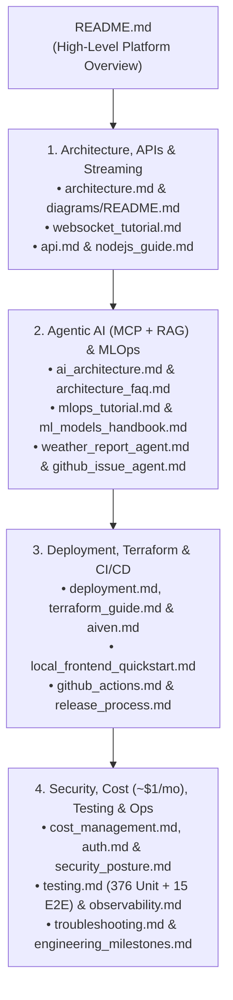

# 📚 CricScore Documentation & Tutorials Hub

Complete index of architectural guides, step-by-step tutorials, operational runbooks, and security references for CricScore (**`~$1/month`** AWS + Aiven serverless platform, **XGBoost `v2.2.0`** in `xgboost-cpu ~309 MB` with ECR `countNumber = 1`, **`376` unit tests**, and **`15` Playwright E2E tests**).

---

## 🗺️ Documentation Map

| Section | Focus Area                                       | Guides |
| :-----: | :----------------------------------------------- | :----: |
|  **1**  | **Architecture, APIs & Real-Time Streaming**     |  `5`   |
|  **2**  | **Agentic AI (MCP + RAG) & Serverless MLOps**    |  `6`   |
|  **3**  | **Self-Deployment, Terraform & CI/CD**           |  `7`   |
|  **4**  | **Security, Cloud Cost (`~$1/mo`), Tests & Ops** |  `15`  |

---

## 1. 🏗️ Architecture, APIs & Real-Time Streaming

- **1. [Architecture Overview](./architecture.md):**
  - End-to-end multi-cloud system design and mobile-friendly Mermaid diagrams.
  - SNS/SQS FIFO dual fan-out sequence flows and component specifications.
- **2. [Architecture Diagram Generator](./diagrams/README.md):**
  - How to regenerate the 4 high-resolution PNG diagrams (`01`–`04`) using Python `diagrams` and Graphviz.
- **3. [Real-Time WebSockets & Fan-Out Tutorial](./websocket_tutorial.md):**
  - Dual-path ball ingestion (`SNS` fast path + `SQS FIFO` ACID path).
  - DynamoDB connection tracking, `410` stale socket pruning, and direct `HUB_UPDATE` sync.
- **4. [HTTP & WebSocket API Reference](./api.md):**
  - Complete endpoint matrix (Method, Route, Auth tier, and Lambda handler).
  - Request/response schemas and copy-paste runnable `curl` examples.
- **5. [Node.js 24 Lambda Engineering Guide](./nodejs_guide.md):**
  - Serverless connection pooling (`pg.Pool`) and structured JSON logging.
  - ES module ZIP packaging and memory/timeout tuning.

---

## 2. 🤖 Agentic AI (MCP + RAG) & Serverless MLOps

- **1. [Agentic AI & RAG Architecture](./ai_architecture.md):**
  - In-memory MCP (`InMemoryTransport`), read-only Text-to-SQL (`execute_sql`), and `pgvector` rulebook RAG.
  - Deterministic **Player of the Match** engine (`computePlayerOfTheMatch`).
- **2. [Architecture & AI/MLOps FAQ](./architecture_faq.md):**
  - Agent Supervisor vs. LLM decision boundary and the Cricket Tactical Agent.
  - S3 Model Registry vs. ECR container decoupling (`xgboost-cpu ~309 MB`, `countNumber = 1`) and the full 6-agent inventory.
- **3. [Serverless MLOps & DLS Tutorial](./mlops_tutorial.md):**
  - Cricsheet + DVC pipeline and 8-model MLflow benchmark led by champion **XGBoost `v2.2.0`**.
  - Markov Chain Dynamic Programming (DP) chase simulation and Standard Edition DLS math.
- **4. [ML Models Benchmark Handbook](./ml_models_handbook.md):**
  - Leakage-free match-grouped validation across 14 algorithms and 8 classifiers.
  - Side-by-side ROC-AUC, Brier Score, and Log-Loss metrics plus `xgboost-cpu` container optimization.
- **5. [Cricket Match Weather Agent](./weather_report_agent.md):**
  - Open-Meteo geocoding and hourly rain/wind forecast integration (`get_match_weather`).
  - Automated Cricket & DLS interruption advisories.
- **6. [GitHub Issue Specialist Agent](./github_issue_agent.md):**
  - 2-step conversational issue filing (`create_github_issue`).
  - Server-side `GITHUB_TOKEN` isolation and 1-issue-per-turn rate limiting.

---

## 3. 🚀 Self-Deployment, Terraform & CI/CD

- **1. [Step-by-Step Deployment Guide](./deployment.md):**
  - Deploy your own instance of CricScore to AWS (`dev` & `prod`) from scratch.
  - Complete `.env.local` and one-time AWS bootstrap (Route 53 hosted zone, S3 state bucket & keyless GitHub Actions OIDC).
- **2. [Terraform Infrastructure Tutorial](./terraform_guide.md):**
  - HCL file layout, S3 remote state locking, and `dev.tfvars` / `prod.tfvars` isolation.
  - Step-by-step `terraform plan`, `apply`, and state unlock commands.
- **3. [Aiven PostgreSQL 16 + `pgvector` Setup](./aiven.md):**
  - Provisioning the free-tier managed PostgreSQL database.
  - Enabling the `vector` extension and running idempotent SQL schema migrations.
- **4. [Local Frontend Quickstart](./local_frontend_quickstart.md):**
  - Running the React 19 Vite app locally on `localhost:3000` connected to your `dev` AWS backend and Cognito pool.
- **5. [GitHub Actions CI/CD Reference](./github_actions.md):**
  - Triggers, jobs, and required secrets/variables across all 10 GitHub Actions workflows, with runnable `gh workflow run` commands.
- **6. [Semantic Release & Rollback Process](./release_process.md):**
  - Automated `v*` versioning, changelog generation, and production CD.
  - 5-second ML model rollbacks via `--model-version`.
- **7. [Domain Migration Log](./domain_migration.md):**
  - Step-by-step runbook for migrating Route 53 hosted zones, ACM certificates, and SES DKIM records.

---

## 4. 🛡️ Security, Cloud Cost (`~$1/mo`), Testing & Operations

- **1. [Cloud Cost Management (`~$1/Month`)](./cost_management.md):**
  - Service-by-service AWS cost breakdown (`~$1/month` combined Dev + Prod) and intentional architectural trade-offs.
  - `xgboost-cpu` (`~309 MB`) single-image ECR lifecycle policy (`countNumber = 1`) and S3/CloudWatch retention rules.
- **2. [Authentication & Authorization (`Cognito`)](./auth.md):**
  - 4-tier RBAC (`Viewer`, `Guest`, `Scorer`, `Admin`), Amplify token flow, and backend `isAdminClaims` / `requireAdmin` guards.
- **3. [Security Posture & DevSecOps](./security_posture.md):**
  - 7-scanner shift-left security gate (GitLeaks, Checkov, Trivy, CodeQL, `npm audit`, OWASP ZAP, and Syft SBOM).
- **4. [Security Audit & Remediation Log](./security_fixes.md):**
  - Historical security findings and exact code/infrastructure fixes.
- **5. [Branch Protection Rules](./branch_protection.md):**
  - Required PR status checks and GitHub repository ruleset configuration.
- **6. [Observability & AWS X-Ray Tracing](./observability.md):**
  - 7-day CloudWatch log groups, Logs Insights queries, 5% X-Ray sampling, and SNS alarms.
- **7. [Automated Testing Tutorial (`376` Unit + `15` E2E)](./testing.md):**
  - Running Vitest (`151` FE + `121` BE), Pytest (`75` AI + `29` ML), and the `15` Playwright E2E tests.
- **8. [Troubleshooting & Root-Cause Analysis Log](./troubleshooting.md):**
  - Quick Symptom-to-Fix navigation index, diagnostic commands, and 54 engineering post-mortems.
- **9. [Featured Engineering Milestones & Key PRs](./engineering_milestones.md):**
  - Curated catalog of major pull requests and architectural milestones.
- **10. [DevSecOps Toolchain Installation](./tools.md):**
  - Installing and running Terraform, AWS CLI, Trivy, Checkov, GitLeaks, and Syft locally.
- **11. [UI/UX Refinement Checklist](./ui_ux_refinement_checklist.md):**
  - Responsive mobile/desktop scoreboard design tokens, `44x44px` touch targets, and accessibility checklist.
- **12. [AI Agent Skills Reference](./agent_skills.md):**
  - Repository-scoped `.agents/skills/` engineering standards for AI coding assistants.
- **13. [Central Platform Dashboard](./platform_dashboard.md):**
  - Auto-generated live inventory of GitHub workflows, AWS resources, ECR images, and ML artifacts.
- **14. [AWS Resources Dashboard](./aws_resources_dashboard.md):**
  - Auto-generated AWS resource ARN and console link directory across `dev` and `prod`.
- **15. [Full Changelog](./changelog.md):**
  - Automated Semantic Release history of all versions and commits.
