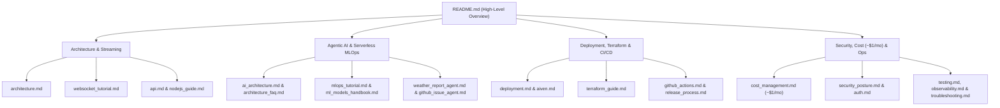

# 📚 CricScore Documentation & Tutorials Hub

Complete index of architectural guides, step-by-step tutorials, operational runbooks, and security references for CricScore.

---

## 🗺️ Documentation Map

---

## 1. 🏗️ Architecture, APIs & Real-Time Streaming

| Guide / Tutorial                                                       | What You Will Learn                                                                                                    |
| :--------------------------------------------------------------------- | :--------------------------------------------------------------------------------------------------------------------- |
| **[Architecture Overview](./architecture.md)**                         | End-to-end multi-cloud system design, Mermaid diagrams, SNS/SQS fan-out sequence flows, and component specs            |
| **[Architecture Diagram Generator](./diagrams/README.md)**             | How to regenerate the 4 high-resolution PNG diagrams (`01`–`04`) using Python `diagrams` and Graphviz                  |
| **[Real-Time WebSockets & Fan-Out Tutorial](./websocket_tutorial.md)** | Dual-path ball ingestion (`SNS` fast path + `SQS FIFO` safe path), DynamoDB connection tracking, and `HUB_UPDATE` sync |
| **[HTTP & WebSocket API Reference](./api.md)**                         | Complete endpoint table (Method, Route, Auth, Lambda handler), request/response schemas, and `curl` examples           |
| **[Node.js 24 Lambda Engineering Guide](./nodejs_guide.md)**           | Serverless connection pooling, structured logging, ES module packaging, and timeout/memory tuning                      |

---

## 2. 🤖 Agentic AI (MCP + RAG) & Serverless MLOps

| Guide / Tutorial                                             | What You Will Learn                                                                                                                                        |
| :----------------------------------------------------------- | :--------------------------------------------------------------------------------------------------------------------------------------------------------- |
| **[Agentic AI & RAG Architecture](./ai_architecture.md)**    | In-memory MCP (`InMemoryTransport`), read-only Text-to-SQL, `pgvector` rulebook RAG, and deterministic **Player of the Match** (`computePlayerOfTheMatch`) |
| **[Architecture & AI/MLOps FAQ](./architecture_faq.md)**     | Deep-dive Q&A on Agent Supervisor vs. LLM, Cricket Tactical Agent, S3 vs. ECR decoupling, and full agent/tool inventory                                    |
| **[Serverless MLOps & DLS Tutorial](./mlops_tutorial.md)**   | Cricsheet + DVC pipeline, 8-model MLflow benchmark (`XGBoost v2.2.0`), Markov Chain DP chase simulation, and DLS math                                      |
| **[ML Models Benchmark Handbook](./ml_models_handbook.md)**  | Leakage-free match-grouped validation, side-by-side metrics for all 8 classifiers, and `xgboost-cpu` container optimization                                |
| **[Cricket Match Weather Agent](./weather_report_agent.md)** | Open-Meteo geocoding + hourly rain/wind forecast integration and DLS interruption advisories (`get_match_weather`)                                         |
| **[GitHub Issue Specialist Agent](./github_issue_agent.md)** | 2-step conversational issue filing (`create_github_issue`) with server-side `GITHUB_TOKEN` and rate limiting                                               |

---

## 3. 🚀 Self-Deployment, Terraform & CI/CD

| Guide / Tutorial                                                | What You Will Learn                                                                                                                |
| :-------------------------------------------------------------- | :--------------------------------------------------------------------------------------------------------------------------------- |
| **[Step-by-Step Deployment Guide](./deployment.md)**            | How to deploy your own instance of CricScore to AWS (`dev` & `prod`) from scratch                                                  |
| **[Terraform Infrastructure Tutorial](./terraform_guide.md)**   | HCL file layout, S3 remote state locking, environment isolation (`dev.tfvars` / `prod.tfvars`), and plan/apply commands            |
| **[Aiven PostgreSQL 16 + `pgvector` Setup](./aiven.md)**        | Provisioning the free-tier managed PostgreSQL database, enabling `vector`, and running schema migrations                           |
| **[Local Frontend Quickstart](./local_frontend_quickstart.md)** | Running the React 19 Vite app on `localhost:5173` against live `dev` cloud APIs                                                    |
| **[GitHub Actions CI/CD Reference](./github_actions.md)**       | Triggers, jobs, required secrets/variables, and CLI commands for all 10 workflows (`ci.yml`, `cd.yml`, `mlops-pipeline.yml`, etc.) |
| **[Semantic Release & Rollback Process](./release_process.md)** | Automated `v*` versioning, changelog generation, production CD, and 5-second ML model rollbacks                                    |
| **[Domain Migration Log](./domain_migration.md)**               | Step-by-step runbook for migrating Route 53 hosted zones, ACM certificates, and SES identities                                     |

---

## 4. 🛡️ Security, Cloud Cost (`~$1/mo`), Testing & Operations

| Guide / Tutorial                                                             | What You Will Learn                                                                                                                                      |
| :--------------------------------------------------------------------------- | :------------------------------------------------------------------------------------------------------------------------------------------------------- |
| **[Cloud Cost Management (`~$1/Month`)](./cost_management.md)**              | Service-by-service AWS cost table, intentional architectural trade-offs, `xgboost-cpu` (`~309 MB`) single-image ECR policy, and S3/CloudWatch lifecycles |
| **[Authentication & Authorization (`Cognito`)](./auth.md)**                  | 4-tier RBAC (`Viewer`, `Guest`, `Scorer`, `Admin`), Amplify token flow, and `isAdminClaims` backend verification                                         |
| **[Security Posture & DevSecOps](./security_posture.md)**                    | 7-scanner shift-left security gate (GitLeaks, Checkov, Trivy, CodeQL, `npm audit`, OWASP ZAP, Syft SBOM)                                                 |
| **[Security Audit & Remediation Log](./security_fixes.md)**                  | Historical security findings and exact code/infrastructure fixes                                                                                         |
| **[Branch Protection Rules](./branch_protection.md)**                        | Required PR status checks and GitHub repository ruleset configuration                                                                                    |
| **[Observability & AWS X-Ray Tracing](./observability.md)**                  | 7-day CloudWatch log groups, Logs Insights queries, 5% X-Ray trace sampling, and SNS error alarms                                                        |
| **[Automated Testing Tutorial (`376` Unit + E2E)](./testing.md)**            | Running Vitest (Frontend + Backend), Pytest (AI + ML), and Playwright E2E / live-sync suites                                                             |
| **[Troubleshooting & Root-Cause Analysis Log](./troubleshooting.md)**        | Engineering post-mortems and diagnostic commands for real-time sync, DLS, auth, and POTM bugs                                                            |
| **[Featured Engineering Milestones & Key PRs](./engineering_milestones.md)** | Curated table of major pull requests and architectural milestones                                                                                        |
| **[DevSecOps Toolchain Installation](./tools.md)**                           | Installing and running Terraform, AWS CLI, Trivy, Checkov, GitLeaks, and Syft locally                                                                    |
| **[UI/UX Refinement Checklist](./ui_ux_refinement_checklist.md)**            | Responsive mobile/desktop scoreboard, broadcast ticker, and accessibility verification checklist                                                         |
| **[AI Agent Skills Reference](./agent_skills.md)**                           | Repository-scoped `.agents/skills/` engineering standards for AI coding assistants                                                                       |
| **[Central Platform Dashboard](./platform_dashboard.md)**                    | Auto-generated live inventory of GitHub workflows, AWS resources, ECR images, and ML artifacts                                                           |
| **[AWS Resources Dashboard](./aws_resources_dashboard.md)**                  | Auto-generated AWS resource ARN and console link directory across `dev` and `prod`                                                                       |
| **[Full Changelog](./changelog.md)**                                         | Automated Semantic Release history of all versions and commits                                                                                           |
