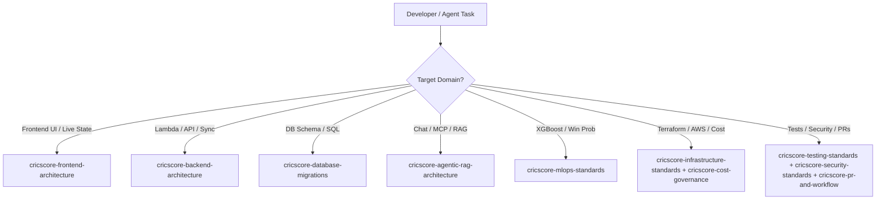

# 🤖 CricScore Agent Skills Reference

CricScore maintains modular, domain-specific agent instructions under `.agents/skills/<skill-name>/SKILL.md`. Load only the skill(s) relevant to your active task to keep context sharp and deterministic.

---

## 🧭 Skill Selection Flow



---

## 📚 Skill Catalog (12 Skills)

- **1. `cricscore-code-review-standards` (`.agents/skills/cricscore-code-review-standards/SKILL.md`):**
  - **Trigger & Scope:** Reviewing diffs and reporting actionable findings.
  - **Key Guardrails:** Severity-tagged feedback, regression detection, and architectural alignment.
- **2. `cricscore-security-standards` (`.agents/skills/cricscore-security-standards/SKILL.md`):**
  - **Trigger & Scope:** Secrets, trust boundaries, JWT authentication, and security scanners.
  - **Key Guardrails:** Exact Cognito `Admin` group check, read-only SQL pre-validation, and GitLeaks/Trivy/Checkov gates.
- **3. `cricscore-pr-and-workflow` (`.agents/skills/cricscore-pr-and-workflow/SKILL.md`):**
  - **Trigger & Scope:** Feature branches, conventional commits, pull requests, and CI/CD pipelines.
  - **Key Guardrails:** Local pre-push validation (`validate_local.sh --skip-e2e`) and automated `semantic-release` conventions.
- **4. `cricscore-dependabot-consolidation` (`.agents/skills/cricscore-dependabot-consolidation/SKILL.md`):**
  - **Trigger & Scope:** Consolidating open Dependabot PRs into a single tested branch.
  - **Key Guardrails:** Batch testing across all workspaces before merging.
- **5. `cricscore-cost-governance` (`.agents/skills/cricscore-cost-governance/SKILL.md`):**
  - **Trigger & Scope:** Evaluating AWS cost impact and enforcing billing guardrails.
  - **Key Guardrails:** `~$1/month` total AWS budget (`dev` + `prod`), `xgboost-cpu` (`~309 MB`) container, and ECR `countNumber = 1` lifecycle policy.
- **6. `cricscore-infrastructure-standards` (`.agents/skills/cricscore-infrastructure-standards/SKILL.md`):**
  - **Trigger & Scope:** Terraform state management, AWS serverless resources, and multi-environment deployments.
  - **Key Guardrails:** Single root module (`infra/terraform`), environment `.tfvars` separation, and zero NAT Gateways or ALBs.
- **7. `cricscore-frontend-architecture` (`.agents/skills/cricscore-frontend-architecture/SKILL.md`):**
  - **Trigger & Scope:** React 19 UI components, Zustand live state, and mobile-first responsive layouts.
  - **Key Guardrails:** Optimistic scoring UI, WebSocket auto-reconnect, and dark-mode glassmorphic standards.
- **8. `cricscore-backend-architecture` (`.agents/skills/cricscore-backend-architecture/SKILL.md`):**
  - **Trigger & Scope:** Node.js 24 Lambdas, ball-by-ball scoring events, and PostgreSQL data access.
  - **Key Guardrails:** SNS → SQS event fan-out and deterministic `computePlayerOfTheMatch` in `summaryHandler.js`.
- **9. `cricscore-mlops-standards` (`.agents/skills/cricscore-mlops-standards/SKILL.md`):**
  - **Trigger & Scope:** Win-prediction training, model evaluation, and Lambda container inference.
  - **Key Guardrails:** Champion `XGBoost (v2.2.0)` (`Val ROC-AUC = 0.7723`, `Test ROC-AUC = 0.7529`) blended with Markov DP and DLS par calculations.
- **10. `cricscore-testing-standards` (`.agents/skills/cricscore-testing-standards/SKILL.md`):**
  - **Trigger & Scope:** Writing and running unit tests, integration test suites, and end-to-end browser verification.
  - **Key Guardrails:** `376` automated unit/integration tests (`151` FE + `121` BE + `75` AI + `29` ML) plus `15` Playwright E2E tests.
- **11. `cricscore-agentic-rag-architecture` (`.agents/skills/cricscore-agentic-rag-architecture/SKILL.md`):**
  - **Trigger & Scope:** Chat API, specialist routing, LangGraph & MCP tools, and `pgvector` rulebook RAG.
  - **Key Guardrails:** Read-only chat tools (destructive tools excluded from chat) and last-10-turn `user`/`assistant` history filter.
- **12. `cricscore-database-migrations` (`.agents/skills/cricscore-database-migrations/SKILL.md`):**
  - **Trigger & Scope:** PostgreSQL schema evolution and idempotent SQL migrations.
  - **Key Guardrails:** Sequential `apps/backend/migrations/*.sql` files and schema isolation (`dev` vs `prod` via `DB_SCHEMA`).

---

## ⚡ Quick Inspection Commands

```bash
# List all available skill definitions
ls -1 .agents/skills/*/SKILL.md

# Search across all skills for a specific keyword (e.g., cost, migration, auth)
grep -rn "cost" .agents/skills/
```

---

## 🔗 Host Configuration & Sync Files

- **1. `.agents/skills/<name>/SKILL.md`:**
  - **Role:** Canonical, task-scoped skill definition.
  - **Maintenance Rule:** Keep concise and factual; verify against current repository code.
- **2. `.github/copilot-instructions.md`:**
  - **Role:** GitHub Copilot repository-level instructions and master skill routing list.
  - **Maintenance Rule:** Update whenever a skill is added, renamed, or removed.
- **3. `.cursorrules`:**
  - **Role:** Legacy Cursor rules and skill routing table.
  - **Maintenance Rule:** Keep catalog synchronized with `.agents/skills/`.
- **4. `README.md`:**
  - **Role:** High-level project documentation.
  - **Maintenance Rule:** Keep skill counts aligned with this reference and maintain direct links to skill docs.
