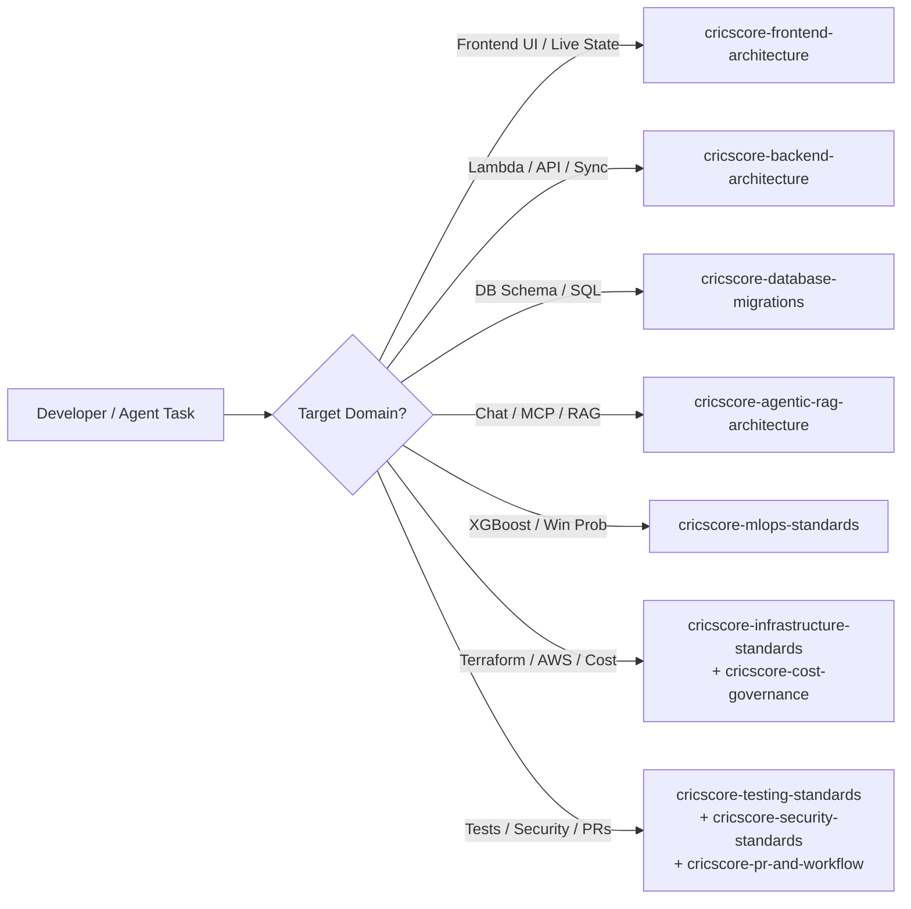

# 🤖 CricScore Agent Skills Reference

CricScore maintains modular, domain-specific agent instructions under `.agents/skills/<skill-name>/SKILL.md`. Load only the skill(s) relevant to your active task to keep context sharp and deterministic.

---

## 🧭 Skill Selection Flow



---

## 📚 Skill Catalog (12 Skills)

| Skill Name                           | Path                                                         | Primary Trigger & Scope                                             | Key Guardrails Verified                                                                                            |
| ------------------------------------ | ------------------------------------------------------------ | ------------------------------------------------------------------- | ------------------------------------------------------------------------------------------------------------------ |
| `cricscore-code-review-standards`    | `.agents/skills/cricscore-code-review-standards/SKILL.md`    | Reviewing diffs and reporting actionable findings                   | Severity-tagged feedback, regressions, and architectural alignment                                                 |
| `cricscore-security-standards`       | `.agents/skills/cricscore-security-standards/SKILL.md`       | Secrets, trust boundaries, JWT auth, and security scanners          | Exact Cognito `Admin` group check, read-only SQL pre-validation, GitLeaks/Trivy/Checkov                            |
| `cricscore-pr-and-workflow`          | `.agents/skills/cricscore-pr-and-workflow/SKILL.md`          | Branches, conventional commits, PRs, and CI/CD pipelines            | Local pre-push validation (`validate_local.sh --skip-e2e`), semantic-release conventions                           |
| `cricscore-dependabot-consolidation` | `.agents/skills/cricscore-dependabot-consolidation/SKILL.md` | Consolidating open Dependabot PRs into a single tested branch       | Batch testing across workspaces before merging                                                                     |
| `cricscore-cost-governance`          | `.agents/skills/cricscore-cost-governance/SKILL.md`          | Evaluating AWS cost impact and billing guardrails                   | `~$1/month` total AWS budget (Dev + Prod), `xgboost-cpu` (`~309 MB`) ECR `countNumber = 1` lifecycle policy        |
| `cricscore-infrastructure-standards` | `.agents/skills/cricscore-infrastructure-standards/SKILL.md` | Terraform state, AWS serverless resources, and deployments          | Single root module (`infra/terraform`), `.tfvars` separation, zero NAT Gateways/ALBs                               |
| `cricscore-frontend-architecture`    | `.agents/skills/cricscore-frontend-architecture/SKILL.md`    | React 19 UI, Zustand live state, and mobile-first layouts           | Optimistic scoring UI, WebSocket auto-reconnect, dark-mode glassmorphic standards                                  |
| `cricscore-backend-architecture`     | `.agents/skills/cricscore-backend-architecture/SKILL.md`     | Node.js 24 Lambdas, scoring events, and PostgreSQL access           | SNS -> SQS fan-out, deterministic `computePlayerOfTheMatch` in `summaryHandler.js`                                 |
| `cricscore-mlops-standards`          | `.agents/skills/cricscore-mlops-standards/SKILL.md`          | Win-prediction training, evaluation, and Lambda container inference | Champion `XGBoost (v2.2.0)` (`Validation ROC-AUC = 0.7723`, `Test ROC-AUC = 0.7529`), blended with Markov DP & DLS |
| `cricscore-testing-standards`        | `.agents/skills/cricscore-testing-standards/SKILL.md`        | Writing and running unit, integration, and E2E tests                | `376` automated unit/integration tests (`151` FE + `121` BE + `75` AI + `29` ML) + Playwright E2E                  |
| `cricscore-agentic-rag-architecture` | `.agents/skills/cricscore-agentic-rag-architecture/SKILL.md` | Chat API, LangGraph/specialist routing, MCP tools, and pgvector RAG | Read-only chat tools (destructive tools excluded from chat), last-10-turn `user`/`assistant` history               |
| `cricscore-database-migrations`      | `.agents/skills/cricscore-database-migrations/SKILL.md`      | PostgreSQL schema evolution and idempotent SQL migrations           | Sequential `apps/backend/migrations/*.sql`, schema isolation (`dev` vs `prod` via `DB_SCHEMA`)                     |

---

## ⚡ Quick Inspection Commands

```bash
# List all available skill definitions
ls -1 .agents/skills/*/SKILL.md

# Search across all skills for a specific keyword (e.g., cost, migration, auth)
grep -rn "cost" .agents/skills/
```

---

## 🔗 Host Configuration & Sync Files

| File                              | Role                                                         | Maintenance Rule                                              |
| --------------------------------- | ------------------------------------------------------------ | ------------------------------------------------------------- |
| `.agents/skills/<name>/SKILL.md`  | Canonical, task-scoped skill definition                      | Keep concise, factual, and verified against current repo code |
| `.github/copilot-instructions.md` | GitHub Copilot repository-level instructions and skill index | Update whenever a skill is added, renamed, or removed         |
| `.cursorrules`                    | Legacy Cursor rules and skill routing table                  | Keep catalog table synchronized with `.agents/skills/`        |
| `README.md`                       | High-level project documentation                             | Keep skill counts and links aligned with this reference       |
