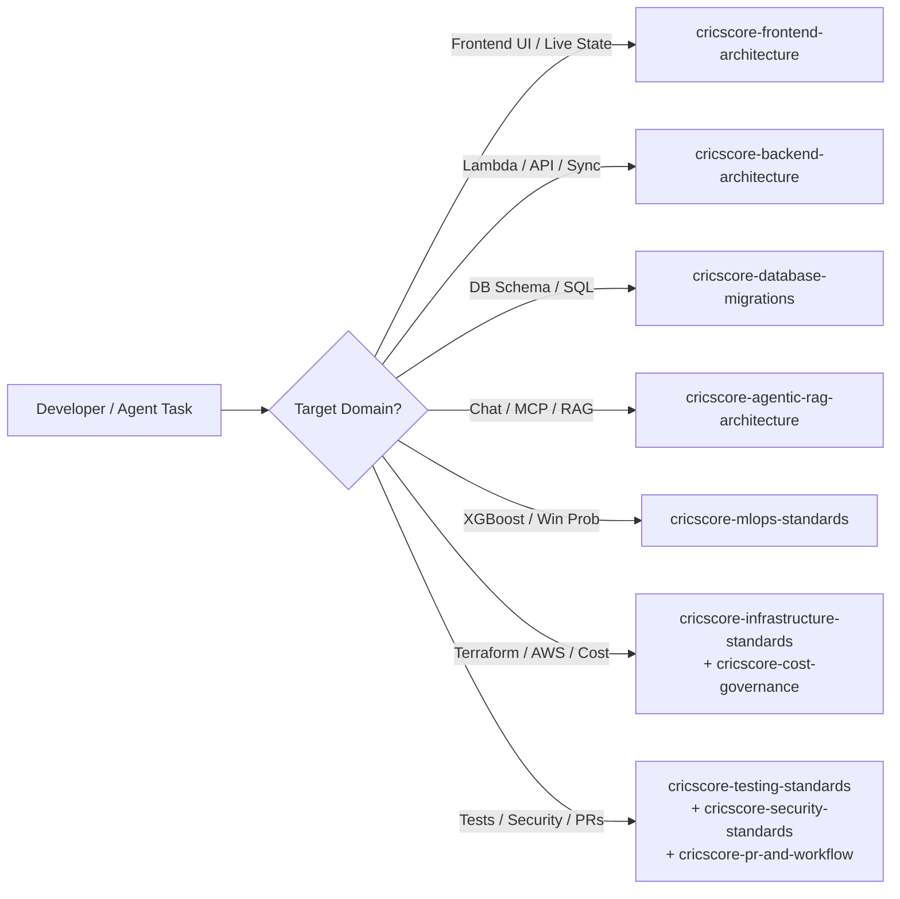

# 🤖 CricScore Agent Skills Reference

CricScore maintains modular, domain-specific agent instructions under `.agents/skills/<skill-name>/SKILL.md`. Load only the skill(s) relevant to your active task to keep context sharp and deterministic.

---

## 🧭 Skill Selection Flow



---

## 📚 Skill Catalog (12 Skills)

| Skill Name                           | Path                                                         | Primary Trigger & Scope                                                                            | Key Guardrails Verified                                                                                                                    |
| ------------------------------------ | ------------------------------------------------------------ | -------------------------------------------------------------------------------------------------- | ------------------------------------------------------------------------------------------------------------------------------------------ |
| `cricscore-code-review-standards`    | `.agents/skills/cricscore-code-review-standards/SKILL.md`    | • Reviewing diffs<br/>• Reporting actionable findings                                              | • Severity-tagged feedback<br/>• Regression detection<br/>• Architectural alignment                                                        |
| `cricscore-security-standards`       | `.agents/skills/cricscore-security-standards/SKILL.md`       | • Secrets & trust boundaries<br/>• JWT authentication<br/>• Security scanners                      | • Exact Cognito `Admin` group check<br/>• Read-only SQL pre-validation<br/>• GitLeaks, Trivy, and Checkov gates                            |
| `cricscore-pr-and-workflow`          | `.agents/skills/cricscore-pr-and-workflow/SKILL.md`          | • Feature branches<br/>• Conventional commits<br/>• Pull requests & CI/CD pipelines                | • Local pre-push validation (`validate_local.sh --skip-e2e`)<br/>• Automated `semantic-release` conventions                                |
| `cricscore-dependabot-consolidation` | `.agents/skills/cricscore-dependabot-consolidation/SKILL.md` | • Consolidating open Dependabot PRs into a single tested branch                                    | • Batch testing across all workspaces before merging                                                                                       |
| `cricscore-cost-governance`          | `.agents/skills/cricscore-cost-governance/SKILL.md`          | • Evaluating AWS cost impact<br/>• Enforcing billing guardrails                                    | • `~$1/month` total AWS budget (Dev + Prod)<br/>• `xgboost-cpu` (`~309 MB`) container<br/>• ECR `countNumber = 1` lifecycle policy         |
| `cricscore-infrastructure-standards` | `.agents/skills/cricscore-infrastructure-standards/SKILL.md` | • Terraform state management<br/>• AWS serverless resources<br/>• Multi-environment deployments    | • Single root module (`infra/terraform`)<br/>• Environment `.tfvars` separation<br/>• Zero NAT Gateways or ALBs                            |
| `cricscore-frontend-architecture`    | `.agents/skills/cricscore-frontend-architecture/SKILL.md`    | • React 19 UI components<br/>• Zustand live state<br/>• Mobile-first responsive layouts            | • Optimistic scoring UI<br/>• WebSocket auto-reconnect<br/>• Dark-mode glassmorphic standards                                              |
| `cricscore-backend-architecture`     | `.agents/skills/cricscore-backend-architecture/SKILL.md`     | • Node.js 24 Lambdas<br/>• Ball-by-ball scoring events<br/>• PostgreSQL data access                | • SNS -> SQS event fan-out<br/>• Deterministic `computePlayerOfTheMatch` in `summaryHandler.js`                                            |
| `cricscore-mlops-standards`          | `.agents/skills/cricscore-mlops-standards/SKILL.md`          | • Win-prediction training<br/>• Model evaluation<br/>• Lambda container inference                  | • Champion `XGBoost (v2.2.0)` (`Validation ROC-AUC = 0.7723`, `Test ROC-AUC = 0.7529`)<br/>• Blended with Markov DP & DLS par calculations |
| `cricscore-testing-standards`        | `.agents/skills/cricscore-testing-standards/SKILL.md`        | • Writing & running unit tests<br/>• Integration test suites<br/>• End-to-end browser verification | • `376` automated unit/integration tests (`151` FE + `121` BE + `75` AI + `29` ML)<br/>• Playwright E2E test suite                         |
| `cricscore-agentic-rag-architecture` | `.agents/skills/cricscore-agentic-rag-architecture/SKILL.md` | • Chat API & specialist routing<br/>• LangGraph & MCP tools<br/>• `pgvector` rulebook RAG          | • Read-only chat tools (destructive tools excluded from chat)<br/>• Last-10-turn `user`/`assistant` history filter                         |
| `cricscore-database-migrations`      | `.agents/skills/cricscore-database-migrations/SKILL.md`      | • PostgreSQL schema evolution<br/>• Idempotent SQL migrations                                      | • Sequential `apps/backend/migrations/*.sql` files<br/>• Schema isolation (`dev` vs `prod` via `DB_SCHEMA`)                                |

---

## ⚡ Quick Inspection Commands

```bash
# List all available skill definitions
ls -1 .agents/skills/*/SKILL.md

# Search across all skills for a specific keyword (e.g., cost, migration, auth)
grep -rn "cost" .agents/skills/
```

---

## 🔗 Host Configuration & Sync Files

| File                              | Role                                                                           | Maintenance Rule                                                                          |
| --------------------------------- | ------------------------------------------------------------------------------ | ----------------------------------------------------------------------------------------- |
| `.agents/skills/<name>/SKILL.md`  | • Canonical, task-scoped skill definition                                      | • Keep concise and factual<br/>• Verify against current repository code                   |
| `.github/copilot-instructions.md` | • GitHub Copilot repository-level instructions<br/>• Master skill routing list | • Update whenever a skill is added, renamed, or removed                                   |
| `.cursorrules`                    | • Legacy Cursor rules<br/>• Skill routing table                                | • Keep catalog table synchronized with `.agents/skills/`                                  |
| `README.md`                       | • High-level project documentation                                             | • Keep skill counts aligned with this reference<br/>• Maintain direct links to skill docs |
