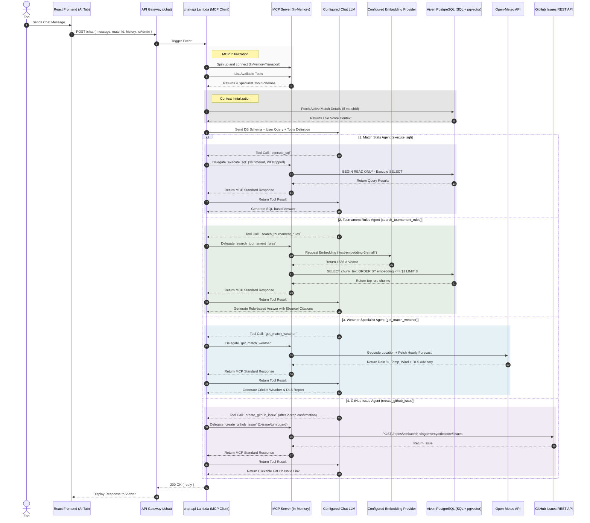
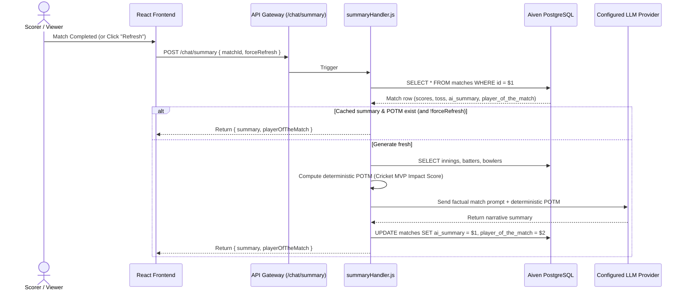

# 🤖 AI Architecture: Agentic RAG, MCP & Specialist Agents

CricScore integrates an **Agentic Retrieval-Augmented Generation (RAG)** and **Model Context Protocol (MCP)** platform that powers the interactive **AI Chat Assistant** and **Post-Match Summary Engine** while maintaining a **~$1/month** AWS footprint across `dev` and `prod`.

- **1. Text-to-SQL Analytics (`execute_sql`):**
  - **Engine & Source:** Aiven PostgreSQL 16 (`BEGIN READ ONLY` transaction + `3000ms` timeout).
  - **Guide:** [Agentic Text-to-SQL & Security Guardrails](#️-how-agentic-text-to-sql-works--security-guardrails)
- **2. Vector Rulebook Search (`search_tournament_rules`):**
  - **Engine & Source:** `pgvector` extension in Aiven PG (`1536-d` cosine similarity `<=>`, top `8` chunks).
  - **Guide:** [Vector RAG: Multi-Document PDF Tournament Rules](#-vector-rag-multi-document-pdf-tournament-rules)
- **3. Weather & DLS Advisor (`get_match_weather`):**
  - **Engine & Source:** Open-Meteo Geocoding + Forecast API (`100%` free public API, no key required).
  - **Guide:** [**Weather Report Agent Guide**](./weather_report_agent.md)
- **4. GitHub Issue Reporter (`create_github_issue`):**
  - **Engine & Source:** GitHub Issues REST API (`2-step` confirmation & `1/turn` rate limit).
  - **Guide:** [**GitHub Issue Agent Guide**](./github_issue_agent.md)
- **5. Summary & Deterministic POTM (`POST /chat/summary`):**
  - **Engine & Source:** `computePlayerOfTheMatch` (deterministic MVP formula) + grounded LLM narrative.
  - **Guide:** [Post-Match Summary & Deterministic POTM](#-ai-post-match-summary--deterministic-player-of-the-match-summaryhandlerjs)

> 💡 **Have architectural questions?** Check out the [**Architecture & AI/MLOps FAQ**](./architecture_faq.md) covering the Agent Supervisor vs. LLM decision flow, the Cricket Context & Tactical Agent, S3 model registry vs. ECR, and full agent inventory.

---

## 🏗️ Architecture & Sequence Flow (`POST /chat`)

The AI Chat system runs in the `chat-api` Lambda (`Node.js 24`, `1024 MB`, `30s` timeout) behind Amazon API Gateway and connects an in-process MCP Client and Server over `InMemoryTransport`.



### Sequence Flow Breakdown (What the Execution Steps & Tool Branches Do)

- **Steps 1–3 (Ingress & Throttling):** Viewer types a prompt into the chat widget; React sends `POST /chat` with `message`, `matchId`, and conversation history to API Gateway, which checks the `5 rps` throttle and invokes `chat-api`.
- **Steps 4–8 (In-Memory MCP Initialization & Live Telemetry):** `chat-api` launches an ephemeral in-process MCP server via `InMemoryTransport` with zero network overhead, registers the 4 specialist tools, and fetches live match state from Aiven PostgreSQL.
- **Step 9 (LLM Intent & Tool Selection):** `chat-api` sends the user prompt, live match telemetry, and tool schemas to `gpt-4o-mini`. The model decides whether to respond directly or call a specialist tool:
  - **Branch 1 (`execute_sql`):** Dispatches to Match Stats Agent; runs parameterized read-only `SELECT` queries with a `3s` statement timeout and automatic `scorer_email` PII stripping.
  - **Branch 2 (`search_tournament_rules`):** Dispatches to Rules Agent; generates a `1536-d` vector via `text-embedding-3-small`, runs HNSW cosine search (`<=>`) against PostgreSQL `pgvector`, and mandates `[Source: document_name]` citations.
  - **Branch 3 (`get_match_weather`):** Dispatches to Weather Agent; calls Open-Meteo for geocoding, rain probability %, and temperature, returning automated Cricket & DLS interruption advisories.
  - **Branch 4 (`create_github_issue`):** Dispatches to GitHub Issue Agent; enforces a 2-step confirmation with the user and rate limits to `1` issue per turn before filing via GitHub REST API.
- **Steps 10–12 (Evidence Synthesis & Delivery):** `chat-api` feeds tool evidence back into `gpt-4o-mini`, synthesizes a user-friendly markdown response, and returns `HTTP 200 OK`.

---

## 🌐 Model Context Protocol (MCP) Integration

CricScore uses the **Model Context Protocol (`@modelcontextprotocol/sdk`)** to separate LLM reasoning (the "Brain") from credentialed tool execution (the "Hands").

- **1. MCP Client / Orchestrator (`apps/backend/lambdas/chat-api/handlers/chatHandler.js`):**
  - Connects via `InMemoryTransport`, sanitizes chat history (last `10` `user`/`assistant` turns), strips `$schema`/`additionalProperties` for OpenAI compatibility, and enforces per-turn rate limits.
- **2. MCP Server / Tool Registry (`apps/backend/lambdas/chat-api/mcp/server.js`):**
  - Encapsulates `DATABASE_URL` and `GITHUB_TOKEN` on the server and registers `execute_sql`, `search_tournament_rules`, `get_match_weather`, and `create_github_issue`.
- **3. Python LangGraph MCP Server (`apps/ai-service/cricscore_ai/mcp_server.py`):**
  - Exposes specialist tools over standard `stdio` JSON-RPC for external AI clients (Claude Desktop, Cursor) and LangGraph multi-agent orchestration.

---

## 📚 Vector RAG: Multi-Document PDF Tournament Rules

PostgreSQL's `pgvector` extension stores tournament rulebook embeddings inside the existing Aiven PostgreSQL instance, avoiding any separate paid vector database.

- **Stage 1 — Admin PDF Upload (`POST /rules/upload` in `handlers/rulesHandler.js`):**
  - Protected by Cognito JWT + `requireAdmin()`. Decodes the base64 PDF via `pdf-parse` and splits text on paragraph boundaries (`~1000` characters per chunk).
- **Stage 2 — Scoped Transactional Replacement (`handlers/rulesHandler.js`):**
  - Runs `DELETE FROM tournament_rules WHERE document_name = $1` inside a SQL transaction before inserting updated chunks for that specific PDF file.
- **Stage 3 — Batch Embedding Generation (`config/llm.js`):**
  - Sends all text chunks in a single batched `fetch` request to `/embeddings` using `text-embedding-3-small` (`1536` dimensions).
- **Stage 4 — Cosine Vector Search (`mcp/tools/searchRules.js`):**
  - Embeds the user query into a `1536-d` vector and executes `SELECT document_name, chunk_text ... ORDER BY embedding <=> $1 LIMIT 8` backed by an HNSW index.
- **Stage 5 — Citation & Proportional Scaling (`handlers/chatHandler.js`):**
  - Mandates `[Source: document_name]` citations and proportionally scales 20-over powerplay rules for shortened matches (`N` overs).

---

## 🔑 LLM Configuration & Retrieval Parameters

| Setting / Variable    | Default Value                  | Purpose                                                    |
| :-------------------- | :----------------------------- | :--------------------------------------------------------- |
| `LLM_BASE_URL`        | `https://api.openai.com/v1`    | OpenAI/Groq-compatible base endpoint                       |
| `LLM_API_KEY`         | `sk-proj-...` (`.env.local`)   | API key for chat & embeddings (`OPENAI_API_KEY` fallback)  |
| `LLM_MODEL`           | `gpt-4o-mini`                  | Default chat model (switches to `llama-3.3-70b` on `groq`) |
| `EMBEDDING_MODEL`     | `text-embedding-3-small`       | `1536`-d vector embeddings for `tournament_rules`          |
| **Chunk / Top-K**     | `~1,000` chars / Top `8`       | Paragraph chunking & cosine similarity retrieval count     |
| **Max Tokens / Temp** | `2,000` tokens (`0.1` / `0.5`) | `temp = 0.1` on tool routing, `0.5` on final synthesis     |

```bash
# Configure LLM credentials in .env.local (never committed to Git)
cat << 'EOF' >> .env.local
LLM_API_KEY="sk-proj-your-key-here"
LLM_BASE_URL="https://api.openai.com/v1"
EOF
```

### 🧪 Curated Evaluation Prompts

- **1. Rulebook (Extras) → `search_tournament_rules`:**
  - _"If a batsman hits the ball onto their pad and takes a run, does it count as leg byes or batsman runs?"_
- **2. Match Stats (High Scores) → `execute_sql`:**
  - _"Which team scored the highest total in the tournament so far?"_
- **3. Knockout Tiebreakers → `search_tournament_rules`:**
  - _"What happens if a semi-final match ends in a tie?"_
- **4. Database Match Count → `execute_sql`:**
  - _"Show me all matches currently recorded in the database."_
- **5. Bowler Quota Scaling → `search_tournament_rules`:**
  - _"What is the maximum number of overs a single bowler can bowl in a 20-over match?"_
- **6. Live Weather & DLS → `get_match_weather`:**
  - _"What is the weather forecast for the next 4 hours in Chicago, IL?"_
- **7. GitHub Bug / Feature Report → `create_github_issue` (2-step):**
  - _"I want to report a bug or request a new feature"_

---

## ⚙️ How Agentic Text-to-SQL Works & Security Guardrails

Because `POST /chat` is open to fans and guests without a Cognito sign-in wall, `chat-api` enforces strict multi-layer security boundaries:

- **1. Read-Only Chat Enforcement (`handlers/chatHandler.js`):**
  - Client-supplied `isAdmin` flags are ignored (`const isAdmin = false`); destructive tools (`delete_guest_data`, `delete_incomplete_matches`) are never registered on `/chat`.
- **2. SQL AST / Keyword Validator (`mcp/tools/executeSql.js` — `validateReadOnlySql`):**
  - Enforces a single `SELECT` or `WITH` statement and rejects semicolons, write/DDL verbs (`DROP`, `DELETE`, `UPDATE`, `INSERT`, `ALTER`), and `pg_sleep`/`dblink`.
- **3. Read-Only DB Transaction (`mcp/tools/executeSql.js`):**
  - Wraps every query in `BEGIN READ ONLY;`, enforces `SET LOCAL statement_timeout = 3000` (`3 seconds`), and finishes with `ROLLBACK;`.
- **4. PII Column Redaction (`mcp/tools/executeSql.js` — `stripSensitiveColumns`):**
  - Automatically strips `scorer_email`, `email`, and `user_email` from returned rows and truncates output at `25,000` characters (`MAX_ROWS = 100`).
- **5. Schema Isolation (`config/db.js` — `setSearchPath`):**
  - Executes `SET search_path TO ${dbSchema}, public` so `dev`/`prod` tables stay isolated while `public.vector` (`<=>`) remains accessible.
- **6. Admin JWT Guard on `/rules/*` (`infra/terraform/apigw.tf`, `config/auth.js`):**
  - `POST /rules/upload`, `GET /rules`, and `DELETE /rules` require a valid Cognito JWT at API Gateway plus server-side `Admin` group or `ADMIN_REPORT_EMAIL` verification.

---

## 📊 AI Post-Match Summary & Deterministic Player of the Match (`summaryHandler.js`)

The `POST /chat/summary` endpoint pairs an LLM-generated match narrative with a **100% deterministic Player of the Match (`computePlayerOfTheMatch`)** so the Scorer view, Viewer view, PostgreSQL database, SES emails, and S3 backups always agree.



### Deterministic Player of the Match Formula (`computePlayerOfTheMatch`)

- **1. Batting Impact:**
  - **Formula:** `runs * 1.0` + `(runs / maxTeamRuns) * 20.0` + boundaries (`4s * 1.5 + 6s * 2.5`) + Strike Rate bonus vs. `matchRPO` (`[-4, +8]`).
  - **Purpose:** Rewards high-volume run scoring, share of team total, boundary hitting, and faster-than-par scoring pace.
- **2. Not-Out & Chase Finisher Bonus:**
  - **Formula:** `+2.0` points when `isOut === false` and `runs >= 5`.
  - **Purpose:** Rewards batters who carry their bat to finish an innings or chase.
- **3. Bowling Impact:**
  - **Formula:** `wickets * max(12.0, maxTeamRuns * 0.32)` + `maidens * 4.0` + Economy bonus vs. `matchRPO` (`[-5, +10]`).
  - **Purpose:** Scales wicket value to the match scoring environment so low-scoring thrillers properly reward bowlers.
- **4. All-Rounder Synergy:**
  - **Formula:** `+4.0` bonus when both `batPts > 0` and `bowlPts > 0`.
  - **Purpose:** Rewards dual batting and bowling contributions.
- **5. Winning-Team Multiplier:**
  - **Formula:** `impact = impact * 1.35 + 5.0` if the candidate belongs to `winningTeamUpper`.
  - **Purpose:** Strongly favors match-winners while still allowing extraordinary losing-side performances to win POTM.
- **6. Cache & Cross-Surface Consistency:**
  - **Formula:** Persisted to `matches.ai_summary` and `matches.player_of_the_match` and returned immediately when `!forceRefresh`.
  - **Purpose:** Guarantees Scorer and Viewer see the exact same summary and deterministic POTM.

---

## 🛠️ Engineering Gotchas & Production Fixes (18 Case Studies)

- **1. SQL Queries Returning 0 Rows:**
  - **Root Cause:** `DB_SCHEMA` env var missing; queries hit the empty `public` schema instead of `dev`/`prod`.
  - **Fix:** Passed `DB_SCHEMA = var.environment` in `infra/terraform/lambda.tf`.
- **2. Over-Strict Context Refusal:**
  - **Root Cause:** LLM refused general DB queries when `matchContext` was empty on the Hub screen.
  - **Fix:** Added explicit system prompt rule: _"If no Active Match Context, query the database via `execute_sql`."_
- **3. Case-Sensitive Status Hallucination:**
  - **Root Cause:** LLM generated `status = 'completed'` instead of uppercase `'COMPLETED'`.
  - **Fix:** Injected uppercase enum hints into the system prompt and mandated `ILIKE` for string comparisons.
- **4. UTC Date Rollover on "Today" Queries:**
  - **Root Cause:** `CURRENT_DATE` rolled over to tomorrow in UTC during US evening games.
  - **Fix:** Guided the LLM to use `created_at >= NOW() - INTERVAL '24 hours'` for recent matches.
- **5. Off-Topic Token Abuse:**
  - **Root Cause:** Users asking non-cricket coding or general trivia questions.
  - **Fix:** Enforced a strict cricket-only persona guardrail in `chatHandler.js` and `router.py`.
- **6. Lambda 3s Timeout on Tool Chains:**
  - **Root Cause:** Default 3s Lambda timeout expired during multi-step MCP + LLM tool loops.
  - **Fix:** Configured `timeout = 30` seconds and `memory_size = 1024` MB in `infra/terraform/lambda.tf`.
- **7. `pdf-parse` Crash (`DOMMatrix` Missing):**
  - **Root Cause:** `pdf.js` referenced browser canvas globals missing in the Node.js Lambda runtime.
  - **Fix:** Polyfilled `global.DOMMatrix`, `global.ImageData`, and `global.Path2D` at handler startup.
- **8. API Gateway 30s Timeout on PDF Uploads:**
  - **Root Cause:** Sequential embedding calls per chunk took `45s+` on multi-page PDFs.
  - **Fix:** Batched all PDF chunks into a single `/embeddings` request (`<3s` total).
- **9. Embedding SDK Streaming Hang:**
  - **Root Cause:** SDK hung silently in the Lambda runtime during large batch requests.
  - **Fix:** Replaced SDK call with native Node.js `fetch` in `config/llm.js`.
- **10. Lambda OOM Thrashing at 128 MB:**
  - **Root Cause:** `pdf-parse` hit `127/128 MB`, causing V8 GC thrashing and 30s timeouts.
  - **Fix:** Increased `chat-api` memory to `1024 MB` (faster CPU allocation + ample heap).
- **11. OpenAI 400 Bad Request on MCP Schemas:**
  - **Root Cause:** MCP tool JSON schemas included `$schema` and `additionalProperties`.
  - **Fix:** Stripped `$schema` and `additionalProperties` before passing `tools` to chat completions.
- **12. `pgvector` `<=>` Operator Not Found:**
  - **Root Cause:** `SET search_path TO dev` hid the `public` schema where `pgvector` registers `<=>`.
  - **Fix:** Updated `setSearchPath()` to `SET search_path TO ${dbSchema}, public`.
- **13. LLM Skipping Rulebook Search:**
  - **Root Cause:** LLM answered from general ICC knowledge instead of calling `search_tournament_rules`.
  - **Fix:** Added mandatory rule: _"NEVER answer a rulebook question from memory; always call `search_tournament_rules`."_
- **14. Toss Outcome Hallucination:**
  - **Root Cause:** Summaries guessed toss winner from batting order before toss columns existed.
  - **Fix:** Added `toss_winner` & `toss_decision` columns to `matches` and injected toss metadata verbatim into `summaryHandler.js`.
- **15. Decimal Over Notation (`"0.5 overs"`):**
  - **Root Cause:** LLM misread `0.5 overs` as half an over instead of `5 balls`.
  - **Fix:** `formatOvers(overs, balls)` converts stored innings counts into plain English (`"5 balls"`, `"1 over and 2 balls"`).
- **16. Match-Winning Ball Over-Flip Race:**
  - **Root Cause:** UI transition to `COMPLETED` occurred before the `0.5 -> 1.0` tick on `matches.team_b_overs`.
  - **Fix:** `summaryHandler.js` reads authoritative `innings.overs` and `innings.balls` directly.
- **17. SQL Result Truncation at 2,000 Chars:**
  - **Root Cause:** `execute_sql` truncated JSON output at 2,000 chars, hiding older matches.
  - **Fix:** Increased `MAX_RESULT_CHARS` to `25,000` (`MAX_ROWS = 100`) in `executeSql.js`.
- **18. Summary Race vs. SQS Buffer:**
  - **Root Cause:** Immediate summary call read pre-final-ball DB state while the final ball was in SQS FIFO.
  - **Fix:** Added a `2.5s` post-completion buffer + fallback to live client payload and deterministic POTM sync.

---

## 🧠 Mapping AI Paradigms to CricScore

- **1. GenAI (Generative AI):**
  - **Definition:** Models that synthesize natural-language narratives from structured inputs.
  - **CricScore Implementation:** `chatHandler.js` and `summaryHandler.js` turn ball-by-ball SQL rows and rulebook chunks into broadcast-style commentary.
- **2. Structured RAG (Text-to-SQL):**
  - **Definition:** Grounding LLM answers in live relational database queries.
  - **CricScore Implementation:** `execute_sql` queries `matches`, `innings`, `players`, `bowlers`, and `ball_events` inside a read-only transaction.
- **3. Unstructured RAG (Vector Search):**
  - **Definition:** Grounding LLM answers in semantic embeddings of documents.
  - **CricScore Implementation:** `search_tournament_rules` embeds queries into `1536-d` vectors and searches `tournament_rules` via `pgvector` `<=>`.
- **4. Agentic AI:**
  - **Definition:** Autonomous tool selection and multi-step execution within guardrails.
  - **CricScore Implementation:** Agent supervisor routes across 6 specialist capabilities (SQL, Rules, Weather, GitHub Issues, Tactical Context, and Win Predictor).
- **5. MCP (Model Context Protocol):**
  - **Definition:** Open protocol separating LLM clients from credentialed tool servers.
  - **CricScore Implementation:** `mcp/server.js` (Node.js `InMemoryTransport`) and `mcp_server.py` (Python `stdio`) isolate DB and GitHub credentials from the LLM.

---

## 🎨 AI Chat UX & Client Features (`ChatComponent.tsx`)

- **Persistent Local Memory:** Syncs conversation history to `localStorage` (`cricscore-chat-memory`) so chat context survives page refreshes.
- **One-Click `[+] New Chat`:** Clears local chat memory and resets the conversation window instantly.
- **Context-Aware Prompt Chips:** Surfaces 7 tailored quick-action chips (match stats, tournament rules, live weather report, and GitHub bug/feature reporting).
- **Clickable Markdown & Citations:** Renders Markdown tables, `[Source: ...]` rulebook citations, and clickable GitHub Issue URLs (`target="_blank"`).
- **Web Speech API Voice (TTS):** Includes a `Voice On/Off` toggle with a silent mobile Safari/iOS audio-context unlock utterance on user interaction.

---

## 🚀 MLOps & Hybrid Win Predictor Integration

> 📖 See the [**Serverless MLOps Tutorial**](./mlops_tutorial.md) and [**ML Models Handbook**](./ml_models_handbook.md) for the full 8-model benchmark, Markov DP math, and DLS resource tables.

- **Champion ML Model:** **XGBoost (`v2.2.0`)** (`Validation ROC-AUC = 0.7723`, `Held-out Test ROC-AUC = 0.7529`, `Validation Log Loss = 0.5786`, `Brier Score = 0.1992`).
- **Decoupled S3 Model Registry:** Stores versioned artifacts (`live_win_predictor_model.joblib` `~227 KB`, `model_manifest.json`) in `s3://<match-backups>/models/v2.2.0/` with SHA-256 verification.
- **Lean ECR Container Runtime:** `cricscore-ml-predict` (`xgboost-cpu ~309 MB` compressed), tagged `:${var.ml_model_version}` only with **`countNumber = 1`** single-image retention (`~$0.03/mo`).
- **Hybrid Inference & Boundary Guards:** Blends format-agnostic **Ball-by-Ball Markov DP** (`win_probability.py`), **DLS Par differential** in 2nd-innings chases, and **XGBoost `v2.2.0`** (up to `50%` weight in 10–20 over games), while enforcing `50%/50%` at `0/0` (Ball `0.0`), `100%/0%` on target completion, `0%/100%` when `runsNeeded > ballsLeft * 6 + 1`, and `[1%, 99%]` clamping during live play.

---

## 🧪 Verification Commands

```bash
# 1. Run all chat-api MCP tool, summaryHandler, and auth unit tests (part of 376 total unit tests, plus 15 E2E tests)
npm --prefix apps/backend test -- --run

# 2. Run Python LangGraph multi-agent & evaluation suite
./apps/ai-service/.venv/bin/pytest apps/ai-service -q

# 3. Run Frontend ChatComponent unit tests
npm --prefix apps/frontend test -- --run src/test/ChatComponent.test.tsx
```
