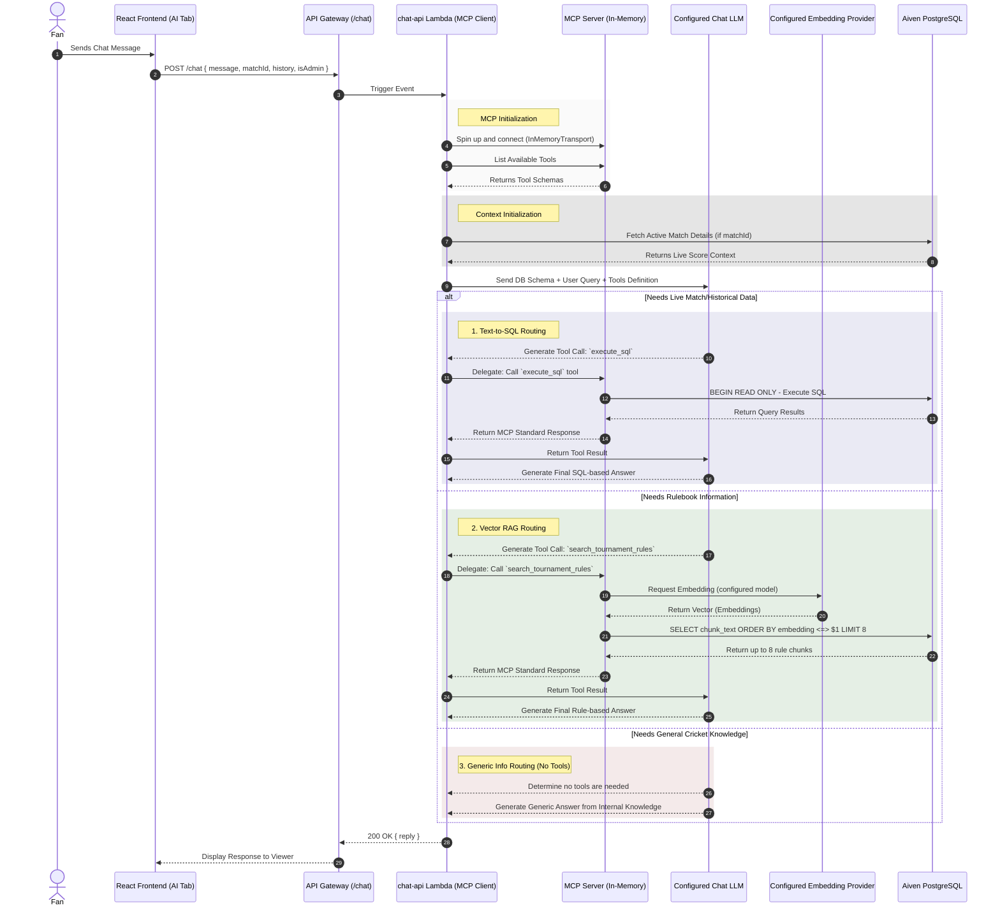
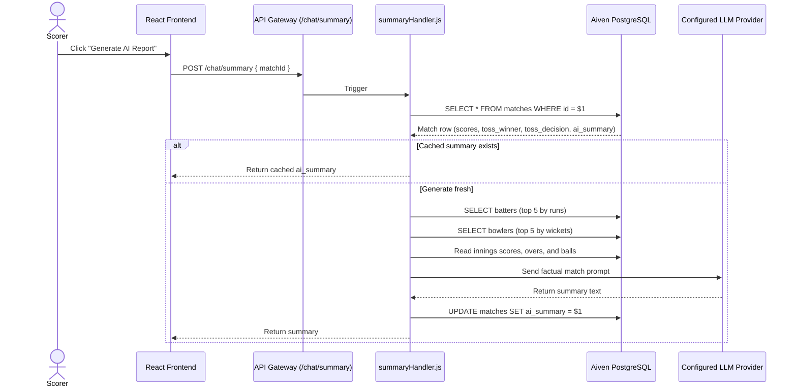

# 🤖 AI Architecture: Agentic RAG (Text-to-SQL & Vector Search)

CricScore integrates an advanced **Agentic Retrieval-Augmented Generation (RAG)** system to provide an interactive **AI Chat Assistant** for fans.

Our chatbot is a fully autonomous AI Agent capable of two primary RAG methodologies:

1. **Text-to-SQL:** It answers questions about live matches, historical data, and player stats in real-time by autonomously writing and executing read-only SQL queries directly against the high-performance PostgreSQL event hub.
2. **Vector Semantic Search:** It answers rule-based questions (e.g. rain delays, tiebreakers) by embedding the query and performing a cosine-similarity search against a custom `pgvector` knowledge base built from uploaded PDF tournament rulebooks.

## 🏗️ Architecture

The AI Chat system runs in the `chat-api` Lambda behind Amazon API Gateway. It uses OpenAI-compatible chat completions and tool calling; the provider and model are configurable.



## 🌐 Model Context Protocol (MCP) Integration

CricScore natively implements the **Model Context Protocol (MCP)** to standardise and decouple its AI tooling.

To understand why it is designed this way, think of it like a **Manager (the LLM)** and an **Executive Assistant (the MCP Server)**:

- The LLM is very smart, but it has no hands. It cannot touch your database.
- The MCP Server is not smart, but it holds the keys to the database and can execute commands securely.

### The Exact Flow: Answering a Fan's Question

When a fan asks a question (e.g., _"Who scored the most runs today?"_), The request is handled as follows:

1. **The Question Arrives:** API Gateway triggers the `chat-api` Lambda.
2. **The MCP Client Checks Tools:** Inside the Lambda, the MCP Client asks the local MCP Server (also inside the Lambda): _"What tools do you have?"_ The server responds with schemas for tools like `execute_sql`.
3. **The LLM "Thinks" (External Call):** The MCP Client sends the question and tool schemas to the configured OpenAI-compatible provider and model. The model may request a tool call such as `execute_sql`.
4. **The MCP Server "Acts" (Local Execution):** The MCP Client receives this request and turns to the local MCP Server. The MCP Server uses its secret `DATABASE_URL`, connects to Aiven PostgreSQL, executes the query, and gets the JSON result.
5. **The LLM Answers:** The MCP Client sends the raw database JSON back to the LLM. The LLM reads it and generates a friendly, natural response (e.g., _"Virat was the top scorer with 85 runs!"_).
6. **The Response:** The final friendly answer is returned to the Fan.

The LLM does not connect directly to PostgreSQL, and the database connection credentials remain in the Lambda environment. Tool results and generated SQL are sent to the configured LLM provider. Read-only SQL execution limits database writes, but does not by itself authenticate callers or make other tools safe.

### Technical Implementation

Instead of tightly coupling database and vector logic directly into the LLM chat router loop, the `chat-api` Lambda operates using an **MCP Client-Server Architecture**:

1. **MCP Server (`mcp/server.js`):** Defines `execute_sql` and `search_tournament_rules`, plus destructive tools when the `isAdmin` argument passed to the chat handler is truthy.
2. **MCP Client (`handlers/chatHandler.js`):** Connects to the in-process server via `InMemoryTransport`, lists its tools, and delegates model-requested tool calls with `client.callTool()`.

_Why use `InMemoryTransport`?_ The MCP client and server communicate inside the Lambda process, so a separate MCP host service is not needed. Lambda, database, and provider usage can still incur costs.

### ⏳ The Serverless Execution Lifecycle

Because the MCP Client and Server run on AWS Lambda via `InMemoryTransport`, their execution speed is determined by the Serverless lifecycle:

AWS Lambda may reuse an execution environment between invocations or create a new one. The MCP client, server, and database pool are initialized in that environment; startup time, reuse duration, and request latency vary and are not fixed guarantees.

## 📚 Vector RAG: Multi-Document PDF Tournament Rules

We have extended the PostgreSQL database with the `pgvector` extension to serve as a native Vector Database alongside our relational data. This completely removes the need for a third-party vector database (like Pinecone).

1. **Multi-Document PDF Processing (`/rules/upload`):** The chatbot UI shows rulebook controls to admins. The `chat-api` Lambda receives a base64-encoded PDF and `fileName`, uses `pdf-parse` (v2) to extract text, and splits the text into chunks.
2. **Scoped Replacements:** If a document with the same `fileName` is uploaded, the backend first issues a scoped `DELETE FROM tournament_rules WHERE document_name = $1` to wipe the old chunks for that specific document before inserting the new ones.
3. **Batch Embedding Generation:** The backend sends the chunks in one batched request to the configured embedding endpoint. The embedding provider and model are configurable.
4. **Storage:** The chunks, their embeddings, and the `document_name` are stored in the `tournament_rules` table. The current default embedding model produces 1536-dimensional vectors.
5. **Agentic Tool:** The LLM is provided the `search_tournament_rules` tool. The backend performs a semantic vector search (`<=>`) against `pgvector` and returns up to 8 matching chunks with their source `document_name`.
6. **Citations:** The system prompt instructs the model to cite `[Source: document_name]`; generated citations are model output and are not independently verified.

> **Authorization warning:** The API Gateway route for `/rules/upload`, as well as the chat and rule-management routes, is configured without a JWT authorizer. Hiding the controls in the frontend does not protect these endpoints. Add server-side admin authorization before relying on them for administrative actions.

## 🔑 LLM API Key Configuration & Provider Setup

The backend uses an OpenAI-compatible API. `LLM_BASE_URL` selects the endpoint, `LLM_API_KEY` (or `OPENAI_API_KEY`) supplies credentials, and `LLM_MODEL` can override the selected chat model:

- **Chat & Tool Calling Engine:** Defaults to `gpt-4o-mini`, or `llama-3.3-70b-versatile` when the configured base URL contains `groq`.
- **Vector Embedding Engine:** Defaults to `text-embedding-3-small`; `EMBEDDING_MODEL` can override it.

The selected provider must support the chat-completions, tool-calling, embeddings, and JSON response features used by the handlers.

### ⚙️ Model and Retrieval Settings

These settings describe the current implementation; they do not guarantee answer accuracy:

| Aspect                 | Current setting                                                            |
| :--------------------- | :------------------------------------------------------------------------- |
| **Model**              | Provider-dependent default; override with `LLM_MODEL`                      |
| **Paragraph chunking** | Splits on paragraph boundaries, targeting about 1,000 characters per chunk |
| **pgvector retrieval** | Returns up to 8 chunks                                                     |
| **Chat token limit**   | Up to 2,000 tokens for each chat completion call                           |
| **Temperature**        | Initial chat call uses `0.1`; follow-up tool-result call uses `0.5`        |
| **Prompt guidance**    | Includes rulebook-priority, date, and PostgreSQL schema/query hints        |

---

### 🔑 How to Create an OpenAI API Key

1. Log in to [OpenAI Platform](https://platform.openai.com/).
2. Navigate to **API Keys** under your Account Dashboard.
3. Create a key for the application and grant only the permissions needed for chat completions and embeddings.
4. Copy the secret key starting with `sk-proj-...`.
5. Add the key to your `.env.local` file:
   ```bash
   LLM_API_KEY="sk-proj-..."
   LLM_BASE_URL="https://api.openai.com/v1"
   ```
6. Store the key as a GitHub Actions secret or supply it through the deployment's protected secret configuration. Do not commit it to the repository.

---

### 💵 Cost Analysis & Query Economics

LLM and embedding costs depend on the selected provider and model, token usage, and current provider pricing. Check the provider's usage dashboard for current balance and charges; the number of requests supported by a balance is not fixed.

---

### 🧪 Demo Prompts Suite for Evaluation

Use the following curated prompts during live demos or automated regression testing:

1. **Rulebook Specific (Leg Byes & Extras)**:
   > _"If a batsman hits the ball onto their pad and takes a run, does it count as leg byes or batsman runs?"_
2. **Match Summary & High Scores**:
   > _"Which team scored the highest total in the tournament so far?"_
3. **Knockout Tiebreaker Rules**:
   > _"What happens if a semi-final match ends in a tie?"_
4. **List Matches Count**:
   > _"Show me all matches currently recorded in the database."_
5. **Bowler Limits & Overs**:
   > _"What is the maximum number of overs a single bowler can bowl in a 20-over match?"_
6. **Forfeits & Points Allocation**:

   > _"How many points does a team get if their opponent forfeits the match?"_

## ⚙️ How Agentic Text-to-SQL Works

Instead of using a Vector Database (which introduces sync latency), the CricScore RAG system operates directly on the relational data:

1. **Schema Injection:** The system prompt injected into the LLM includes a highly succinct schema representation of the `matches`, `innings`, `players`, `bowlers`, and `ball_events` tables.
2. **Tool Definition:** The LLM is provided with an `execute_sql` tool definition in the OpenAI API request.
3. **Autonomous Execution:** If the user asks an analytical question, the LLM generates a PostgreSQL query. The `chat-api` Lambda executes this query on the user's behalf.
4. **Security & Governance:**
   - **Read-Only:** All LLM-generated queries are strictly wrapped in a `BEGIN READ ONLY;` transaction to prevent data corruption or hallucinated `DROP TABLE` commands.
   - **Performance Protection:** A strict `statement_timeout = 3000` is enforced at the transaction level to prevent the LLM from generating wildly complex joins that could bottleneck the database.
   - **Schema Selection:** The `chat-api` Lambda sets its configured search path before queries; it includes the environment schema and `public` for pgvector.
   - **Caller Authentication:** `/chat` is configured without an API Gateway JWT authorizer. The handler accepts `isAdmin` from the request body and does not validate it against Cognito claims. Do not rely on the frontend or this flag to authorize admin tools.

### Database Connection Notes

The chat Lambda's PostgreSQL pool currently configures TLS with `rejectUnauthorized: false`. This encrypts the connection but does not verify the database server certificate; configure certificate verification with the Aiven CA for server identity validation.

---

## 📊 AI Post-Match Summary (`summaryHandler.js`)

The `/chat/summary` handler can generate an **AI-generated post-match report**. For registered matches, it reuses a valid cached value unless `forceRefresh` is requested, and stores newly generated summaries in `matches.ai_summary`. Local/guest match payloads are also sent to the configured LLM, but that branch does not cache the result in the database.

### How It Works

For registered matches, the handler reads summary facts from PostgreSQL and sends them to the configured OpenAI-compatible endpoint. For local/guest matches it builds a prompt from the supplied match payload and also calls the LLM; this route has no API Gateway JWT authorizer.



### Data Sources

The prompt is built from match and innings data read from the database. The resulting prose and Player of the Match selection are model-generated and can contain errors:

| Data Point                  | Source                                                           |
| --------------------------- | ---------------------------------------------------------------- |
| Match result & winner       | `matches.match_winner`, `matches.status`                         |
| Team scores & wickets       | `innings.total_runs`, `innings.total_wickets`                    |
| Toss winner & decision      | `matches.toss_winner`, `matches.toss_decision`                   |
| Overs and balls per innings | `innings.overs` and `innings.balls`, formatted as plain language |
| Top batters                 | `players` JOIN `innings` — sorted by runs DESC                   |
| Top bowlers                 | `bowlers` JOIN `innings` — sorted by wickets DESC                |

### Overs Calculation Strategy

For registered matches, the handler reads `overs` and `balls` from each `innings` row and formats them as plain language; it does not count `ball_events` to calculate overs. Local/guest matches use overs and balls from the supplied payload:

```js
// Read the stored innings overs and balls, then format them as plain language.
```

The formatted text reflects the stored innings values; it is not an independent audit of ball events.

### Prompt Engineering

For registered matches, the LLM receives match data read from PostgreSQL; the handler formats stored overs and balls as plain English and inserts the database toss details. The separate local/guest branch uses the supplied payload and formats overs as `${overs}.${balls}`. Both prompts ask the model to use the supplied scores, result, and batting/bowling performances; this does not guarantee error-free output.

### Caching

For registered matches, the summary and Player of the Match are cached in `matches.ai_summary` and `matches.player_of_the_match`. A valid cached result is reused unless forced to refresh; guest/local payload summaries are not cached in the database.

---

## 🛠️ Agentic Text-to-SQL Gotchas & Fixes

While building the Agentic SQL RAG, we encountered and resolved several common hallucination/execution issues:

1. **Schema Environment Fallback Issue:**
   - **Bug:** The Lambda relied on `process.env.DB_SCHEMA` to set the `search_path`. Since Terraform wasn't passing this variable, the AI kept querying the empty `public` schema instead of `dev`, falsely reporting 0 results.
   - **Fix:** Added `DB_SCHEMA = var.environment` to the `chat_api` Lambda's environment variables in Terraform.

2. **Over-Strict Context Refusal:**
   - **Bug:** The system prompt originally said "You can answer questions about the active match...". Because `matchContext` was sometimes empty (e.g., when chatting from the main dashboard), the LLM assumed it wasn't allowed to answer generic queries and refused to run SQL tools.
   - **Fix:** Explicitly commanded the LLM: `"Do not refuse to answer if there is no 'Active Match Context'. Just query the database!"`

3. **Case Sensitivity SQL Hallucination:**
   - **Bug:** The LLM successfully executed SQL but guessed lowercase enum strings (e.g., `WHERE status = 'completed'`). PostgreSQL strings are case-sensitive, so this returned 0 rows.
   - **Fix:** Injected explicit `Database Hints` into the system prompt:
     - Notified the LLM that `status` uses `UPPERCASE` values.
     - Mandated the use of `ILIKE` for all other case-insensitive string matching.

4. **Timezone (UTC) Hallucination:**
   - **Bug:** When asked "how many matches were played today?", the LLM ran `CURRENT_DATE = CAST(created_at AS DATE)`. Because the PostgreSQL server runs in UTC, "today" for the server had already rolled over to the next day, causing it to return 0 matches.
   - **Fix:** Added a hint telling the LLM to query using an interval for "today" (e.g. `created_at >= NOW() - INTERVAL '24 hours'`).

5. **Off-Topic Abuse (Guardrails):**
   - **Bug:** The LLM was willing to answer non-cricket questions (e.g. "generate code for adding 2 numbers in python"), which wastes API tokens on irrelevant requests.
   - **Fix:** Implemented strict persona boundaries in the system prompt. The AI is explicitly instructed to act strictly as a CricScore AI and refuse any prompts unrelated to cricket, matches, or sports statistics.

6. **Lambda & LLM API Timeouts:**
   - **Bug:** When executing complex tool chains, the `chat_api` Lambda repeatedly crashed with `Error: undefined`. CloudWatch logs revealed it was hitting the default 3-second AWS Lambda timeout, and sometimes hanging indefinitely due to Groq's API server stability issues/rate limits for the `llama-3.3-70b-versatile` model.
   - **Fix:**
     - Increased the AWS Lambda timeout to `30` seconds in Terraform (`infra/terraform/lambda.tf`).
     - The default endpoint is OpenAI; the current provider and model can be overridden with `LLM_BASE_URL` and `LLM_MODEL`. Provider choice does not guarantee requests will avoid timeouts.

7. **Vector RAG - PDF-Parse Canvas Crash:**
   - **Bug:** Deploying `pdf-parse` inside the Lambda environment crashed instantly during initialization with `ReferenceError: DOMMatrix is not defined`. This is due to the underlying `pdf.js` library attempting to use browser-specific canvas APIs on modern Node.js environments without native canvas bindings.
   - **Fix:** Polyfilled the missing APIs globally (`global.DOMMatrix`, `global.ImageData`, `global.Path2D`) at the very top of the Lambda handler before the require statement.

8. **Vector RAG - API Gateway 30s Timeout Limit:**
   - **Bug:** When uploading a large PDF, iterating over 50+ chunks and making sequential requests to OpenAI to generate vector embeddings caused the Lambda to exceed API Gateway's unchangeable 30-second maximum integration timeout, leading to an immediate `503 Service Unavailable` for the client.
   - **Fix:** Refactored the embedding pipeline to collect all valid chunks into an array and send a single batched request to `openai.embeddings.create({ input: chunkArray })`. This brought processing time for a 10-page document down from 45+ seconds to under 3 seconds!

9. **Vector RAG - Embedding Generation Crash:**
   - **Bug:** Even with batch embeddings, the Lambda timed out at exactly 30 seconds without generating vectors. Testing revealed an underlying streaming issue, causing the server to silently hang.
   - **Fix:** Ripped out the OpenAI SDK dependency for generating the vector embeddings and replaced it with a 100% native Node.js `fetch` request, directly bypassing the bugged SDK library.

10. **Vector RAG - Lambda Out of Memory (OOM) Timeout:**

- **Bug:** The Lambda function was still randomly timing out at exactly 30 seconds when uploading larger PDFs. CloudWatch logs showed `Max Memory Used: 127 MB | Memory Size: 128 MB`. The `pdf-parse` library loads the entire PDF into memory; when it hit the default 128MB ceiling, V8's garbage collector aggressively thrashed to keep the function alive. This slowed down parsing to an absolute crawl, inevitably hitting the 30-second timeout limit.
- **Fix:** Increased the Lambda memory allocation in `lambda.tf` from `128 MB` to `1024 MB`. The configured memory is current, but parsing duration and charges depend on the input document, runtime, and AWS account; the earlier timing and free-tier statements were not guarantees.

11. **MCP - OpenAI Strict Schema Rejection:**

- **Bug:** Passing MCP tool schemas directly to the configured chat-completions provider caused a `400 Bad Request`.
- **Fix:** The handler removes schema properties (`$schema` and `additionalProperties`) that are not accepted by the provider's tool schema format before sending the tools.

12. **Vector RAG - pgvector `<=>` Operator Not Found:**

- **Bug:** After successfully routing to the `search_tournament_rules` MCP tool and generating an embedding, the vector similarity query failed with `operator does not exist: public.vector <=> public.vector`. The `pgvector` extension registers its `<=>` cosine operator inside the `public` schema. However, the MCP Server was executing `SET search_path TO dev` (or `prod`), which **removes `public` from the path entirely**. PostgreSQL found the `vector` type but could not locate its operators.
- **Fix:** Changed the `SET search_path` query to include `public`: `SET search_path TO ${dbSchema}, public`. Environment tables are resolved from the configured schema first, while `public` remains available for pgvector operators; database permissions should still be used to enforce isolation.

13. **LLM Answering from General Knowledge Instead of Rulebook:**

- **Bug:** When users asked vague rules questions like "break timings?" without explicitly saying "in my rulebook", the LLM skipped the `search_tournament_rules` tool entirely and answered from its general cricket training data, giving generic ICC rules instead of tournament-specific ones.
- **Fix (1) - Stronger System Prompt:** Updated the routing instruction to a strict mandate: _"NEVER answer a rulebook-type question from memory. Always search first, then answer based on the retrieved chunks. The rulebook has tournament-specific rules that override general cricket knowledge."_
- **Fix (2) - DB_SCHEMA Escaping Bug:** The database schema was being sent to the LLM as a literal `${DB_SCHEMA}` string (due to a `\\$` escape in a JavaScript template literal) instead of the actual table definitions. Fixed by removing the erroneous backslash escape.

14. **AI Post-Match Summary — Toss Outcome Hallucination:**

- **Bug:** The AI summary invented or assumed the toss result (e.g., "Team A won the toss and elected to bat") even when Team B actually won the toss and bowled. This happened because the original match creation used a single `batFirstTeam` field — the AI had no factual toss data and guessed based on batting order.
- **Fix:** Added `toss_winner` and `toss_decision` columns to the `matches` table. The Match Setup screen now collects these explicitly. The `summaryHandler.js` reads them from the DB and injects them verbatim into the prompt: _"Mention the toss details: [TEAM X] won the toss and elected to [BAT/BOWL]."_

15. **AI Post-Match Summary — Decimal Over Notation ("0.5 overs", "1.1 overs"):**

- **Bug:** The AI wrote "Team B chased in 0.5 overs" instead of "5 balls". The original `formatOvers()` helper produced strings like `"0.5 overs (0 completed overs and 5 balls)"`. The LLM latched onto the decimal prefix and used it verbatim, ignoring the parenthetical description.
- **Current implementation:** The handler formats the persisted `innings.overs` and `innings.balls` values as plain English (see **Overs Calculation Strategy** above). It does not use the earlier `ballsToOversText()` helper or independently count legal balls.

16. **AI Post-Match Summary — Innings Over Formatting:**

- **Bug:** A team that chased the target on ball 6 (completing exactly 1 over) was shown as having batted "5 balls" in the summary. The root cause was a race condition in the scoring engine: when the match-winning ball is recorded, the match immediately moves to `COMPLETED` state — but the over-flip transition (`overs=0.5 → overs=1.0`) runs on the _next_ state tick, which never fires. As a result, `matches.team_b_overs` was persisted as `0.5`.
- **Current implementation:** `summaryHandler.js` reads `overs` and `balls` from the `innings` table and formats those stored values as plain English. It does not count legal `ball_events`, so the formatted output depends on the persisted innings values.

17. **AI Database Context Truncation:**

- **Bug:** The AI could only "see" and analyze the 4 most recent matches, even if there were 10+ in the database. When users asked for "all matches", it would claim there were only 4.
- **Fix:** The `executeSql.js` MCP tool was previously stringifying the database JSON results and strictly truncating them at 2,000 characters to prevent prompt bloat. Increased the truncation limit to 25,000 characters, allowing the LLM to ingest much larger datasets for historical queries.

18. **AI Summary Race Condition ("1 run" Hallucination):**

- **Bug:** When a match ended with a boundary (e.g. hitting 6 runs to win), the AI summary immediately generated and confidently stated the team "finished at 1 run". The frontend was triggering the summary generation API instantly upon UI completion, but the final ball's payload was still sitting in the backend's SQS processing queue. Thus, the database query inside the summary handler was reading the pre-final-ball state.
- **Fix:** The frontend delays the `/chat/summary` request by 2.5 seconds as a buffer for asynchronous score persistence. This delay does not guarantee that SQS processing has completed.

---

## 🧠 Educational Context: Mapping AI Buzzwords to CricScore

This architecture seamlessly combines several advanced AI concepts. Here is a breakdown of what these terms actually mean in the context of this specific CricScore application:

### 1. AI (Artificial Intelligence)

The broad concept of computers mimicking human understanding.
**In CricScore:** The overall Chat feature where a fan can type a natural language question (e.g., "Who won the match yesterday?") and receive an intelligent, contextual answer instead of navigating through rigid menus or clicking buttons.

### 2. GenAI (Generative AI)

A subset of AI that focuses on creating novel content (text, images, code) rather than just classifying or predicting.
**In CricScore:** Instead of returning pre-programmed string templates (like `"Player X scored Y runs"`), the `chat-api` Lambda sends the data to the configured OpenAI-compatible LLM provider, which generates a conversational response.

### 3. RAG (Retrieval-Augmented Generation)

A technique where the AI system retrieves factual, external data from a database and injects it into the LLM's prompt so it can generate answers based on truth rather than hallucinating from its training data.
**In CricScore:** We implement two types of RAG:

- **Structured RAG (Text-to-SQL):** Retrieving live match scores and historical statistics from PostgreSQL.
- **Unstructured RAG (Vector Search):** Retrieving semantic chunks of the uploaded PDF Tournament Rulebook via `pgvector`.

### 4. Agentic AI

Systems where the LLM is given autonomous decision-making capabilities and access to "tools," allowing it to dynamically decide _how_ to solve a problem rather than just answering a static prompt.
**In CricScore:** The LLM acts as an Agent. When asked a question, it autonomously routes the request: it decides whether it needs to call the `execute_sql` tool for score data, the `search_tournament_rules` tool for PDF data, or no tools at all for general cricket knowledge.

### 5. MCP (Model Context Protocol)

An open standard that standardizes how AI models securely connect to and use external tools and data sources, separating the AI "brain" from the actual execution of the code.
**In CricScore:** We use an MCP Server (`mcpServer.js`) to securely encapsulate our database credentials (`DATABASE_URL`) and the tool execution code. The LLM acts as the MCP Client, receiving the schemas but never seeing the actual database passwords. This enforces a strict security boundary and makes the tools highly reusable!

---

## 💰 Cost & Infrastructure Scaling

This AI architecture is specifically designed to be **Serverless** and **Pay-Per-Use**, making it incredibly cheap (often entirely free) for local development and small-to-medium tournaments.

### AWS Lambda & API Gateway

- **Compute:** The `chat-api` Lambda is configured with **1024 MB** of memory and a 30-second timeout. Runtime, memory, requests, and API Gateway usage contribute to cost; AWS free-tier eligibility and consumption depend on the account and current AWS terms.
- **MCP Infrastructure:** The `@modelcontextprotocol/sdk`'s `InMemoryTransport` allows the MCP client and server to run inside the Lambda without a separate MCP host. Lambda and API Gateway usage still incur their normal charges.

### Vector Database (`pgvector`)

- The `pgvector` extension and an HNSW cosine-similarity index are configured in the existing Aiven PostgreSQL database. This avoids provisioning a separate vector database, but database capacity and storage remain subject to the Aiven plan and usage.

### LLM Providers

- The default endpoint is OpenAI, but `LLM_BASE_URL`, `LLM_API_KEY`, `LLM_MODEL`, and `EMBEDDING_MODEL` allow an OpenAI-compatible provider and model to be configured.
- The default chat model is `gpt-4o-mini`; the embedding model defaults to `text-embedding-3-small`. Provider pricing and model availability can change.

---

## 🔐 Admin Tools

The Admin Panel is shown to users recognized by the frontend as admins. API Gateway JWT checks and Lambda authorization protect the administrative match/user routes; this does not apply to all chat-related routes.

### Admin Access

Administrators log in via the Cognito Hosted UI. Once logged in as a designated admin, they can click the **Settings (⚙️)** icon in the navigation bar to access the Admin Panel, which provides tools for managing matches, users, and bulk database cleanups.

### MCP Tools and Admin Authorization

The MCP Server always registers `execute_sql` and `search_tournament_rules`. It additionally registers the following tools when the request's `isAdmin` body value is truthy:

| Tool                        | Description                                          |
| :-------------------------- | :--------------------------------------------------- |
| `delete_guest_data`         | Delete guest users and guest matches                 |
| `delete_incomplete_matches` | Delete matches not marked `COMPLETED` or `ABANDONED` |
| `delete_match`              | Delete one match specified by `match_id`             |

The `/chat` route has no API Gateway JWT authorizer, and the handler does not verify `isAdmin` against Cognito claims. A caller can supply that body value; therefore these tools are not securely admin-only until server-side identity verification is added. Rule upload/list/delete controls are frontend features, not MCP tools, and their API routes also have no API Gateway JWT authorizer.

`delete_match` accepts a single match ID. It does not support deleting multiple matches or all matches in one tool call.

### Toss Details in Match Creation

Match setup now captures full toss information:

- **Toss Winner**: Which team won the coin toss
- **Toss Decision**: Whether they chose to bat or bowl

These fields are persisted to the `matches` table (`toss_winner`, `toss_decision` columns) and included in the AI post-match summary automatically.

### Player of the Match (POM) Extraction

The AI post-match summary prompt explicitly commands the model to identify the "Player of the Match" based on the statistics provided.
To ensure this data is programmatically accessible:

1. The LLM is instructed to respond with `response_format: { type: "json_object" }`.
2. It returns a JSON object containing `{"summary": "...", "playerOfTheMatch": "..."}`.
3. The `chat-api` backend parses this JSON, saves the summary to `matches.ai_summary`, and explicitly stores the extracted name to `matches.player_of_the_match`.
4. This allows the Player of the Match to be prominently rendered in the Scoreboard UI and automated SES emails independently from the summary paragraph.

### Game-Changing Moments Analysis

The post-match summary prompt asks the model to include a "Game-Changing Moments" section based on the supplied top batting and bowling statistics. This prompt guidance does not guarantee that generated text will be error-free.

## 🎨 AI Chat UX & Client Features

The frontend `ChatComponent` is designed for a premium user experience and seamless interaction:

- **Persistent Memory**: The chat history is synchronized to `localStorage` (`cricscore-chat-memory`). This ensures that if a fan navigates away or refreshes the page, their ongoing context and conversation history are completely preserved.
- **New Chat Initialization**: A dedicated `[+] New Chat` button allows users to wipe the local memory instantly and start a fresh context with the LLM.
- **Copy Functionality**: Every response generated by the AI includes a quick-copy clipboard button, allowing fans to easily extract insights, statistics, and game summaries.
- **Premium Aesthetics**: The interface utilizes modern glassmorphism (`backdrop-blur-sm`), tailored indigo gradients, and constrained viewport scrolling (`min-h-0`) so that only the conversation scrolls, keeping the interface stable and usable regardless of chat length.
- **Voice Response System (TTS)**: The system integrates Web Speech API for Text-to-Speech responses. To overcome modern browser restrictions against asynchronous audio playback (especially on mobile and Safari), the UI triggers a silent "unlocking" utterance immediately upon user interaction (clicking "Voice On" or submitting the form), which primes the audio context and allows the AI's delayed response to be spoken aloud seamlessly.

---

## 🚀 MLOps Pipeline (Live Win Predictor)

The live **Match Win Predictor** calculates win probabilities from match state. AWS costs depend on usage and the resources retained; deployment and runtime are not guaranteed to fit within a free tier.

### Architecture Overview

1. **Model Storage (AWS ECR)**: The trained ML model (Logistic Regression) and its dependencies (Pandas, Scikit-Learn) are packaged into a Docker container image stored in ECR. Image storage and data transfer are subject to AWS pricing.
2. **Inference Engine (AWS Lambda - Container Image)**: The `ml-predict` Lambda runs the image to expose a prediction API. Lambda compute and request charges depend on use; other provisioned resources may also incur charges when there are no predictions.
3. **Automated Pipeline**: Terraform uses a `null_resource` to run the Docker build and push during deployment.
4. **Monorepo Integration**: The model code, Dockerfile, and inference API live in `apps/ml-engine/` inside the existing CricScore monorepo, keeping the data science and backend engineering perfectly synchronized.

- 📖 **[MLOps & Prediction Guide](./mlops_tutorial.md)**: Full pipeline docs, [Win Prediction Specification](./mlops_tutorial.md#-8-win-prediction-engine-specification) (par-RPO scaling, RRR caps, wicket sensitivity), and [DLS Method](./mlops_tutorial.md#️-9-duckworth-lewis-stern-dls-method) (ICC resource decay, par-score calculations).

### Edge Case Handling & Heuristics

1. **Dynamic Team Alignment**: The frontend `AiMatchPrediction.tsx` passes `battingTeam` as `team1` and `bowlingTeam` as `team2` so the model always receives the active batting team as the primary target class.
2. **Shortened Match Scale Normalization**: For shortened matches (e.g., 1-over matches), raw inputs of `balls_left = 5` and `current_score = 6` at ball 0.1 would trick a linear model into thinking the match is in the 20th over. `predict.py` normalizes `balls_left` and `current_score` by a factor of `(120 / total_match_balls)` during the 1st innings to evaluate probabilities on a 120-ball T20 equivalent scale.
3. **Start-of-Match Baseline (50% / 50%)**: At the start of the 1st innings (`currentScore = 0`, `wicketsLost = 0`), the model forces a 50% / 50% baseline probability before the first ball is bowled.
4. **Impossible Chase Override**: During the 2nd innings, if the required runs exceed the maximum possible runs (`runsNeeded > ballsLeft * 6`), the frontend and backend cap win probabilities to 0% for the chasing team and 100% for the defending team.
