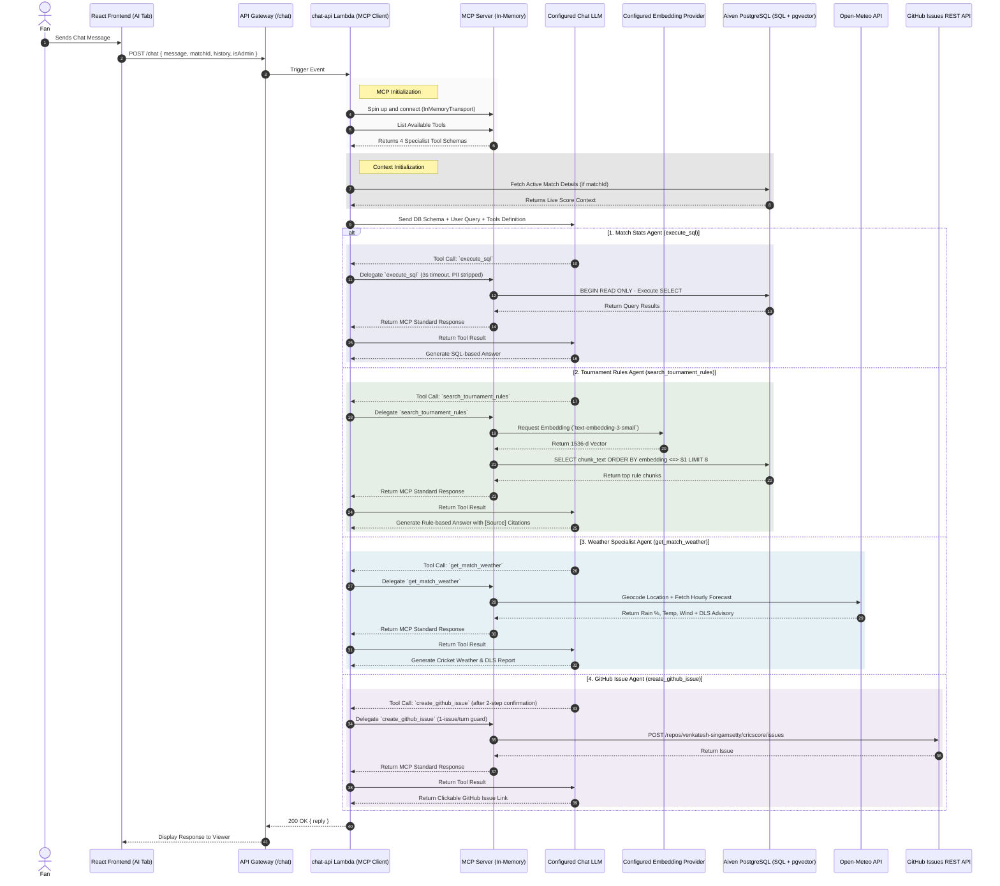
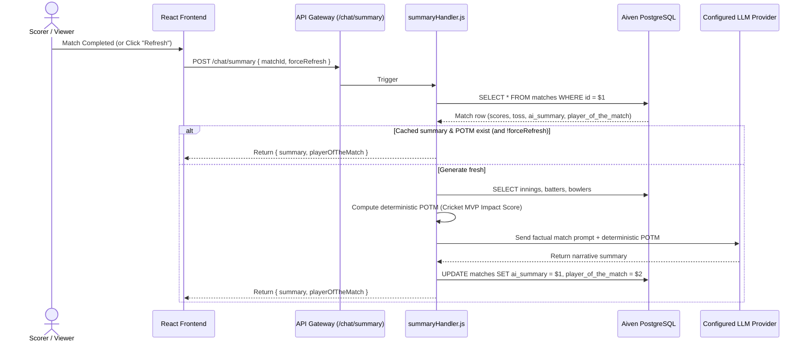

# 🤖 AI Architecture: Agentic RAG, MCP & Specialist Agents

CricScore integrates an **Agentic Retrieval-Augmented Generation (RAG)** and **Model Context Protocol (MCP)** platform that powers the interactive **AI Chat Assistant** and **Post-Match Summary Engine** while maintaining a **~$1/month** AWS footprint across `dev` and `prod`.

|   #   | Core AI Capability                          | MCP Tool / Endpoint       | Underlying Engine & Data Source                          | Dedicated Guide                                                                                            |
| :---: | :------------------------------------------ | :------------------------ | :------------------------------------------------------- | :--------------------------------------------------------------------------------------------------------- |
| **1** | **Text-to-SQL Match & Player Analytics**    | `execute_sql`             | Aiven PostgreSQL 16 (`BEGIN READ ONLY`, `3000ms` limit)  | [Section: Agentic Text-to-SQL](#️-how-agentic-text-to-sql-works)                                            |
| **2** | **Vector Semantic Rulebook Search**         | `search_tournament_rules` | `pgvector` (`1536-d` cosine similarity `<=>`, top `8`)   | [Section: Vector RAG](#-vector-rag-multi-document-pdf-tournament-rules)                                    |
| **3** | **Cricket Match Weather & DLS Advisor**     | `get_match_weather`       | Open-Meteo Geocoding + Forecast API (no API key needed)  | [**Weather Report Agent Guide**](./weather_report_agent.md)                                                |
| **4** | **GitHub Issue Reporter**                   | `create_github_issue`     | GitHub Issues REST API (`2-step` confirmation, `1/turn`) | [**GitHub Issue Agent Guide**](./github_issue_agent.md)                                                    |
| **5** | **Post-Match Summary & Deterministic POTM** | `POST /chat/summary`      | `computePlayerOfTheMatch` (MVP formula) + LLM narrative  | [Section: Post-Match Summary](#-ai-post-match-summary--deterministic-player-of-the-match-summaryhandlerjs) |

> 💡 **Have architectural questions?** Check out the [**Architecture & AI/MLOps FAQ**](./architecture_faq.md) covering the Agent Supervisor vs. LLM decision flow, the Cricket Context & Tactical Agent, S3 model registry vs. ECR, and full agent inventory.

---

## 🏗️ Architecture & Sequence Flow (`POST /chat`)

The AI Chat system runs in the `chat-api` Lambda (`Node.js 24`, `1024 MB`, `30s` timeout) behind Amazon API Gateway and connects an in-process MCP Client and Server over `InMemoryTransport`.



---

## 🌐 Model Context Protocol (MCP) Integration

CricScore uses the **Model Context Protocol (`@modelcontextprotocol/sdk`)** to separate LLM reasoning (the "Brain") from credentialed tool execution (the "Hands").

| Component                        | File Path                                               | Role & Security Boundary                                                                                                                                          |
| :------------------------------- | :------------------------------------------------------ | :---------------------------------------------------------------------------------------------------------------------------------------------------------------- |
| **MCP Client (Orchestrator)**    | `apps/backend/lambdas/chat-api/handlers/chatHandler.js` | Connects via `InMemoryTransport`, sanitizes chat history (last `10` `user`/`assistant` turns), strips `$schema`/`additionalProperties`, and enforces rate limits. |
| **MCP Server (Tool Registry)**   | `apps/backend/lambdas/chat-api/mcp/server.js`           | Encapsulates `DATABASE_URL` and `GITHUB_TOKEN`; registers `execute_sql`, `search_tournament_rules`, `get_match_weather`, and `create_github_issue`.               |
| **Python LangGraph MCP Service** | `apps/ai-service/cricscore_ai/mcp_server.py`            | Exposes the specialist tools over standard `stdio` JSON-RPC for external AI clients (Claude Desktop, Cursor) and LangGraph multi-agent orchestration.             |

---

## 📚 Vector RAG: Multi-Document PDF Tournament Rules

PostgreSQL's `pgvector` extension stores tournament rulebook embeddings inside the existing Aiven PostgreSQL instance, avoiding any separate paid vector database.

| Stage | Endpoint / Tool                   | Implementation File                                      | Operation Details                                                                                                                         |
| :---: | :-------------------------------- | :------------------------------------------------------- | :---------------------------------------------------------------------------------------------------------------------------------------- |
| **1** | `POST /rules/upload`              | `apps/backend/lambdas/chat-api/handlers/rulesHandler.js` | Admin-only (Cognito JWT + `requireAdmin()` check). Decodes base64 PDF via `pdf-parse` and splits on paragraph boundaries (`~1000` chars). |
| **2** | **Scoped Replacement**            | `apps/backend/lambdas/chat-api/handlers/rulesHandler.js` | Runs `DELETE FROM tournament_rules WHERE document_name = $1` inside a transaction before inserting updated chunks for that file.          |
| **3** | **Batch Embedding Generation**    | `apps/backend/lambdas/chat-api/config/llm.js`            | Sends all chunks in a single batched `fetch` request to `/embeddings` (`text-embedding-3-small`, `1536` dimensions).                      |
| **4** | **Vector Search (`<=>`)**         | `apps/backend/lambdas/chat-api/mcp/tools/searchRules.js` | Embeds the user query and executes `SELECT document_name, chunk_text ... ORDER BY embedding <=> $1 LIMIT 8` with HNSW index.              |
| **5** | **Citation & Proportional Rules** | `apps/backend/lambdas/chat-api/handlers/chatHandler.js`  | Mandates `[Source: document_name]` citations and scales 20-over powerplay rules proportionally for shortened matches (`N` overs).         |

---

## 🔑 LLM Configuration & Retrieval Parameters

| Setting / Variable        | Default Value                         | Purpose & Override Behavior                                                                        |
| :------------------------ | :------------------------------------ | :------------------------------------------------------------------------------------------------- |
| `LLM_BASE_URL`            | `https://api.openai.com/v1`           | OpenAI-compatible base endpoint (supports OpenAI, Groq, or compatible gateways).                   |
| `LLM_API_KEY`             | `sk-proj-...` (via `.env.local` / CI) | API key for chat completions and embeddings (`OPENAI_API_KEY` also supported as fallback).         |
| `LLM_MODEL`               | `gpt-4o-mini`                         | Default chat & tool-calling model (`llama-3.3-70b-versatile` if `LLM_BASE_URL` contains `groq`).   |
| `EMBEDDING_MODEL`         | `text-embedding-3-small`              | Produces `1536`-dimensional vectors for `tournament_rules.embedding`.                              |
| **Chunk Size**            | `~1,000` characters                   | Paragraph-boundary splitting during PDF ingestion.                                                 |
| **Top-K Retrieval**       | `8` chunks                            | Returned per `search_tournament_rules` cosine similarity search.                                   |
| **Completion Max Tokens** | `2,000` tokens                        | Per chat completion call (`temperature = 0.1` on initial routing, `0.5` on tool-result synthesis). |

```bash
# Configure LLM credentials in .env.local (never committed to Git)
cat << 'EOF' >> .env.local
LLM_API_KEY="sk-proj-your-key-here"
LLM_BASE_URL="https://api.openai.com/v1"
EOF
```

### 🧪 Curated Evaluation Prompts

|   #   | Category                        | Test Prompt                                                                                               | Expected Agent / Tool          |
| :---: | :------------------------------ | :-------------------------------------------------------------------------------------------------------- | :----------------------------- |
| **1** | **Rulebook (Extras)**           | _"If a batsman hits the ball onto their pad and takes a run, does it count as leg byes or batsman runs?"_ | `search_tournament_rules`      |
| **2** | **Match Stats (High Scores)**   | _"Which team scored the highest total in the tournament so far?"_                                         | `execute_sql`                  |
| **3** | **Knockout Tiebreakers**        | _"What happens if a semi-final match ends in a tie?"_                                                     | `search_tournament_rules`      |
| **4** | **Database Match Count**        | _"Show me all matches currently recorded in the database."_                                               | `execute_sql`                  |
| **5** | **Bowler Quota Scaling**        | _"What is the maximum number of overs a single bowler can bowl in a 20-over match?"_                      | `search_tournament_rules`      |
| **6** | **Live Weather & DLS**          | _"What is the weather forecast for the next 4 hours in Chicago, IL?"_                                     | `get_match_weather`            |
| **7** | **GitHub Bug / Feature Report** | _"I want to report a bug or request a new feature"_                                                       | `create_github_issue` (2-step) |

---

## ⚙️ How Agentic Text-to-SQL Works & Security Guardrails

Because `POST /chat` is open to fans and guests without a Cognito sign-in wall, `chat-api` enforces strict multi-layer security boundaries:

| Security Layer                         | Enforcement Location                                | Protection Mechanism                                                                                                                                              |
| :------------------------------------- | :-------------------------------------------------- | :---------------------------------------------------------------------------------------------------------------------------------------------------------------- |
| **Read-Only Chat (`isAdmin = false`)** | `handlers/chatHandler.js`                           | Client-supplied `isAdmin` flags are ignored (`const isAdmin = false`). Destructive tools (`delete_guest_data`, `delete_incomplete_matches`) are never registered. |
| **SQL AST / Keyword Validator**        | `mcp/tools/executeSql.js` (`validateReadOnlySql`)   | Enforces a single `SELECT` or `WITH` statement; rejects semicolons, write/DDL verbs (`DROP`, `DELETE`, `UPDATE`, `INSERT`, `ALTER`), and `pg_sleep`/`dblink`.     |
| **Read-Only DB Transaction & Timeout** | `mcp/tools/executeSql.js`                           | Wraps every query in `BEGIN READ ONLY;` with `SET LOCAL statement_timeout = 3000` (3 seconds) and `ROLLBACK;`.                                                    |
| **PII Column Redaction**               | `mcp/tools/executeSql.js` (`stripSensitiveColumns`) | Automatically strips `scorer_email`, `email`, and `user_email` from returned rows and truncates output at `25,000` chars (`MAX_ROWS = 100`).                      |
| **Schema Isolation (`search_path`)**   | `config/db.js` (`setSearchPath`)                    | Executes `SET search_path TO ${dbSchema}, public` so `dev`/`prod` tables stay isolated while `public.vector` (`<=>`) remains accessible.                          |
| **Admin JWT Guard on `/rules/*`**      | `infra/terraform/apigw.tf`, `config/auth.js`        | `POST /rules/upload`, `GET /rules`, and `DELETE /rules` require a valid Cognito JWT at API Gateway AND server-side `Admin` group / `ADMIN_REPORT_EMAIL` check.    |

---

## 📊 AI Post-Match Summary & Deterministic Player of the Match (`summaryHandler.js`)

The `POST /chat/summary` endpoint pairs an LLM-generated match narrative with a **100% deterministic Player of the Match (`computePlayerOfTheMatch`)** so the Scorer view, Viewer view, PostgreSQL database, SES emails, and S3 backups always agree.



### Deterministic Player of the Match Formula (`computePlayerOfTheMatch`)

| Dimension                    | Formula / Weighting in `summaryHandler.js`                                                                            | Purpose                                                                                    |
| :--------------------------- | :-------------------------------------------------------------------------------------------------------------------- | :----------------------------------------------------------------------------------------- |
| **Batting Impact**           | `runs * 1.0` + `(runs / maxTeamRuns) * 20.0` + `(4s * 1.5 + 6s * 2.5)` + Strike Rate bonus vs `matchRPO` (`[-4, +8]`) | Rewards high-volume run scoring, boundary hitting, and faster-than-par strike rates.       |
| **Not-Out & Chase Finisher** | `+2.0` if `isOut === false` and `runs >= 5`                                                                           | Rewards batters who carry their bat to finish an innings or chase.                         |
| **Bowling Impact**           | `wickets * max(12.0, maxTeamRuns * 0.32)` + `maidens * 4.0` + Economy bonus vs `matchRPO` (`[-5, +10]`)               | Scales wicket value to match scoring environment so low-scoring thrillers reward bowlers.  |
| **All-Rounder Synergy**      | `+4.0` when `batPts > 0` and `bowlPts > 0`                                                                            | Rewards dual batting and bowling contributions.                                            |
| **Winning-Team Multiplier**  | `impact = impact * 1.35 + 5.0` if candidate belongs to `winningTeamUpper`                                             | Strongly favors match-winners while still allowing extraordinary losing-side performances. |
| **Cache & Consistency**      | Persisted to `matches.ai_summary` and `matches.player_of_the_match`; returned immediately on `!forceRefresh`          | Guarantees Scorer and Viewer see the exact same summary and POTM.                          |

---

## 🛠️ Engineering Gotchas & Production Fixes (18 Case Studies)

|   #    | Issue Encountered                                      | Root Cause                                                                                | Production Fix Implemented                                                                                           |
| :----: | :----------------------------------------------------- | :---------------------------------------------------------------------------------------- | :------------------------------------------------------------------------------------------------------------------- |
| **1**  | **SQL Queries Returning 0 Rows**                       | `DB_SCHEMA` env var missing; queries hit empty `public` schema instead of `dev`/`prod`.   | Passed `DB_SCHEMA = var.environment` in `infra/terraform/lambda.tf`.                                                 |
| **2**  | **Over-Strict Context Refusal**                        | LLM refused general DB queries when `matchContext` was empty on the Hub screen.           | Added explicit system prompt rule: _"If no Active Match Context, query the database via `execute_sql`."_             |
| **3**  | **Case-Sensitive Status Hallucination**                | LLM generated `status = 'completed'` instead of uppercase `'COMPLETED'`.                  | Injected uppercase enum hints and mandated `ILIKE` for string comparisons.                                           |
| **4**  | **UTC Date Rollover on "Today" Queries**               | `CURRENT_DATE` rolled over to tomorrow in UTC during US evening games.                    | Guided LLM to use `created_at >= NOW() - INTERVAL '24 hours'` for recent matches.                                    |
| **5**  | **Off-Topic Token Abuse**                              | Users asking non-cricket coding/general questions.                                        | Enforced strict cricket-only persona guardrail in `chatHandler.js` and `router.py`.                                  |
| **6**  | **Lambda 3-Second Timeout on Tool Chains**             | Default 3s Lambda timeout expired during multi-step MCP + LLM tool loops.                 | Configured `timeout = 30` seconds and `memory_size = 1024` MB in `infra/terraform/lambda.tf`.                        |
| **7**  | **`pdf-parse` Crash (`DOMMatrix is not defined`)**     | `pdf.js` referenced browser canvas globals missing in Node.js Lambda runtime.             | Polyfilled `global.DOMMatrix`, `global.ImageData`, and `global.Path2D` at handler startup.                           |
| **8**  | **API Gateway 30s Timeout on PDF Uploads**             | Sequential embedding calls per chunk took `45s+` on multi-page PDFs.                      | Batched all PDF chunks into a single `/embeddings` request (`<3s` total).                                            |
| **9**  | **Embedding SDK Streaming Hang**                       | SDK hung silently in Lambda runtime during large batch requests.                          | Replaced SDK call with native Node.js `fetch` in `config/llm.js`.                                                    |
| **10** | **Lambda OOM Thrashing at 128 MB**                     | `pdf-parse` hit `127/128 MB`, causing V8 GC thrashing and 30s timeouts.                   | Increased `chat-api` memory to `1024 MB` (faster CPU allocation + ample heap).                                       |
| **11** | **OpenAI 400 Bad Request on MCP Schemas**              | MCP tool JSON schemas included `$schema` and `additionalProperties`.                      | Stripped `$schema` and `additionalProperties` before passing `tools` to chat completions.                            |
| **12** | **`pgvector` `<=>` Operator Not Found**                | `SET search_path TO dev` hid the `public` schema where `pgvector` registers `<=>`.        | Updated `setSearchPath()` to `SET search_path TO ${dbSchema}, public`.                                               |
| **13** | **LLM Skipping Rulebook Search for Generic Questions** | LLM answered from general ICC knowledge instead of calling `search_tournament_rules`.     | Added mandatory rule: _"NEVER answer a rulebook question from memory; always call `search_tournament_rules`."_       |
| **14** | **Toss Outcome Hallucination in Summaries**            | Summaries guessed toss winner from batting order before toss columns existed.             | Added `toss_winner` & `toss_decision` columns to `matches` and injected them verbatim into `summaryHandler.js`.      |
| **15** | **Decimal Over Notation (`"0.5 overs"`)**              | LLM misread `0.5 overs` as half an over instead of `5 balls`.                             | `formatOvers(overs, balls)` converts stored innings counts into plain English (`"5 balls"`, `"1 over and 2 balls"`). |
| **16** | **Match-Winning Ball Over-Flip Race**                  | UI transition to `COMPLETED` occurred before `0.5 -> 1.0` tick on `matches.team_b_overs`. | `summaryHandler.js` reads authoritative `innings.overs` and `innings.balls` directly.                                |
| **17** | **SQL Result Truncation at 2,000 Chars**               | `execute_sql` truncated JSON output at 2,000 chars, hiding older matches.                 | Increased `MAX_RESULT_CHARS` to `25,000` (`MAX_ROWS = 100`) in `executeSql.js`.                                      |
| **18** | **Summary Race Condition vs. SQS Buffer**              | Immediate summary call read pre-final-ball DB state while final ball was in SQS FIFO.     | Added 2.5s post-completion buffer + fallback to live client payload and deterministic POTM sync.                     |

---

## 🧠 Mapping AI Paradigms to CricScore

| Concept                              | General Definition                                                             | CricScore Implementation                                                                                                     |
| :----------------------------------- | :----------------------------------------------------------------------------- | :--------------------------------------------------------------------------------------------------------------------------- |
| **GenAI (Generative AI)**            | Models that synthesize new natural-language narratives from structured inputs. | `chatHandler.js` and `summaryHandler.js` turn raw ball-by-ball SQL rows and rulebook chunks into broadcast-style commentary. |
| **Structured RAG (Text-to-SQL)**     | Grounding LLM answers in live relational database queries.                     | `execute_sql` queries `matches`, `innings`, `players`, `bowlers`, and `ball_events` inside a read-only transaction.          |
| **Unstructured RAG (Vector Search)** | Grounding LLM answers in semantic embeddings of documents.                     | `search_tournament_rules` embeds queries into `1536-d` vectors and searches `tournament_rules` via `pgvector` `<=>`.         |
| **Agentic AI**                       | Autonomous tool selection and multi-step execution within guardrails.          | The supervisor routes between 6 specialist capabilities (SQL, Rules, Weather, GitHub Issues, Tactical Context, Win Predict). |
| **MCP (Model Context Protocol)**     | Open protocol separating LLM clients from credentialed tool servers.           | `mcp/server.js` (Node.js `InMemoryTransport`) and `mcp_server.py` (Python `stdio`) isolate DB and GitHub credentials.        |

---

## 🎨 AI Chat UX & Client Features (`ChatComponent.tsx`)

| UX Feature                     | Implementation Detail                                                                                                |
| :----------------------------- | :------------------------------------------------------------------------------------------------------------------- |
| **Persistent Local Memory**    | Syncs conversation history to `localStorage` (`cricscore-chat-memory`) so page refreshes preserve context.           |
| **One-Click `[+] New Chat`**   | Clears local chat memory and resets the conversation window instantly.                                               |
| **Context-Aware Prompt Chips** | Surfaces 7 tailored quick-action chips (stats, rules, weather report, GitHub bug/feature report).                    |
| **Clickable Markdown & Links** | Renders Markdown tables, rulebook citations, and clickable GitHub Issue URLs (`target="_blank"`).                    |
| **Web Speech API Voice (TTS)** | Includes a `Voice On/Off` toggle with a silent mobile Safari/iOS audio-context unlock utterance on user interaction. |

---

## 🚀 MLOps & Hybrid Win Predictor Integration

> 📖 See the [**Serverless MLOps Tutorial**](./mlops_tutorial.md) and [**ML Models Handbook**](./ml_models_handbook.md) for the full 8-model benchmark, Markov DP math, and DLS resource tables.

| Aspect                     | Production Specification                                                                                                                                                  |
| :------------------------- | :------------------------------------------------------------------------------------------------------------------------------------------------------------------------ |
| **Champion ML Model**      | **XGBoost (`v2.2.0`)** — Validation `ROC-AUC = 0.7723`, Held-out Test `ROC-AUC = 0.7529`, Validation `Log Loss = 0.5786`, `Brier Score = 0.1992`.                         |
| **S3 Model Registry**      | Versioned artifacts (`live_win_predictor_model.joblib` `~227 KB`, `model_manifest.json`) stored in `s3://<match-backups>/models/v2.2.0/` with SHA-256 verification.       |
| **ECR Container Runtime**  | `cricscore-ml-predict` (`xgboost-cpu`, **`~309 MB`** compressed), tagged `:${var.ml_model_version}` only with **`countNumber = 1`** single-image retention (`~$0.03/mo`). |
| **Hybrid Inference Blend** | Combines format-agnostic **Ball-by-Ball Markov DP** (`win_probability.py`), **DLS Par differential**, and **XGBoost `v2.2.0`** (up to `50%` weight in 10–20 over games).  |
| **Boundary Heuristics**    | Enforces `50% / 50%` at `0/0` (Ball `0.0`), `100% / 0%` when target is reached, `0% / 100%` when `runsNeeded > ballsLeft * 6 + 1`, and `[1%, 99%]` live clamping.         |

---

## 🧪 Verification Commands

```bash
# 1. Run all chat-api MCP tool, summaryHandler, and auth unit tests
npm --prefix apps/backend test -- --run

# 2. Run Python LangGraph multi-agent & evaluation suite
./apps/ai-service/.venv/bin/pytest apps/ai-service -q

# 3. Run Frontend ChatComponent unit tests
npm --prefix apps/frontend test -- --run src/test/ChatComponent.test.tsx
```
