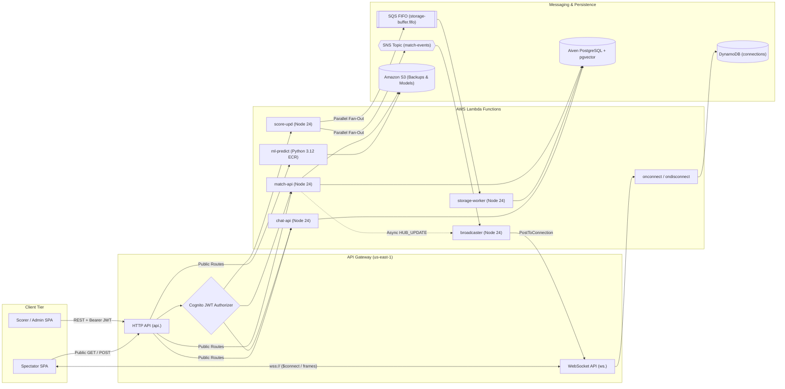

# 🛰️ API & WebSocket Reference

CricScore exposes a regional **Amazon API Gateway HTTP API** (`https://api.<domain>`) for REST operations and an **Amazon API Gateway WebSocket API** (`wss://ws.<domain>`) for real-time spectator score broadcasts.

---

## 🔄 1. Request & Real-Time Event Flow



---

## 🚦 2. HTTP API Routes (`infra/terraform/apigateway_http.tf`)

**Base URL & Rate Limits**:

- **Dev Base URL**: `https://api.cricscoredev.venkateshsingamsetty.com`
- **Prod Base URL**: `https://api.cricscore.venkateshsingamsetty.com`
- **Default Stage Throttling**: `50 req/s` (`100` burst)
- **LLM Route Throttling (`POST /chat`, `POST /chat/summary`)**: `5 req/s` (`10` burst)

### Match & Scoring Endpoints

| Method   | Route                      | Auth (API GW + Lambda)         | Lambda Handler | Description                                                                                                                               |
| :------- | :------------------------- | :----------------------------- | :------------- | :---------------------------------------------------------------------------------------------------------------------------------------- |
| `GET`    | `/health`                  | `NONE`                         | `match-api`    | • Executes `SELECT 1 AS ok` on PostgreSQL<br/>• Returns `200` (`healthy`) or `503` (`unhealthy`)                                          |
| `GET`    | `/matches`                 | `NONE`                         | `match-api`    | • Lists all matches with innings scores, toss details, and `is_test` flags                                                                |
| `POST`   | `/match`                   | `JWT` (Scorer / Guest / Admin) | `match-api`    | • Creates match + Innings 1<br/>• Bulk-inserts batting/bowling squads<br/>• Broadcasts `HUB_UPDATE` via `broadcaster`                     |
| `GET`    | `/match/{matchId}`         | `NONE`                         | `match-api`    | • Fetches match header row by UUID                                                                                                        |
| `GET`    | `/match/{matchId}/details` | `NONE`                         | `match-api`    | • Deep-link restoration snapshot<br/>• Returns match header, ordered innings, players (`ORDER BY batting_position ASC`), bowlers, & balls |
| `PATCH`  | `/match/{matchId}`         | `JWT` + Owner/Admin            | `match-api`    | • Updates overs, status (`COMPLETED`/`ABANDONED`), toss, or squads<br/>• Triggers S3 JSON backup on match completion                      |
| `DELETE` | `/match/{matchId}`         | `JWT` + Owner/Admin            | `match-api`    | • Deletes match (`ON DELETE CASCADE` removes innings/players/bowlers/balls)<br/>• Broadcasts `HUB_UPDATE`                                 |
| `POST`   | `/match/{matchId}/innings` | `JWT` + Owner/Admin            | `match-api`    | • Initializes or upserts 2nd innings and squads<br/>• Sets target score and broadcasts `HUB_UPDATE`                                       |
| `POST`   | `/match/{matchId}/email`   | `JWT` + Owner/Admin            | `match-api`    | • Formats HTML scorecard report<br/>• Dispatches email via Amazon SES                                                                     |
| `POST`   | `/update-score`            | `JWT` + Owner/Admin            | `score-upd`    | • Publishes live ball/sync event in parallel to SNS (`match-events`) and SQS FIFO (`storage-buffer.fifo`)                                 |

### AI, RAG Rulebooks & ML Inference Endpoints

| Method   | Route            | Auth (API GW + Lambda) | Lambda Handler | Description                                                                                                                       |
| :------- | :--------------- | :--------------------- | :------------- | :-------------------------------------------------------------------------------------------------------------------------------- |
| `POST`   | `/match/predict` | `NONE`                 | `ml-predict`   | • Hybrid win-probability inference<br/>• Combines XGBoost `v2.2.0` + Markov DP + DLS par calculator                               |
| `POST`   | `/chat`          | `NONE` (`5 rps` cap)   | `chat-api`     | • Read-only Agentic AI Chat<br/>• Executes MCP tools: `execute_sql`, `search_rules`, `get_match_weather`, `create_github_issue`   |
| `POST`   | `/chat/summary`  | `NONE` (`5 rps` cap)   | `chat-api`     | • Generates or returns cached plain-English AI match summary<br/>• Uses deterministic Player of the Match (POTM) points breakdown |
| `GET`    | `/rules`         | `JWT` + `requireAdmin` | `chat-api`     | • Lists ingested tournament PDF rulebooks and chunk counts from `pgvector`                                                        |
| `POST`   | `/rules/upload`  | `JWT` + `requireAdmin` | `chat-api`     | • Parses uploaded PDF and chunks text<br/>• Embeds via `text-embedding-3-small` and stores vectors in PostgreSQL                  |
| `DELETE` | `/rules`         | `JWT` + `requireAdmin` | `chat-api`     | • Deletes a tournament rulebook and its embeddings from PostgreSQL                                                                |

### Admin & Database Maintenance Endpoints

| Method   | Route                       | Auth (API GW + Lambda)  | Lambda Handler | Description                                                                                              |
| :------- | :-------------------------- | :---------------------- | :------------- | :------------------------------------------------------------------------------------------------------- |
| `DELETE` | `/matches`                  | `JWT` + `isAdminClaims` | `match-api`    | • Full database purge (`TRUNCATE ... RESTART IDENTITY CASCADE`)<br/>• Broadcasts `HUB_UPDATE` to viewers |
| `GET`    | `/admin/users`              | `JWT` + `isAdminClaims` | `match-api`    | • Lists Cognito User Pool users with `isAdmin` and `isScorer` group flags                                |
| `DELETE` | `/admin/users`              | `JWT` + `isAdminClaims` | `match-api`    | • Permanently deletes a Cognito user<br/>• Blocks self-deletion and root admin deletion                  |
| `POST`   | `/admin/users/roles`        | `JWT` + `isAdminClaims` | `match-api`    | • Promotes a user to `Admin` or `Scorer` Cognito group                                                   |
| `DELETE` | `/admin/users/roles`        | `JWT` + `isAdminClaims` | `match-api`    | • Removes a user from `Admin` or `Scorer` Cognito group                                                  |
| `DELETE` | `/admin/users/guests`       | `JWT` + `isAdminClaims` | `match-api`    | • Bulk-deletes `guest-*` shadow users from Cognito User Pool                                             |
| `DELETE` | `/admin/matches/guests`     | `JWT` + `isAdminClaims` | `match-api`    | • Deletes all matches scored by `guest-*` accounts                                                       |
| `DELETE` | `/admin/matches/incomplete` | `JWT` + `isAdminClaims` | `match-api`    | • Deletes matches where `status NOT IN ('COMPLETED', 'ABANDONED')`                                       |
| `DELETE` | `/admin/matches/test`       | `JWT` + `isAdminClaims` | `match-api`    | • Deletes automated/practice matches (`is_test = TRUE` or test team/email patterns)                      |

---

## 🌐 3. WebSocket API & Broadcast Protocol (`infra/terraform/apigateway_websocket.tf`)

**WebSocket Endpoints**:

- **Dev**: `wss://ws.cricscoredev.venkateshsingamsetty.com`
- **Prod**: `wss://ws.cricscore.venkateshsingamsetty.com`

| Route / Event Type      | Handler / Source                                          | DynamoDB / API Action                                                                          | Payload / Frame Format                                                                               |
| :---------------------- | :-------------------------------------------------------- | :--------------------------------------------------------------------------------------------- | :--------------------------------------------------------------------------------------------------- |
| **`$connect`**          | `onconnect`                                               | • `PutItem` (`connectionId`) in `<project>-connections`                                        | • Handshake upgrade (`HTTP 101 Switching Protocols`)                                                 |
| **`$disconnect`**       | `ondisconnect`                                            | • `DeleteItem` (`connectionId`) in `<project>-connections`                                     | • Automatic cleanup on tab close or disconnect                                                       |
| **`LIVE_SCORE_UPDATE`** | `score-upd` $\rightarrow$ SNS $\rightarrow$ `broadcaster` | • Scans `connections` table<br/>• Sends `PostToConnectionCommand` & prunes stale `410` sockets | `{ "matchId": "<uuid>", "inningId": "<uuid>", "type": "LIVE_SCORE_UPDATE", "ballData": { ... } }`    |
| **`STATE_SYNC`**        | `score-upd` $\rightarrow$ SNS $\rightarrow$ `broadcaster` | • Pushes bowler/batter selection<br/>• Broadcasts `undo: true` state rollback                  | `{ "matchId": "<uuid>", "type": "STATE_SYNC", "syncOnly": true, "ballData": { "undo": true, ... } }` |
| **`HUB_UPDATE`**        | `match-api` $\rightarrow$ `broadcaster`                   | • Direct async Lambda invocation when match is created, deleted, or switches innings           | `{ "matchId": "<uuid>", "type": "HUB_UPDATE", "syncOnly": true, "timestamp": "..." }`                |

---

## 🧪 4. Runnable CLI Test Commands

Set your target API base URL before running the commands below:

```bash
export API_URL="https://api.cricscoredev.venkateshsingamsetty.com"
export WS_URL="wss://ws.cricscoredev.venkateshsingamsetty.com"
```

### Public Endpoint Checks (`curl`)

```bash
# 1. Database & API Health Check
curl -s "${API_URL}/health" | jq .

# 2. List Matches
curl -s "${API_URL}/matches" | jq '.[0:2]'

# 3. Fetch Full Match Details (replace <MATCH_ID>)
curl -s "${API_URL}/match/<MATCH_ID>/details" | jq '.match'

# 4. Run Hybrid ML Win-Probability Prediction
curl -s -X POST "${API_URL}/match/predict" \
  -H "Content-Type: application/json" \
  -d '{
    "inningNumber": 2,
    "totalRuns": 85,
    "totalWickets": 3,
    "overs": 10,
    "balls": 0,
    "totalOvers": 20,
    "target": 165
  }' | jq .

# 5. Query Read-Only AI Chat
curl -s -X POST "${API_URL}/chat" \
  -H "Content-Type: application/json" \
  -d '{"message": "What are the recent completed matches?"}' | jq .
```

### Authenticated Endpoint Checks (`curl` with Cognito JWT)

```bash
# Export a valid Cognito ID token from your browser session or Amplify CLI
export JWT_TOKEN="<YOUR_COGNITO_ID_TOKEN>"

# 1. Create a New Match (marked as test fixture)
curl -s -X POST "${API_URL}/match" \
  -H "Authorization: Bearer ${JWT_TOKEN}" \
  -H "Content-Type: application/json" \
  -d '{
    "teamA": "TEST ALPHA",
    "teamB": "TEST BRAVO",
    "totalOvers": 2,
    "batFirstTeam": "TEST ALPHA",
    "tossWinner": "TEST ALPHA",
    "tossDecision": "BAT",
    "teamASquad": ["Batter 1", "Batter 2"],
    "teamBSquad": ["Bowler 1", "Bowler 2"],
    "isTest": true
  }' | jq .

# 2. Publish a Ball Score Event
curl -s -X POST "${API_URL}/update-score" \
  -H "Authorization: Bearer ${JWT_TOKEN}" \
  -H "Content-Type: application/json" \
  -d '{
    "matchId": "<MATCH_ID>",
    "inningId": "<INNING_ID>",
    "ballData": {
      "overNumber": 0,
      "ballNumber": 1,
      "batsmanName": "Batter 1",
      "nonStrikerName": "Batter 2",
      "bowlerName": "Bowler 1",
      "runs": 4,
      "isWicket": false,
      "totalRuns": 4,
      "totalWickets": 0,
      "totalOvers": 0,
      "totalBalls": 1
    }
  }' | jq .

# 3. Clean Up Test Matches (Admin JWT Required)
curl -s -X DELETE "${API_URL}/admin/matches/test" \
  -H "Authorization: Bearer ${JWT_TOKEN}" | jq .
```

### Live WebSocket Stream Test (`npx wscat`)

```bash
# Connect as a spectator to inspect real-time LIVE_SCORE_UPDATE and HUB_UPDATE frames
npx -y wscat -c "${WS_URL}"
```
