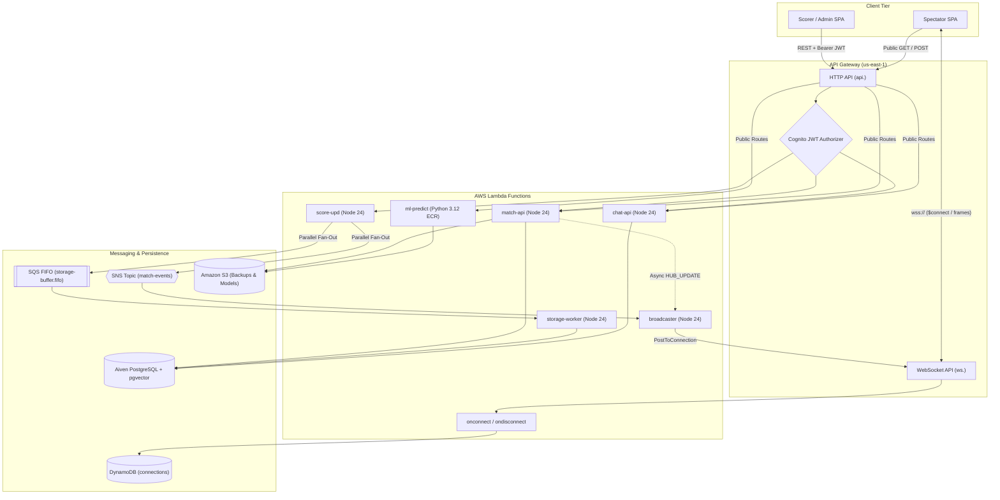

# 🛰️ API & WebSocket Reference

CricScore exposes a regional **Amazon API Gateway HTTP API** (`https://api.<domain>`) for REST operations and an **Amazon API Gateway WebSocket API** (`wss://ws.<domain>`) for real-time spectator score broadcasts.

---

## 🔄 1. Request & Real-Time Event Flow



---

## 🚦 2. HTTP API Routes (`infra/terraform/apigateway_http.tf`)

**Base URL & Rate Limits**:

- **Dev Base URL**: `https://api.cricscoredev.venkateshsingamsetty.com`
- **Prod Base URL**: `https://api.cricscore.venkateshsingamsetty.com`
- **Default Stage Throttling**: `50 req/s` (`100` burst)
- **LLM Route Throttling (`POST /chat`, `POST /chat/summary`)**: `5 req/s` (`10` burst)

### Match & Scoring Endpoints

| Method   | Route                      | Auth        | Purpose                                     |
| :------- | :------------------------- | :---------- | :------------------------------------------ |
| `GET`    | `/health`                  | `NONE`      | PostgreSQL probe (`200` or `503`)           |
| `GET`    | `/matches`                 | `NONE`      | List matches with scores & toss info        |
| `POST`   | `/match`                   | `JWT`       | Create match, Innings 1, & squads           |
| `GET`    | `/match/{matchId}`         | `NONE`      | Fetch match header by UUID                  |
| `GET`    | `/match/{matchId}/details` | `NONE`      | Full deep-link match restoration snapshot   |
| `PATCH`  | `/match/{matchId}`         | `JWT` Owner | Update match state & trigger S3 JSON backup |
| `DELETE` | `/match/{matchId}`         | `JWT` Owner | Cascade-delete match & broadcast update     |
| `POST`   | `/match/{matchId}/innings` | `JWT` Owner | Initialize or upsert 2nd innings & target   |
| `POST`   | `/match/{matchId}/email`   | `JWT` Owner | Dispatch HTML scorecard via Amazon SES      |
| `POST`   | `/update-score`            | `JWT` Owner | Fan out live ball event to SNS + SQS FIFO   |

- **Key Match & Scoring Behavior (`match-api` & `score-upd`):**
  - `GET /match/{matchId}/details` returns the match header, ordered innings, players (`ORDER BY batting_position ASC`), bowlers, and delivery history.
  - `POST /match`, `DELETE /match/{matchId}`, and `POST /match/{matchId}/innings` trigger an asynchronous `HUB_UPDATE` broadcast via `broadcaster`.
  - `POST /update-score` publishes each ball or sync event in parallel to SNS (`match-events`) and SQS FIFO (`storage-buffer.fifo`).

### AI, RAG Rulebooks & ML Inference Endpoints

| Method   | Route            | Auth          | Purpose                                   |
| :------- | :--------------- | :------------ | :---------------------------------------- |
| `POST`   | `/match/predict` | `NONE`        | Hybrid XGBoost `v2.2.0` + Markov + DLS    |
| `POST`   | `/chat`          | `NONE` (5rps) | Read-only Agentic AI Chat & MCP tools     |
| `POST`   | `/chat/summary`  | `NONE` (5rps) | Cached AI match summary + POTM breakdown  |
| `GET`    | `/rules`         | `JWT` Admin   | List ingested PDF rulebooks in `pgvector` |
| `POST`   | `/rules/upload`  | `JWT` Admin   | Chunk & embed PDF rulebook into Postgres  |
| `DELETE` | `/rules`         | `JWT` Admin   | Delete rulebook & embeddings from DB      |

- **AI, RAG & ML Implementation Details (`ml-predict` & `chat-api`):**
  - `POST /match/predict` blends **XGBoost `v2.2.0`** live inference with Markov DP expected runs and the Duckworth-Lewis-Stern (DLS) par calculator.
  - `POST /chat` executes read-only MCP tools (`execute_sql`, `search_rules`, `get_match_weather`, `create_github_issue`) under a `5 req/s` rate cap.
  - `POST /chat/summary` injects a deterministic Player of the Match (POTM) points breakdown before generating or returning cached commentary.
  - `POST /rules/upload` chunks uploaded PDFs and generates `text-embedding-3-small` vectors stored in PostgreSQL `pgvector`.

### Admin & Database Maintenance Endpoints

| Method   | Route                       | Auth        | Purpose                                  |
| :------- | :-------------------------- | :---------- | :--------------------------------------- |
| `DELETE` | `/matches`                  | `JWT` Admin | Full DB `TRUNCATE ... CASCADE` purge     |
| `GET`    | `/admin/users`              | `JWT` Admin | List Cognito users & role flags          |
| `DELETE` | `/admin/users`              | `JWT` Admin | Delete Cognito user (blocks self/root)   |
| `POST`   | `/admin/users/roles`        | `JWT` Admin | Add user to `Admin` or `Scorer` group    |
| `DELETE` | `/admin/users/roles`        | `JWT` Admin | Remove user from `Admin` or `Scorer`     |
| `DELETE` | `/admin/users/guests`       | `JWT` Admin | Bulk-delete `guest-*` Cognito users      |
| `DELETE` | `/admin/matches/guests`     | `JWT` Admin | Delete matches scored by `guest-*` users |
| `DELETE` | `/admin/matches/incomplete` | `JWT` Admin | Delete non-`COMPLETED`/`ABANDONED` games |
| `DELETE` | `/admin/matches/test`       | `JWT` Admin | Delete E2E/practice (`is_test`) fixtures |

---

## 🌐 3. WebSocket API & Broadcast Protocol (`infra/terraform/apigateway_websocket.tf`)

**WebSocket Endpoints**:

- **Dev**: `wss://ws.cricscoredev.venkateshsingamsetty.com`
- **Prod**: `wss://ws.cricscore.venkateshsingamsetty.com`

### WebSocket Lifecycle & Frame Types

- **`$connect` (`onconnect` Lambda):**
  - Upgrades connection (`HTTP 101 Switching Protocols`) and executes `PutItem` (`connectionId`) in the `<project>-connections` DynamoDB table.
- **`$disconnect` (`ondisconnect` Lambda):**
  - Executes `DeleteItem` (`connectionId`) in `<project>-connections` on tab close or disconnect.
- **`LIVE_SCORE_UPDATE` (`score-upd` $\rightarrow$ SNS $\rightarrow$ `broadcaster`):**
  - Scans active `connections`, sends `PostToConnectionCommand`, and automatically prunes stale `410 GoneException` sockets.
  - Frame payload: `{ "matchId": "<uuid>", "inningId": "<uuid>", "type": "LIVE_SCORE_UPDATE", "ballData": { ... } }`.
- **`STATE_SYNC` (`score-upd` $\rightarrow$ SNS $\rightarrow$ `broadcaster`):**
  - Pushes striker/non-striker/bowler selection updates and broadcasts `undo: true` delivery rollbacks.
  - Frame payload: `{ "matchId": "<uuid>", "type": "STATE_SYNC", "syncOnly": true, "ballData": { "undo": true, ... } }`.
- **`HUB_UPDATE` (`match-api` $\rightarrow$ `broadcaster`):**
  - Direct asynchronous Lambda invocation when a match is created, deleted, or switches innings.
  - Frame payload: `{ "matchId": "<uuid>", "type": "HUB_UPDATE", "syncOnly": true, "timestamp": "..." }`.

---

## 🧪 4. Runnable CLI Test Commands

Set your target API base URL before running the commands below:

```bash
export API_URL="https://api.cricscoredev.venkateshsingamsetty.com"
export WS_URL="wss://ws.cricscoredev.venkateshsingamsetty.com"
```

### Public Endpoint Checks (`curl`)

```bash
# 1. Database & API Health Check
curl -s "${API_URL}/health" | jq .

# 2. List Matches
curl -s "${API_URL}/matches" | jq '.[0:2]'

# 3. Fetch Full Match Details (replace <MATCH_ID>)
curl -s "${API_URL}/match/<MATCH_ID>/details" | jq '.match'

# 4. Run Hybrid ML Win-Probability Prediction
curl -s -X POST "${API_URL}/match/predict" \
  -H "Content-Type: application/json" \
  -d '{
    "inningNumber": 2,
    "totalRuns": 85,
    "totalWickets": 3,
    "overs": 10,
    "balls": 0,
    "totalOvers": 20,
    "target": 165
  }' | jq .

# 5. Query Read-Only AI Chat
curl -s -X POST "${API_URL}/chat" \
  -H "Content-Type: application/json" \
  -d '{"message": "What are the recent completed matches?"}' | jq .
```

### Authenticated Endpoint Checks (`curl` with Cognito JWT)

```bash
# Export a valid Cognito ID token from your browser session or Amplify CLI
export JWT_TOKEN="<YOUR_COGNITO_ID_TOKEN>"

# 1. Create a New Match (marked as test fixture)
curl -s -X POST "${API_URL}/match" \
  -H "Authorization: Bearer ${JWT_TOKEN}" \
  -H "Content-Type: application/json" \
  -d '{
    "teamA": "TEST ALPHA",
    "teamB": "TEST BRAVO",
    "totalOvers": 2,
    "batFirstTeam": "TEST ALPHA",
    "tossWinner": "TEST ALPHA",
    "tossDecision": "BAT",
    "teamASquad": ["Batter 1", "Batter 2"],
    "teamBSquad": ["Bowler 1", "Bowler 2"],
    "isTest": true
  }' | jq .

# 2. Publish a Ball Score Event
curl -s -X POST "${API_URL}/update-score" \
  -H "Authorization: Bearer ${JWT_TOKEN}" \
  -H "Content-Type: application/json" \
  -d '{
    "matchId": "<MATCH_ID>",
    "inningId": "<INNING_ID>",
    "ballData": {
      "overNumber": 0,
      "ballNumber": 1,
      "batsmanName": "Batter 1",
      "nonStrikerName": "Batter 2",
      "bowlerName": "Bowler 1",
      "runs": 4,
      "isWicket": false,
      "totalRuns": 4,
      "totalWickets": 0,
      "totalOvers": 0,
      "totalBalls": 1
    }
  }' | jq .

# 3. Clean Up Test Matches (Admin JWT Required)
curl -s -X DELETE "${API_URL}/admin/matches/test" \
  -H "Authorization: Bearer ${JWT_TOKEN}" | jq .
```

### Live WebSocket Stream Test (`npx wscat`)

```bash
# Connect as a spectator to inspect real-time LIVE_SCORE_UPDATE and HUB_UPDATE frames
npx -y wscat -c "${WS_URL}"
```
