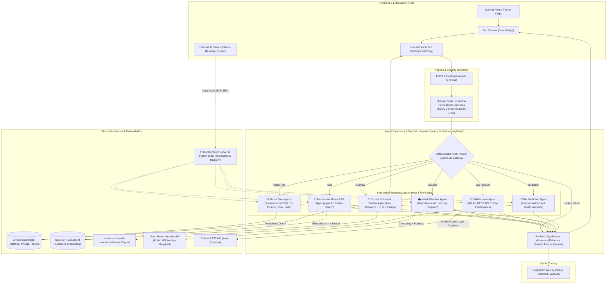
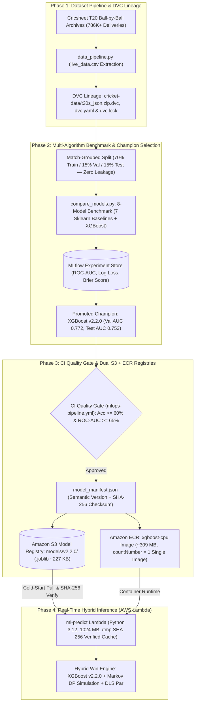
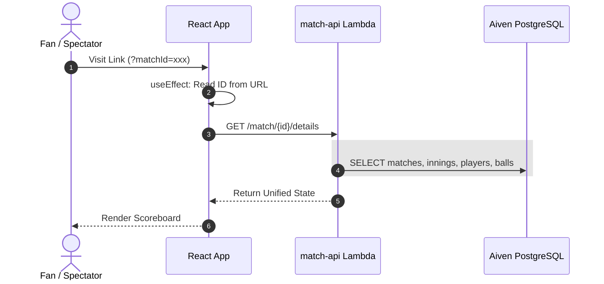
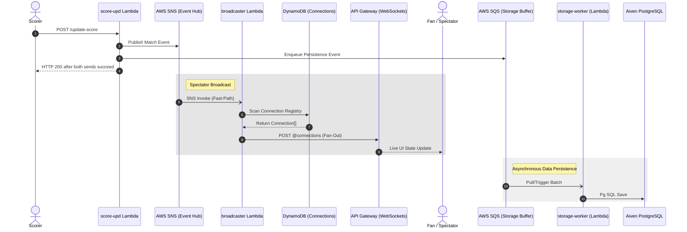

# 🏗️ Architecture: Live Event-Driven Scoring Engine

CricScore is built on a high-concurrency, **Event-Driven Architecture (EDA)** where every ball event is a persistent record in **Aiven PostgreSQL** and a real-time broadcast via **AWS API Gateway WebSockets**, operating at **~$1/month** across `dev` and `prod` combined.

## 🧭 Quick Navigation

- [🗺️ System Diagrams (Mermaid)](#-system-diagrams-mermaid)
  - [☁️ 1. Multi-Cloud System Architecture: AWS Serverless & Aiven PostgreSQL](#️-1-multi-cloud-system-architecture-aws-serverless--aiven-postgresql)
  - [🤖 2. Agentic AI, MCP & Specialist Multi-Agent Architecture](#-2-agentic-ai-mcp--specialist-multi-agent-architecture)
  - [🧠 3. Serverless MLOps & Hybrid Win Prediction Architecture](#-3-serverless-mlops--hybrid-win-prediction-architecture)
- [🔄 Detailed Sequence Flows (Fan-Out)](#-detailed-sequence-flows-fan-out)
- [🏛️ Technical Pillars & Specifications](#️-technical-pillars--specifications)
- [🔐 Authentication & Role Model](#-authentication--role-model)
- [🧩 Platform Component Breakdown](#-platform-component-breakdown)
- [🛠️ Quick Verification Commands](#️-quick-verification-commands)

---

## 🗺️ System Diagrams (Mermaid)

Editable, text-based versions of the platform diagrams. The icon-based PNG/SVG diagrams shown in the main [README](../README.md) are generated via [`docs/diagrams/generate_architecture_diagrams.py`](./diagrams/generate_architecture_diagrams.py).

```bash
# Regenerate all 3 high-resolution architecture diagrams (PNG + SVG)
python3 docs/diagrams/generate_architecture_diagrams.py
```

### ☁️ 1. Multi-Cloud System Architecture: AWS Serverless & Aiven PostgreSQL

The core application platform leverages a serverless, event-driven multi-cloud design separating high-speed real-time ingestion from relational persistence.

```mermaid
flowchart TD
    %% User and CDN Layer
    Client["Fan / Scorer / Admin (React 19 SPA)"] --> Route53["Amazon Route 53 (DNS)"]
    Route53 --> ACM["AWS Certificate Manager (TLS Certs)"]
    ACM --> CloudFront["Amazon CloudFront (CDN + OAC)"]
    ACM --> APIGW_HTTP["Amazon API Gateway (HTTP REST API)"]
    ACM --> APIGW_WS["Amazon API Gateway (WebSocket API)"]

    subgraph Edge ["1. DNS, SSL & CDN Edge"]
        CloudFront --> S3_App["Amazon S3: Static React SPA & Access Logs (7d/30d Lifecycle)"]
    end

    %% Security & Ingress
    subgraph Security ["2. Auth (AWS Amplify + Cognito) & IAM"]
        Amplify["AWS Amplify Auth SDK & UI"]
        Cognito["AWS Cognito User Pool (JWT + RBAC)"]
        PreSignup["cognito-presignup Lambda (Guest Auto-Confirm)"]
        IAM["AWS IAM (Least-Privilege Roles)"]
        Client --> Amplify --> Cognito --> PreSignup
        Cognito -.->|JWT Authorizer| APIGW_HTTP
    end

    %% Backend Compute
    subgraph Compute ["3. AWS Lambda Serverless Compute"]
        MatchAPI["match-api Lambda (Node.js 24)"]
        ScoreUpdate["score-update Lambda (Node.js 24)"]
        StorageWorker["storage-worker Lambda (Node.js 24)"]
        Broadcaster["broadcaster Lambda (Node.js 24)"]
        ConnHandlers["onconnect / ondisconnect Lambdas"]
        ChatAPI["chat-api Lambda (Node.js 24 + In-Memory MCP)"]
        MLPredict["ml-predict Lambda (Python 3.12 Container)"]
    end

    %% Asynchronous Fan-Out
    subgraph Messaging ["Event-Driven Fan-Out Ingestion (Diagram 2)"]
        SNS_Score{{"Amazon SNS: match-events"}}
        SQS_Queue[["Amazon SQS FIFO: storage-buffer.fifo"]]
        DDB[("Amazon DynamoDB: WebSocket Connections")]
    end

    %% Multi-Cloud Persistence & Registries
    subgraph DataLayer ["4. Data, Registries & Email"]
        AivenPG[("Aiven PostgreSQL 16 + pgvector (dev / prod schemas)")]
        SES["Amazon SES (Scorecard Emails)"]
        S3_Backups[("Amazon S3: Match Backups (180d), ML Model Registry & TF State")]
        ECR["Amazon ECR: xgboost-cpu Image (~309 MB, 1-Image Retention)"]
    end

    %% External & Observability Services
    subgraph Operations ["5. Observability, Tracing, Cost & External APIs"]
        CloudWatch["CloudWatch Logs (7d Retention) & Alarms + SNS"]
        XRay["AWS X-Ray (5% Trace Sampling)"]
        Budgets["AWS Budgets (~$1/mo Alert)"]
        OpenAI["OpenAI-Compatible LLM & Embeddings"]
        OpenMeteo["Open-Meteo Weather API"]
        GitHubAPI["GitHub Issues REST API"]
    end

    %% Wire connections
    APIGW_HTTP -->|/match & /admin| MatchAPI
    APIGW_HTTP -->|POST /update-score| ScoreUpdate
    APIGW_HTTP -->|POST /chat & /chat/summary| ChatAPI
    APIGW_HTTP -->|POST /match/predict| MLPredict
    APIGW_WS -->|$connect / $disconnect| ConnHandlers
    ConnHandlers --> DDB

    ScoreUpdate -->|Fast Path Broadcast| SNS_Score
    ScoreUpdate -->|Ordered Persistence| SQS_Queue
    SNS_Score --> Broadcaster
    MatchAPI -->|Direct Invoke: HUB_UPDATE| Broadcaster
    Broadcaster --> DDB
    Broadcaster -->|Push Live Frames| APIGW_WS
    SQS_Queue --> StorageWorker

    MatchAPI --> AivenPG
    StorageWorker -->|Transactional Ball Writes| AivenPG
    MatchAPI --> SES
    MatchAPI --> S3_Backups

    ECR -->|Container Runtime| MLPredict
    S3_Backups -->|Versioned Model v2.2.0| MLPredict

    ChatAPI -->|Read-Only SQL & pgvector RAG| AivenPG
    ChatAPI -.-> OpenAI
    ChatAPI -.-> OpenMeteo
    ChatAPI -.-> GitHubAPI
```



---

### 🤖 2. Agentic AI, MCP & Specialist Multi-Agent Architecture

CricScore implements a modular Agentic AI platform built on **Model Context Protocol (MCP)**, **LangGraph**, and **LangChain** with strict read-only security boundaries and domain-bounded specialist agents:



#### Complete Specialist Agent & Tool Inventory

- **1. 📊 Match Stats Agent (`execute_sql`):**
  - **Source & Tech:** Aiven PostgreSQL 16.
  - **Key Guardrails:** Strict read-only `SELECT` enforcement, blocks write/DDL keywords (`DROP`, `DELETE`, `UPDATE`), and enforces a `3-second` statement timeout.
- **2. 📖 Tournament Rules Agent (`search_tournament_rules`):**
  - **Source & Tech:** `pgvector` store in Aiven PostgreSQL.
  - **Key Guardrails:** Cosine similarity search (`<=>`) on PDF chunks, proportional powerplay scaling for shortened overs, and mandatory `[Source: document_name]` citations.
- **3. 🌦️ Weather Agent (`get_match_weather`):**
  - **Source & Tech:** Open-Meteo API (100% free public API, no key required).
  - **Key Guardrails:** Global geocoding + hourly forecasts (`rain %`, `temp`, `wind`) paired with automated Cricket & DLS rain advisories.
- **4. 🐛 GitHub Issue Agent (`create_github_issue`):**
  - **Source & Tech:** GitHub Issues REST API.
  - **Key Guardrails:** Enforces a 2-step confirmation protocol to capture title and description, applies `via-cricscore-ai` labels, and rate-limits to max `1` issue per turn.
- **5. 🏏 Tactical Context Agent (Live Match Context Injection):**
  - **Source & Tech:** Real-time scoreboard telemetry (`chatHandler.js` & `graph.py`).
  - **Key Guardrails:** Evaluates live CRR vs. RRR equations, match phase (Powerplay / Middle / Death), and bowler quotas without extra database roundtrips.
- **6. 🎯 Win Prediction Agent (`predict_match_outcome` / direct Lambda):**
  - **Source & Tech:** **XGBoost (`v2.2.0`)** + Ball-by-Ball Markov DP + DLS Par.
  - **Key Guardrails:** Validates 8 situational features and blends gradient boosting with exact dynamic programming to produce calibrated win probabilities.

---

### 🧠 3. Serverless MLOps & Hybrid Win Prediction Architecture

The prediction platform integrates a reproducible **MLOps lifecycle** (DVC + MLflow + GitHub Actions) with a hybrid **Dynamic Programming (DP) + DLS win probability engine**:



---

## 🔄 Detailed Sequence Flows (Fan-Out)

### 1. 📊 Fetch Match Details (Deep-Link Hydration)



### 2. ⚡ Live Score Update (Decoupled Fan-Out)



---

## 🏛️ Technical Pillars & Specifications

- **1. Decoupled Fan-Out (`score-update/index.js`, `broadcaster/index.js`, `storage-worker/index.js`):**
  - **Mechanism:** Publishes to **AWS SNS** (`match-events`) for instant `<50ms` WebSocket fan-out and enqueues into **AWS SQS FIFO** (`storage-buffer.fifo`) for ordered PostgreSQL writes.
- **2. Authoritative State (`App.tsx`, `storage-worker/index.js`, `LiveScoreboard.tsx`):**
  - **Mechanism:** Every `POST /update-score` payload sends `explicitTotalRuns`, `explicitTotalWickets`, and `ballData.batterName` to keep DB and UI state synchronized across strike rotations and undos.
- **3. WS vs. Poll Recency Guard (`LiveScoreboard.tsx` — `lastWsUpdateRef`):**
  - **Mechanism:** Suppresses background REST poll overwrites for `3 seconds` after any WebSocket push, preventing lagging database reads from reverting a live boundary or wicket.
- **4. Idempotent Innings Sync (`match-api/index.js`, `storage-worker/index.js`):**
  - **Mechanism:** `POST /match/{id}/innings` uses `ON CONFLICT (match_id, inning_number) DO UPDATE` and resolves optimistic `inn2_<timestamp>` IDs to the canonical PostgreSQL `inning_id`.
- **5. Deterministic POTM (`chat-api/handlers/summaryHandler.js` — `computePlayerOfTheMatch()`):**
  - **Mechanism:** Computes the Cricket MVP Impact Score deterministically (runs, team share, `4s`/`6s`, SR vs. RPO, wickets, economy, maidens, `1.35x + 5.0` win bonus) and caches it in PostgreSQL.
- **6. X-Ray Distributed Tracing (`infra/terraform/xray.tf`, `infra/terraform/lambda.tf`):**
  - **Mechanism:** Active tracing enabled on all 8 Lambdas with a `5%` fixed sampling rate and `1 req/sec` reservoir (`cricscore-low-cost-5pct`) to stay within the AWS X-Ray Free Tier.
- **7. Scoring & Admin Authorization (`infra/terraform/apigw.tf`, `match-api/index.js` — `isAuthorized`):**
  - **Mechanism:** Cognito JWT Authorizer protects write/admin routes at API Gateway, while `match-api` verifies resource ownership (`scorer_email`) or Cognito `Admin` group membership.

---

## 🔐 Authentication & Role Model

> See [`docs/auth.md`](./auth.md) for the full authentication specification.

- **1. Viewer 🌍 (Public UUID Link):**
  - **Identity:** No sign-in required.
  - **Capabilities:** View live scoreboards, browse full scorecards, and query the AI Chat Assistant.
  - **Backend Auth:** Open access on `GET /matches`, `GET /match/{id}/details`, `POST /chat`, and `POST /match/predict`.
- **2. Guest 🎮 (Shadow Cognito Account):**
  - **Identity:** Auto-confirmed `guest-{ts}@cricscore.local` account via `cognito-presignup`.
  - **Capabilities:** Create and score practice matches immediately without email verification.
  - **Backend Auth:** Valid Cognito JWT required; isolated guest records can be bulk-pruned by Admins.
- **3. Scorer 🎮 (Verified Cognito Account):**
  - **Identity:** Verified Cognito User Pool account.
  - **Capabilities:** Create matches, score ball-by-ball, undo deliveries, and send SES email reports.
  - **Backend Auth:** Valid Cognito JWT required + per-match ownership check (`matches.scorer_email == jwt.email`).
- **4. Admin ⚡ (Cognito `Admin` Group / `ADMIN_REPORT_EMAIL`):**
  - **Identity:** Cognito `Admin` group membership or super-admin email.
  - **Capabilities:** Full Match Ops Admin Panel, user management, guest data cleanup, and PDF rulebook upload.
  - **Backend Auth:** Valid Cognito JWT required + server-side `cognito:groups` `Admin` verification.

---

## 🧩 Platform Component Breakdown

- **1. Scorer Engine (`apps/frontend/src/App.tsx`, `apps/backend/lambdas/score-update/`):**
  - **Cloud Components:** `score-update` Lambda, Amazon SNS, Amazon SQS FIFO, AWS Cognito.
  - **Responsibilities:** Initializes UUID matches, validates ball-by-ball deliveries, publishes to SNS/SQS in parallel, and isolates sessions via the `prevEmailRef` identity guard.
- **2. Managed Fan Hub (`apps/backend/lambdas/match-api/`, `apps/backend/lambdas/broadcaster/`):**
  - **Cloud Components:** `match-api` & `broadcaster` Lambdas, Amazon DynamoDB, API Gateway WebSockets.
  - **Responsibilities:** Serves live match discovery and deep-link hydration, pushes `HUB_UPDATE` broadcasts, manages `$connect`/`$disconnect`, and powers the Match Ops Admin Panel.
- **3. Storage Buffer Worker (`apps/backend/lambdas/storage-worker/index.js`):**
  - **Cloud Components:** `storage-worker` Lambda, Amazon SQS FIFO, Aiven PostgreSQL 16.
  - **Responsibilities:** Drains ordered FIFO batches (`MessageGroupId = matchId`) and executes transactional SQL updates for `matches`, `innings`, `players`, `bowlers`, and `ball_events`.
- **4. Security & Identity (`infra/terraform/cognito.tf`, `infra/terraform/iam.tf`):**
  - **Cloud Components:** AWS Cognito User Pool, `cognito-presignup` Lambda, AWS IAM.
  - **Responsibilities:** Enforces least-privilege IAM roles, JWT route protection, `isAuthorized()` ownership checks, TLS PostgreSQL connections, and isolated shadow guest accounts.
- **5. Infrastructure & CI/CD (`infra/scripts/setup.sh`, `infra/scripts/deploy.sh`, `infra/terraform/`):**
  - **Cloud Components:** Terraform + S3 State, GitHub Actions (`ci.yml`, `cd.yml`).
  - **Responsibilities:** Automates bootstrapping, dynamic `.env.local` hydration into `TF_VAR_*`, `dev` deployments on `main`, and `prod` releases on `v*` tags.
- **6. Agentic AI & MCP (`apps/backend/lambdas/chat-api/`, `apps/ai-service/cricscore_ai/`):**
  - **Cloud Components:** `chat-api` Lambda (Node.js 24), `apps/ai-service` (Python LangGraph).
  - **Responsibilities:** Runs the in-memory MCP Server and 6 specialist agents covering SQL Stats, `pgvector` Rules RAG, Open-Meteo Weather, GitHub Issues, Tactical Context, and Win Predictor.
- **7. Serverless MLOps (`apps/ml-engine/compare_models.py`, `apps/ml-engine/predict.py`):**
  - **Cloud Components:** `ml-predict` Lambda, Amazon ECR (`xgboost-cpu`), Amazon S3 Model Registry.
  - **Responsibilities:** Tracks 786K+ Cricsheet deliveries via DVC, benchmarks 8 models in MLflow, and serves **XGBoost (`v2.2.0`)** (`Val ROC-AUC = 0.7723`, `Test ROC-AUC = 0.7529`) + Markov DP + DLS from S3/ECR (`xgboost-cpu ~309 MB`, `countNumber = 1`).

---

## 🛠️ Quick Verification Commands

```bash
# 1. Validate Terraform infrastructure configuration
./infra/scripts/terraform.sh validate

# 2. Run all backend, frontend, AI service, and ML engine test suites (376 unit tests, plus 15 E2E tests)
npm --prefix apps/backend test -- --run
npm --prefix apps/frontend test -- --run
./apps/ai-service/.venv/bin/pytest apps/ai-service -q
./apps/ai-service/.venv/bin/pytest apps/ml-engine/tests -q

# 3. Deploy full stack to dev using local environment variables
./infra/scripts/deploy.sh --env dev --use-local-env
```

---

© 2026 CricScore Documentation. 🏎️🏆🏛️🛡️🏁🚀
