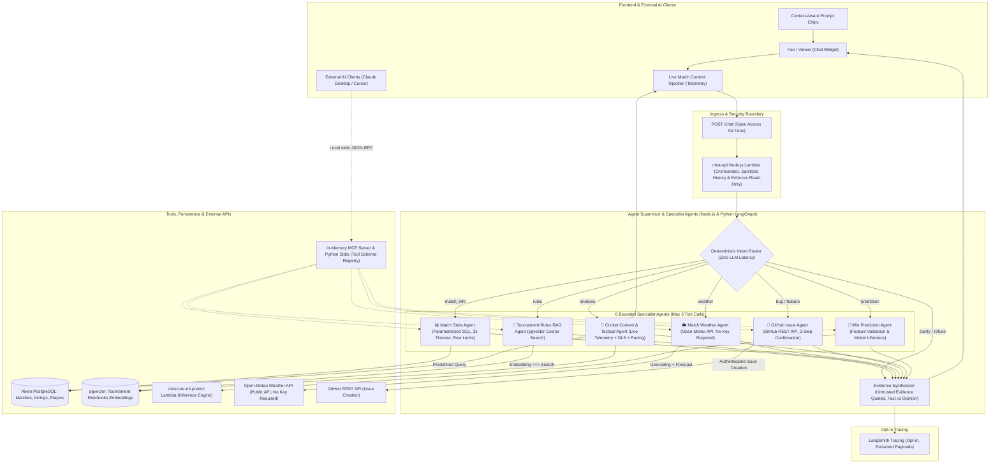
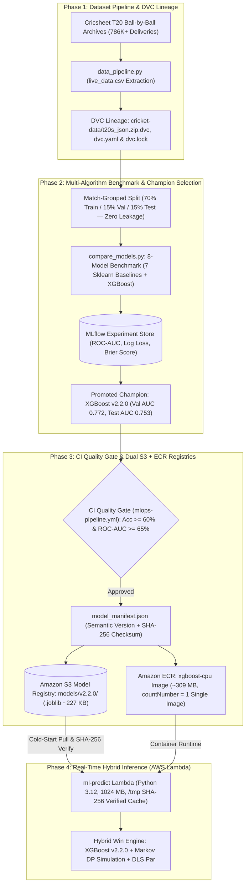
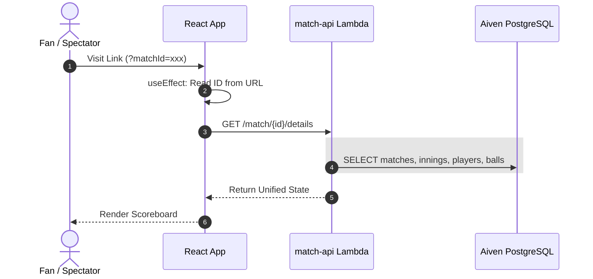
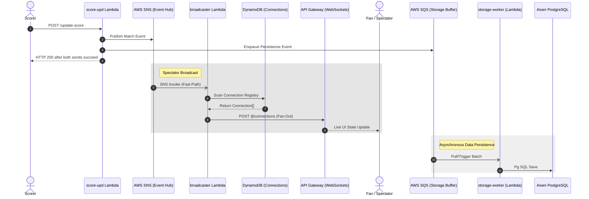

# 🏗️ Architecture: Live Event-Driven Scoring Engine

CricScore is built on a high-concurrency, **Event-Driven Architecture (EDA)** where every ball event is a persistent record in **Aiven PostgreSQL** and a real-time broadcast via **AWS API Gateway WebSockets**, operating at **~$1/month** across `dev` and `prod` combined.

## 🧭 Quick Navigation

- [🗺️ System Diagrams (Mermaid)](#-system-diagrams-mermaid)
  - [☁️ 1. Multi-Cloud System Architecture: AWS Serverless & Aiven PostgreSQL](#️-1-multi-cloud-system-architecture-aws-serverless--aiven-postgresql)
  - [🤖 2. Agentic AI, MCP & Specialist Multi-Agent Architecture](#-2-agentic-ai-mcp--specialist-multi-agent-architecture)
  - [🧠 3. Serverless MLOps & Hybrid Win Prediction Architecture](#-3-serverless-mlops--hybrid-win-prediction-architecture)
- [🔄 Detailed Sequence Flows (Fan-Out)](#-detailed-sequence-flows-fan-out)
- [🏛️ Technical Pillars & Specifications](#️-technical-pillars--specifications)
- [🔐 Authentication & Role Model](#-authentication--role-model)
- [🧩 Platform Component Breakdown](#-platform-component-breakdown)
- [🛠️ Quick Verification Commands](#️-quick-verification-commands)

---

## 🗺️ System Diagrams (Mermaid)

Editable, text-based versions of the platform diagrams. The icon-based PNG/SVG diagrams shown in the main [README](../README.md) are generated via [`docs/diagrams/generate_architecture_diagrams.py`](./diagrams/generate_architecture_diagrams.py).

```bash
# Regenerate all 3 high-resolution architecture diagrams (PNG + SVG)
python3 docs/diagrams/generate_architecture_diagrams.py
```

### ☁️ 1. Multi-Cloud System Architecture: AWS Serverless & Aiven PostgreSQL

The core application platform leverages a serverless, event-driven multi-cloud design separating high-speed real-time ingestion from relational persistence.

```mermaid
flowchart TD
    %% User and CDN Layer
    Client["Fan / Scorer / Admin (React 19 SPA)"] --> Route53["Amazon Route 53 (DNS)"]
    Route53 --> ACM["AWS Certificate Manager (TLS Certs)"]
    ACM --> CloudFront["Amazon CloudFront (CDN + OAC)"]
    ACM --> APIGW_HTTP["Amazon API Gateway (HTTP REST API)"]
    ACM --> APIGW_WS["Amazon API Gateway (WebSocket API)"]

    subgraph Edge ["1. DNS, SSL & CDN Edge"]
        CloudFront --> S3_App["Amazon S3: Static React SPA & Access Logs (7d/30d Lifecycle)"]
    end

    %% Security & Ingress
    subgraph Security ["2. Auth (AWS Amplify + Cognito) & IAM"]
        Amplify["AWS Amplify Auth SDK & UI"]
        Cognito["AWS Cognito User Pool (JWT + RBAC)"]
        PreSignup["cognito-presignup Lambda (Guest Auto-Confirm)"]
        IAM["AWS IAM (Least-Privilege Roles)"]
        Client --> Amplify --> Cognito --> PreSignup
        Cognito -.->|JWT Authorizer| APIGW_HTTP
    end

    %% Backend Compute
    subgraph Compute ["3. AWS Lambda Serverless Compute"]
        MatchAPI["match-api Lambda (Node.js 24)"]
        ScoreUpdate["score-update Lambda (Node.js 24)"]
        StorageWorker["storage-worker Lambda (Node.js 24)"]
        Broadcaster["broadcaster Lambda (Node.js 24)"]
        ConnHandlers["onconnect / ondisconnect Lambdas"]
        ChatAPI["chat-api Lambda (Node.js 24 + In-Memory MCP)"]
        MLPredict["ml-predict Lambda (Python 3.12 Container)"]
    end

    %% Asynchronous Fan-Out
    subgraph Messaging ["Event-Driven Fan-Out Ingestion (Diagram 2)"]
        SNS_Score{{"Amazon SNS: match-events"}}
        SQS_Queue[["Amazon SQS FIFO: storage-buffer.fifo"]]
        DDB[("Amazon DynamoDB: WebSocket Connections")]
    end

    %% Multi-Cloud Persistence & Registries
    subgraph DataLayer ["4. Data, Registries & Email"]
        AivenPG[("Aiven PostgreSQL 16 + pgvector (dev / prod schemas)")]
        SES["Amazon SES (Scorecard Emails)"]
        S3_Backups[("Amazon S3: Match Backups (180d), ML Model Registry & TF State")]
        ECR["Amazon ECR: xgboost-cpu Image (~309 MB, 1-Image Retention)"]
    end

    %% External & Observability Services
    subgraph Operations ["5. Observability, Tracing, Cost & External APIs"]
        CloudWatch["CloudWatch Logs (7d Retention) & Alarms + SNS"]
        XRay["AWS X-Ray (5% Trace Sampling)"]
        Budgets["AWS Budgets (~$1/mo Alert)"]
        OpenAI["OpenAI-Compatible LLM & Embeddings"]
        OpenMeteo["Open-Meteo Weather API"]
        GitHubAPI["GitHub Issues REST API"]
    end

    %% Wire connections
    APIGW_HTTP -->|/match & /admin| MatchAPI
    APIGW_HTTP -->|POST /update-score| ScoreUpdate
    APIGW_HTTP -->|POST /chat & /chat/summary| ChatAPI
    APIGW_HTTP -->|POST /match/predict| MLPredict
    APIGW_WS -->|$connect / $disconnect| ConnHandlers
    ConnHandlers --> DDB

    ScoreUpdate -->|Fast Path Broadcast| SNS_Score
    ScoreUpdate -->|Ordered Persistence| SQS_Queue
    SNS_Score --> Broadcaster
    MatchAPI -->|Direct Invoke: HUB_UPDATE| Broadcaster
    Broadcaster --> DDB
    Broadcaster -->|Push Live Frames| APIGW_WS
    SQS_Queue --> StorageWorker

    MatchAPI --> AivenPG
    StorageWorker -->|Transactional Ball Writes| AivenPG
    MatchAPI --> SES
    MatchAPI --> S3_Backups

    ECR -->|Container Runtime| MLPredict
    S3_Backups -->|Versioned Model v2.2.0| MLPredict

    ChatAPI -->|Read-Only SQL & pgvector RAG| AivenPG
    ChatAPI -.-> OpenAI
    ChatAPI -.-> OpenMeteo
    ChatAPI -.-> GitHubAPI
```



---

### 🤖 2. Agentic AI, MCP & Specialist Multi-Agent Architecture

CricScore implements a modular Agentic AI platform built on **Model Context Protocol (MCP)**, **LangGraph**, and **LangChain** with strict read-only security boundaries and domain-bounded specialist agents:



#### Complete Specialist Agent & Tool Inventory

|   #   | Specialist Agent              | Capability / MCP Tool                   | Source & Technology         | Key Features & Guardrails                                                                                                                                                                |
| :---: | :---------------------------- | :-------------------------------------- | :-------------------------- | :--------------------------------------------------------------------------------------------------------------------------------------------------------------------------------------- |
| **1** | 📊 **Match Stats Agent**      | `execute_sql`                           | Aiven PostgreSQL 16         | • Strict read-only `SELECT` enforcement<br/>• Blocks write/DDL keywords (`DROP`, `DELETE`, `UPDATE`)<br/>• 3-second statement timeout                                                    |
| **2** | 📖 **Tournament Rules Agent** | `search_tournament_rules`               | `pgvector` store (Aiven PG) | • Cosine similarity search on PDF chunks<br/>• Proportional powerplay scaling for shortened overs<br/>• Strict citation: `[Source: document_name]`<br/>• Anti-hallucination truthfulness |
| **3** | 🌦️ **Weather Agent**          | `get_match_weather`                     | Open-Meteo API              | • Geocoding + hourly forecasts<br/>• Rain probability %, temp, wind speed<br/>• Cricket & DLS rain advisories<br/>• Public API (no API key required)                                     |
| **4** | 🐛 **GitHub Issue Agent**     | `create_github_issue`                   | GitHub REST API             | • Creates labeled issues (`via-cricscore-ai`, category)<br/>• 2-step confirmation to capture title & description<br/>• Rate-limited: max 1 issue per turn                                |
| **5** | 🏏 **Tactical Context Agent** | Live match context injection            | Real-time scoreboard state  | • Analyzes CRR vs RRR equations<br/>• Match phase analysis (Powerplay / Middle / Death)<br/>• Evaluates bowler overs and matchup strategy without extra DB queries                       |
| **6** | 🎯 **Win Prediction Agent**   | `predict_match_outcome` / direct Lambda | XGBoost + Markov DP + DLS   | • Validates 8 situational features<br/>• Blends ML gradient boosting with dynamic programming<br/>• Produces probabilistic percentages and conversational commentary                     |

---

### 🧠 3. Serverless MLOps & Hybrid Win Prediction Architecture

The prediction platform integrates a reproducible **MLOps lifecycle** (DVC + MLflow + GitHub Actions) with a hybrid **Dynamic Programming (DP) + DLS win probability engine**:



---

## 🔄 Detailed Sequence Flows (Fan-Out)

### 1. 📊 Fetch Match Details (Deep-Link Hydration)



### 2. ⚡ Live Score Update (Decoupled Fan-Out)



---

## 🏛️ Technical Pillars & Specifications

| Technical Pillar                  | Implementation File(s)                                                                 | Mechanism & Guarantee                                                                                                                                                                             |
| :-------------------------------- | :------------------------------------------------------------------------------------- | :------------------------------------------------------------------------------------------------------------------------------------------------------------------------------------------------ |
| **Decoupled Fan-Out**             | • `score-update/index.js`<br/>• `broadcaster/index.js`<br/>• `storage-worker/index.js` | • Publishes to **AWS SNS** (`match-events`) for instant `<50ms` WebSocket fan-out<br/>• Enqueues into **AWS SQS FIFO** (`storage-buffer.fifo`) for ordered PostgreSQL writes                      |
| **Authoritative State**           | • `App.tsx`<br/>• `storage-worker/index.js`<br/>• `LiveScoreboard.tsx`                 | • Every `POST /update-score` payload sends `explicitTotalRuns`, `explicitTotalWickets`, and `ballData.batterName`<br/>• Keeps DB and UI synchronized across strike rotations and undos            |
| **WS vs. Poll Recency Guard**     | • `LiveScoreboard.tsx` (`lastWsUpdateRef`)                                             | • Suppresses background REST poll overwrites for `3 seconds` after any WebSocket push<br/>• Prevents lagging database reads from reverting a live boundary or wicket                              |
| **Idempotent Innings Sync**       | • `match-api/index.js`<br/>• `storage-worker/index.js`                                 | • `POST /match/{id}/innings` uses `ON CONFLICT (match_id, inning_number) DO UPDATE`<br/>• Resolves optimistic `inn2_<timestamp>` IDs to the canonical PostgreSQL `inning_id`                      |
| **Deterministic POTM**            | • `chat-api/handlers/summaryHandler.js`<br/>• `computePlayerOfTheMatch()`              | • Computes Cricket MVP Impact Score deterministically (runs, team share, `4s`/`6s`, SR vs RPO, wickets, economy, maidens, `1.35x + 5.0` win bonus)<br/>• Persists and caches result in PostgreSQL |
| **X-Ray Distributed Tracing**     | • `infra/terraform/xray.tf`<br/>• `infra/terraform/lambda.tf`                          | • Active tracing enabled on all 8 Lambdas with a `5%` fixed sampling rate<br/>• Enforces a `1 req/sec` reservoir (`cricscore-low-cost-5pct`) to stay within AWS X-Ray Free Tier                   |
| **Scoring & Admin Authorization** | • `infra/terraform/apigw.tf`<br/>• `match-api/index.js` (`isAuthorized`)               | • Cognito JWT Authorizer protects write/admin routes at API Gateway<br/>• `match-api` verifies resource ownership (`scorer_email`) or Cognito `Admin` group membership                            |

---

## 🔐 Authentication & Role Model

> See [`docs/auth.md`](./auth.md) for the full authentication specification.

| Role          | Identity Mechanism                                    | Frontend Capabilities                                                                            | Backend Authorization (`API Gateway` + `Lambda`)                                                         |
| :------------ | :---------------------------------------------------- | :----------------------------------------------------------------------------------------------- | :------------------------------------------------------------------------------------------------------- |
| **Viewer 🌍** | Public UUID link (no sign-in required)                | • View live scoreboards<br/>• Browse full scorecards<br/>• Query AI Chat Assistant               | • Open `GET /matches` and `GET /match/{id}/details`<br/>• Open `POST /chat` and `POST /match/predict`    |
| **Guest 🎮**  | Shadow Cognito account (`guest-{ts}@cricscore.local`) | • Score practice matches<br/>• Auto-confirmed via `cognito-presignup`                            | • Valid Cognito JWT required<br/>• Isolated guest records can be bulk-pruned by Admins                   |
| **Scorer 🎮** | Verified Cognito User Pool account                    | • Create matches and score ball-by-ball<br/>• Undo deliveries and send SES email reports         | • Valid Cognito JWT required<br/>• Per-match ownership check (`matches.scorer_email == jwt.email`)       |
| **Admin ⚡**  | Cognito `Admin` group / `ADMIN_REPORT_EMAIL`          | • Full Match Ops Admin Panel<br/>• User management and guest data cleanup<br/>• PDF rules upload | • Valid Cognito JWT required<br/>• `cognito:groups` includes `Admin` (or super-admin email verification) |

---

## 🧩 Platform Component Breakdown

| Subsystem                     | AWS / Cloud Components                                                                   | Key Files                                                                           | Primary Responsibilities                                                                                                                                                                   |
| :---------------------------- | :--------------------------------------------------------------------------------------- | :---------------------------------------------------------------------------------- | :----------------------------------------------------------------------------------------------------------------------------------------------------------------------------------------- |
| **1. Scorer Engine**          | • `score-update` Lambda<br/>• Amazon SNS & SQS FIFO<br/>• AWS Cognito                    | • `apps/frontend/src/App.tsx`<br/>• `apps/backend/lambdas/score-update/`            | • Initializes UUID matches and validates ball-by-ball deliveries<br/>• Publishes to SNS/SQS in parallel<br/>• Isolates sessions via `prevEmailRef` identity guard                          |
| **2. Managed Fan Hub**        | • `match-api` & `broadcaster` Lambdas<br/>• Amazon DynamoDB<br/>• API Gateway WebSockets | • `apps/backend/lambdas/match-api/`<br/>• `apps/backend/lambdas/broadcaster/`       | • Serves live match discovery and deep-link hydration<br/>• Pushes `HUB_UPDATE` broadcasts and manages `$connect`/`$disconnect`<br/>• Powers the Match Ops Admin Panel                     |
| **3. Storage Buffer Worker**  | • `storage-worker` Lambda<br/>• Amazon SQS FIFO<br/>• Aiven PostgreSQL 16                | • `apps/backend/lambdas/storage-worker/index.js`                                    | • Drains ordered FIFO batches (`MessageGroupId = matchId`)<br/>• Executes transactional SQL updates for `matches`, `innings`, `players`, `bowlers`, and `ball_events`                      |
| **4. Security & Identity**    | • AWS Cognito User Pool<br/>• `cognito-presignup` Lambda<br/>• AWS IAM                   | • `infra/terraform/cognito.tf`<br/>• `infra/terraform/iam.tf`                       | • Enforces least-privilege IAM roles and JWT route protection<br/>• Runs `isAuthorized()` ownership checks and TLS PostgreSQL connections<br/>• Isolates shadow guest accounts             |
| **5. Infrastructure & CI/CD** | • Terraform + S3 State<br/>• GitHub Actions (`ci.yml`, `cd.yml`)                         | • `infra/scripts/setup.sh`<br/>• `infra/scripts/deploy.sh`<br/>• `infra/terraform/` | • Automates bootstrapping and dynamic `.env.local` hydration into `TF_VAR_*`<br/>• Runs `dev` deployments on `main` and `prod` releases on `v*` tags                                       |
| **6. Agentic AI & MCP**       | • `chat-api` Lambda (Node.js 24)<br/>• `apps/ai-service` (Python LangGraph)              | • `apps/backend/lambdas/chat-api/`<br/>• `apps/ai-service/cricscore_ai/`            | • Runs in-memory MCP Server + 6 specialist agents<br/>• Covers SQL Stats, `pgvector` Rules RAG, Open-Meteo Weather, GitHub Issues, Tactical Context, and Win Predictor                     |
| **7. Serverless MLOps**       | • `ml-predict` Lambda<br/>• Amazon ECR (`xgboost-cpu`)<br/>• Amazon S3 Model Registry    | • `apps/ml-engine/compare_models.py`<br/>• `apps/ml-engine/predict.py`              | • Tracks 786K+ Cricsheet deliveries via DVC and benchmarks 8 models in MLflow<br/>• Serves **XGBoost (`v2.2.0`)** + Markov DP + DLS from S3/ECR (`xgboost-cpu ~309 MB`, `countNumber = 1`) |

---

## 🛠️ Quick Verification Commands

```bash
# 1. Validate Terraform infrastructure configuration
./infra/scripts/terraform.sh validate

# 2. Run all backend, frontend, AI service, and ML engine test suites (376 unit tests)
npm --prefix apps/backend test -- --run
npm --prefix apps/frontend test -- --run
./apps/ai-service/.venv/bin/pytest apps/ai-service -q
./apps/ai-service/.venv/bin/pytest apps/ml-engine/tests -q

# 3. Deploy full stack to dev using local environment variables
./infra/scripts/deploy.sh --env dev --use-local-env
```

---

© 2026 CricScore Documentation. 🏎️🏆🏛️🛡️🏁🚀
