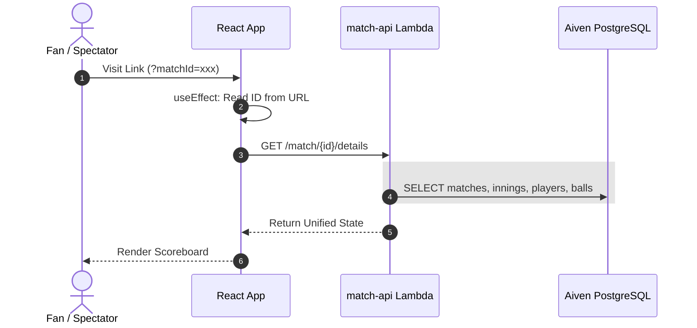
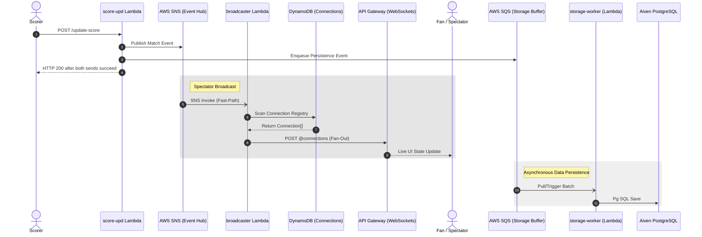

# 🏗️ Architecture: Live Event-Driven Scoring Engine

CricScore is built on a high-concurrency, **Event-Driven Architecture (EDA)** where every ball event is a persistent record in **Aiven PostgreSQL** and a real-time broadcast via **AWS API Gateway WebSockets**.

## 🔄 Detailed Sequence Flows (Fan-Out)

### 1. 📊 Fetch Match Details (Deep-Link Hydration)

### 2. ⚡ Live Score Update (Decoupled Fan-Out)

---

## 🏛️ Technical Pillars & Specifications

CricScore implements an **Event-Driven Architecture (EDA)** using serverless and managed services:

- **Decoupled Fan-Out:** The `score-upd` Lambda publishes to AWS SNS for instant spectator broadcasts and enqueues a separate FIFO message into AWS SQS (`storage-buffer.fifo`) for ordered asynchronous persistence to Aiven PostgreSQL.
- **Authoritative Cumulative State & Strike-Rotation Safety:** Every `POST /match/{id}/score` payload includes authoritative `explicitTotalRuns` and `explicitTotalWickets` alongside `ballData.batterName` (the batter who faced the delivery), ensuring both `storage-worker` and `LiveScoreboard` stay 100% synchronized across odd-run strike rotations, over completions, and `undo: true` rollbacks.
- **WebSocket vs. Polling Recency Guard (`lastWsUpdateRef`):** `LiveScoreboard` suppresses background REST poll overwrites for 3 seconds after any WebSocket push so a lagging database read never reverts a live boundary or wicket.
- **Idempotent Innings & Match Completion:** `POST /match/{id}/innings` uses `ON CONFLICT (match_id, inning_number) DO UPDATE`, and both `storage-worker` and `match-api` automatically resolve optimistic `inn2_<timestamp>` IDs to the canonical PostgreSQL `inning_id`.
- **X-Ray Distributed Tracing:** AWS X-Ray active tracing is enabled across all Lambda functions with a 5% fixed sampling rate and a one-request-per-second reservoir (`infra/terraform/xray.tf`).
- **Scoring Authorization:** Cognito JWTs protect scoring and admin routes at API Gateway, while `match-api` enforces per-resource ownership (`scorer_email`) or Cognito `Admin` group membership. Public match-read routes expose live scoreboards by match UUID.

---

## 🔐 Authentication & Role Model

> See [`docs/auth.md`](./auth.md) for the full authentication specification.

CricScore uses **AWS Cognito User Pools** with a 4-tier role model:

| Role          | Access                                                                                            |
| ------------- | ------------------------------------------------------------------------------------------------- |
| **Viewer 🌍** | Public-only, no sign-in required                                                                  |
| **Guest 🎮**  | Cognito account (`guest-{ts}@cricscore.local`); guest matches are persisted and can be cleaned up |
| **Scorer 🎮** | Authenticated scorer access; owns their own matches                                               |
| **Admin ⚡**  | Admin-group access, with a configured super-admin email bypass for backend operations             |

Authorization for protected operations is enforced at two layers:

1. **Frontend** — JWT presence and `cognito:groups` group check in React state
2. **Backend** — API Gateway JWT Authorizer validates tokens on protected routes; Lambda checks ownership or admin access where applicable. Public routes do not use this authorizer.

---

## 🏛️ Component Breakdown

### **1. Official Scorer (The Implementation)**

- **Match Registry**: Games are anchored to a unique UUID provided by **Aiven PostgreSQL** during initialization.
- **score_update Lambda**: Validates ball-by-ball payloads and publishes them to AWS SNS for downstream fan-out.
- **State Persistence**: Score events are queued through FIFO SQS for asynchronous storage; the live broadcast and database write are separate operations.
- **Cross-Session Identity Guard**: A `prevEmailRef` ref in `App.tsx` detects user identity changes (e.g., guest → real account) and automatically clears all match state, preventing data bleed across sessions.

### **2. Managed Fan Hub (The Discovery Engine)**

- **match_api Lambda**: Handles match discovery, initial deep-link hydration, admin user management APIs, and all CRUD operations with per-resource auth checks.
- **broadcaster Lambda**: Consumes SNS events and performs parallel pushes to active spectator WebSocket tunnels via DynamoDB Registry.
- **WebSocket Lifecycle (onConnect/onDisconnect)**: Manage the "who is watching now" registry in DynamoDB.
- **Admin Panel**: React component providing user management (list, promote, demote, delete) and database cleanup operations. Accessible only to users in the Cognito `Admin` group.

### **3. Reliability & Persistence (The Storage Buffer)**

- **storage_worker Lambda**: Triggered by FIFO AWS SQS batches to persist queued match events to Aiven PostgreSQL.

### **4. Security Strategy**

- **Cognito Authentication**: Scoring and administrative routes require a valid Cognito JWT. API Gateway applies its JWT Authorizer only to configured protected routes; public routes do not use it.
- **Per-Resource Authorization**: The `isAuthorized()` function in `match-api` checks that the requesting user is either the match owner, a super-admin email, or in the Cognito `Admin` group.
- **Admin Group**: Managed in Cognito via Terraform. Administrative routes check group membership; selected backend operations also permit the configured super-admin email.
- **Guest Isolation**: Guest accounts use shadow Cognito accounts (`guest-*@cricscore.local`) that can be cleaned up by Admins without affecting real user data.
- **TLS**: PostgreSQL connections use TLS; the chat API currently disables server-certificate verification.
- **Match Ownership**: Scoring changes check `scorer_email` and `matchId`; public match-read routes remain accessible by match UUID.
- **Role-Based Access Hierarchy**:
  - **Viewer 🌍**: Public/No-Auth spectator access based solely on the sharable match UUID.
  - **Scorer 🎮**: Cognito-authenticated access for persistence and ball-by-ball updates. Can only manage matches they created.
  - **Admin ⚡**: Cognito `Admin` group membership is checked for administrative operations; selected backend operations also allow the configured super-admin email.

### **5. Infrastructure Automation & CI/CD**

- **Automated Bootstrapping**: `infra/scripts/setup.sh` provides intelligent OS-aware dependency installation.
- **Dynamic Variable Hydration**: `./infra/scripts/deploy.sh --env dev` bridges environment variables into Terraform format.
- **Non-Destructive Configuration**: Local deployment cleanly appends live API Gateway and WebSocket URLs into `apps/frontend/.env`.
- **Pipeline Dynamics**: `.github/workflows/ci.yml` validates changes and deploys DEV; `.github/workflows/cd.yml` handles PROD releases. Both use GitHub environment variables and secrets.

---

© 2026 CricScore Documentation. 🏎️🏎️🏆🏛️🛡️🏁🚀
