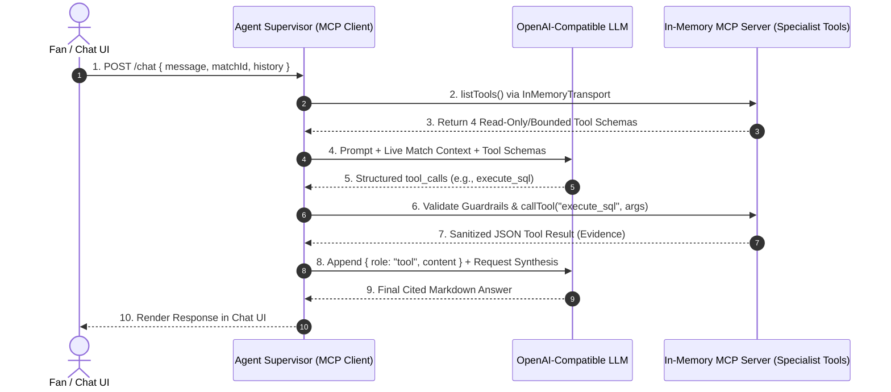
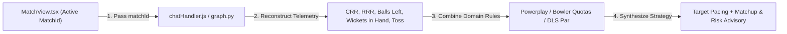
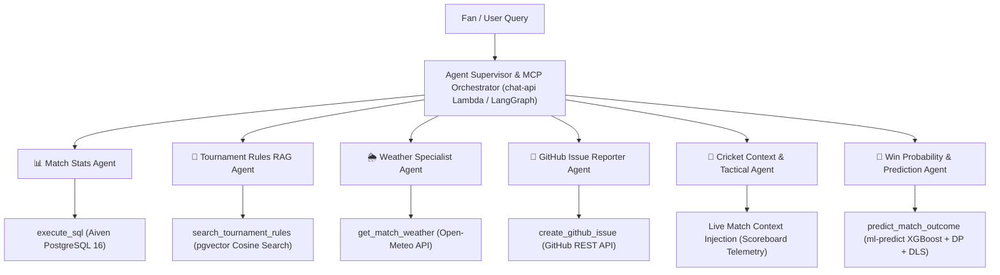

# ❓ CricScore Architecture & AI/MLOps FAQ

This document answers the most frequently asked architectural questions regarding CricScore's **Agentic AI System**, **Model Context Protocol (MCP)**, **MLOps Pipeline**, and **Hybrid Win Prediction Engine**, using structured comparison tables, Mermaid diagrams, and runnable CLI commands.

---

## 📑 Table of Contents

1. [Agent Supervisor vs. LLM: Who decides which tool to call and who communicates with whom?](#1-agent-supervisor-vs-llm-who-decides-which-tool-to-call-and-who-communicates-with-whom)
2. [What is the "Cricket Context & Tactical Agent" and how does it work?](#2-what-is-the-cricket-context--tactical-agent-and-how-does-it-work)
3. [ECR Container Image vs. S3 Model Registry: Where do ML artifacts live and how are versions managed?](#3-ecr-container-image-vs-s3-model-registry-where-do-ml-artifacts-live-and-how-are-versions-managed)
4. [Direct Lambda vs. Conversational AI Agent: How is Win Probability computed?](#4-direct-lambda-vs-conversational-ai-agent-how-is-win-probability-computed)
5. [Complete Inventory: How many total agents and tools exist across the platform?](#5-complete-inventory-how-many-total-agents-and-tools-exist-across-the-platform)

---

## 1. Agent Supervisor vs. LLM: Who decides which tool to call and who communicates with whom?

### Decision vs. Execution Responsibility Matrix

| Actor                    | Role in Tool Calling                                             |          Network / DB Credentials?          | Security Boundary Enforced                                                                                                                    |
| :----------------------- | :--------------------------------------------------------------- | :-----------------------------------------: | :-------------------------------------------------------------------------------------------------------------------------------------------- |
| **LLM (`gpt-4o-mini`)**  | Decides **which** tool to request and **what arguments** to pass |                  ❌ **No**                  | • Emits structured JSON `tool_calls` only<br/>• Cannot open network sockets or read env vars<br/>• Cannot touch PostgreSQL or GitHub directly |
| **Agent Supervisor**     | Decides **whether** and **how** a requested tool is executed     |            ❌ **No** (delegates)            | • Hardcodes `isAdmin = false` on `/chat`<br/>• Caps conversation history to `10` turns<br/>• Enforces `1-issue-per-turn` GitHub rate limit    |
| **In-Memory MCP Server** | Executes verified tool logic against external systems            | ✅ **Yes** (`DATABASE_URL`, `GITHUB_TOKEN`) | • Wraps SQL in `BEGIN READ ONLY` + `3000ms` timeout<br/>• Strips PII (`scorer_email`)<br/>• Locks GitHub issues to allowlisted repository     |

### Sequence Diagram: End-to-End Tool Call Lifecycle



### Step-by-Step Communication Flow

1. **`ChatComponent.tsx` → `chat-api`:** Sends `POST /chat` with `{ message, matchId, history }`.
2. **`chatHandler.js` → `mcp/server.js`:** Initializes `InMemoryTransport` and discovers registered MCP tool schemas.
3. **`chatHandler.js` → `LLM` (`config/llm.js`):** Sends system prompt guardrails, active match telemetry, and tool schemas.
4. **`LLM` → `chatHandler.js`:** Emits structured `tool_calls` JSON (zero direct execution).
5. **`chatHandler.js` → `MCP Tool` (`mcp/tools/*.js`):** Validates per-turn rate limits and invokes `execute_sql`, `get_match_weather`, `search_tournament_rules`, or `create_github_issue`.
6. **`MCP Tool` → `LLM` → `User`:** Returns sanitized JSON evidence to the LLM, which synthesizes the final cited Markdown response.

---

## 2. What is the "Cricket Context & Tactical Agent" and how does it work?

### Raw SQL Tool vs. Cricket Context & Tactical Agent

| Dimension                | Raw SQL Query (`execute_sql`)                                                 | Cricket Context & Tactical Agent (`matchContext` + `analysis_node`)                                                    |
| :----------------------- | :---------------------------------------------------------------------------- | :--------------------------------------------------------------------------------------------------------------------- |
| **Example Input**        | `"We need 45 runs in 4 overs with 6 wickets left. How do we pace?"`           | `"We need 45 runs in 4 overs with 6 wickets left. How do we pace?"`                                                    |
| **Data Returned**        | `{ "overs": 16, "balls": 0, "total_runs": 135, "wickets": 4, "target": 180 }` | • Live CRR (`8.4`) and RRR (`11.25`)<br/>• Balls left (`24`) and wickets in hand (`6`)<br/>• Active match phase        |
| **Cricket Phase Logic**  | ❌ None (raw numbers only)                                                    | • Identifies **Death Overs (16–20)**<br/>• Balances strike rotation vs boundary risk<br/>• Tracks bowler over quotas   |
| **DLS & Rule Awareness** | ❌ None                                                                       | • Combines scoreboard telemetry with tournament rules (`search_tournament_rules`)<br/>• Evaluates DLS par score buffer |
| **Extra DB Roundtrips**  | Requires LLM to write & run a new SQL query                                   | • Injects live match context on turn start<br/>• Uses `1` indexed PK lookup when `matchId` is active                   |

### Tactical Reasoning Pipeline



1. **Telemetry Injection (`chatHandler.js`):** Reconstructs 1st- and 2nd-innings score and overs from the active `matches` row and computes live `CRR`, `target`, `runsNeeded`, and `ballsLeft`.
2. **LangGraph Specialist (`graph.py`):** Runs `analysis_node` to coordinate `get_match_details`, `get_match_statistics` (bowler economy, batter SR), and `search_tournament_rules`.
3. **Tactical Synthesis (`synthesizer_node` / LLM):** Produces actionable pacing recommendations highlighting which overs to attack, wicket preservation, and DLS par awareness.

---

## 3. ECR Container Image vs. S3 Model Registry: Where do ML artifacts live and how are versions managed?

### Decoupled Runtime vs. Model Artifact Architecture

| Component             | Hosted Location                         | Contents                                                                                                                                                  | Retention & Cost Policy                                                                                     | Update Trigger                                                                     |
| :-------------------- | :-------------------------------------- | :-------------------------------------------------------------------------------------------------------------------------------------------------------- | :---------------------------------------------------------------------------------------------------------- | :--------------------------------------------------------------------------------- |
| **Inference Runtime** | **Amazon ECR** (`cricscore-ml-predict`) | • Python 3.12 base image (`~309 MB`)<br/>• Linux `x86_64` CPU-only wheels (`xgboost-cpu`, `scikit-learn`, `pandas`, `numpy`, `joblib`)<br/>• `predict.py` | • Tagged `:${var.ml_model_version}` only (no `:latest`)<br/>• ECR lifecycle `countNumber = 1` (`~$0.03/mo`) | • Only when Python dependencies change<br/>• When OS image or handler code changes |
| **Model Registry**    | **Amazon S3** (`match-backups/models/`) | • `live_win_predictor_model.joblib` (`~227 KB`)<br/>• `model_manifest.json` (SHA-256 hash)<br/>• `live_metadata.json` under `models/v2.2.0/`              | • Stored alongside 180-day match backups in S3<br/>• Storage cost `<$0.01/mo`                               | • Every model training run<br/>• Benchmark promotion or version release            |

### Dynamic Cold-Start Loading & SHA-256 Verification Flow

| Step  | Phase                          | Action in `apps/ml-engine/predict.py`                                                                                                          | Failure / Fallback Behavior                                                               |
| :---: | :----------------------------- | :--------------------------------------------------------------------------------------------------------------------------------------------- | :---------------------------------------------------------------------------------------- |
| **1** | **Lazy Import on Invoke**      | • Defers importing `joblib`, `pandas`, `numpy`, and `xgboost` until `lambda_handler` runs<br/>• Keeps Lambda container init duration `<70ms`   | • Avoids cold-start init timeouts on 1024 MB Firecracker MicroVMs                         |
| **2** | **S3 Registry Pull to `/tmp`** | • Reads `MODEL_S3_BUCKET` and `MODEL_VERSION` (`v2.2.0`)<br/>• Downloads `model_manifest.json` + `.joblib` to `/tmp/models/v2.2.0/`            | • If S3 is unreachable, falls back to the baseline model bundled inside the Docker image  |
| **3** | **SHA-256 Integrity Check**    | • Computes `hashlib.sha256()` on `/tmp/models/v2.2.0/live_win_predictor_model.joblib`<br/>• Compares digest against `manifest.artifact.sha256` | • **Security Guarantee**: Rejects tampered or corrupted `.joblib` files with `ValueError` |
| **4** | **Warm Container Reuse**       | • Caches verified pipeline in memory (`_cached_model`)<br/>• Serves all subsequent warm invocations in `~1.98 ms` per 100 rows                 | • If no ML artifact is available, serves exact Markov DP + DLS probabilities seamlessly   |

### Instant Zero-Downtime Model Rollback Commands

```bash
# Option A: Full Terraform deploy/rollback to a specific model version tag
./infra/scripts/deploy.sh --env prod --use-local-env --model-version v2.2.0

# Option B: Instant ~5-second Lambda env-var rollback (no Docker rebuild required)
aws lambda update-function-configuration \
  --function-name cricscoreprod-ml-predict \
  --environment "Variables={MODEL_VERSION=v2.1.0,MODEL_S3_BUCKET=cricscore-match-backups-prod}"
```

---

## 4. Direct Lambda vs. Conversational AI Agent: How is Win Probability computed?

### Comparison: Path A (Scoreboard UI) vs. Path B (AI Chat Assistant)

| Dimension              | Path A: High-Frequency Direct Lambda (`POST /match/predict`)             | Path B: Conversational Prediction Agent (`predict_match_outcome`)                                         |
| :--------------------- | :----------------------------------------------------------------------- | :-------------------------------------------------------------------------------------------------------- |
| **Primary Consumer**   | Live Scoreboard Win Probability Bar (`AiMatchPrediction.tsx`)            | AI Chat Assistant (`ChatComponent.tsx` / `apps/ai-service`)                                               |
| **Trigger Event**      | Automatically after **every single ball** bowled or WebSocket frame      | On-demand when a fan asks _"Who is likely to win and why?"_ or _"What if..."_                             |
| **End-to-End Latency** | • **`<100ms`** end-to-end<br/>• Warm Lambda invocation `~15–40ms`        | • **`1.2s – 2.5s`** end-to-end<br/>• Includes LLM synthesis of tactical commentary                        |
| **LLM Token Cost**     | • **`$0.00`** (zero LLM calls)<br/>• Pure Python/C++ numerical inference | • Uses standard chat completion tokens (`gpt-4o-mini` / configured provider)                              |
| **Underlying Engine**  | • `ml-predict` Lambda<br/>• **XGBoost (`v2.2.0`) + Markov DP + DLS Par** | • Invokes the exact same **XGBoost (`v2.2.0`) + Markov DP + DLS** engine<br/>• Adds LLM narrative wrapper |
| **Output Format**      | Compact JSON (`{ team1Probability: 64.2, team2Probability: 35.8 }`)      | • Conversational Markdown<br/>• Explains RRR pressure, wickets in hand, and turning points                |

```bash
# Test Path A directly against the local or deployed prediction engine
python3 -c '
import json
from predict import lambda_handler
event = {"body": json.dumps({"batting_team": "India", "bowling_team": "Australia", "inning": 2, "balls_left": 30, "current_score": 135, "wickets_lost": 4, "target_score": 175, "total_match_balls": 120})}
print(lambda_handler(event, None))
'
```

---

## 5. Complete Inventory: How many total agents and tools exist across the platform?

CricScore features **6 Specialist AI Agents** orchestrated across the Node.js `chat-api` MCP supervisor and the Python `apps/ai-service` LangGraph service:



### Detailed Agent & Tool Specification

|   #   | Specialist Agent              | Capability / MCP Tool                   | Source & Technology         | Key Features & Guardrails                                                                                                                                                            |
| :---: | :---------------------------- | :-------------------------------------- | :-------------------------- | :----------------------------------------------------------------------------------------------------------------------------------------------------------------------------------- |
| **1** | 📊 **Match Stats Agent**      | `execute_sql`                           | Aiven PostgreSQL 16         | • Strict read-only `SELECT` / `WITH` enforcement<br/>• Blocks write/DDL keywords (`DROP`, `DELETE`, `UPDATE`)<br/>• `3000ms` statement timeout & strips `scorer_email`               |
| **2** | 📖 **Tournament Rules Agent** | `search_tournament_rules`               | `pgvector` store (Aiven PG) | • Cosine similarity search (`<=>`) on 1536-d PDF chunks<br/>• Proportional powerplay scaling for shortened overs<br/>• Strict citation: `[Source: document_name]`                    |
| **3** | 🌦️ **Weather Agent**          | `get_match_weather`                     | Open-Meteo API              | • Global geocoding + hourly forecasts<br/>• Rain probability %, temp, wind speed<br/>• Cricket & DLS rain advisories (`buildCricketAdvisory`)<br/>• Public API (no API key required) |
| **4** | 🐛 **GitHub Issue Agent**     | `create_github_issue`                   | GitHub REST API             | • Creates labeled issues (`via-cricscore-ai`, category)<br/>• 2-step confirmation to capture title & description<br/>• Rate-limited: max `1` issue per turn                          |
| **5** | 🏏 **Tactical Context Agent** | Live match context injection            | Real-time scoreboard state  | • Analyzes CRR vs RRR equations<br/>• Match phase analysis (Powerplay / Middle / Death)<br/>• Evaluates bowler overs and matchup strategy without extra DB queries                   |
| **6** | 🎯 **Win Prediction Agent**   | `predict_match_outcome` / direct Lambda | XGBoost + Markov DP + DLS   | • Validates situational match features<br/>• Blends **XGBoost (`v2.2.0`)** with Markov DP + DLS par<br/>• Produces calibrated win percentages and tactical commentary                |

---

## 🔗 Related Documentation

- **[AI Architecture & Agentic RAG](./ai_architecture.md):** In-memory MCP server, Text-to-SQL guardrails, `pgvector` RAG, and deterministic Player of the Match (POTM).
- **[Weather Report Agent Guide](./weather_report_agent.md):** Open-Meteo geocoding, hourly forecast windows, and Cricket & DLS rain advisory thresholds.
- **[GitHub Issue Specialist Agent Guide](./github_issue_agent.md):** 2-step confirmation protocol, SSRF/spam guardrails, and `GITHUB_TOKEN` wiring.
- **[MLOps Tutorial & Model Benchmarking](./mlops_tutorial.md):** DVC lineage, 8-model MLflow benchmark, **XGBoost `v2.2.0`**, `xgboost-cpu ~309 MB`, `countNumber = 1`, and DLS math.
- **[ML Models Handbook](./ml_models_handbook.md):** Mathematical formulas and empirical CricScore benchmarks across 14 Classification, Regression, and Clustering algorithms.
- **[Architecture & Diagrams Overview](./architecture.md):** Multi-cloud system diagrams (`~$1/month` footprint), WebSocket fan-out sequences, RBAC matrix, and `376` automated tests.
