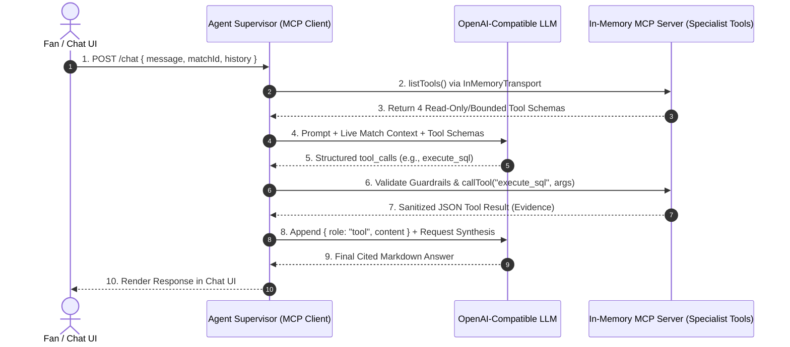
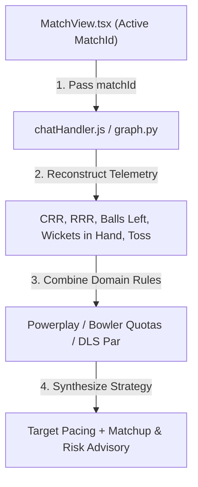
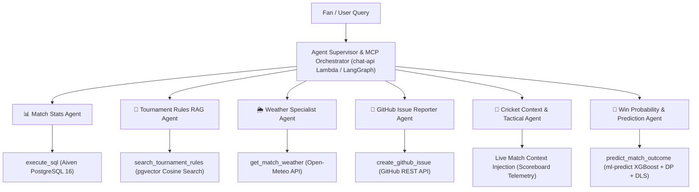

# ❓ CricScore Architecture & AI/MLOps FAQ

This document answers the most frequently asked architectural questions regarding CricScore's **Agentic AI System**, **Model Context Protocol (MCP)**, **MLOps Pipeline**, and **Hybrid Win Prediction Engine**, using structured breakdowns, Mermaid diagrams, and runnable CLI commands.

---

## 📑 Table of Contents

1. [Agent Supervisor vs. LLM: Who decides which tool to call and who communicates with whom?](#1-agent-supervisor-vs-llm-who-decides-which-tool-to-call-and-who-communicates-with-whom)
2. [What is the "Cricket Context & Tactical Agent" and how does it work?](#2-what-is-the-cricket-context--tactical-agent-and-how-does-it-work)
3. [ECR Container Image vs. S3 Model Registry: Where do ML artifacts live and how are versions managed?](#3-ecr-container-image-vs-s3-model-registry-where-do-ml-artifacts-live-and-how-are-versions-managed)
4. [Direct Lambda vs. Conversational AI Agent: How is Win Probability computed?](#4-direct-lambda-vs-conversational-ai-agent-how-is-win-probability-computed)
5. [Complete Inventory: How many total agents and tools exist across the platform?](#5-complete-inventory-how-many-total-agents-and-tools-exist-across-the-platform)

---

## 1. Agent Supervisor vs. LLM: Who decides which tool to call and who communicates with whom?

### Decision vs. Execution Responsibility Matrix

- **1. LLM (`gpt-4o-mini`):**
  - **Role in Tool Calling:** Decides **which** tool to request and **what arguments** to pass.
  - **Network / DB Credentials:** ❌ **No**.
  - **Security Boundary:** Emits structured JSON `tool_calls` only; cannot open network sockets, read environment variables, or touch PostgreSQL/GitHub directly.
- **2. Agent Supervisor (`chatHandler.js` / `graph.py`):**
  - **Role in Tool Calling:** Decides **whether** and **how** a requested tool is executed.
  - **Network / DB Credentials:** ❌ **No** (delegates to MCP server).
  - **Security Boundary:** Hardcodes `isAdmin = false` on `/chat`, caps conversation history to `10` turns, and enforces the `1-issue-per-turn` GitHub rate limit.
- **3. In-Memory MCP Server (`mcp/server.js`):**
  - **Role in Tool Calling:** Executes verified tool logic against external systems.
  - **Network / DB Credentials:** ✅ **Yes** (`DATABASE_URL`, `GITHUB_TOKEN`).
  - **Security Boundary:** Wraps SQL in `BEGIN READ ONLY` + `3000ms` timeout, strips PII (`scorer_email`), and locks GitHub issues to the allowlisted repository.

### Sequence Diagram: End-to-End Tool Call Lifecycle



### Step-by-Step Communication Flow

1. **`ChatComponent.tsx` → `chat-api`:** Sends `POST /chat` with `{ message, matchId, history }`.
2. **`chatHandler.js` → `mcp/server.js`:** Initializes `InMemoryTransport` and discovers registered MCP tool schemas.
3. **`chatHandler.js` → `LLM` (`config/llm.js`):** Sends system prompt guardrails, active match telemetry, and tool schemas.
4. **`LLM` → `chatHandler.js`:** Emits structured `tool_calls` JSON (zero direct execution).
5. **`chatHandler.js` → `MCP Tool` (`mcp/tools/*.js`):** Validates per-turn rate limits and invokes `execute_sql`, `get_match_weather`, `search_tournament_rules`, or `create_github_issue`.
6. **`MCP Tool` → `LLM` → `User`:** Returns sanitized JSON evidence to the LLM, which synthesizes the final cited Markdown response.

---

## 2. What is the "Cricket Context & Tactical Agent" and how does it work?

### Raw SQL Tool vs. Cricket Context & Tactical Agent

- **1. Example Input (`"We need 45 runs in 4 overs with 6 wickets left. How do we pace?"`):**
  - **Raw SQL (`execute_sql`):** Returns raw database columns (`{ "overs": 16, "balls": 0, "total_runs": 135, "wickets": 4, "target": 180 }`).
  - **Cricket Context & Tactical Agent (`matchContext` + `analysis_node`):** Computes live CRR (`8.4`), RRR (`11.25`), balls left (`24`), wickets in hand (`6`), and active match phase.
- **2. Cricket Phase & Matchup Logic:**
  - **Raw SQL (`execute_sql`):** ❌ None (raw numbers only).
  - **Cricket Context & Tactical Agent:** Identifies **Death Overs (16–20)**, balances strike rotation vs. boundary risk, and tracks bowler over quotas.
- **3. DLS & Rulebook Awareness:**
  - **Raw SQL (`execute_sql`):** ❌ None.
  - **Cricket Context & Tactical Agent:** Combines scoreboard telemetry with tournament rules (`search_tournament_rules`) to evaluate the DLS par score buffer.
- **4. Database Roundtrips:**
  - **Raw SQL (`execute_sql`):** Requires the LLM to write and execute a new SQL query.
  - **Cricket Context & Tactical Agent:** Injects live match context on turn start using `1` indexed primary-key lookup when `matchId` is active.

### Tactical Reasoning Pipeline



1. **Telemetry Injection (`chatHandler.js`):** Reconstructs 1st- and 2nd-innings score and overs from the active `matches` row and computes live `CRR`, `target`, `runsNeeded`, and `ballsLeft`.
2. **LangGraph Specialist (`graph.py`):** Runs `analysis_node` to coordinate `get_match_details`, `get_match_statistics` (bowler economy, batter SR), and `search_tournament_rules`.
3. **Tactical Synthesis (`synthesizer_node` / LLM):** Produces actionable pacing recommendations highlighting which overs to attack, wicket preservation, and DLS par awareness.

---

## 3. ECR Container Image vs. S3 Model Registry: Where do ML artifacts live and how are versions managed?

### Decoupled Runtime vs. Model Artifact Architecture

- **1. Inference Runtime (`Amazon ECR` — `cricscore-ml-predict`):**
  - **Contents:** Python 3.12 base image (`xgboost-cpu ~309 MB`), Linux `x86_64` CPU-only wheels (`xgboost-cpu`, `scikit-learn`, `pandas`, `numpy`, `joblib`), and `predict.py`.
  - **Retention & Cost Policy:** Tagged `:${var.ml_model_version}` only (never `:latest`) with ECR lifecycle `countNumber = 1` (`~$0.03/mo`).
  - **Update Trigger:** Rebuilt only when Python dependencies, OS packages, or handler code change.
- **2. Model Registry (`Amazon S3` — `match-backups/models/`):**
  - **Contents:** `live_win_predictor_model.joblib` (`~227 KB`), `model_manifest.json` (SHA-256 hash), and `live_metadata.json` under `models/v2.2.0/`.
  - **Retention & Cost Policy:** Stored alongside 180-day match backups in S3 (`<$0.01/mo`).
  - **Update Trigger:** Updated on every model training run, benchmark promotion, or version release.

### Dynamic Cold-Start Loading & SHA-256 Verification Flow

- **Step 1 — Lazy Import on Invoke (`apps/ml-engine/predict.py`):**
  - **Action:** Defers importing `joblib`, `pandas`, `numpy`, and `xgboost` until `lambda_handler` runs, keeping Lambda container init duration `<70ms`.
  - **Fallback Guarantee:** Avoids cold-start init timeouts on 1024 MB Firecracker MicroVMs.
- **Step 2 — S3 Registry Pull to `/tmp`:**
  - **Action:** Reads `MODEL_S3_BUCKET` and `MODEL_VERSION` (`v2.2.0`) and downloads `model_manifest.json` + `.joblib` to `/tmp/models/v2.2.0/`.
  - **Fallback Guarantee:** If S3 is unreachable, falls back to the baseline model bundled inside the Docker image.
- **Step 3 — SHA-256 Integrity Check:**
  - **Action:** Computes `hashlib.sha256()` on `/tmp/models/v2.2.0/live_win_predictor_model.joblib` and compares the digest against `manifest.artifact.sha256`.
  - **Security Guarantee:** Rejects tampered or corrupted `.joblib` files immediately with a `ValueError`.
- **Step 4 — Warm Container Reuse:**
  - **Action:** Caches the verified pipeline in memory (`_cached_model`) and serves all subsequent warm invocations in `~1.98 ms` per 100 rows.
  - **Fallback Guarantee:** If no ML artifact is available, serves exact Markov DP + DLS probabilities seamlessly.

### Instant Zero-Downtime Model Rollback Commands

```bash
# Option A: Full Terraform deploy/rollback to a specific model version tag
./infra/scripts/deploy.sh --env prod --use-local-env --model-version v2.2.0

# Option B: Instant ~5-second Lambda env-var rollback (no Docker rebuild required)
aws lambda update-function-configuration \
  --function-name cricscoreprod-ml-predict \
  --environment "Variables={MODEL_VERSION=v2.1.0,MODEL_S3_BUCKET=cricscore-match-backups-prod}"
```

---

## 4. Direct Lambda vs. Conversational AI Agent: How is Win Probability computed?

### Comparison: Path A (Scoreboard UI) vs. Path B (AI Chat Assistant)

- **1. Path A — High-Frequency Direct Lambda (`POST /match/predict`):**
  - **Primary Consumer:** Live Scoreboard Win Probability Bar (`AiMatchPrediction.tsx`).
  - **Trigger Event:** Automatically after **every single ball** bowled or WebSocket frame.
  - **Latency & Token Cost:** **`<100ms`** end-to-end (`~15–40ms` warm Lambda) and **`$0.00`** LLM token cost (pure Python/C++ numerical inference).
  - **Engine & Output:** Invokes `ml-predict` Lambda (**XGBoost `v2.2.0` + Markov DP + DLS Par**) and returns compact JSON (`{ team1Probability: 64.2, team2Probability: 35.8 }`).
- **2. Path B — Conversational Prediction Agent (`predict_match_outcome`):**
  - **Primary Consumer:** AI Chat Assistant (`ChatComponent.tsx` / `apps/ai-service`).
  - **Trigger Event:** On-demand when a fan asks _"Who is likely to win and why?"_ or _"What if..."_.
  - **Latency & Token Cost:** **`1.2s – 2.5s`** end-to-end using standard chat completion tokens (`gpt-4o-mini` / configured provider).
  - **Engine & Output:** Invokes the exact same **XGBoost (`v2.2.0`) + Markov DP + DLS** engine and wraps the numbers in conversational Markdown explaining RRR pressure, wickets in hand, and turning points.

```bash
# Test Path A directly against the local or deployed prediction engine
python3 -c '
import json
from predict import lambda_handler
event = {"body": json.dumps({"batting_team": "India", "bowling_team": "Australia", "inning": 2, "balls_left": 30, "current_score": 135, "wickets_lost": 4, "target_score": 175, "total_match_balls": 120})}
print(lambda_handler(event, None))
'
```

---

## 5. Complete Inventory: How many total agents and tools exist across the platform?

CricScore features **6 Specialist AI Agents** orchestrated across the Node.js `chat-api` MCP supervisor and the Python `apps/ai-service` LangGraph service:



### Detailed Agent & Tool Specification

- **1. 📊 Match Stats Agent (`execute_sql` — Aiven PostgreSQL 16):**
  - Enforces read-only `SELECT` / `WITH` queries, blocks write/DDL keywords (`DROP`, `DELETE`, `UPDATE`), sets a `3000ms` statement timeout, and strips `scorer_email`.
- **2. 📖 Tournament Rules Agent (`search_tournament_rules` — `pgvector` in Aiven PG):**
  - Runs cosine similarity search (`<=>`) on 1536-d PDF rulebook chunks, scales powerplay overs proportionally for shortened games, and enforces `[Source: document_name]` citations.
- **3. 🌦️ Weather Agent (`get_match_weather` — Open-Meteo API):**
  - Performs global geocoding + hourly forecasts (`rain %`, `temp`, `wind`) and generates Cricket & DLS rain advisories (`buildCricketAdvisory`) with zero API keys required.
- **4. 🐛 GitHub Issue Agent (`create_github_issue` — GitHub REST API):**
  - Enforces a 2-step confirmation flow to capture title and description, attaches `via-cricscore-ai` + category labels, and caps creation at `1` issue per turn.
- **5. 🏏 Tactical Context Agent (Live Match Context Injection — Real-Time Scoreboard):**
  - Analyzes CRR vs. RRR equations, match phase (Powerplay / Middle / Death), and bowler overs/matchups without extra DB queries.
- **6. 🎯 Win Prediction Agent (`predict_match_outcome` / Direct Lambda — XGBoost + Markov DP + DLS):**
  - Validates situational match features and blends **XGBoost (`v2.2.0`)** (`Val ROC-AUC = 0.7723`, `Test ROC-AUC = 0.7529`) with Markov DP + DLS par to output calibrated win percentages.

---

## 🔗 Related Documentation

- **[AI Architecture & Agentic RAG](./ai_architecture.md):** In-memory MCP server, Text-to-SQL guardrails, `pgvector` RAG, and deterministic Player of the Match (`computePlayerOfTheMatch`).
- **[Weather Report Agent Guide](./weather_report_agent.md):** Open-Meteo geocoding, hourly forecast windows, and Cricket & DLS rain advisory thresholds.
- **[GitHub Issue Specialist Agent Guide](./github_issue_agent.md):** 2-step confirmation protocol, SSRF/spam guardrails, and `GITHUB_TOKEN` wiring.
- **[MLOps Tutorial & Model Benchmarking](./mlops_tutorial.md):** DVC lineage, 8-model MLflow benchmark, **XGBoost `v2.2.0`**, `xgboost-cpu ~309 MB`, `countNumber = 1`, and DLS math.
- **[ML Models Handbook](./ml_models_handbook.md):** Mathematical formulas and empirical CricScore benchmarks across 14 Classification, Regression, and Clustering algorithms.
- **[Architecture & Diagrams Overview](./architecture.md):** Multi-cloud system diagrams (`~$1/month` footprint), WebSocket fan-out sequences, RBAC matrix, `376` unit tests, and `15` E2E tests.
