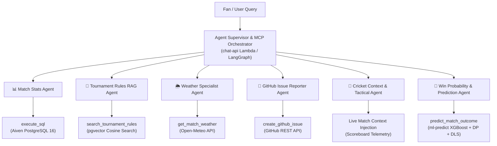

# ❓ CricScore Architecture & AI/MLOps FAQ

This document answers the most frequently asked architectural questions regarding CricScore's **Agentic AI System**, **Model Context Protocol (MCP)**, **MLOps Pipeline**, and **Hybrid Win Prediction Engine**.

---

## 📑 Table of Contents

1. [Agent Supervisor vs. LLM: Who decides which tool to call and who communicates with whom?](#1-agent-supervisor-vs-llm-who-decides-which-tool-to-call-and-who-communicates-with-whom)
2. [What is the "Cricket Context & Tactical Agent" and how does it work?](#2-what-is-the-cricket-context--tactical-agent-and-how-does-it-work)
3. [ECR Container Image vs. S3 Model Registry: Where do ML artifacts live and how are versions managed?](#3-ecr-container-image-vs-s3-model-registry-where-do-ml-artifacts-live-and-how-are-versions-managed)
4. [Direct Lambda vs. Conversational AI Agent: How is Win Probability computed?](#4-direct-lambda-vs-conversational-ai-agent-how-is-win-probability-computed)
5. [Complete Inventory: How many total agents and tools exist across the platform?](#5-complete-inventory-how-many-total-agents-and-tools-exist-across-the-platform)

---

## 1. Agent Supervisor vs. LLM: Who decides which tool to call and who communicates with whom?

### The Decision vs. Execution Distinction

- **The LLM decides _which_ tool to call (and what parameters to pass).**
- **The Agent Supervisor / MCP Orchestrator decides _if_ and _how_ that tool is safely executed.**

```
                      1. User message + Tool Schemas
 [User / Chat UI] ──────────────────────────────────────────► [Agent Supervisor (MCP Client)]
                                                                       │
                                                                       │ 2. Prompt + MCP Tool Schemas
                                                                       ▼
                                                                 [OpenAI-compatible LLM]
                                                                       │
                                              3. Structured Tool Call: │
                                                 `execute_sql(...)`    │
                                                                       ▼
 [Specialist Tool] ◄── 4. Verify & Execute ─────────────────── [Agent Supervisor (MCP Client)]
         │
         │ 5. Tool Result (Evidence)
         ▼
 [Agent Supervisor] ── 6. Tool Result + History ─────────────► [OpenAI-compatible LLM]
                                                                       │
                                                               7. Final Response (Cited Answer)
 [User / Chat UI] ◄─── 8. Formatted Markdown Response ─────────┴───────┘
```

### Who Communicates With Whom?

1. **User → Agent Supervisor**: The user sends their chat message along with active `matchId` and conversational history to `POST /chat` on API Gateway, which triggers the `chat-api` Lambda.
2. **Supervisor → LLM**: The supervisor initializes an in-memory MCP Client and Server (`InMemoryTransport`). It retrieves JSON Schema tool definitions (`execute_sql`, `search_tournament_rules`, `get_match_weather`, `create_github_issue`) and passes them along with the user's message and system guardrails to the configured LLM.
3. **LLM → Supervisor**: The LLM analyzes the request. If it needs external facts, **it does not execute the tool itself** (the LLM has no network or database access). Instead, it returns a structured JSON `tool_calls` object to the **Supervisor** (e.g. `[{"function": {"name": "execute_sql", "arguments": "{\"query\":\"SELECT ...\"}"}}]`).
4. **Supervisor → Specialist Tool Execution**: The supervisor validates that the request passes all security guardrails (e.g., verifying that the SQL query is strictly a single `SELECT` statement wrapped in a read-only transaction, and verifying that no more than 1 GitHub issue is filed in a single turn). It then calls the local MCP tool.
5. **Specialist Tool → Supervisor → LLM**: The tool returns raw JSON evidence to the supervisor, which appends `{ role: "tool", content: toolResult }` into the message history and sends it back to the LLM.
6. **LLM → User**: The LLM synthesizes a clean, user-friendly Markdown response with rulebook citations (`[Source: document_name]`) or tables.

---

## 2. What is the "Cricket Context & Tactical Agent" and how does it work?

### Why Raw SQL is Not Enough for Cricket Tactics

When a fan asks:

> _"We need 45 runs in 4 overs with 6 wickets left. Can we win, and how should we pace the chase?"_

A simple SQL query tool (`execute_sql`) can only tell you:

```json
{ "overs": 16, "balls": 0, "total_runs": 135, "wickets": 4, "target": 180 }
```

Raw numbers do not give tactical insight. They don't explain:

- What is the **Required Run Rate (RRR)** vs **Current Run Rate (CRR)**?
- What phase of the game are we in (**Death Overs: 16–20**)?
- How many overs do the front-line strike bowlers have left vs the 5th part-time bowler?
- What are the boundary dimensions or tournament fielding restrictions?

### How the Cricket Context & Tactical Agent Works

The **Cricket Context & Tactical Agent** operates as an intelligent in-game domain specialist across both the Node.js adapter and Python LangGraph service:

1. **Telemetry Injection (`ChatComponent.tsx` → `chatHandler.js`)**:
   - When viewing an active game in `MatchView.tsx`, the client automatically passes the active match telemetry.
   - The agent reconstructs the dynamic game state:
     - 1st Innings score, overs, run-rate momentum.
     - 2nd Innings score, current partnership, wickets in hand.
     - Live chase equation: **"Need X runs from Y balls at Z RRR"**.
2. **LangGraph Specialist Node (`apps/ai-service/cricscore_ai/graph.py`)**:
   - In the Python AI Service, the supervisor routes tactical queries to the **`analysis_node`**.
   - The `analysis_node` coordinates between:
     - `get_match_details` & `get_match_statistics` (recent bowler economy, boundary percentages, batter strike rates).
     - `search_tournament_rules` (maximum overs per bowler, powerplay rules, tiebreakers).
3. **Tactical Synthesis**:
   - Blends game state with cricket domain reasoning to offer tactical recommendations:
     - _Target pacing_: Recommending targeting specific bowlers in middle overs before specialist death bowlers take over.
     - _DLS awareness_: Warning if passing rain showers might bring the Duckworth-Lewis-Stern par score into play.
     - _Risk management_: Recommending whether to rotate strike or take boundary risks based on wickets in hand.

---

## 3. ECR Container Image vs. S3 Model Registry: Where do ML artifacts live and how are versions managed?

CricScore decouples the **execution runtime container** from the **ML model artifacts**:

| Component             | Hosted Location                         | Contents                                                                                                                                                                                                                        | Update Frequency                                                          |
| --------------------- | --------------------------------------- | ------------------------------------------------------------------------------------------------------------------------------------------------------------------------------------------------------------------------------- | ------------------------------------------------------------------------- |
| **Inference Runtime** | **Amazon ECR** (`cricscore-ml-predict`) | Python 3.12, Linux x86_64 pre-compiled binary wheels (XGBoost, Scikit-learn, Pandas, NumPy, Joblib), and Lambda handler entrypoints (`predict.py`, `win_probability.py`). Tagged with `:${var.ml_model_version}` and `:latest`. | Only when Python packages, OS base image, or core inference code changes. |
| **Model Registry**    | **Amazon S3** (`match_backups/models/`) | `live_win_predictor_model.joblib`, `model_manifest.json` (SHA-256 checksum), and `live_metadata.json` partitioned by version tag (e.g. `models/v2.2.0/`).                                                                       | Every time model retraining runs or a new model is promoted.              |

### How Dynamic Model Loading & Verification Works

1. **Cold Start Download**: When the `ml-predict` Lambda spins up, it inspects environment variables:
   - `MODEL_S3_BUCKET` (e.g., `cricscore-match-backups-dev`)
   - `MODEL_VERSION` (e.g., `v2.2.0`)
2. **Local Caching in `/tmp`**:
   - Downloads `model_manifest.json` and `live_win_predictor_model.joblib` to `/tmp/models/v2.2.0/`.
3. **SHA-256 Checksum Validation**:
   - Computes the SHA-256 hash of `/tmp/models/v2.2.0/live_win_predictor_model.joblib`.
   - Compares the computed hash against `manifest_data['artifact']['sha256']`.
   - **Security Guarantee**: If the hash does not match, the artifact is rejected immediately to prevent tampering or corrupted models from loading.
4. **Resilient Fallback**:
   - If S3 is unreachable, it seamlessly falls back to the baseline model bundled inside the Docker image.
   - If no artifact exists, it operates using the deterministic Markov DP + DLS mathematical simulation engine.
5. **Instant Zero-Downtime Rollbacks**:
   - You can switch or roll back model versions across dev and prod instantly with:
     ```bash
     ./infra/scripts/deploy.sh --env prod --use-local-env --model-version v2.1.0
     ```
   - Terraform updates the Lambda's `MODEL_VERSION` environment variable in ~5 seconds without needing to rebuild or push a 500MB+ Docker image to ECR!

---

## 4. Direct Lambda vs. Conversational AI Agent: How is Win Probability computed?

Win probability is calculated through two distinct architectural paths depending on latency and user experience requirements:

### Path A: High-Frequency Direct Lambda (`POST /match/predict`)

- **Consumer**: React Frontend Live Scoreboard (`AiMatchPrediction.tsx`).
- **Trigger**: Every single ball delivery entered by the scorer or received via WebSocket.
- **Latency**: **<100ms**.
- **Execution**: The browser invokes the `ml-predict` Lambda container directly through API Gateway. The Lambda executes XGBoost inference blended with the Markov Chain DP chase simulation and DLS resource tables, immediately returning numeric win percentages (e.g. `team1Probability: 0.64, team2Probability: 0.36`).
- **Why no LLM?**: Running an LLM agent reasoning loop on every ball would introduce 1–3 seconds of latency and substantial token costs. Direct serverless inference is optimal.

### Path B: Conversational Prediction Agent (`predict_match_outcome` tool)

- **Consumer**: AI Chat Assistant (`ChatComponent.tsx`).
- **Trigger**: When a user asks conversational questions such as:
  - _"Who is more likely to win this match and why?"_
  - _"What happens to our winning chances if we lose 2 wickets in the next over?"_
- **Execution**: The AI Chat Assistant routes to the **Prediction Agent**. It calls the predictive engine, receives the probabilistic outcome, and wraps it in a comprehensive cricket analysis explaining:
  - Current required run rate pressure.
  - Historical win likelihood given wickets in hand and remaining balls.
  - The tactical turning points in the match.

---

## 5. Complete Inventory: How many total agents and tools exist across the platform?

CricScore features **6 Specialist AI Agents** and **8 Tools / Data Capabilities**:



### Detailed Agent & Tool Specification

| #     | Specialist Agent                          | Capability / MCP Tool                   | Source & Technology         | Key Features & Guardrails                                                                                                                                                                |
| ----- | ----------------------------------------- | --------------------------------------- | --------------------------- | ---------------------------------------------------------------------------------------------------------------------------------------------------------------------------------------- |
| **1** | 📊 **Match Stats Agent**                  | `execute_sql`                           | Aiven PostgreSQL 16         | • Strict read-only `SELECT` enforcement<br/>• Blocks write/DDL keywords (`DROP`, `DELETE`, `UPDATE`)<br/>• 3-second statement timeout                                                    |
| **2** | 📖 **Tournament Rules (RAG) Agent**       | `search_tournament_rules`               | `pgvector` store (Aiven PG) | • Cosine similarity search on PDF chunks<br/>• Proportional powerplay scaling for shortened overs<br/>• Strict citation: `[Source: document_name]`<br/>• Anti-hallucination truthfulness |
| **3** | 🌦️ **Weather Specialist Agent**           | `get_match_weather`                     | Open-Meteo API              | • Geocoding + hourly forecasts<br/>• Rain probability %, temp, wind speed<br/>• Cricket & DLS rain advisories<br/>• $0 cost (no API key required)                                        |
| **4** | 🐛 **GitHub Issue Reporter Agent**        | `create_github_issue`                   | GitHub REST API             | • Creates labeled issues (`via-cricscore-ai`, category)<br/>• 2-step confirmation to capture title & description<br/>• Rate-limited: max 1 issue per message                             |
| **5** | 🏏 **Cricket Context & Tactical Agent**   | Live match context injection            | Real-time scoreboard state  | • Analyzes CRR vs RRR equations<br/>• Match phase analysis (Powerplay / Middle / Death)<br/>• Evaluates bowler overs and matchup strategy without extra DB queries                       |
| **6** | 🎯 **Win Probability & Prediction Agent** | `predict_match_outcome` / direct Lambda | XGBoost + Markov DP + DLS   | • Validates 8 situational features<br/>• Blends ML gradient boosting with dynamic programming<br/>• Produces probabilistic percentages and conversational commentary                     |

---

## 🔗 Related Documentation

- [AI Architecture & Agentic RAG](./ai_architecture.md)
- [Weather Report Agent Guide](./weather_report_agent.md)
- [GitHub Issue Specialist Agent Guide](./github_issue_agent.md)
- [MLOps Tutorial & Model Benchmarking](./mlops_tutorial.md)
- [ML Models Handbook](./ml_models_handbook.md)
- [Architecture & Diagrams Overview](./architecture.md)
