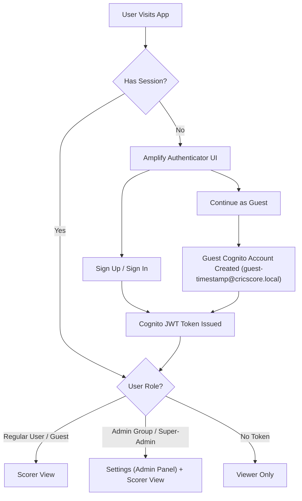
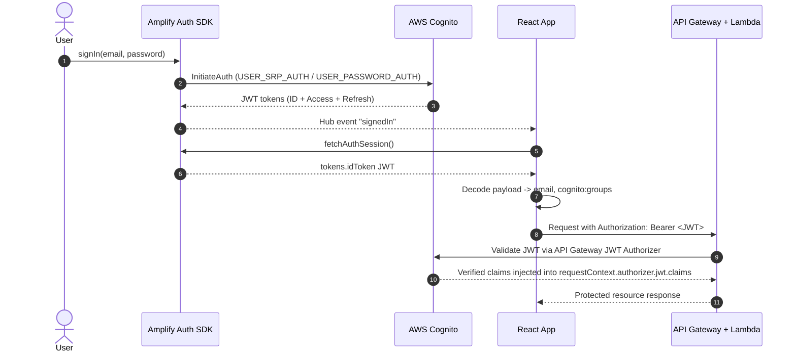

# 🔐 Authentication & Authorization

CricScore uses **AWS Cognito User Pools** and an **API Gateway HTTP JWT Authorizer** with a four-tier role model supporting public spectators, authenticated scorers, ephemeral guest scorers, and administrators.

---

## 🏛️ 1. Auth Architecture Overview



---

## 👤 2. User Roles & Capabilities

| Role          | Access Level                                                            | Identity Mechanism                                 | Token / Claim Verification                                  |
| :------------ | :---------------------------------------------------------------------- | :------------------------------------------------- | :---------------------------------------------------------- |
| **Viewer 🌍** | Live scoreboard, match history, win predictions, read-only AI chat      | Unauthenticated                                    | None required (`authorization_type = "NONE"`)               |
| **Scorer 🎮** | Create/score matches, switch innings, email reports, delete own matches | Cognito User Pool account                          | Valid JWT + `claims.email === matchRecord.scorer_email`     |
| **Guest 🎮**  | Full scorer capabilities via zero-friction shadow account               | Auto-confirmed `guest-{timestamp}@cricscore.local` | Auto-confirmed by `cognito-presignup` Lambda; JWT issued    |
| **Admin ⚡**  | User & role management, rulebook RAG ingestion, bulk DB cleanup         | Cognito `Admin` group or `ADMIN_REPORT_EMAIL`      | Valid JWT + `isAdminClaims(claims)` / `requireAdmin(event)` |

---

## 🔑 3. Authentication Flows

| Flow                             | Trigger                     | Step-by-Step Execution                                                                                                                                                                                                                                  | State & Storage Impact                                                                    |
| :------------------------------- | :-------------------------- | :------------------------------------------------------------------------------------------------------------------------------------------------------------------------------------------------------------------------------------------------------ | :---------------------------------------------------------------------------------------- |
| **Regular Sign-Up / Sign-In**    | Click **SCORER** tab        | 1. Amplify Authenticator collects `email`, `given_name`, `family_name`<br>2. `Hub.listen("auth", "signedIn")` fires<br>3. `fetchAuthSession()` retrieves JWT (`idToken`)                                                                                | Sets `userToken`, `userEmail`, and `isAdmin` (if `cognito:groups` contains `Admin`)       |
| **Guest Mode**                   | Click **Continue as Guest** | 1. Calls `signOut()` to clear prior session<br>2. Calls `signUp({ username: "guest-{timestamp}@cricscore.local" })`<br>3. `cognito-presignup` Lambda sets `autoConfirmUser = true` & `autoVerifyEmail = true`<br>4. Immediately signs in via `signIn()` | Sets `isGuestScorer = true`; matches tagged with `scorer_email = guest-*@cricscore.local` |
| **Sign Out**                     | Click **SIGN OUT**          | 1. Calls `signOut()` via `aws-amplify/auth`<br>2. Scrubs `?matchId` from URL via `window.history.replaceState`                                                                                                                                          | Resets `userToken`, `isAdmin`, `userEmail` to `null`; returns view to `VIEWER`            |
| **Cross-Session Identity Guard** | `userEmail` changes         | 1. `prevEmailRef` detects identity change (e.g., Guest $\rightarrow$ Regular User)<br>2. Clears in-memory match state (`matchStatus`, `matchId`, `currentInnings`)                                                                                      | Increments `hubKey` and reloads scoped state from `cric-match-state-{email}`              |

---

## 🗝️ 4. Session Token Lifecycle



---

## 🛡️ 5. Authorization Enforcement Matrix

### Route-Level Security (`infra/terraform/apigateway_http.tf`)

| Endpoint Pattern                                                                                                                                                                                                                                     | API Gateway Auth | Lambda Handler Check                                                                 | Who Can Access                               |
| :--------------------------------------------------------------------------------------------------------------------------------------------------------------------------------------------------------------------------------------------------- | :--------------- | :----------------------------------------------------------------------------------- | :------------------------------------------- |
| `GET /health`, `GET /matches`, `GET /match/{matchId}`, `GET /match/{matchId}/details`                                                                                                                                                                | `NONE`           | Public read queries                                                                  | Anyone                                       |
| `POST /match/predict`, `POST /chat`, `POST /chat/summary`                                                                                                                                                                                            | `NONE`           | Read-only execution; `/chat` & `/chat/summary` throttled at `5 req/s` (`10` burst)   | Anyone (strictly read-only tools in `/chat`) |
| `POST /match`                                                                                                                                                                                                                                        | `JWT`            | Requires `claims.email` (`401` if missing)                                           | Any authenticated Scorer, Guest, or Admin    |
| `PATCH /match/{matchId}`, `DELETE /match/{matchId}`, `POST /match/{matchId}/innings`, `POST /match/{matchId}/email`, `POST /update-score`                                                                                                            | `JWT`            | `isAuthorized(event, matchRecord)` (`403` if neither owner nor Admin)                | Match owner (`scorer_email`) or Admin        |
| `DELETE /matches`, `GET /admin/users`, `DELETE /admin/users`, `POST /admin/users/roles`, `DELETE /admin/users/roles`, `DELETE /admin/users/guests`, `DELETE /admin/matches/guests`, `DELETE /admin/matches/incomplete`, `DELETE /admin/matches/test` | `JWT`            | `isAdminClaims(claims)` in `match-api/index.js` (`403` if non-admin)                 | Admin only                                   |
| `GET /rules`, `DELETE /rules`, `POST /rules/upload`                                                                                                                                                                                                  | `JWT`            | `requireAdmin(event, corsHeaders)` in `chat-api/config/auth.js` (`403` if non-admin) | Admin only                                   |

### Exact Admin Group & Claim Verification (`match-api` & `chat-api`)

API Gateway HTTP APIs serialize array claims such as `cognito:groups` either as a JSON array or a bracketed string (e.g., `"[Admin Scorer]"`). Both `match-api/index.js` (`isAdminClaims`) and `chat-api/config/auth.js` (`isAdmin`) strip brackets/quotes, split on whitespace/commas, and check for an **exact** `"Admin"` token match or `ADMIN_REPORT_EMAIL`:

```javascript
// apps/backend/lambdas/match-api/index.js
const isAdminClaims = (claims) => {
  if (!claims || typeof claims !== "object") return false;
  const userEmail = claims.email;
  const isSuperAdmin = Boolean(
    userEmail &&
    process.env.ADMIN_REPORT_EMAIL &&
    userEmail.toLowerCase() === process.env.ADMIN_REPORT_EMAIL.toLowerCase(),
  );
  const groups = claims["cognito:groups"] || [];
  const groupList = Array.isArray(groups)
    ? groups
    : String(groups)
        .replace(/[[\]"]/g, "")
        .split(/[\s,]+/)
        .map((g) => g.trim())
        .filter(Boolean);
  const hasAdminGroup = groupList.includes("Admin");
  return isSuperAdmin || hasAdminGroup;
};
```

> [!IMPORTANT]
> Client-supplied headers (such as the legacy `x-scorer-email`) and request body flags (`isAdmin` in `POST /chat`) are **never** trusted for privilege elevation. Identity and group membership are read exclusively from `event.requestContext.authorizer.jwt.claims`.

---

## 👥 6. Admin User & Database Lifecycle Operations

| Admin Operation              | Route                              | AWS SDK / SQL Action                                                                   | Safeguards                                                 |
| :--------------------------- | :--------------------------------- | :------------------------------------------------------------------------------------- | :--------------------------------------------------------- |
| **List Users**               | `GET /admin/users`                 | `ListUsersCommand` + `ListUsersInGroupCommand` (`Admin`, `Scorer`)                     | Requires `isAdminClaims(claims)`                           |
| **Promote Role**             | `POST /admin/users/roles`          | `AdminAddUserToGroupCommand` (`Admin` or `Scorer`)                                     | Requires `isAdminClaims(claims)`                           |
| **Demote Role**              | `DELETE /admin/users/roles`        | `AdminRemoveUserFromGroupCommand`                                                      | Blocks demoting `ADMIN_REPORT_EMAIL` (`400`)               |
| **Delete User**              | `DELETE /admin/users`              | `AdminDeleteUserCommand`                                                               | Blocks deleting primary system admin or self (`400`)       |
| **Purge Guest Users**        | `DELETE /admin/users/guests`       | Paginates `ListUsersCommand` + `AdminDeleteUserCommand` for `guest` accounts           | Only deletes accounts with `guest` email/username prefix   |
| **Purge Guest Matches**      | `DELETE /admin/matches/guests`     | `DELETE FROM matches WHERE scorer_email LIKE 'guest-%' OR scorer_email LIKE 'guest_%'` | Cascades to child innings, players, bowlers, and balls     |
| **Purge Incomplete Matches** | `DELETE /admin/matches/incomplete` | `DELETE FROM matches WHERE status != 'COMPLETED' AND status != 'ABANDONED'`            | Preserves finished & abandoned historical fixtures         |
| **Purge Test Matches**       | `DELETE /admin/matches/test`       | `DELETE FROM matches WHERE is_test = TRUE OR ...`                                      | Cleans E2E/practice fixtures without touching user matches |

---

## 🔒 7. Cognito Infrastructure Configuration (`infra/terraform/cognito.tf`)

| Setting                           | Configured Value                                                              | Source File                          |
| :-------------------------------- | :---------------------------------------------------------------------------- | :----------------------------------- |
| **User Pool Name**                | `${var.project_name}-user-pool`                                               | `infra/terraform/cognito.tf`         |
| **Sign-In / Auto-Verified Alias** | `email`                                                                       | `infra/terraform/cognito.tf`         |
| **Password Policy**               | Min `8` chars; requires uppercase, lowercase, number, and symbol              | `infra/terraform/cognito.tf`         |
| **Pre-Sign-Up Trigger**           | `module.cognito_presignup.arn` (auto-confirms `guest-*@cricscore.local`)      | `infra/terraform/cognito.tf`         |
| **Explicit Auth Flows**           | `ALLOW_USER_PASSWORD_AUTH`, `ALLOW_REFRESH_TOKEN_AUTH`, `ALLOW_USER_SRP_AUTH` | `infra/terraform/cognito.tf`         |
| **Admin Group**                   | `Admin` (`aws_cognito_user_group.admin`)                                      | `infra/terraform/cognito.tf`         |
| **API Gateway Authorizer**        | `cognito-authorizer` (`$request.header.Authorization`)                        | `infra/terraform/apigateway_http.tf` |

---

## 🧪 8. Verification & CLI Commands

### Run Auth & Authorization Unit Tests

```bash
# Run backend authorization test suite (match-api, score-update, chat-api, cognito-presignup)
npm run test --prefix apps/backend

# Run frontend scorer access & auth config unit tests
npx --prefix apps/frontend vitest run src/test/scorerAccess.test.ts src/test/authConfig.test.ts
```

### Verify JWT Enforcement Against Deployed API

```bash
# 1. Unauthenticated POST /match -> Expect HTTP 401 Unauthorized
curl -i -X POST "https://api.cricscoredev.venkateshsingamsetty.com/match" \
  -H "Content-Type: application/json" \
  -d '{"teamA":"India","teamB":"Australia","totalOvers":5}'

# 2. Unauthenticated GET /rules -> Expect HTTP 401 Unauthorized
curl -i "https://api.cricscoredev.venkateshsingamsetty.com/rules"

# 3. Inspect Cognito User Pool groups via AWS CLI
aws cognito-idp list-groups \
  --user-pool-id "$(cd infra/terraform && terraform output -raw cognito_user_pool_id)" \
  --region us-east-1
```
