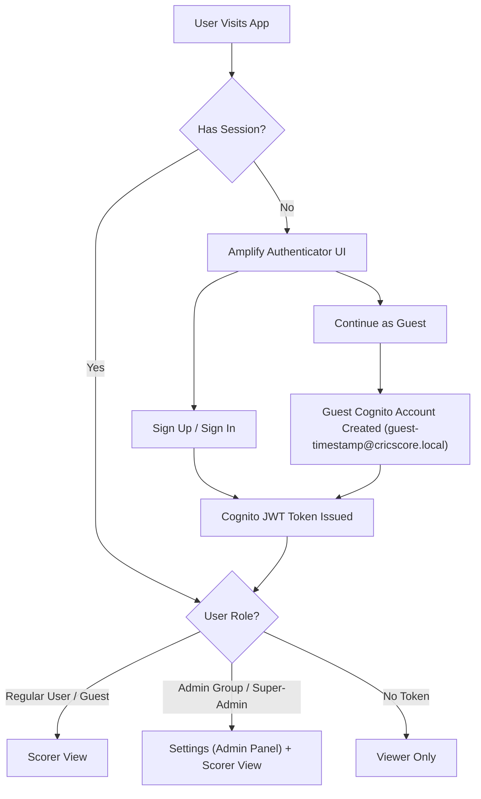
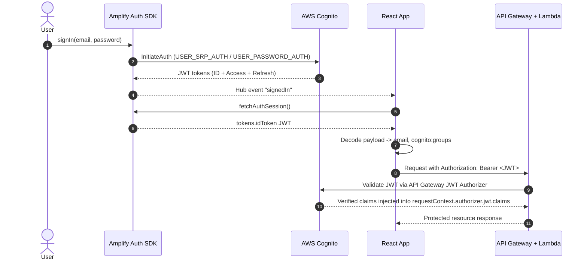

# 🔐 Authentication & Authorization

CricScore uses **AWS Cognito User Pools** and an **API Gateway HTTP JWT Authorizer** with a four-tier role model supporting public spectators, authenticated scorers, ephemeral guest scorers, and administrators.

---

## 🏛️ 1. Auth Architecture Overview



---

## 👤 2. User Roles & Capabilities

### RBAC Permission Matrix

| Capability                      | Viewer 🌍 | Guest 🎮 | Scorer 🎮 | Admin ⚡ |
| :------------------------------ | :-------: | :------: | :-------: | :------: |
| Live Scoreboard & Match History |    ✅     |    ✅    |    ✅     |    ✅    |
| Read-Only AI Chat & Predictions |    ✅     |    ✅    |    ✅     |    ✅    |
| Create & Score Matches          |    ❌     |    ✅    |    ✅     |    ✅    |
| Edit / Delete Own Matches       |    ❌     |    ✅    |    ✅     |    ✅    |
| Edit / Delete Any Match         |    ❌     |    ❌    |    ❌     |    ✅    |
| Rulebook RAG Upload & Admin Ops |    ❌     |    ❌    |    ❌     |    ✅    |

### Role Identity & Verification Breakdown

- **Viewer 🌍 (Unauthenticated Spectator):**
  - Accesses live scoreboards, match history, hybrid ML win predictions, deterministic POTM awards, and read-only AI chat.
  - Requires no Cognito session (`authorization_type = "NONE"`).
- **Scorer 🎮 (Authenticated Cognito User):**
  - Creates and scores matches, switches innings, dispatches SES email reports, and deletes own matches.
  - Verified via valid Cognito JWT and ownership check (`claims.email === matchRecord.scorer_email`).
- **Guest 🎮 (Ephemeral Shadow Account):**
  - Full scorer capabilities via a zero-friction shadow account (`guest-{timestamp}@cricscore.local`) scoped to the browser session.
  - Auto-confirmed immediately by the `cognito-presignup` Lambda trigger with a standard Cognito JWT.
- **Admin ⚡ (Cognito `Admin` Group / `ADMIN_REPORT_EMAIL`):**
  - Manages Cognito users and roles (`Admin` / `Scorer`), uploads tournament PDF rulebooks for `pgvector` RAG ingestion, and runs bulk database cleanup operations.
  - Verified server-side by `isAdminClaims(claims)` and `requireAdmin(event)`.

---

## 🔑 3. Authentication Flows

- **Sign-Up / Login (Click `SCORER` Tab):**
  - Amplify Authenticator collects `email`, `given_name`, and `family_name`.
  - `Hub.listen("auth", "signedIn")` fires and `fetchAuthSession()` retrieves the JWT (`idToken`).
  - Sets `userToken` and `userEmail`, and enables `isAdmin` if `cognito:groups` contains `Admin`.
- **Guest Mode (Click `Continue as Guest`):**
  - Calls `signOut()` to clear any prior session, then calls `signUp({ username: "guest-{timestamp}@cricscore.local" })`.
  - The `cognito-presignup` Lambda sets `autoConfirmUser = true` and `autoVerifyEmail = true`, allowing immediate `signIn()`.
  - Sets `isGuestScorer = true` and tags created matches with `scorer_email = guest-*@cricscore.local`.
- **Sign Out (Click `SIGN OUT`):**
  - Calls `signOut()` via `aws-amplify/auth` and scrubs `?matchId` from the URL via `window.history.replaceState`.
  - Resets `userToken`, `isAdmin`, and `userEmail` to `null` and returns the active view to `VIEWER`.
- **Identity Guard (`userEmail` Change Detection):**
  - `prevEmailRef` detects identity changes (e.g., transitioning from Guest to Regular User) and clears in-memory match state (`matchStatus`, `matchId`, `currentInnings`).
  - Increments `hubKey` and reloads user-scoped state from `cric-match-state-{email}`.

---

## 🗝️ 4. Session Token Lifecycle



---

## 🛡️ 5. Authorization Enforcement Matrix

### Route-Level Security (`infra/terraform/apigateway_http.tf`)

- **Public Read-Only Match Queries (`GET /health`, `GET /matches`, `GET /match/{matchId}`, `GET /match/{matchId}/details`):**
  - **API Gateway Auth**: `NONE`
  - **Handler Guard**: Public read-only PostgreSQL queries accessible to anyone.
- **Public AI & ML Inference (`POST /match/predict`, `POST /chat`, `POST /chat/summary`):**
  - **API Gateway Auth**: `NONE`
  - **Handler Guard**: Strictly read-only tools in `/chat`; `/chat` and `/chat/summary` are throttled at `5 req/s` (`10` burst).
- **Match Creation (`POST /match`):**
  - **API Gateway Auth**: `JWT`
  - **Handler Guard**: Requires verified `claims.email` (`401` if missing); accessible to any authenticated Scorer, Guest, or Admin.
- **Match Mutation & Scoring (`PATCH /match/{matchId}`, `DELETE /match/{matchId}`, `POST /match/{matchId}/innings`, `POST /match/{matchId}/email`, `POST /update-score`):**
  - **API Gateway Auth**: `JWT`
  - **Handler Guard**: Enforces `isAuthorized(event, matchRecord)` — returns `403` unless caller is the match owner (`scorer_email`) or an Admin.
- **Admin User & Database Operations (`DELETE /matches`, `GET|DELETE /admin/users`, `POST|DELETE /admin/users/roles`, `DELETE /admin/users/guests`, `DELETE /admin/matches/{guests,incomplete,test}`):**
  - **API Gateway Auth**: `JWT`
  - **Handler Guard**: Enforces `isAdminClaims(claims)` in `match-api/index.js` (`403` if non-admin).
- **Tournament Rulebook RAG Management (`GET /rules`, `DELETE /rules`, `POST /rules/upload`):**
  - **API Gateway Auth**: `JWT`
  - **Handler Guard**: Enforces `requireAdmin(event, corsHeaders)` in `chat-api/config/auth.js` (`403` if denied).

### Exact Admin Group & Claim Verification (`match-api` & `chat-api`)

API Gateway HTTP APIs serialize array claims such as `cognito:groups` either as a JSON array or a bracketed string (e.g., `"[Admin Scorer]"`). Both `match-api/index.js` (`isAdminClaims`) and `chat-api/config/auth.js` (`isAdmin`) strip brackets/quotes, split on whitespace/commas, and check for an **exact** `"Admin"` token match or `ADMIN_REPORT_EMAIL`:

```javascript
// apps/backend/lambdas/match-api/index.js
const isAdminClaims = (claims) => {
  if (!claims || typeof claims !== "object") return false;
  const userEmail = claims.email;
  const isSuperAdmin = Boolean(
    userEmail &&
    process.env.ADMIN_REPORT_EMAIL &&
    userEmail.toLowerCase() === process.env.ADMIN_REPORT_EMAIL.toLowerCase(),
  );
  const groups = claims["cognito:groups"] || [];
  const groupList = Array.isArray(groups)
    ? groups
    : String(groups)
        .replace(/[[\]"]/g, "")
        .split(/[\s,]+/)
        .map((g) => g.trim())
        .filter(Boolean);
  const hasAdminGroup = groupList.includes("Admin");
  return isSuperAdmin || hasAdminGroup;
};
```

> [!IMPORTANT]
> Client-supplied headers (such as the legacy `x-scorer-email`) and request body flags (`isAdmin` in `POST /chat`) are **never** trusted for privilege elevation. Identity and group membership are read exclusively from `event.requestContext.authorizer.jwt.claims`.

---

## 👥 6. Admin User & Database Lifecycle Operations

- **List Users (`GET /admin/users`):**
  - Executes `ListUsersCommand` and `ListUsersInGroupCommand` (`Admin`, `Scorer`).
  - Guarded by `isAdminClaims(claims)`.
- **Promote Role (`POST /admin/users/roles`):**
  - Executes `AdminAddUserToGroupCommand` (`Admin` or `Scorer`) after verifying `isAdminClaims(claims)`.
- **Demote Role (`DELETE /admin/users/roles`):**
  - Executes `AdminRemoveUserFromGroupCommand` after verifying `isAdminClaims(claims)`.
  - Blocks demoting the primary `ADMIN_REPORT_EMAIL` account (`400`).
- **Delete User (`DELETE /admin/users`):**
  - Executes `AdminDeleteUserCommand` after verifying `isAdminClaims(claims)`.
  - Blocks deleting the primary admin or the caller's own account (`400`).
- **Purge Guest Users (`DELETE /admin/users/guests`):**
  - Paginates `ListUsersCommand` and calls `AdminDeleteUserCommand` strictly for accounts with a `guest` email/username prefix.
- **Purge Guest Matches (`DELETE /admin/matches/guests`):**
  - Executes `DELETE FROM matches WHERE scorer_email LIKE 'guest-%' OR scorer_email LIKE 'guest_%'`, cascading to child innings, players, bowlers, and balls.
- **Purge Incomplete Matches (`DELETE /admin/matches/incomplete`):**
  - Executes `DELETE FROM matches WHERE status != 'COMPLETED' AND status != 'ABANDONED'`, preserving finished and abandoned historical fixtures.
- **Purge Test Matches (`DELETE /admin/matches/test`):**
  - Executes `DELETE FROM matches WHERE is_test = TRUE OR ...` to clean E2E and practice fixtures without touching user matches.

---

## 🔒 7. Cognito Infrastructure Configuration (`infra/terraform/cognito.tf`)

- **User Pool (`${var.project_name}-user-pool` in `infra/terraform/cognito.tf`):**
  - Uses `email` as the auto-verified sign-in alias.
  - Enforces a minimum 8-character password policy requiring uppercase, lowercase, numeric, and symbol characters.
- **Pre-Sign-Up Trigger (`module.cognito_presignup.arn`):**
  - Auto-confirms `guest-*@cricscore.local` shadow accounts while requiring standard verification for regular users.
- **Explicit Auth Flows & Groups (`infra/terraform/cognito.tf`):**
  - Enables `ALLOW_USER_PASSWORD_AUTH`, `ALLOW_REFRESH_TOKEN_AUTH`, and `ALLOW_USER_SRP_AUTH`.
  - Provisions the `Admin` group (`aws_cognito_user_group.admin`).
- **API Gateway JWT Authorizer (`infra/terraform/apigateway_http.tf`):**
  - Validates `$request.header.Authorization` against the Cognito User Pool issuer and client audience (`cognito-authorizer`).

---

## 🧪 8. Verification & CLI Commands

### Run Auth & Authorization Unit Tests

```bash
# Run backend authorization test suite (match-api, score-update, chat-api, cognito-presignup)
npm run test --prefix apps/backend

# Run frontend scorer access & auth config unit tests
npx --prefix apps/frontend vitest run src/test/scorerAccess.test.ts src/test/authConfig.test.ts
```

### Verify JWT Enforcement Against Deployed API

```bash
# 1. Unauthenticated POST /match -> Expect HTTP 401 Unauthorized
curl -i -X POST "https://api.cricscoredev.venkateshsingamsetty.com/match" \
  -H "Content-Type: application/json" \
  -d '{"teamA":"India","teamB":"Australia","totalOvers":5}'

# 2. Unauthenticated GET /rules -> Expect HTTP 401 Unauthorized
curl -i "https://api.cricscoredev.venkateshsingamsetty.com/rules"

# 3. Inspect Cognito User Pool groups via AWS CLI
aws cognito-idp list-groups \
  --user-pool-id "$(cd infra/terraform && terraform output -raw cognito_user_pool_id)" \
  --region us-east-1
```
