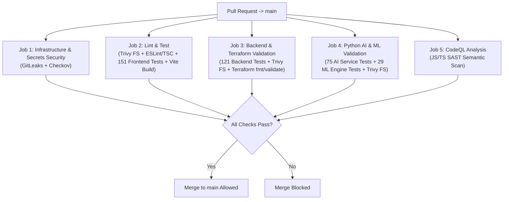

# 🛡️ Branch Protection & CI Governance

This guide documents CricScore's pull request validation gates, automated security checks, and recommended GitHub branch protection rules for `main`.

---

## 🔄 Pull Request Validation Pipeline



---

## 1. Automated Pull Request Status Checks

The `.github/workflows/ci.yml` and `.github/workflows/codeql.yml` workflows execute **376 automated unit/integration tests** alongside static security and infrastructure gates on every pull request targeting `main`:

| Status Check Job                           | Workflow File | What It Verifies                                                                                                                                                 |
| ------------------------------------------ | ------------- | ---------------------------------------------------------------------------------------------------------------------------------------------------------------- |
| **`Infrastructure & Secrets Security`**    | `ci.yml`      | • Full-history **GitLeaks** secrets scan<br/>• **Checkov** Terraform IaC security audit (`infra/terraform`)                                                      |
| **`Lint & Test`**                          | `ci.yml`      | • **Trivy** (`HIGH`/`CRITICAL`) scan on `apps/frontend`<br/>• TypeScript lint & typecheck<br/>• **151 Frontend Vitest** tests<br/>• Production Vite bundle build |
| **`Backend & Terraform Validation`**       | `ci.yml`      | • **121 Backend Vitest** tests<br/>• **Trivy** scan on `apps/backend/lambdas`<br/>• `terraform fmt -check` & `terraform validate`                                |
| **`Python AI & ML Validation`**            | `ci.yml`      | • **75 AI Service Pytest** tests<br/>• **29 ML Engine Pytest** tests<br/>• **Trivy** filesystem scan on `apps/ai-service`                                        |
| **`Analyze Code (javascript-typescript)`** | `codeql.yml`  | • GitHub **CodeQL** semantic SAST analysis<br/>• Detects XSS, injection, and taint-flow logic flaws                                                              |

> [!NOTE]
> Post-merge jobs (`Deploy, Test & OWASP ZAP DEV`, Playwright E2E suite, and `sbom.yml`) run on pushes to `main` or manual `workflow_dispatch`, keeping PR feedback fast and deterministic.

---

## 2. Recommended GitHub Branch Protection Settings (`main`)

Verify or configure these settings under **GitHub Repository -> Settings -> Branches -> Branch protection rules (`main`)**:

| Protection Setting                            | Recommended Value | Purpose                                                                                       |
| --------------------------------------------- | ----------------- | --------------------------------------------------------------------------------------------- |
| **Require a pull request before merging**     | `Enabled`         | • Prevents direct commits to `main`<br/>• Enforces peer/automated code review on every change |
| **Require status checks to pass**             | `Enabled`         | • Enforces all 5 CI and CodeQL validation jobs before merge                                   |
| **Require branches to be up to date**         | `Enabled`         | • Ensures the PR branch is tested against the latest `main` commit                            |
| **Do not allow bypassing the above settings** | `Enabled`         | • Enforces governance rules equally for repository administrators                             |
| **Allow force pushes**                        | `Disabled`        | • Protects commit history<br/>• Preserves `semantic-release` version tags                     |
| **Allow deletions**                           | `Disabled`        | • Prevents accidental deletion of the default `main` branch                                   |

---

## ⚡ CLI Commands to Inspect & Reproduce Locally

```bash
# Run the full local validation suite before pushing a branch (mirrors PR checks)
./infra/scripts/validate_local.sh --skip-e2e

# Query active branch protection status on main via GitHub CLI
gh api repos/:owner/:repo/branches/main/protection --jq '{
  strict_status_checks: .required_status_checks.strict,
  required_contexts: .required_status_checks.contexts,
  enforce_admins: .enforce_admins.enabled
}'
```

---

© 2026 CricScore Documentation. 🏎️🏁🚀
