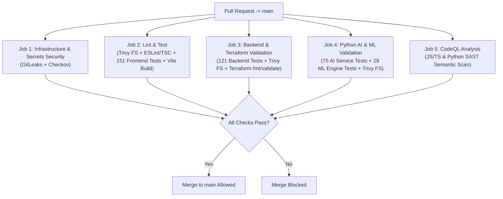

# 🛡️ Branch Protection & CI Governance

This guide documents CricScore's pull request validation gates, automated security checks, and recommended GitHub branch protection rules for `main`.

---

## 🔄 Pull Request Validation Pipeline



---

## 1. Automated Pull Request Status Checks

The `.github/workflows/ci.yml` and `.github/workflows/codeql.yml` workflows execute **`376` automated unit/integration tests** alongside static security and infrastructure gates on every pull request targeting `main`:

- **`Infrastructure & Secrets Security` (`ci.yml`):**
  - Runs full-history **GitLeaks** secrets scanning and **Checkov** Terraform IaC security audits (`infra/terraform`).
- **`Lint & Test` (`ci.yml`):**
  - Runs **Trivy** (`HIGH`/`CRITICAL`) filesystem scanning on `apps/frontend`, TypeScript lint & typecheck, **`151` Frontend Vitest** tests, and a production Vite bundle dry-run build.
- **`Backend & Terraform Validation` (`ci.yml`):**
  - Runs **`121` Backend Vitest** Lambda unit tests, **Trivy** scanning on `apps/backend/lambdas`, and `terraform fmt -check` + `terraform validate`.
- **`Python AI & ML Validation` (`ci.yml`):**
  - Runs **`75` AI Service Pytest** tests, **`29` ML Engine Pytest** tests (including `XGBoost v2.2.0` artifact checks), and **Trivy** filesystem scanning on `apps/ai-service`.
- **`Analyze Code (javascript-typescript / python)` (`codeql.yml`):**
  - Executes GitHub **CodeQL** semantic SAST analysis to detect XSS, injection, and taint-flow logic flaws.

> [!NOTE]
> Post-merge jobs (`deploy_and_test_dev`, `15` Playwright E2E tests, OWASP ZAP scan, and `sbom.yml`) run on pushes to `main` or manual `workflow_dispatch`, keeping PR feedback fast and deterministic.

---

## 2. Recommended GitHub Branch Protection Settings (`main`)

Verify or configure these settings under **GitHub Repository → Settings → Branches → Branch protection rules (`main`)**:

| Protection Setting                        | Value      | Purpose                           |
| :---------------------------------------- | :--------- | :-------------------------------- |
| **Require a pull request before merging** | `Enabled`  | Blocks direct commits to `main`   |
| **Require status checks to pass**         | `Enabled`  | Enforces all CI & CodeQL gates    |
| **Require branches to be up to date**     | `Enabled`  | Tests PR against latest `main`    |
| **Do not allow bypassing settings**       | `Enabled`  | Applies rules to administrators   |
| **Allow force pushes**                    | `Disabled` | Protects commit & release history |
| **Allow deletions**                       | `Disabled` | Prevents deleting `main` branch   |

---

## ⚡ CLI Commands to Inspect & Reproduce Locally

```bash
# Run the full local validation suite before pushing a branch (mirrors PR checks)
./infra/scripts/validate_local.sh --skip-e2e

# Query active branch protection status on main via GitHub CLI
gh api repos/:owner/:repo/branches/main/protection --jq '{
  strict_status_checks: .required_status_checks.strict,
  required_contexts: .required_status_checks.contexts,
  enforce_admins: .enforce_admins.enabled
}'
```

---

© 2026 CricScore Documentation. 🏎️🏁🚀
