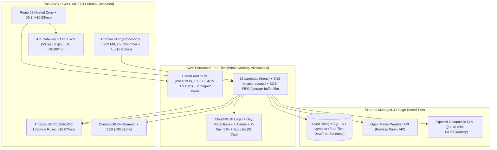

# 💰 Cloud Cost & Infrastructure Management (~$1/Month AWS Footprint)

CricScore is engineered around **serverless scale-to-zero** and deliberate architectural **trade-offs** to keep the combined **Development + Production** AWS monthly bill around **~$1.00 / month**.

---

## 🗺️ 1. Cost-Optimized Serverless Architecture



---

## 📊 2. Monthly AWS Cloud Cost Summary (Dev + Prod Combined)

Measured from AWS Cost Explorer in `us-east-1` across both deployed environments (`cricscoredev` and `cricscore`):

| AWS Service / Layer            |   Monthly Cost   | Primary Guardrail                            |
| :----------------------------- | :--------------: | :------------------------------------------- |
| **Amazon Route 53**            |    **~$0.53**    | 1 Hosted Zone + free Alias `A` queries       |
| **Amazon S3**                  |    **~$0.07**    | `7d` / `30d` / `180d` lifecycle expiration   |
| **Amazon API Gateway**         |    **~$0.06**    | `50 rps` stage cap (`5 rps` on `/chat`)      |
| **Amazon SES & DynamoDB**      |    **~$0.02**    | `PAY_PER_REQUEST` tables (zero idle cost)    |
| **Amazon ECR**                 |    **~$0.01**    | `xgboost-cpu ~309 MB` + `countNumber = 1`    |
| **Lambda, SNS & SQS FIFO**     |  **Free Tier**   | Within `1M` req & `400K` GB-s monthly tier   |
| **CloudFront, ACM & Cognito**  |  **Free Tier**   | `PriceClass_100` CDN & free public ACM certs |
| **CloudWatch, X-Ray & Budget** |  **Free Tier**   | `7-day` log retention, `5%` X-Ray, `$5` cap  |
| **Total Monthly AWS Bill**     | **~$0.85–$1.00** | **Combined Dev + Prod Serverless Footprint** |

### External Services Breakdown

- **Aiven PostgreSQL 16 + `pgvector` (Managed Free Tier — `$0/mo`):**
  - `1 vCPU`, `1 GB RAM`, `1 GB storage` shared across `dev` and `prod` schemas (`SET search_path`) and kept warm via `keepalive.yml`.
- **Open-Meteo Weather API (Public Forecast API — `$0/mo`):**
  - Keyless geocoding and hourly precipitation/wind data for live cricket DLS advisories.
- **OpenAI-Compatible LLM (`gpt-4o-mini` + `text-embedding-3-small` — `~$0.0004/query`):**
  - Usage-based API (`~$0.0003` per uploaded rulebook PDF), guarded by `5 req/sec` API Gateway route throttling.

---

## ⚖️ 3. Intentional Architectural Trade-Offs for the ~$1/Month Target

- **Public Serverless + JWT/IAM (Avoids NAT Gateway / VPC Endpoints — Saves `~$32.00+/mo`):**
  - Lambdas run outside a private VPC and connect to Aiven PostgreSQL over TLS (`sslmode=require`) with Cognito JWT and IAM authorization.
- **AWS-Managed Encryption `AES256` (Avoids Custom KMS Keys — Saves `~$2.00+/mo`):**
  - Uses `SSE-S3 (AES256)`, `alias/aws/sns`, and `sqs_managed_sse_enabled` to avoid `$1/key/month` customer-managed KMS fees.
- **Auto-Generated Markdown Dashboards (Avoids CloudWatch Dashboards — Saves `~$3.00+/mo`):**
  - Uses auto-generated [`docs/aws_resources_dashboard.md`](./aws_resources_dashboard.md) and [`docs/platform_dashboard.md`](./platform_dashboard.md) instead of paid `aws_cloudwatch_dashboard` widgets.
- **GitHub Secret Injection (Avoids AWS Secrets Manager — Saves `~$0.40/secret/mo`):**
  - Injects sensitive configuration via Terraform `TF_VAR_*` from GitHub Environment secrets and `.env.local`.
- **7-Day CloudWatch Log Retention (Avoids Indefinite Storage — Saves `~$0.50+/mo`):**
  - Enforces `retention_in_days = 7` on all API Gateway and Lambda log groups so historical logs never accumulate storage fees.
- **Shared Aiven PostgreSQL Instance (Avoids Dedicated Multi-AZ RDS — Saves `~$15.00+/mo`):**
  - Isolates `dev` and `prod` via PostgreSQL schemas (`SET search_path`) and keeps the instance warm with a scheduled keepalive workflow.

---

## 🏗️ 4. AWS Service-by-Service Cost & Sizing Tables (`us-east-1`)

### 4.1 Compute: AWS Lambda (9 Functions per Environment)

| Function                      | Package   | Memory    | Timeout | Warm Avg  |
| :---------------------------- | :-------- | :-------- | :------ | :-------- |
| `<project>-match-api`         | ZIP Node  | `128 MB`  | `30s`   | `~25 ms`  |
| `<project>-score-upd`         | ZIP Node  | `256 MB`  | `30s`   | `~15 ms`  |
| `<project>-storage-worker`    | ZIP Node  | `256 MB`  | `30s`   | `~20 ms`  |
| `<project>-broadcaster`       | ZIP Node  | `128 MB`  | `3s`    | `~10 ms`  |
| `<project>-onconnect`         | ZIP Node  | `128 MB`  | `3s`    | `~8 ms`   |
| `<project>-ondisconnect`      | ZIP Node  | `128 MB`  | `3s`    | `~8 ms`   |
| `<project>-cognito-presignup` | ZIP Node  | `128 MB`  | `3s`    | `~5 ms`   |
| `<project>-chat-api`          | ZIP Node  | `1024 MB` | `30s`   | `~800 ms` |
| `<project>-ml-predict`        | ECR Image | `1024 MB` | `30s`   | `~1.6 ms` |

> **Fan-Out Compute Math**: Every ball scored triggers `score-upd` (`0.00384 GB-s`) + `storage-worker` (`0.00512 GB-s`) + `broadcaster` (`0.00128 GB-s`) + `ml-predict` (`0.00160 GB-s`), consuming **`~0.0118 GB-seconds`** total. Scoring `1,000` full T20 matches (`240,000` deliveries) uses `< 1%` of the monthly `400,000 GB-second` AWS Free Tier allowance.

### 4.2 ML Container, Model Registry & DVC Governance

- **Private Amazon ECR (`infra/terraform/ecr.tf`):**
  - AWS Lambda requires container images in a same-account/region private ECR repo (`cricscoredev-ml-predict`, `cricscore-ml-predict`).
- **CPU Image Slimming (`xgboost-cpu ~309 MB` in `apps/ml-engine/Dockerfile`):**
  - Standard Linux `xgboost` wheels bundle `345 MB` of NVIDIA CUDA libraries; switching to `xgboost-cpu` cuts image size by **55%** (`684 MB` $\rightarrow$ **`~309 MB`**).
  - Reduces combined Dev+Prod ECR storage from `$0.17/mo` to **`~$0.01/mo`** (`500 MB` Free Tier covers ~81% of total `~618 MB`).
- **ECR Lifecycle Policy (`countNumber = 1` in `infra/terraform/ecr.tf`):**
  - Expires untagged images after **1 day** and retains strictly **1 active versioned image** (`countNumber = 1`) per repository.
- **S3 Model Registry (`infra/terraform/s3_backups.tf`):**
  - Stores `live_win_predictor_model.joblib` (`~227 KB`, **XGBoost v2.2.0**), `model_manifest.json`, and `live_metadata.json` under `s3://<project>-match-backups-.../models/<version>/` for instant rollbacks and SHA-256 verification in `/tmp`.
- **DVC Dataset Tracking (`dvc.yaml`, `dvc.lock`, `cricket-data/t20s_json.zip.dvc`):**
  - Tracks raw `22.7 MB` Cricsheet `t20s_json.zip` via MD5 hash (`31e19c47bdbc05d773938754d8589516`) for reproducible training (`compare_models.py`).

### 4.3 Storage, Edge, DNS & Cost Guardrails

- **Static App S3 Bucket (`infra/terraform/frontend.tf`):**
  - Versioned `<project>-app-*` bucket behind CloudFront OAC; noncurrent object versions expire after **7 days**.
- **Access Logs S3 Bucket (`infra/terraform/kms_and_logging.tf`):**
  - `<project>-app-logs-*` server access logs expire automatically after **30 days**.
- **Match Backups & Models Bucket (`infra/terraform/s3_backups.tf`):**
  - Completed match JSON snapshots (`backups/*`) expire after **180 days**, while `models/*` artifacts are retained permanently.
- **DynamoDB Connections (`infra/terraform/dynamodb.tf`):**
  - `<project>-connections` uses `billing_mode = "PAY_PER_REQUEST"` (`~$0.01/mo` with zero idle cost).
- **API Gateway Throttling (`infra/terraform/apigateway_http.tf`):**
  - Default stage cap of `50 rps` (`100` burst) and strict **`5 rps` (`10` burst)** cap on `/chat` and `/chat/summary` to prevent LLM token abuse.
- **AWS Budgets Alert (`infra/terraform/cost_budget.tf`):**
  - `<project>-monthly-budget` emails `var.admin_email` if actual monthly spend exceeds **`$5.00`**.

---

## 🧪 5. Runnable Cost & Resource Verification Commands

```bash
# 1. Inspect current month-to-date AWS spend by service via Cost Explorer
aws ce get-cost-and-usage \
  --time-period Start=$(date -u +%Y-%m-01),End=$(date -u +%Y-%m-%d) \
  --granularity MONTHLY \
  --metrics "UnblendedCost" \
  --group-by Type=DIMENSION,Key=SERVICE \
  --query "ResultsByTime[0].Groups[?Metrics.UnblendedCost.Amount!='0'].[Keys[0],Metrics.UnblendedCost.Amount]" \
  --output table

# 2. Verify ECR image size (~309 MB) and single-image retention (countNumber = 1)
aws ecr describe-images \
  --repository-name cricscoredev-ml-predict \
  --region us-east-1 \
  --query "imageDetails[*].[imageTags[0],imageSizeInBytes]" \
  --output table

# 3. Verify S3 lifecycle expiration policies (7d / 30d / 180d)
for b in $(aws s3api list-buckets --query "Buckets[?starts_with(Name, 'cricscore')].Name" --output text); do
  echo "=== $b ==="
  aws s3api get-bucket-lifecycle-configuration --bucket "$b" \
    --query "Rules[*].[ID,Status,Expiration.Days,NoncurrentVersionExpiration.NoncurrentDays]" \
    --output table 2>/dev/null || echo "No lifecycle rules"
done

# 4. Regenerate the local Markdown AWS Resource & Cost Dashboard
./infra/scripts/generate_platform_dashboard.sh
```
