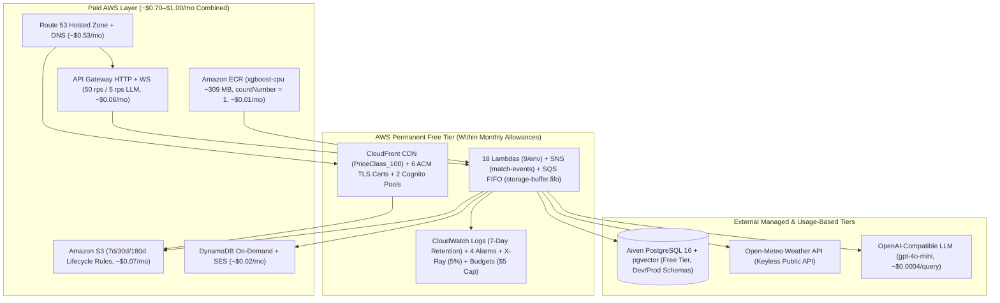

# 💰 Cloud Cost & Infrastructure Management (~$1/Month AWS Footprint)

CricScore is engineered around **serverless scale-to-zero** and deliberate architectural **trade-offs** to keep the combined **Development + Production** AWS monthly bill around **~$1.00 / month**.

---

## 🗺️ 1. Cost-Optimized Serverless Architecture



---

## 📊 2. Monthly AWS Cloud Cost Summary (Dev + Prod Combined)

Measured from AWS Cost Explorer in `us-east-1` across both deployed environments (`cricscoredev` and `cricscore`):

| AWS Service / Layer            |   Monthly Cost   | Primary Guardrail                            |
| :----------------------------- | :--------------: | :------------------------------------------- |
| **Amazon Route 53**            |    **~$0.53**    | 1 Hosted Zone + free Alias `A` queries       |
| **Amazon S3**                  |    **~$0.07**    | `7d` / `30d` / `180d` lifecycle expiration   |
| **Amazon API Gateway**         |    **~$0.06**    | `50 rps` stage cap (`5 rps` on `/chat`)      |
| **Amazon SES & DynamoDB**      |    **~$0.02**    | `PAY_PER_REQUEST` tables (zero idle cost)    |
| **Amazon ECR**                 |    **~$0.01**    | `xgboost-cpu ~309 MB` + `countNumber = 1`    |
| **Lambda, SNS & SQS FIFO**     |  **Free Tier**   | Within `1M` req & `400K` GB-s monthly tier   |
| **CloudFront, ACM & Cognito**  |  **Free Tier**   | `PriceClass_100` CDN & free public ACM certs |
| **CloudWatch, X-Ray & Budget** |  **Free Tier**   | `7-day` log retention, `5%` X-Ray, `$5` cap  |
| **Total Monthly AWS Bill**     | **~$0.85–$1.00** | **Combined Dev + Prod Serverless Footprint** |

### External Services Breakdown

- **Aiven PostgreSQL 16 + `pgvector` (Managed Free Tier — `$0/mo`):**
  - `1 vCPU`, `1 GB RAM`, `1 GB storage` shared across `dev` and `prod` schemas (`SET search_path`) and kept warm via `keepalive.yml`.
- **Open-Meteo Weather API (Public Forecast API — `$0/mo`):**
  - Keyless geocoding and hourly precipitation/wind data for live cricket DLS advisories.
- **OpenAI-Compatible LLM (`gpt-4o-mini` + `text-embedding-3-small` — `~$0.0004/query`):**
  - Usage-based API (`~$0.0003` per uploaded rulebook PDF), guarded by `5 req/sec` API Gateway route throttling.

---

## ⚖️ 3. Intentional Architectural Trade-Offs: Why We Avoided Expensive AWS Services

To maintain enterprise-grade security while sustaining a **`~$1.00/month`** run rate, CricScore intentionally avoids high-cost traditional AWS services. Instead, each omitted service is compensated by an enterprise-grade, **zero-cost software-level alternative**:

### 📊 Trade-Off & Savings Matrix

| Expensive AWS Service          |    Typical Cost     | Why Omitted                                                                                | CricScore Lean Enterprise Solution ($0.00)                                                     | Monthly Savings |
| :----------------------------- | :-----------------: | :----------------------------------------------------------------------------------------- | :--------------------------------------------------------------------------------------------- | :-------------: |
| **AWS NAT Gateways**           |  ~$32.40–$65.00/mo  | $0.045/hr per gateway + $0.045/GB data fees.                                               | Egress via AWS default serverless network over TLS with **Aiven Root CA verification**.        | **~$45.00/mo**  |
| **Private VPC & Subnets**      |   Included w/ NAT   | Requires NAT Gateways for Lambda outbound Internet access and adds ENI cold-start latency. | Serverless edge execution isolated by IAM, Cognito JWT authorizer, and CloudFront OAC.         |   Avoids NAT    |
| **AWS PrivateLink Endpoints**  | ~$7.20/mo / service | $0.01/hr per endpoint interface across multiple AZs.                                       | Authenticated HTTPS API calls signed with AWS SigV4 / IAM permissions.                         | **~$28.80/mo**  |
| **AWS WAF (Web App Firewall)** |  ~$15.00–$35.00/mo  | $5.00/mo per Web ACL + $1.00/rule/mo + traffic fees.                                       | **API Gateway token-bucket route rate limiting** (50 rps default, 5 rps LLM) + CloudFront OAC. | **~$20.00/mo**  |
| **Amazon ElastiCache (Redis)** |  ~$13.00–$25.00/mo  | Cannot scale to zero; minimum ~$13/mo for `cache.t4g.micro` + requires VPC/ENI setup.      | **DynamoDB Pay-Per-Request** for connection state (`~$0.01/mo`) + in-memory Lambda caching.    | **~$15.00/mo**  |
| **AWS Secrets Manager**        |      ~$3.20/mo      | $0.40/secret/mo + $0.05/10k API calls + 50–150ms cold-start latency.                       | **Encrypted Lambda Environment Variables** (AWS KMS encrypted at rest, 0ms latency).           |  **~$3.20/mo**  |
| **Dedicated RDS Multi-AZ**     |  ~$29.00–$55.00/mo  | Idle hourly instance billing for `db.t4g.micro` + storage.                                 | **Aiven Managed PostgreSQL Free Tier** (`pgvector` included) with schema isolation.            | **~$35.00/mo**  |
| **Customer Managed KMS Keys**  |   ~$2.00–$5.00/mo   | $1.00/key/mo + per-request cryptographic fees.                                             | Free **AWS-Managed Encryption** (`AES256`, `alias/aws/sns`, `sqs_managed_sse_enabled`).        |  **~$3.00/mo**  |
| **CloudWatch Paid Dashboards** |      ~$3.00/mo      | $3.00/month per dashboard widget view.                                                     | Auto-generated markdown dashboards refreshed automatically via GitHub Actions.                 |  **~$3.00/mo**  |
| **Total Avoided AWS Fees**     |                     |                                                                                            | **Achieves Enterprise Security & Scalability at ~$1/mo**                                       | **`~$150+/mo`** |

---

### Detailed Service-by-Service Rationale

#### 1. Why No AWS NAT Gateway & Private VPC?

- **The Problem:** In AWS, placing Lambda functions inside a Private VPC to isolate database traffic requires provisioning an **AWS NAT Gateway** so Lambdas can reach external services (Aiven PostgreSQL, OpenAI API, SES, Open-Meteo, GitHub API). NAT Gateways incur a fixed charge of **~$0.045/hour (~$32.40/month)** per Availability Zone, scaling to **~$65.00/month** for High Availability (2 AZs), plus $0.045 per GB transferred.
- **The Solution:** Lambdas run in AWS's native serverless network. All outbound communication with Aiven PostgreSQL travels over encrypted TLS 1.2+ and is cryptographically verified against the private **Aiven Project Root CA certificate (`aiven-ca.pem`)** via `rejectUnauthorized: true`. Inbound access is strictly blocked at the AWS API Gateway edge via Cognito JWT authorization.

#### 2. Why No AWS WAF (Web Application Firewall)?

- **The Problem:** AWS WAF charges **$5.00/month per Web ACL** plus **$1.00/rule/month** for AWS Managed Rules (OWASP Top 10, IP Reputation, Bot Control), plus $0.60 per million requests. For two environments (`dev` + `prod`), WAF alone would cost **$15.00–$35.00+/month**.
- **The Solution:** We implement defense-in-depth at the application and gateway layer without WAF:
  1. **Token-Bucket Throttling:** API Gateway enforces `50 req/s` (`100` burst) for API routes and a strict **`5 req/s` (`10` burst)** on `/chat` to eliminate LLM token exhaustion.
  2. **Origin Access Control (OAC):** S3 static web buckets block 100% of public internet traffic; only authenticated CloudFront edge requests can read static assets.
  3. **SQL Injection Neutralization:** 100% parameterized queries (`$1, $2, ...`) across all backend Lambdas.
  4. **AI Query Safeguards:** MCP `execute_sql` tool enforces a read-only transaction guard and regular expression validation to reject DDL/DML write statements.

#### 3. Why No Amazon ElastiCache (Redis / Memcached)?

- **The Problem:** AWS ElastiCache clusters cannot scale to zero. Even the smallest `cache.t4g.micro` node costs **~$13.00/month** (running 24/7), requires dedicated VPC subnets and ENIs, and incurs data transfer fees.
- **The Solution:**
  1. **Ephemeral WebSocket State:** Active WebSocket client connections (`connectionId`) are stored in an **Amazon DynamoDB table (`cricscore-connections`)** set to `PAY_PER_REQUEST` billing mode, costing **`~$0.01/month`** with zero idle cost.
  2. **Fast Read Performance:** PostgreSQL indexes (B-tree primary/foreign keys and HNSW vector indexes) deliver sub-millisecond query responses.
  3. **In-Memory Caching:** Lambda container instances reuse connection pools (`Pool.query`) and in-memory caches across warm invocations.

#### 4. Why No AWS Secrets Manager?

- **The Problem:** AWS Secrets Manager charges **$0.40 per secret per month** plus $0.05 per 10,000 API calls. Storing 4 secrets across `dev` and `prod` adds **~$3.20/month**. Furthermore, retrieving secrets at runtime via the Secrets Manager SDK adds **50–150ms of cold-start latency** to every Lambda container start.
- **The Solution:** Secrets are stored in GitHub Actions encrypted secrets and injected at deploy time into **Lambda Environment Variables**. AWS natively encrypts all Lambda environment variables at rest using default AWS-managed KMS keys at **$0.00 cost**. Variables are available in memory (`process.env`) on cold start with **0ms latency**.

#### 5. Why No Dedicated AWS RDS PostgreSQL Multi-AZ?

- **The Problem:** The smallest production-capable RDS instance (`db.t4g.micro` Multi-AZ) costs **~$29.00/month**, plus storage and automated backup fees.
- **The Solution:** We utilize **Aiven Managed PostgreSQL 16 Free Tier** (`1 vCPU`, `1 GB RAM`, `1 GB storage`, `pgvector` included). Environment isolation is achieved using PostgreSQL schemas (`DB_SCHEMA=dev` and `DB_SCHEMA=prod`) within a single database. Service hibernation is completely prevented by a daily synthetic E2E keep-alive workflow ([`.github/workflows/keepalive.yml`](file:///Users/venkat/workspace/gitRepos/cricscore/.github/workflows/keepalive.yml)), saving **~$35.00/month**.

#### 6. Why No Customer Managed KMS Keys (CMK)?

- **The Problem:** AWS Key Management Service charges **$1.00/key/month** for each Customer Managed Key, plus $0.03 per 10,000 cryptographic calls. Creating dedicated CMKs for S3, SNS, SQS, ECR, and CloudWatch would add **$5.00–$7.00/month**.
- **The Solution:** CricScore uses free **AWS-Managed Encryption** (`AES256` for S3, `alias/aws/sns` for SNS topics, and `sqs_managed_sse_enabled = true` for SQS FIFO queues) achieving AES-256 encryption at rest at **$0.00 cost**.

#### 7. Why No Multi-Account AWS Organization (AWS Control Tower)?

- **The Problem:** While large enterprises split Dev, Prod, and Audit into separate AWS accounts, each AWS account requires independent Route 53 root hosted zones ($0.50/zone/mo), separate Terraform state buckets, and cross-account IAM role complexity.
- **The Solution:** A unified single AWS account (`926789386606`) where `dev` and `prod` are isolated cleanly by **resource prefixes** (`cricscoredev-*` vs `cricscore-*`), **Route 53 subdomains** (`cricscoredev.domain.com` vs `cricscore.domain.com`), and **database schemas** (`dev` vs `prod`).

---

## 🏗️ 4. AWS Service-by-Service Cost & Sizing Tables (`us-east-1`)

### 4.1 Compute: AWS Lambda (9 Functions per Environment)

| Function                      | Package   | Memory    | Timeout | Warm Avg  |
| :---------------------------- | :-------- | :-------- | :------ | :-------- |
| `<project>-match-api`         | ZIP Node  | `128 MB`  | `30s`   | `~25 ms`  |
| `<project>-score-upd`         | ZIP Node  | `256 MB`  | `30s`   | `~15 ms`  |
| `<project>-storage-worker`    | ZIP Node  | `256 MB`  | `30s`   | `~20 ms`  |
| `<project>-broadcaster`       | ZIP Node  | `128 MB`  | `3s`    | `~10 ms`  |
| `<project>-onconnect`         | ZIP Node  | `128 MB`  | `3s`    | `~8 ms`   |
| `<project>-ondisconnect`      | ZIP Node  | `128 MB`  | `3s`    | `~8 ms`   |
| `<project>-cognito-presignup` | ZIP Node  | `128 MB`  | `3s`    | `~5 ms`   |
| `<project>-chat-api`          | ZIP Node  | `1024 MB` | `30s`   | `~800 ms` |
| `<project>-ml-predict`        | ECR Image | `1024 MB` | `30s`   | `~1.6 ms` |

> **Fan-Out Compute Math**: Every ball scored triggers `score-upd` (`0.00384 GB-s`) + `storage-worker` (`0.00512 GB-s`) + `broadcaster` (`0.00128 GB-s`) + `ml-predict` (`0.00160 GB-s`), consuming **`~0.0118 GB-seconds`** total. Scoring `1,000` full T20 matches (`240,000` deliveries) uses `< 1%` of the monthly `400,000 GB-second` AWS Free Tier allowance.

### 4.2 ML Container, Model Registry & DVC Governance

- **Private Amazon ECR (`infra/terraform/ecr.tf`):**
  - AWS Lambda requires container images in a same-account/region private ECR repo (`cricscoredev-ml-predict`, `cricscore-ml-predict`).
- **CPU Image Slimming (`xgboost-cpu ~309 MB` in `apps/ml-engine/Dockerfile`):**
  - Standard Linux `xgboost` wheels bundle `345 MB` of NVIDIA CUDA libraries; switching to `xgboost-cpu` cuts image size by **55%** (`684 MB` $\rightarrow$ **`~309 MB`**).
  - Reduces combined Dev+Prod ECR storage from `$0.17/mo` to **`~$0.01/mo`** (`500 MB` Free Tier covers ~81% of total `~618 MB`).
- **ECR Lifecycle Policy (`countNumber = 1` in `infra/terraform/ecr.tf`):**
  - Expires untagged images after **1 day** and retains strictly **1 active versioned image** (`countNumber = 1`) per repository.
- **S3 Model Registry (`infra/terraform/s3_backups.tf`):**
  - Stores `live_win_predictor_model.joblib` (`~227 KB`, **XGBoost v2.2.0**), `model_manifest.json`, and `live_metadata.json` under `s3://<project>-match-backups-.../models/<version>/` for instant rollbacks and SHA-256 verification in `/tmp`.
- **DVC Dataset Tracking (`dvc.yaml`, `dvc.lock`, `cricket-data/t20s_json.zip.dvc`):**
  - Tracks raw `22.7 MB` Cricsheet `t20s_json.zip` via MD5 hash (`31e19c47bdbc05d773938754d8589516`) for reproducible training (`compare_models.py`).

### 4.3 Storage, Edge, DNS & Cost Guardrails

- **Static App S3 Bucket (`infra/terraform/frontend.tf`):**
  - Versioned `<project>-app-*` bucket behind CloudFront OAC; noncurrent object versions expire after **7 days**.
- **Access Logs S3 Bucket (`infra/terraform/kms_and_logging.tf`):**
  - `<project>-app-logs-*` server access logs expire automatically after **30 days**.
- **Match Backups & Models Bucket (`infra/terraform/s3_backups.tf`):**
  - Completed match JSON snapshots (`backups/*`) expire after **180 days**, while `models/*` artifacts are retained permanently.
- **DynamoDB Connections (`infra/terraform/dynamodb.tf`):**
  - `<project>-connections` uses `billing_mode = "PAY_PER_REQUEST"` (`~$0.01/mo` with zero idle cost).
- **API Gateway Throttling (`infra/terraform/apigateway_http.tf`):**
  - Default stage cap of `50 rps` (`100` burst) and strict **`5 rps` (`10` burst)** cap on `/chat` and `/chat/summary` to prevent LLM token abuse.
- **AWS Budgets Alert (`infra/terraform/cost_budget.tf`):**
  - `<project>-monthly-budget` emails `var.admin_email` if actual monthly spend exceeds **`$5.00`**.

---

## 🧪 5. Runnable Cost & Resource Verification Commands

```bash
# 1. Inspect current month-to-date AWS spend by service via Cost Explorer
aws ce get-cost-and-usage \
  --time-period Start=$(date -u +%Y-%m-01),End=$(date -u +%Y-%m-%d) \
  --granularity MONTHLY \
  --metrics "UnblendedCost" \
  --group-by Type=DIMENSION,Key=SERVICE \
  --query "ResultsByTime[0].Groups[?Metrics.UnblendedCost.Amount!='0'].[Keys[0],Metrics.UnblendedCost.Amount]" \
  --output table

# 2. Verify ECR image size (~309 MB) and single-image retention (countNumber = 1)
aws ecr describe-images \
  --repository-name cricscoredev-ml-predict \
  --region us-east-1 \
  --query "imageDetails[*].[imageTags[0],imageSizeInBytes]" \
  --output table

# 3. Verify S3 lifecycle expiration policies (7d / 30d / 180d)
for b in $(aws s3api list-buckets --query "Buckets[?starts_with(Name, 'cricscore')].Name" --output text); do
  echo "=== $b ==="
  aws s3api get-bucket-lifecycle-configuration --bucket "$b" \
    --query "Rules[*].[ID,Status,Expiration.Days,NoncurrentVersionExpiration.NoncurrentDays]" \
    --output table 2>/dev/null || echo "No lifecycle rules"
done

# 4. Regenerate the local Markdown AWS Resource & Cost Dashboard
./infra/scripts/generate_platform_dashboard.sh
```
