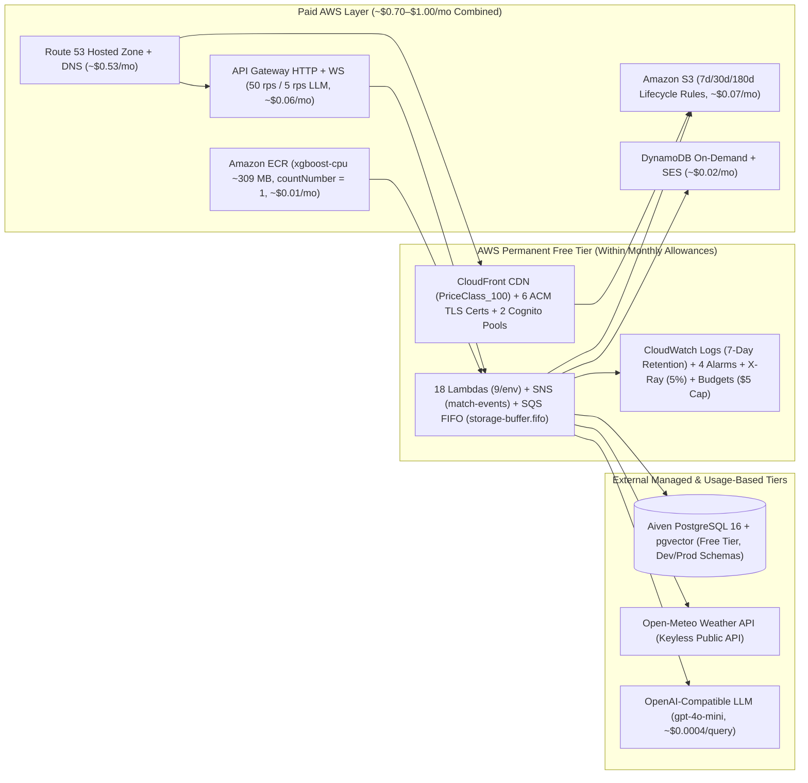

# 💰 Cloud Cost & Infrastructure Management (~$1/Month AWS Footprint)

CricScore is engineered around **serverless scale-to-zero** and deliberate architectural **trade-offs** to keep the combined **Development + Production** AWS monthly bill around **~$1.00 / month**.

---

## 🗺️ 1. Cost-Optimized Serverless Architecture



---

## 📊 2. Monthly AWS Cloud Cost Summary (Dev + Prod Combined)

Measured from AWS Cost Explorer in `us-east-1` across both deployed environments (`cricscoredev` and `cricscore`):

| AWS Service / Layer            | Provisioned Resources (Dev + Prod)                                                           | Monthly AWS Cost | Cost Driver & Architectural Trade-Off                                                                                                              |
| :----------------------------- | :------------------------------------------------------------------------------------------- | :--------------: | :------------------------------------------------------------------------------------------------------------------------------------------------- |
| **Amazon Route 53**            | • 1 Hosted Zone<br/>• Alias (`A`) & ACM DNS validation records                               |    **~$0.53**    | • Fixed `$0.50/mo` hosted zone + `~$0.03/mo` standard DNS queries<br/>• `A` Alias queries to CloudFront & API Gateway are free                     |
| **Amazon S3**                  | • Static SPA buckets & access logs<br/>• Match backups, ML model registry, & Terraform state |    **~$0.07**    | • Lifecycle rules expire old static versions after **7d**<br/>• Access logs expire after **30d** and match backups after **180d**                  |
| **Amazon API Gateway**         | • 2 HTTP APIs<br/>• 2 WebSocket APIs                                                         |    **~$0.06**    | • `$1.00` per million requests/messages<br/>• Protected by stage throttling (`50 rps`) and `/chat` route throttling (`5 rps`)                      |
| **Amazon SES & DynamoDB**      | • Scorecard email dispatch<br/>• `PAY_PER_REQUEST` WebSocket connection tables               |    **~$0.02**    | • On-demand DynamoDB (`PAY_PER_REQUEST`, zero idle RCU/WCU cost)<br/>• `$0.10` per 1,000 SES emails                                                |
| **Amazon ECR**                 | • 2 private repos (`cricscoredev-ml-predict`, `cricscore-ml-predict`)                        |    **~$0.01**    | • `xgboost-cpu` slims each image from `684 MB` to `~309 MB` (`countNumber = 1`)<br/>• `500 MB/mo` free tier + `$0.10/GB-mo` on remaining `~118 MB` |
| **Lambda, SNS & SQS FIFO**     | • 9 functions per env (`18` total)<br/>• SNS `match-events` + SQS `storage-buffer.fifo`      |  **Free Tier**   | • Covered under permanent monthly allowances<br/>• `1M` Lambda invocations, `400K` GB-s, `1M` SNS publishes, `1M` SQS FIFO requests                |
| **CloudFront, ACM & Cognito**  | • Global CDN (`PriceClass_100`)<br/>• 6 ACM TLS certs & 2 Cognito User Pools                 |  **Free Tier**   | • `1 TB/mo` CloudFront egress & public ACM TLS certificates<br/>• Cognito User Pool MAUs within permanent free allowances                          |
| **CloudWatch, X-Ray & Budget** | • 7-day log groups & 2 metric alarms per env<br/>• 5% X-Ray sampling & `$5` AWS Budgets      |  **Free Tier**   | • `retention_in_days = 7` keeps logs well under `5 GB` allowance<br/>• `5%` X-Ray trace sampling stays under `100K` traces/mo                      |
| **Total Monthly AWS Bill**     | **Full Multi-Environment Serverless Platform (Dev + Prod)**                                  | **~$0.85–$1.00** | **Production-grade serverless architecture running for ~$1/month**                                                                                 |

### External Services Breakdown

| External Service                  | Tier / Model                             | Cost Footprint     | Notes                                                                                                                                  |
| :-------------------------------- | :--------------------------------------- | :----------------- | :------------------------------------------------------------------------------------------------------------------------------------- |
| **Aiven PostgreSQL + `pgvector`** | Managed Free Tier                        | Included           | • `1 vCPU`, `1 GB RAM`, `1 GB storage`<br/>• Shared across `dev` and `prod` schemas (`SET search_path`), kept warm via `keepalive.yml` |
| **Open-Meteo Weather API**        | Public Forecast API                      | Included           | • Keyless geocoding<br/>• Hourly precipitation and wind cricket DLS advisories                                                         |
| **OpenAI-Compatible LLM**         | `gpt-4o-mini` + `text-embedding-3-small` | `~$0.0004` / query | • Usage-based API (`~$0.0003` per uploaded rulebook PDF)<br/>• Guarded by `5 req/sec` API Gateway route throttling                     |

---

## ⚖️ 3. Intentional Architectural Trade-Offs for the ~$1/Month Target

| Architectural Decision                 | Paid Alternative Avoided                           | Monthly Savings | Trade-Off & Mitigation in CricScore                                                                                                                                                                |
| :------------------------------------- | :------------------------------------------------- | :-------------: | :------------------------------------------------------------------------------------------------------------------------------------------------------------------------------------------------- |
| **Public Serverless + JWT/IAM**        | AWS NAT Gateway / VPC Interface Endpoints          |  **~$32.00+**   | • Lambdas run outside a private VPC<br/>• Connect to Aiven PostgreSQL over TLS (`sslmode=require`) with Cognito JWT & IAM authorization                                                            |
| **AWS-Managed Encryption (`AES256`)**  | KMS Customer-Managed Keys (`aws_kms_key`)          |   **~$2.00+**   | • Uses `SSE-S3 (AES256)`, `alias/aws/sns`, and `sqs_managed_sse_enabled`<br/>• Avoids `$1/key/month` custom KMS key fees                                                                           |
| **Auto-Generated Markdown Dashboards** | CloudWatch Dashboards (`aws_cloudwatch_dashboard`) |   **~$3.00+**   | • Uses auto-generated [`docs/aws_resources_dashboard.md`](./aws_resources_dashboard.md) and [`docs/platform_dashboard.md`](./platform_dashboard.md)<br/>• Avoids `$3/mo` CloudWatch dashboard fees |
| **GitHub Secret Injection**            | AWS Secrets Manager                                | **~$0.40/sec**  | • Injects sensitive config via Terraform `TF_VAR_*` from GitHub Environment secrets and `.env.local`                                                                                               |
| **7-Day CloudWatch Log Retention**     | Indefinite (`Never Expire`) Log Storage            |   **~$0.50+**   | • Enforces `retention_in_days = 7` on all API Gateway and Lambda log groups<br/>• Prevents historical logs from accumulating storage fees                                                          |
| **Shared Aiven PostgreSQL Instance**   | Dedicated RDS / Multi-AZ PostgreSQL                |  **~$15.00+**   | • Isolates `dev` and `prod` via PostgreSQL schemas (`SET search_path`)<br/>• Keeps instance warm with a scheduled keepalive workflow                                                               |

---

## 🏗️ 4. AWS Service-by-Service Cost & Sizing Tables (`us-east-1`)

### 4.1 Compute: AWS Lambda (9 Functions per Environment)

| Function                      | Package Type | Memory    | Timeout | Avg Warm Duration | GB-s per Ball  | Primary Role                                                                                     |
| :---------------------------- | :----------- | :-------- | :------ | :---------------- | :------------- | :----------------------------------------------------------------------------------------------- |
| `<project>-match-api`         | ZIP (Node24) | `128 MB`  | `30s`   | `~25 ms`          | —              | • Match CRUD & deep-link hydration<br/>• Admin ops, SES email, & S3 backup                       |
| `<project>-score-upd`         | ZIP (Node24) | `256 MB`  | `30s`   | `~15 ms`          | `0.00384 GB-s` | • Validates ball events<br/>• Fans out in parallel to SNS + SQS FIFO                             |
| `<project>-storage-worker`    | ZIP (Node24) | `256 MB`  | `30s`   | `~20 ms`          | `0.00512 GB-s` | • Consumes SQS FIFO (`batch_size = 1`)<br/>• Persists deliveries & rollbacks to PostgreSQL       |
| `<project>-broadcaster`       | ZIP (Node24) | `128 MB`  | `3s`    | `~10 ms`          | `0.00128 GB-s` | • Consumes SNS events<br/>• Pushes WebSocket frames via API Gateway                              |
| `<project>-onconnect`         | ZIP (Node24) | `128 MB`  | `3s`    | `~8 ms`           | —              | • Registers active spectator WebSocket `connectionId` in DynamoDB                                |
| `<project>-ondisconnect`      | ZIP (Node24) | `128 MB`  | `3s`    | `~8 ms`           | —              | • Removes disconnected spectator `connectionId` from DynamoDB                                    |
| `<project>-cognito-presignup` | ZIP (Node24) | `128 MB`  | `3s`    | `~5 ms`           | —              | • Auto-confirms `guest-*@cricscore.local` shadow accounts                                        |
| `<project>-chat-api`          | ZIP (Node24) | `1024 MB` | `30s`   | `~800 ms`         | —              | • Read-only Agentic RAG (`pgvector` + `execute_sql` guard)<br/>• AI summary & deterministic POTM |
| `<project>-ml-predict`        | ECR Image    | `1024 MB` | `30s`   | `~1.6 ms`         | `0.00160 GB-s` | • XGBoost (`v2.2.0`, S3 versioned model registry)<br/>• Markov DP + DLS win predictor            |

> **Fan-Out Compute Math**: Every ball scored triggers `score-upd` + `storage-worker` + `broadcaster` (+ `ml-predict`), consuming **`~0.0118 GB-seconds`** total. Scoring `1,000` full T20 matches (`240,000` deliveries) uses `< 1%` of the monthly `400,000 GB-second` AWS Free Tier allowance.

### 4.2 ML Container, Model Registry & DVC Governance

| Component                              | Technical Mechanism                                                                                                                                                              | Cost / Storage Impact                                                                                                              | Source File                                                      |
| :------------------------------------- | :------------------------------------------------------------------------------------------------------------------------------------------------------------------------------- | :--------------------------------------------------------------------------------------------------------------------------------- | :--------------------------------------------------------------- |
| **Private Amazon ECR**                 | • AWS Lambda `CreateFunction`/`UpdateFunctionCode` requires container images in a same-account/region private ECR repo<br/>• Cannot deploy directly from `public.ecr.aws`        | • 2 private repos (`cricscoredev-ml-predict`, `cricscore-ml-predict`)                                                              | `infra/terraform/ecr.tf`                                         |
| **CPU Image Slimming (`xgboost-cpu`)** | • Standard Linux `xgboost` wheels bundle `345 MB` of NVIDIA CUDA libraries<br/>• Switching to `xgboost-cpu` cuts image size by **55%** (`684 MB` $\rightarrow$ **`~309 MB`**)    | • Reduces combined Dev+Prod ECR storage from `$0.17/mo` to **`~$0.01/mo`**<br/>• `500 MB` Free Tier covers ~81% of total `~618 MB` | `apps/ml-engine/Dockerfile`                                      |
| **ECR Lifecycle (`countNumber = 1`)**  | • Automated `aws_ecr_lifecycle_policy` expires untagged images after **1 day**<br/>• Retains strictly **1 active versioned image** (`countNumber = 1`) per repo                  | • Prevents old container digests from accumulating `$0.10/GB-month` charges                                                        | `infra/terraform/ecr.tf`                                         |
| **S3 Model Registry**                  | • Stores `live_win_predictor_model.joblib` (`~227 KB`), `model_manifest.json`, & `live_metadata.json`<br/>• Versioned under `s3://<project>-match-backups-.../models/<version>/` | • Enables instant model rollbacks & SHA-256 verification in `/tmp` without rebuilding Docker images                                | `infra/terraform/s3_backups.tf`                                  |
| **DVC Dataset Tracking**               | • Tracks raw `22.7 MB` Cricsheet `t20s_json.zip` via MD5 hash (`31e19c47bdbc05d773938754d8589516`)<br/>• Reproducible training pipeline (`compare_models.py`)                    | • Keeps Git repository fast and lightweight while preserving full ML reproducibility                                               | • `dvc.yaml` & `dvc.lock`<br/>• `cricket-data/t20s_json.zip.dvc` |

### 4.3 Storage, Edge, DNS & Cost Guardrails

| Resource / Policy          | Configuration                                                                                   | Retention / Limit                                                               | Terraform Source                                 |
| :------------------------- | :---------------------------------------------------------------------------------------------- | :------------------------------------------------------------------------------ | :----------------------------------------------- |
| **Static App Bucket**      | • `<project>-app-*` versioned S3 bucket behind CloudFront OAC                                   | • Noncurrent versions expire after **7 days**                                   | `infra/terraform/frontend.tf`                    |
| **Access Logs Bucket**     | • `<project>-app-logs-*` S3 server access logging target                                        | • Log objects expire after **30 days**                                          | `infra/terraform/kms_and_logging.tf`             |
| **Match Backups Bucket**   | • `<project>-match-backups-*` stores completed match JSON snapshots + ML models                 | • `backups/*` expire after **180 days**<br/>• `models/*` kept permanently       | `infra/terraform/s3_backups.tf`                  |
| **DynamoDB Connections**   | • `<project>-connections` with `billing_mode = "PAY_PER_REQUEST"`                               | • On-demand WebSocket connection registry (`~$0.01/mo`)                         | `infra/terraform/dynamodb.tf`                    |
| **Route 53 + CloudFront**  | • `PriceClass_100` CDN + DNS-validated ACM TLS certs                                            | • `$0.50/mo` hosted zone + `~$0.03/mo` queries<br/>• Alias `A` queries are free | `infra/terraform/frontend.tf`                    |
| **API Gateway Throttling** | • Default stage `50 rps` (`100` burst)<br/>• `/chat` & `/chat/summary` **`5 rps` (`10` burst)** | • Caps unauthenticated LLM token spend and API abuse                            | `infra/terraform/apigateway_http.tf`             |
| **CloudWatch Logs**        | • `retention_in_days = 7` on all 9 Lambdas + 2 API Gateways per env                             | • Keeps total log storage well under the `5 GB/mo` Free Tier                    | • `modules/zip_lambda/main.tf`<br/>• `lambda.tf` |
| **AWS Budgets Alert**      | • `<project>-monthly-budget` (`$5.00/month` cap)                                                | • Emails `var.admin_email` if actual monthly spend exceeds `$5.00`              | `infra/terraform/cost_budget.tf`                 |

---

## 🧪 5. Runnable Cost & Resource Verification Commands

```bash
# 1. Inspect current month-to-date AWS spend by service via Cost Explorer
aws ce get-cost-and-usage \
  --time-period Start=$(date -u +%Y-%m-01),End=$(date -u +%Y-%m-%d) \
  --granularity MONTHLY \
  --metrics "UnblendedCost" \
  --group-by Type=DIMENSION,Key=SERVICE \
  --query "ResultsByTime[0].Groups[?Metrics.UnblendedCost.Amount!='0'].[Keys[0],Metrics.UnblendedCost.Amount]" \
  --output table

# 2. Verify ECR image size (~309 MB) and single-image retention (countNumber = 1)
aws ecr describe-images \
  --repository-name cricscoredev-ml-predict \
  --region us-east-1 \
  --query "imageDetails[*].[imageTags[0],imageSizeInBytes]" \
  --output table

# 3. Verify S3 lifecycle expiration policies (7d / 30d / 180d)
for b in $(aws s3api list-buckets --query "Buckets[?starts_with(Name, 'cricscore')].Name" --output text); do
  echo "=== $b ==="
  aws s3api get-bucket-lifecycle-configuration --bucket "$b" \
    --query "Rules[*].[ID,Status,Expiration.Days,NoncurrentVersionExpiration.NoncurrentDays]" \
    --output table 2>/dev/null || echo "No lifecycle rules"
done

# 4. Regenerate the local Markdown AWS Resource & Cost Dashboard
./infra/scripts/generate_platform_dashboard.sh
```
