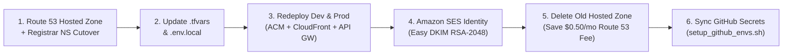

# 🌐 Domain Migration Log & Runbook (`.site` → `.com`)

This runbook documents the end-to-end migration of CricScore from `.site` to `.com` (`cricscore.venkateshsingamsetty.com` & `cricscore-dev.venkateshsingamsetty.com`), including DNS cutover, ACM/CloudFront updates, Amazon SES DKIM verification, and Route 53 cost cleanup to preserve the **`~$1/month` total AWS footprint** (Dev + Prod combined).

---

## 🔄 Migration Workflow



---

## 📋 Step-by-Step Migration Checklist

| Step  | Component                    | Action Taken / Configuration Updated                                                                                    | Cost / Operational Impact                                                   |
| ----- | ---------------------------- | ----------------------------------------------------------------------------------------------------------------------- | --------------------------------------------------------------------------- |
| **1** | **Route 53 & Registrar**     | Created `.com` Hosted Zone via `infra/terraform/bootstrap` and updated all 4 NS records at the domain registrar.        | `$0.50/month` for the active hosted zone                                    |
| **2** | **Terraform `.tfvars`**      | Updated `zone_domain` and `domain_name` in `infra/terraform/environments/dev.tfvars` and `prod.tfvars`.                 | Points CloudFront, ACM, and Cognito callbacks to `.com`                     |
| **3** | **Local `.env.local`**       | Updated `DOMAIN_NAME`, `ZONE_DOMAIN`, and `TF_SES_SOURCE_EMAIL=noreply@<new-domain>.com`.                               | Ensures local deploy scripts pass verified sender identity                  |
| **4** | **ACM, CloudFront & API GW** | Re-ran `./infra/scripts/deploy.sh` for `dev` and `prod` to issue free ACM TLS certs and update CloudFront aliases.      | Included with ACM (public TLS certificates have no extra charge)            |
| **5** | **Amazon SES (Email)**       | Created `.com` Domain Identity with **Easy DKIM (`RSA_2048_BIT`)** and auto-published verification records to Route 53. | Enables authenticated password-reset and admin report emails                |
| **6** | **Old Resource Cleanup**     | Deleted the old `.site` SES identity, non-default DNS records, and the old `.site` Route 53 Hosted Zone.                | Eliminates duplicate `$0.50/month` hosted zone charge (`~$1/mo` total kept) |
| **7** | **GitHub Environments**      | Executed `./infra/scripts/setup_github_envs.sh` to sync `DOMAIN_NAME`, `ZONE_DOMAIN`, and `TF_SES_SOURCE_EMAIL`.        | Keeps automated CI/CD deployments aligned with the new domain               |

---

## ⚡ Runnable Migration & Verification Commands

### 1. Provision Bootstrap DNS & Redeploy Environments

```bash
# 1. Deploy Dev and Prod stacks with updated .tfvars and .env.local
./infra/scripts/deploy.sh --env dev --use-local-env
./infra/scripts/deploy.sh --env prod --use-local-env

# 2. Synchronize updated domain variables to GitHub Actions (dev & prod environments)
./infra/scripts/setup_github_envs.sh
```

### 2. Verify DNS Propagation & SSL Certificates

```bash
# Verify Route 53 NS delegation and CloudFront A/ALIAS resolution
dig NS venkateshsingamsetty.com +short
dig A cricscore.venkateshsingamsetty.com +short
dig A cricscore-dev.venkateshsingamsetty.com +short

# Verify HTTPS TLS certificate subject and issuer
curl -Iv https://cricscore.venkateshsingamsetty.com 2>&1 | grep -E "subject:|issuer:|SSL certificate verify"
```

### 3. Decommission Legacy Hosted Zone (Cost Protection)

```bash
# List hosted zones to confirm only a single active zone remains ($0.50/mo)
aws route53 list-hosted-zones --query "HostedZones[*].[Id,Name,ResourceRecordSetCount]" --output table
```

---

© 2026 CricScore Documentation. 🏎️🏁🚀
