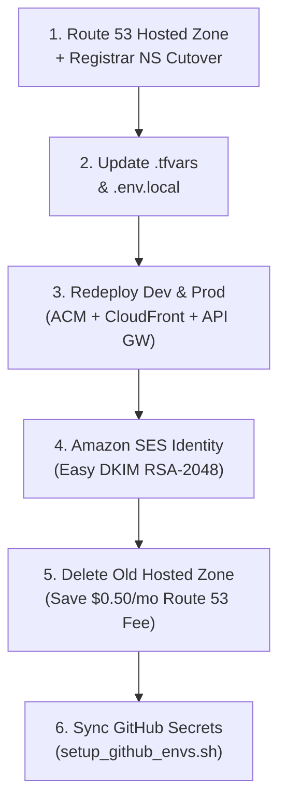

# 🌐 Domain Migration Log & Runbook (`.site` → `.com`)

This runbook documents the end-to-end migration of CricScore from `.site` to `.com`, including DNS cutover, ACM/CloudFront updates, Amazon SES DKIM verification, and Route 53 cost cleanup to preserve the **`~$1/month` total AWS footprint** (`dev` + `prod` combined):

- **Production Domain**: `cricscore.venkateshsingamsetty.com`
- **Development Domain**: `cricscoredev.venkateshsingamsetty.com`

---

## 🔄 Migration Workflow



---

## 📋 Step-by-Step Migration Checklist

1. **Route 53 & Registrar (`infra/terraform/bootstrap`):**
   - Created the `.com` Route 53 Hosted Zone and updated all 4 NS records at the domain registrar (`$0.50/month` for the single active hosted zone).
2. **Terraform `.tfvars` (`infra/terraform/environments/`):**
   - Updated `zone_domain` and `domain_name` in `dev.tfvars` and `prod.tfvars` so CloudFront, ACM, and Cognito callbacks point to `.com`.
3. **Local `.env.local`:**
   - Updated `DOMAIN_NAME`, `ZONE_DOMAIN`, and `TF_SES_SOURCE_EMAIL=noreply@<new-domain>.com` for local deployments.
4. **ACM, CloudFront & API Gateway (`./infra/scripts/deploy.sh`):**
   - Re-ran `deploy.sh` for `dev` and `prod` to issue free ACM public TLS certificates and update CloudFront aliases and API Gateway custom domains.
5. **Amazon SES Email Identity:**
   - Created the `.com` Domain Identity with **Easy DKIM (`RSA_2048_BIT`)** and auto-published DKIM verification records to Route 53 for authenticated password-reset and scorecard emails.
6. **Legacy Resource Cleanup (Cost Protection):**
   - Deleted the old `.site` SES identity, removed non-default DNS records, and deleted the legacy `.site` Route 53 Hosted Zone to eliminate duplicate `$0.50/month` zone fees and preserve the **`~$1/month`** total AWS budget.
7. **GitHub Environments Sync (`./infra/scripts/setup_github_envs.sh`):**
   - Synced `DOMAIN_NAME`, `ZONE_DOMAIN`, and `TF_SES_SOURCE_EMAIL` to the `dev` and `prod` GitHub Actions environments.

---

## ⚡ Runnable Migration & Verification Commands

### 1. Provision Bootstrap DNS & Redeploy Environments

```bash
# 1. Deploy Dev and Prod stacks with updated .tfvars and .env.local
./infra/scripts/deploy.sh --env dev --use-local-env
./infra/scripts/deploy.sh --env prod --use-local-env

# 2. Synchronize updated domain variables to GitHub Actions (dev & prod environments)
./infra/scripts/setup_github_envs.sh
```

### 2. Verify DNS Propagation & SSL Certificates

```bash
# Verify Route 53 NS delegation and CloudFront A/ALIAS resolution
dig NS venkateshsingamsetty.com +short
dig A cricscore.venkateshsingamsetty.com +short
dig A cricscoredev.venkateshsingamsetty.com +short

# Verify HTTPS TLS certificate subject and issuer
curl -Iv https://cricscore.venkateshsingamsetty.com 2>&1 | grep -E "subject:|issuer:|SSL certificate verify"
```

### 3. Decommission Legacy Hosted Zone (Cost Protection)

```bash
# List hosted zones to confirm only a single active zone remains ($0.50/mo)
aws route53 list-hosted-zones --query "HostedZones[*].[Id,Name,ResourceRecordSetCount]" --output table
```

---

© 2026 CricScore Documentation. 🏎️🏁🚀
