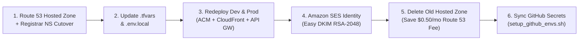

# 🌐 Domain Migration Log & Runbook (`.site` → `.com`)

This runbook documents the end-to-end migration of CricScore from `.site` to `.com`, including DNS cutover, ACM/CloudFront updates, Amazon SES DKIM verification, and Route 53 cost cleanup to preserve the **`~$1/month` total AWS footprint** (Dev + Prod combined):

- **Production Domain**: `cricscore.venkateshsingamsetty.com`
- **Development Domain**: `cricscore-dev.venkateshsingamsetty.com`

---

## 🔄 Migration Workflow



---

## 📋 Step-by-Step Migration Checklist

| Step  | Component                         | Action Taken / Configuration Updated                                                                                                           | Cost / Operational Impact                                                                                    |
| ----- | --------------------------------- | ---------------------------------------------------------------------------------------------------------------------------------------------- | ------------------------------------------------------------------------------------------------------------ |
| **1** | **Route&nbsp;53 & Registrar**     | • Created `.com` Hosted Zone via `infra/terraform/bootstrap`<br/>• Updated all 4 NS records at the domain registrar                            | • `$0.50/month` for the single active hosted zone                                                            |
| **2** | **Terraform&nbsp;`.tfvars`**      | • Updated `zone_domain` and `domain_name` in `infra/terraform/environments/dev.tfvars`<br/>• Applied matching `.com` settings in `prod.tfvars` | • Points CloudFront, ACM, and Cognito callbacks to `.com`                                                    |
| **3** | **Local&nbsp;`.env.local`**       | • Updated `DOMAIN_NAME` and `ZONE_DOMAIN`<br/>• Set `TF_SES_SOURCE_EMAIL=noreply@<new-domain>.com`                                             | • Ensures local deploy scripts pass verified sender identity                                                 |
| **4** | **ACM, CloudFront & API&nbsp;GW** | • Re-ran `./infra/scripts/deploy.sh` for `dev` and `prod`<br/>• Issued free ACM TLS certificates and updated CloudFront aliases                | • Included with ACM (public TLS certificates have no extra charge)                                           |
| **5** | **Amazon&nbsp;SES (Email)**       | • Created `.com` Domain Identity with **Easy DKIM (`RSA_2048_BIT`)**<br/>• Auto-published DKIM verification records to Route 53                | • Enables authenticated password-reset emails<br/>• Delivers automated admin report emails                   |
| **6** | **Old&nbsp;Resource Cleanup**     | • Deleted the old `.site` SES identity<br/>• Removed non-default DNS records<br/>• Deleted the legacy `.site` Route 53 Hosted Zone             | • Eliminates duplicate `$0.50/month` hosted zone charge<br/>• Preserves the **`~$1/month`** total AWS budget |
| **7** | **GitHub&nbsp;Environments**      | • Executed `./infra/scripts/setup_github_envs.sh`<br/>• Synced `DOMAIN_NAME`, `ZONE_DOMAIN`, and `TF_SES_SOURCE_EMAIL` to GitHub Actions       | • Keeps automated CI/CD deployments aligned with the `.com` domain                                           |

---

## ⚡ Runnable Migration & Verification Commands

### 1. Provision Bootstrap DNS & Redeploy Environments

```bash
# 1. Deploy Dev and Prod stacks with updated .tfvars and .env.local
./infra/scripts/deploy.sh --env dev --use-local-env
./infra/scripts/deploy.sh --env prod --use-local-env

# 2. Synchronize updated domain variables to GitHub Actions (dev & prod environments)
./infra/scripts/setup_github_envs.sh
```

### 2. Verify DNS Propagation & SSL Certificates

```bash
# Verify Route 53 NS delegation and CloudFront A/ALIAS resolution
dig NS venkateshsingamsetty.com +short
dig A cricscore.venkateshsingamsetty.com +short
dig A cricscore-dev.venkateshsingamsetty.com +short

# Verify HTTPS TLS certificate subject and issuer
curl -Iv https://cricscore.venkateshsingamsetty.com 2>&1 | grep -E "subject:|issuer:|SSL certificate verify"
```

### 3. Decommission Legacy Hosted Zone (Cost Protection)

```bash
# List hosted zones to confirm only a single active zone remains ($0.50/mo)
aws route53 list-hosted-zones --query "HostedZones[*].[Id,Name,ResourceRecordSetCount]" --output table
```

---

© 2026 CricScore Documentation. 🏎️🏁🚀
