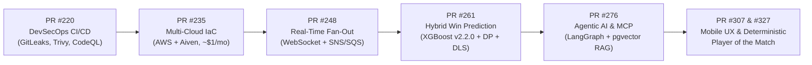

# 🏆 Featured Engineering Milestones & Key Pull Requests

This document catalogs key architectural milestones and pull requests authored by [@venkatesh-singamsetty](https://github.com/venkatesh-singamsetty) across the CricScore platform.

> 🔍 **[👉 View all Pull Requests authored by @venkatesh-singamsetty](https://github.com/venkatesh-singamsetty/cricscore/pulls?q=is%3Apr+author%3Avenkatesh-singamsetty)** _(filters out automated bot activity)_

---

## 🗺️ Platform Evolution Timeline

---

## 📋 Architectural Milestones Catalog

| Milestone & PR                                                                         | Architectural Domain             | Key Innovations & Verified Engineering Impact                                                                                                                                           |
| -------------------------------------------------------------------------------------- | -------------------------------- | --------------------------------------------------------------------------------------------------------------------------------------------------------------------------------------- |
| **[PR #327](https://github.com/venkatesh-singamsetty/cricscore/pull/327)** (`v4.21.2`) | **Mobile UI & Chat Polish**      | Stable Create Account layout, compact ChatBot welcome interface on short mobile screens, and deterministic `computePlayerOfTheMatch` in `summaryHandler.js`.                            |
| **[PR #307](https://github.com/venkatesh-singamsetty/cricscore/pull/307)** (`v4.17.1`) | **UI & Responsive Architecture** | Responsive chat question layout, tournament rulebook sync, and comprehensive architecture diagram refresh.                                                                              |
| **[PR #276](https://github.com/venkatesh-singamsetty/cricscore/pull/276)** (`v4.15.0`) | **Agentic AI & MLOps**           | Integrated autonomous Weather & GitHub Issue specialist agents via MCP, diagrams-as-code, and the Architecture & MLOps FAQ.                                                             |
| **[PR #261](https://github.com/venkatesh-singamsetty/cricscore/pull/261)**             | **Dynamic ML Win Prediction**    | Blended champion **XGBoost (`v2.2.0`)** (`Validation ROC-AUC = 0.7723`, `Test ROC-AUC = 0.7529`) with Markov DP and DLS par calculations in a lean `xgboost-cpu` (`~309 MB`) container. |
| **[PR #248](https://github.com/venkatesh-singamsetty/cricscore/pull/248)**             | **Real-Time Streaming**          | Serverless WebSocket event fan-out with Amazon SNS + SQS dual-path broadcast and storage worker resilience.                                                                             |
| **[PR #235](https://github.com/venkatesh-singamsetty/cricscore/pull/235)**             | **Multi-Cloud IaC & Cost Ops**   | Automated Terraform bridging AWS and Aiven PostgreSQL with strict cost guardrails (**`~$1/month`** Dev + Prod combined, ECR `countNumber = 1` retention) and Checkov compliance.        |
| **[PR #220](https://github.com/venkatesh-singamsetty/cricscore/pull/220)**             | **DevSecOps & Test Suite**       | End-to-end GitHub Actions CI/CD with GitLeaks, Trivy, CodeQL SAST, Playwright E2E, and **376 automated tests** (`151` FE + `121` BE + `75` AI + `29` ML).                               |

---

## 📊 Key Platform Metrics at a Glance

| Metric Category              | Verified Benchmark                                                                                         |
| ---------------------------- | ---------------------------------------------------------------------------------------------------------- |
| **Total Monthly Cloud Cost** | **`~$1/month`** combined for Dev + Prod on AWS (Route 53 `$0.50/mo` + S3/ECR/CloudWatch pennies)           |
| **ML Inference Image**       | `ml-predict` built on lightweight `xgboost-cpu` (`~309 MB`) with ECR `countNumber = 1` single-image policy |
| **Champion Win-Prob Model**  | `XGBoost (v2.2.0)` — `Validation ROC-AUC = 0.7723`, `Test ROC-AUC = 0.7529`                                |
| **Automated Test Coverage**  | **376 unit/integration tests** (`151` Frontend + `121` Backend + `75` AI Service + `29` ML Engine) + E2E   |

---

## 🔗 Related Documentation

- **[Root README](../README.md)** — High-level platform overview, architecture diagrams, and engineering summary.
- **[Full Changelog](./changelog.md)** — Automated semantic-release version history.
- **[Architecture Overview](./architecture.md)** — Detailed Mermaid diagrams and sequence flows.
