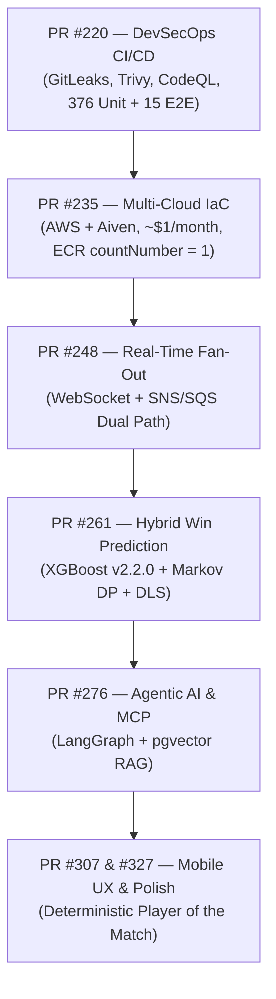

# 🏆 Featured Engineering Milestones & Key Pull Requests

This document catalogs key architectural milestones and pull requests authored by [@venkatesh-singamsetty](https://github.com/venkatesh-singamsetty) across the CricScore platform.

> 🔍 **[👉 View all Pull Requests authored by @venkatesh-singamsetty](https://github.com/venkatesh-singamsetty/cricscore/pulls?q=is%3Apr+author%3Avenkatesh-singamsetty)** _(filters out automated bot activity)_

---

## 🗺️ Platform Evolution Timeline

---

## 📋 Architectural Milestones Catalog

| Milestone & PR                                                             | Architectural Domain          | Headline Engineering Impact                                |
| :------------------------------------------------------------------------- | :---------------------------- | :--------------------------------------------------------- |
| **[PR #327](https://github.com/venkatesh-singamsetty/cricscore/pull/327)** | **Mobile UI & Chat Polish**   | Stable auth layout & deterministic POTM (`v4.21.2`)        |
| **[PR #307](https://github.com/venkatesh-singamsetty/cricscore/pull/307)** | **Responsive Architecture**   | Mobile chat layout & tournament rulebook sync (`v4.17.1`)  |
| **[PR #276](https://github.com/venkatesh-singamsetty/cricscore/pull/276)** | **Agentic AI & MLOps**        | Weather & GitHub MCP agents + diagrams-as-code (`v4.15.0`) |
| **[PR #261](https://github.com/venkatesh-singamsetty/cricscore/pull/261)** | **Dynamic ML Win Prediction** | Champion `XGBoost v2.2.0` (`xgboost-cpu ~309 MB`)          |
| **[PR #248](https://github.com/venkatesh-singamsetty/cricscore/pull/248)** | **Real-Time Streaming**       | Serverless WebSocket + SNS/SQS FIFO dual fan-out           |
| **[PR #235](https://github.com/venkatesh-singamsetty/cricscore/pull/235)** | **Multi-Cloud IaC & Cost**    | AWS + Aiven Terraform at `~$1/month` (`countNumber = 1`)   |
| **[PR #220](https://github.com/venkatesh-singamsetty/cricscore/pull/220)** | **DevSecOps & Test Suite**    | 7-scanner CI gate + `376` unit & `15` E2E tests            |

### Detailed Milestone Breakdown

- **1. [PR #327](https://github.com/venkatesh-singamsetty/cricscore/pull/327) (`v4.21.2` — Mobile UI & Chat Polish):**
  - Stabilized the Create Account layout across portrait mobile viewports.
  - Designed a compact ChatBot welcome interface so the input bar stays visible on short mobile screens.
  - Implemented deterministic `computePlayerOfTheMatch` in `summaryHandler.js`.
- **2. [PR #307](https://github.com/venkatesh-singamsetty/cricscore/pull/307) (`v4.17.1` — UI & Responsive Architecture):**
  - Built a responsive quick-question chip layout for the AI Assistant.
  - Synchronized tournament rulebook RAG ingestion and refreshed architecture diagrams.
- **3. [PR #276](https://github.com/venkatesh-singamsetty/cricscore/pull/276) (`v4.15.0` — Agentic AI & MLOps):**
  - Added autonomous Weather (Open-Meteo) and GitHub Issue specialist agents via in-memory Model Context Protocol (MCP).
  - Automated architecture diagrams-as-code (`docs/diagrams/generate_architecture_diagrams.py`) and authored the Architecture & MLOps FAQ.
- **4. [PR #261](https://github.com/venkatesh-singamsetty/cricscore/pull/261) (Dynamic ML Win Prediction):**
  - Promoted champion **XGBoost (`v2.2.0`)** (`Validation ROC-AUC = 0.7723`, `Test ROC-AUC = 0.7529`).
  - Blended XGBoost probabilities with Markov Chain Dynamic Programming (DP) and Standard Edition DLS par calculations.
  - Packaged inference into a lean `xgboost-cpu` (`~309 MB`) AWS Lambda container.
- **5. [PR #248](https://github.com/venkatesh-singamsetty/cricscore/pull/248) (Real-Time Streaming):**
  - Engineered serverless WebSocket event fan-out backed by DynamoDB connection tracking.
  - Decoupled fast-path Amazon SNS broadcast from ACID-safe SQS FIFO storage-worker persistence.
- **6. [PR #235](https://github.com/venkatesh-singamsetty/cricscore/pull/235) (Multi-Cloud IaC & Cost Ops):**
  - Automated Terraform infrastructure bridging AWS and Aiven PostgreSQL 16 (`pgvector`).
  - Enforced strict cost guardrails (**`~$1/month`** combined for Dev + Prod, ECR `countNumber = 1` retention) and full Checkov IaC compliance.
- **7. [PR #220](https://github.com/venkatesh-singamsetty/cricscore/pull/220) (DevSecOps & Test Suite):**
  - Built end-to-end GitHub Actions CI/CD with GitLeaks, Checkov, Trivy, and CodeQL SAST.
  - Established **`376` automated unit/integration tests** (`151` FE + `121` BE + `75` AI + `29` ML) and **`15` Playwright E2E browser tests**.

---

## 📊 Key Platform Metrics at a Glance

| Metric Category              | Verified Benchmark                                         |
| :--------------------------- | :--------------------------------------------------------- |
| **Total Monthly Cloud Cost** | **`~$1/month`** combined for Dev + Prod on AWS             |
| **ML Inference Image**       | `xgboost-cpu` (`~309 MB`) with ECR `countNumber = 1`       |
| **Champion Win-Prob Model**  | **`XGBoost v2.2.0`** (`Val AUC = 0.7723`, `Test = 0.7529`) |
| **Automated Test Coverage**  | **`376`** unit/integration tests + **`15`** Playwright E2E |

- **Cloud Cost Efficiency (`~$1/month`):** Route 53 Hosted Zone (`$0.50/mo`) + S3, ECR, and CloudWatch pennies across both `dev` and `prod`.
- **Container & Registry Discipline:** `ml-predict` runs on `xgboost-cpu ~309 MB` with an automated ECR lifecycle policy (`countNumber = 1`) that purges untagged/superseded images.
- **Multi-Layer Verification:** `151` Frontend Vitest + `121` Backend Vitest + `75` AI Service Pytest + `29` ML Engine Pytest = **`376` unit tests**, complemented by **`15` Playwright E2E tests**.

---

## 🔗 Related Documentation

- **[Root README](../README.md)** — High-level platform overview, architecture diagrams, and engineering summary.
- **[Full Changelog](./changelog.md)** — Automated semantic-release version history.
- **[Architecture Overview](./architecture.md)** — Detailed Mermaid diagrams and sequence flows.
