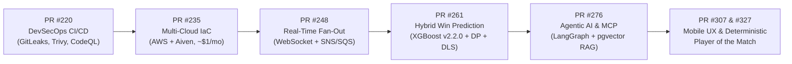

# 🏆 Featured Engineering Milestones & Key Pull Requests

This document catalogs key architectural milestones and pull requests authored by [@venkatesh-singamsetty](https://github.com/venkatesh-singamsetty) across the CricScore platform.

> 🔍 **[👉 View all Pull Requests authored by @venkatesh-singamsetty](https://github.com/venkatesh-singamsetty/cricscore/pulls?q=is%3Apr+author%3Avenkatesh-singamsetty)** _(filters out automated bot activity)_

---

## 🗺️ Platform Evolution Timeline

---

## 📋 Architectural Milestones Catalog

| Milestone & PR                                                                              | Architectural Domain                      | Key Innovations & Verified Engineering Impact                                                                                                                                                                        |
| ------------------------------------------------------------------------------------------- | ----------------------------------------- | -------------------------------------------------------------------------------------------------------------------------------------------------------------------------------------------------------------------- |
| **[PR&nbsp;#327](https://github.com/venkatesh-singamsetty/cricscore/pull/327)** (`v4.21.2`) | **Mobile&nbsp;UI & Chat&nbsp;Polish**     | • Stable Create Account layout • Compact ChatBot welcome interface on short mobile screens • Deterministic `computePlayerOfTheMatch` in `summaryHandler.js`                                                  |
| **[PR&nbsp;#307](https://github.com/venkatesh-singamsetty/cricscore/pull/307)** (`v4.17.1`) | **UI & Responsive Architecture**          | • Responsive chat question layout • Tournament rulebook synchronization • Comprehensive architecture diagram refresh                                                                                         |
| **[PR&nbsp;#276](https://github.com/venkatesh-singamsetty/cricscore/pull/276)** (`v4.15.0`) | **Agentic&nbsp;AI & MLOps**               | • Autonomous Weather & GitHub Issue specialist agents via MCP • Diagrams-as-code automation • Comprehensive Architecture & MLOps FAQ                                                                         |
| **[PR&nbsp;#261](https://github.com/venkatesh-singamsetty/cricscore/pull/261)**             | **Dynamic&nbsp;ML Win&nbsp;Prediction**   | • Champion **XGBoost (`v2.2.0`)** (`Validation ROC-AUC = 0.7723`, `Test ROC-AUC = 0.7529`) • Blended with Markov DP and DLS par calculations • Packaged in a lean `xgboost-cpu` (`~309 MB`) Lambda container |
| **[PR&nbsp;#248](https://github.com/venkatesh-singamsetty/cricscore/pull/248)**             | **Real&#8209;Time Streaming**             | • Serverless WebSocket event fan-out • Amazon SNS + SQS dual-path broadcast • Storage worker fault resilience                                                                                                |
| **[PR&nbsp;#235](https://github.com/venkatesh-singamsetty/cricscore/pull/235)**             | **Multi&#8209;Cloud IaC & Cost&nbsp;Ops** | • Automated Terraform bridging AWS and Aiven PostgreSQL • Strict cost guardrails (**`~$1/month`** Dev + Prod combined, ECR `countNumber = 1` retention) • Full Checkov IaC security compliance               |
| **[PR&nbsp;#220](https://github.com/venkatesh-singamsetty/cricscore/pull/220)**             | **DevSecOps & Test&nbsp;Suite**           | • End-to-end GitHub Actions CI/CD with GitLeaks, Trivy, and CodeQL SAST • Playwright E2E browser suite • **376 automated tests** (`151` FE + `121` BE + `75` AI + `29` ML)                                   |

---

## 📊 Key Platform Metrics at a Glance

| Metric Category                        | Verified Benchmark                                                                                                                                |
| -------------------------------------- | ------------------------------------------------------------------------------------------------------------------------------------------------- |
| **Total&nbsp;Monthly Cloud&nbsp;Cost** | • **`~$1/month`** combined for Dev + Prod on AWS • Route 53 Hosted Zone (`$0.50/mo`) + S3/ECR/CloudWatch pennies                              |
| **ML&nbsp;Inference Image**            | • `ml-predict` built on lightweight `xgboost-cpu` (`~309 MB`) • Enforced by ECR `countNumber = 1` single-image retention policy               |
| **Champion&nbsp;Win&#8209;Prob Model** | • `XGBoost (v2.2.0)` champion model • `Validation ROC-AUC = 0.7723` and `Test ROC-AUC = 0.7529`                                               |
| **Automated&nbsp;Test Coverage**       | • **376 unit/integration tests** (`151` Frontend + `121` Backend + `75` AI Service + `29` ML Engine) • Full Playwright E2E browser test suite |

---

## 🔗 Related Documentation

- **[Root README](../README.md)** — High-level platform overview, architecture diagrams, and engineering summary.
- **[Full Changelog](./changelog.md)** — Automated semantic-release version history.
- **[Architecture Overview](./architecture.md)** — Detailed Mermaid diagrams and sequence flows.
