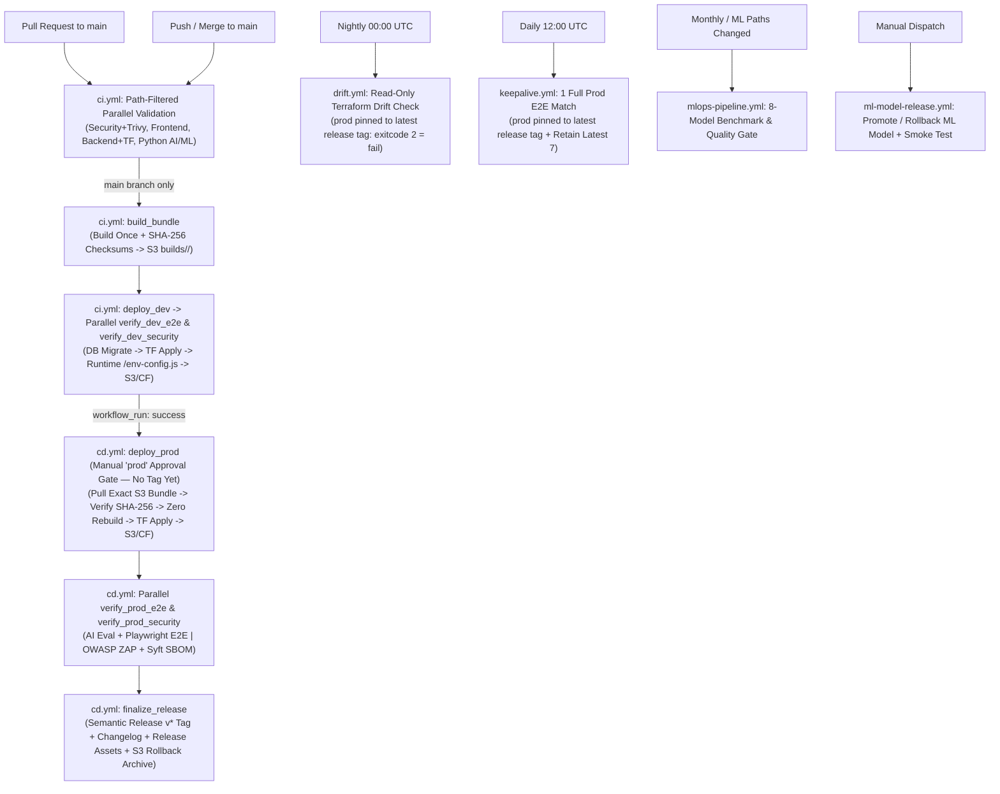

# ⚙️ GitHub Actions CI/CD Architecture

Reference guide for all 10 GitHub Actions workflows in `.github/workflows/`, their execution flow, jobs, secrets, variables, and CLI triggers (`~$1/month` combined AWS run rate across `dev` + `prod`).



---

## Workflow Inventory (`.github/workflows/`)

- **`ci.yml` — Continuous Integration, Immutable Build & DEV Verification (`dev` on `main`):**
  - **Triggers:** `push` (`main`), `pull_request` (`main`), `workflow_dispatch`.
  - Runs path-filtered parallel validation jobs on PRs (preserving all required branch-protection check names) with a single consolidated Trivy scan.
  - On `main`, builds the immutable frontend + hydrated Lambda bundle **once** (`build_bundle` with `SHA256SUMS.txt`), deploys to `dev` (`deploy_dev` with runtime `/env-config.js`), and runs `verify_dev_e2e` and `verify_dev_security` **in parallel**.
- **`cd.yml` — Immutable PROD Promotion, Post-PROD SemVer Release & Tag-Based Rollback (`prod`):**
  - **Triggers:** `workflow_run` (`CI` success on `main`), `workflow_dispatch` (`action: deploy|rollback`, `target_ref`).
  - Pauses at the GitHub `prod` Environment required-reviewer gate **before any Git tag is created**.
  - Downloads and SHA-256-verifies the exact immutable bundle built in `ci.yml` (zero rebuild), deploys to `prod`, runs `verify_prod_e2e` and `verify_prod_security` **in parallel**, and only on success runs `finalize_release` (`semantic-release` `v*` tag, `docs/changelog.md`, enriched release notes, SBOM + `SHA256SUMS.txt` assets, and S3 rollback archive at `releases/vX.Y.Z/`).
  - Supports 1-click rollback via `workflow_dispatch` (`action: rollback`, `target_ref: previous` or any `vX.Y.Z` tag).
- **`release.yml` — Semantic Release (Manual Override):**
  - **Triggers:** `workflow_dispatch` only (normal releases are finalized automatically inside `cd.yml` after `prod` passes).
- **`drift.yml` — Nightly Infrastructure Drift Detection (`prod` pinned to latest release tag):**
  - **Triggers:** `schedule` (`0 0 * * *` daily against `prod`), `workflow_dispatch` (choice of `prod` or `dev`).
  - Pins checkout to the **latest published production release tag** (`v*`), passes `TF_VAR_github_token` (`GH_PAT`), and sets `terraform_wrapper: false` so `terraform plan -detailed-exitcode` exit code `2` directly fails the job on real AWS drift.
- **`mlops-pipeline.yml` — ML Training, Benchmarking & Quality Gate:**
  - **Triggers:** `push`/`pull_request` (`cricket-data/**`, `apps/ml-engine/**`), `schedule` (`0 0 1 * *` monthly), `workflow_dispatch`.
  - Runs `pytest test_predict.py` and `compare_models.py` across 8 candidate models with MLflow, enforcing quality gates (`accuracy >= 0.60`, `roc_auc >= 0.65`, `approvalStatus == "approved"`) and uploading `XGBoost v2.2.0` artifacts.
- **`ml-model-release.yml` — ML Model Promotion & Rollback (`dev` or `prod`):**
  - **Triggers:** `workflow_dispatch` (`model_version`, `action: release|rollback`, `target_env: dev|prod`).
  - Verifies SHA-256 checksum against `model_manifest.json`, updates `<project>-ml-predict` Lambda `MODEL_VERSION` env var while preserving `MODEL_S3_BUCKET`, and runs a live `POST /match/predict` regression smoke test.
- **`codeql.yml` — GitHub CodeQL SAST Security Scan:**
  - **Triggers:** `push` & `pull_request` (`main`), `schedule` (`30 20 * * 4` Thu), `workflow_dispatch`.
  - Runs CodeQL static analysis (`security-extended,security-and-quality`) across `javascript-typescript` and `python`.
- **`sbom.yml` — Software Bill of Materials Generation:**
  - **Triggers:** `push` (`main`), `schedule` (`0 0 * * 0` Sun), `workflow_dispatch`.
  - Generates an SPDX JSON SBOM (`cricscore-sbom.spdx.json`) using Anchore Syft and uploads it as a 30-day artifact.
- **`keepalive.yml` — Daily Production E2E Match & Aiven PostgreSQL Keep-Alive (`prod` pinned to latest release tag):**
  - **Triggers:** `schedule` (`0 12 * * *` daily), `workflow_dispatch`.
  - Automatically resolves and checks out the **latest published production release tag** (`v*`), ensuring Playwright locators and specs match the deployed frontend version without false failures from unreleased PRs or changes on `main`.
  - Runs 1 full 2-over Playwright E2E match (`tests/user-journey.spec.ts`) against Production (`cricscore.venkateshsingamsetty.com`) to generate real WAL write activity (`INSERT`/`UPDATE`/`DELETE`) in Aiven Free Tier PostgreSQL while verifying live production health, and prunes older E2E test matches in `prod` (`OFFSET 7`) so only the **latest 7 E2E test matches** are retained.
  - Runs autonomously with repo-level database secrets, completely free of manual environment review approvals. If an E2E test or database wake ping fails, GitHub triggers an immediate workflow failure email alert.
- **`terraform-unlock.yml` — Emergency State Force-Unlock (`dev` or `prod`):**
  - **Triggers:** `workflow_dispatch` (`environment: dev|prod`, `lock_id`).
  - Runs `terraform init` and `terraform force-unlock -force "<lock_id>"` to clear a stale `.tflock` object in S3.

> [!NOTE]
> Automated dependency updates are configured separately in `.github/dependabot.yml`.

---

## `ci.yml` Job Breakdown

- **`changes` (Runs on PR & `main`):**
  - Uses `dorny/paths-filter@v3` on PRs to skip untouched test/build suites while keeping all required branch-protection checks green.
- **`validate_security` (Runs on PR & `main`):**
  - Full-history **GitLeaks** secrets scan, **Checkov** Terraform IaC security audit (`infra/terraform`), and a single consolidated **Trivy** FS scan (`HIGH,CRITICAL`).
- **`validate_frontend` (Runs on PR & `main`):**
  - Node.js 24 setup (`npm ci`), TypeScript check (`npm run lint`), **Vitest** unit/component tests (`169` tests), and Vite production dry-run build.
- **`validate_backend` (Runs on PR & `main`):**
  - Node.js 24 Lambda unit tests (`124` tests) and Terraform `~1.10` `fmt -check -recursive`, `init -backend=false`, and `validate`.
- **`validate_python` (Runs on PR & `main`):**
  - Python 3.12 **AI Service** pytest (`75` tests) and **ML Engine** pytest & `XGBoost v2.2.0` artifact verification (`29` tests).
- **`build_bundle` → `deploy_dev` → parallel `verify_dev_e2e` & `verify_dev_security` (Runs on `main` only):**
  - Builds immutable frontend + hydrated Lambdas once with `SHA256SUMS.txt` archived to S3, runs `migrate.sh dev` + `terraform apply` + 7-day log retention + runtime `/env-config.js` + S3/CloudFront sync, then runs AI eval + `15` Playwright E2E and OWASP ZAP + Syft SBOM in parallel.

---

## GitHub Secrets & Variables Inventory

Populated automatically for `dev` and `prod` environments by `./infra/scripts/setup_github_envs.sh`:

| Name                         | Type     | Scope               | Purpose                                                |
| :--------------------------- | :------- | :------------------ | :----------------------------------------------------- |
| `AWS_ROLE_ARN`               | Variable | `dev`, `prod`, Repo | IAM Role ARN for Keyless GitHub Actions OIDC (AWS STS) |
| `AIVEN_CA_CERT`              | Secret   | `dev`, `prod`, Repo | Aiven PostgreSQL Project Root CA for strict SSL        |
| `TF_DATABASE_URL`            | Secret   | `dev`, `prod`, Repo | Aiven PostgreSQL 16 URI (`?sslmode=require`)           |
| `TF_SES_SOURCE_EMAIL`        | Secret   | `dev`, `prod`, Repo | Verified Amazon SES sender email                       |
| `OPENAI_API_KEY`             | Secret   | `dev`, `prod`, Repo | OpenAI API key (`TF_VAR_llm_api_key`)                  |
| `GH_PAT`                     | Secret   | Repo                | Scoped PAT for `release.yml` & Chat Bot MCP Issue Tool |
| `AWS_REGION`                 | Variable | `dev`, `prod`       | Target AWS region (`us-east-1`)                        |
| `TF_STATE_BUCKET`            | Variable | `dev`, `prod`       | S3 bucket for `cricscore/<env>/terraform.tfstate`      |
| `DOMAIN_NAME`                | Variable | `dev`, `prod`       | Environment domain (`cricscoredev.*` / `cricscore.*`)  |
| `ZONE_DOMAIN`                | Variable | `dev`, `prod`       | Root Route 53 hosted zone domain                       |
| `SUBDOMAIN_PREFIX`           | Variable | `dev`, `prod`       | `cricscoredev` (`dev`) / `cricscore` (`prod`)          |
| `PROJECT_NAME`               | Variable | `dev`, `prod`       | `cricscoredev` (`dev`) / `cricscore` (`prod`)          |
| `ADMIN_EMAIL`                | Variable | `dev`, `prod`       | Recipient for SES BCC & `$5/mo` Budget alerts          |
| `LLM_BASE_URL` / `LLM_MODEL` | Variable | `dev`, `prod`       | Optional LLM endpoint & model (`gpt-4o-mini`)          |

> [!NOTE]
> Static AWS credentials (`AWS_ACCESS_KEY_ID` / `AWS_SECRET_ACCESS_KEY`) and obsolete legacy secrets (`VITE_ADMIN_PIN`) have been permanently removed from GitHub Secrets. Deployments authenticate exclusively via keyless GitHub Actions OIDC (`AWS_ROLE_ARN`).

### 🛡️ Repository Security Settings & Guardrails ($0.00 Free)

1. **Least-Privilege Actions Token (`default_workflow_permissions: "read"`)**:
   - The default `GITHUB_TOKEN` across all workflows is restricted to read-only. Workflows must declare explicit permissions (`permissions: id-token: write, contents: read`).
2. **Pull Request Approval Protection (`can_approve_pull_request_reviews: false`)**:
   - GitHub Actions workflows are forbidden from approving pull requests, enforcing human and policy approval gates.
3. **Secret Scanning Push Protection**:
   - Active on repository commits and pull requests to block accidental secret leaks.
4. **Chat Bot MCP Issue Agent Access (`GH_PAT`)**:
   - Required permissions for the AI Chat Assistant to file issues on user request:
     - **Fine-Grained PAT**: Target `venkatesh-singamsetty/cricscore`, **Issues**: `Read and Write`, **Contents**: `Read and Write`.
     - Automatically logs issues with labels: `via-cricscore-ai`, `bug`, `feature-request`, or `feedback`.

---

## 🔔 Alerting & Failure Notifications Architecture

| Failure Domain                               | Trigger Mechanism                                                    | Notification Channel                    | Recipient                              |
| :------------------------------------------- | :------------------------------------------------------------------- | :-------------------------------------- | :------------------------------------- |
| **Infrastructure Drift** (`drift.yml`)       | `terraform plan -detailed-exitcode` exits `2`                        | **GitHub Actions Email**                | Repository Watcher / Account Email     |
| **E2E Keep-Alive Failure** (`keepalive.yml`) | Playwright test or database ping exits non-zero                      | **GitHub Actions Email**                | Repository Watcher / Account Email     |
| **Live Lambda Runtime Errors**               | CloudWatch Metric Alarms (`match-api-errors`, `score-update-errors`) | **AWS SNS (`cricscore-lambda-alerts`)** | `ADMIN_EMAIL` (`venky.2k57@gmail.com`) |
| **AWS Monthly Budget Breach**                | AWS Budgets (`cricscore-monthly-cost-budget`)                        | **AWS Budgets Email**                   | `ADMIN_EMAIL` (`venky.2k57@gmail.com`) |

---

## Useful `gh` CLI Commands

```bash
# 1. Provision and populate 'dev' and 'prod' GitHub Environments from .env.local
./infra/scripts/setup_github_envs.sh

# 2. Trigger CI workflow manually on main
gh workflow run ci.yml --ref main

# 3. Trigger Production CD deployment for a specific release tag
gh workflow run cd.yml -f tag=v4.19.2

# 4. Trigger on-demand Terraform drift check across dev and prod
gh workflow run drift.yml

# 5. Promote or roll back an ML model version in dev or prod
gh workflow run ml-model-release.yml -f model_version=v2.2.0 -f action=release -f target_env=dev

# 6. Force-unlock a stuck Terraform state lock
gh workflow run terraform-unlock.yml -f environment=dev -f lock_id=e-12345678-abcd
```
