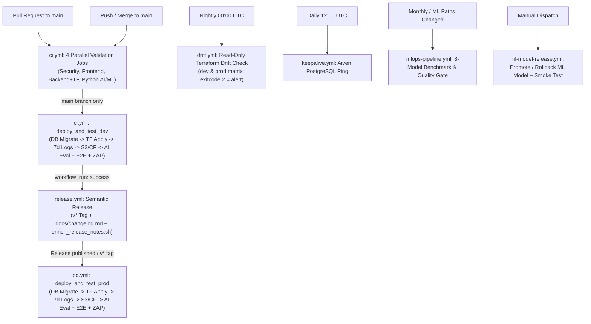

# ⚙️ GitHub Actions CI/CD Architecture

Reference guide for all 10 GitHub Actions workflows in `.github/workflows/`, their execution flow, jobs, secrets, variables, and CLI triggers.



---

## Workflow Inventory (`.github/workflows/`)

| Workflow File              | Triggers                                                                                                                     | Target Env             | Purpose & Key Steps                                                                                                                                                                                                                           |
| :------------------------- | :--------------------------------------------------------------------------------------------------------------------------- | :--------------------- | :-------------------------------------------------------------------------------------------------------------------------------------------------------------------------------------------------------------------------------------------- |
| **`ci.yml`**               | • `push` (`main`)<br/>• `pull_request` (`main`)<br/>• `workflow_dispatch`                                                    | `dev` (`main` only)    | • Runs 4 parallel validation jobs (`376` unit tests) on all PRs and pushes<br/>• On `main`, runs `deploy_and_test_dev` (`migrate.sh`, `terraform init -upgrade` & `apply`, 7-day log retention, S3/CF sync, AI eval, 14 E2E tests, OWASP ZAP) |
| **`release.yml`**          | • `workflow_run` (`CI` on `main`)<br/>• `workflow_dispatch`                                                                  | Repository (`main`)    | • Runs when `CI` succeeds on `main`<br/>• Resets to exact tested commit SHA and runs `npx semantic-release` (`v*` tag + `docs/changelog.md`)<br/>• Enriches release notes with PR overview via `enrich_release_notes.sh`                      |
| **`cd.yml`**               | • `release` (`published`)<br/>• `push` (`tags: v*`)<br/>• `workflow_dispatch` (`tag`)                                        | `prod`                 | • Checks out the release tag and runs `migrate.sh prod`<br/>• Runs `terraform init -upgrade` & `apply` and enforces 7-day Lambda log retention<br/>• Deploys production SPA to S3/CloudFront and runs AI eval, Playwright E2E, and OWASP ZAP  |
| **`drift.yml`**            | • `schedule` (`0 0 * * *` daily)<br/>• `workflow_dispatch`                                                                   | `dev`, `prod` (matrix) | • Autonomous read-only drift check (`terraform init -upgrade` + `terraform plan -detailed-exitcode`)<br/>• Runs across `dev` and `prod` without human environment gates<br/>• Exits with code `2` and alerts if out-of-band drift is found    |
| **`mlops-pipeline.yml`**   | • `push`/`pull_request` (`cricket-data/**`, `apps/ml-engine/**`)<br/>• `schedule` (`0 0 1 * *` monthly)<br/>• Manual trigger | CI Runner              | • Runs `pytest test_predict.py` and `compare_models.py` across 8 candidate models with MLflow<br/>• Enforces quality gates (`accuracy >= 0.60`, `roc_auc >= 0.65`, `approvalStatus == "approved"`)<br/>• Uploads XGBoost `v2.2.0` artifacts   |
| **`ml-model-release.yml`** | • `workflow_dispatch` (`model_version`, `action: release\|rollback`, `target_env: dev\|prod`)                                | `dev` or `prod`        | • Verifies SHA-256 artifact checksum against `model_manifest.json`<br/>• Updates `<project>-ml-predict` Lambda `MODEL_VERSION` env var while preserving `MODEL_S3_BUCKET`<br/>• Runs a live `POST /match/predict` regression smoke test       |
| **`codeql.yml`**           | • `push` & `pull_request` (`main`)<br/>• `schedule` (`30 20 * * 4` Thu)<br/>• `workflow_dispatch`                            | CI Runner              | • Runs GitHub CodeQL static analysis (`security-extended,security-and-quality`)<br/>• Scans `javascript-typescript` and `python` matrices                                                                                                     |
| **`sbom.yml`**             | • `push` (`main`)<br/>• `schedule` (`0 0 * * 0` Sun)<br/>• `workflow_dispatch`                                               | CI Runner              | • Generates an SPDX JSON Software Bill of Materials (`cricscore-sbom.spdx.json`) using Anchore Syft<br/>• Uploads SBOM as a 30-day workflow artifact                                                                                          |
| **`keepalive.yml`**        | • `schedule` (`0 12 * * *` daily)<br/>• `workflow_dispatch`                                                                  | Aiven DB               | • Runs `SELECT 1 AS keep_alive;` via `psql` (up to 3 retries) at 12:00 UTC daily<br/>• Prevents the Aiven Free Tier PostgreSQL instance from pausing due to inactivity                                                                        |
| **`terraform-unlock.yml`** | • `workflow_dispatch` (`environment: dev\|prod`, `lock_id`)                                                                  | `dev` or `prod`        | • Emergency manual workflow that runs `terraform init`<br/>• Executes `terraform force-unlock -force "<lock_id>"` to clear a stale `.tflock` object in S3                                                                                     |

> [!NOTE]
> Automated dependency updates are configured separately in `.github/dependabot.yml`.

---

## `ci.yml` Job Breakdown

| Job ID                    | Runs On               | Tools & Checks Executed                                                                                                                                                                                                                     | Runs on PR? | Runs on `main`? |
| :------------------------ | :-------------------- | :------------------------------------------------------------------------------------------------------------------------------------------------------------------------------------------------------------------------------------------ | :---------: | :-------------: |
| **`validate_security`**   | `ubuntu-latest`       | • **GitLeaks** full-history secrets scan<br/>• **Checkov** Terraform IaC security scan (`infra/terraform`)                                                                                                                                  |     ✅      |       ✅        |
| **`validate_frontend`**   | `ubuntu-latest`       | • Node.js 24 setup & **Trivy** FS scan (`HIGH,CRITICAL`)<br/>• TypeScript check (`npm run lint`)<br/>• **Vitest** unit/component tests (`151` tests) & Vite production dry-run build                                                        |     ✅      |       ✅        |
| **`validate_backend`**    | `ubuntu-latest`       | • Node.js 24 Lambda unit tests (`121` tests)<br/>• **Trivy** FS scan across `apps/backend/lambdas`<br/>• Terraform `~1.10` `fmt -check -recursive`, `init -backend=false`, and `validate`                                                   |     ✅      |       ✅        |
| **`validate_python`**     | `ubuntu-latest`       | • Python 3.12 **AI Service** pytest (`75` tests)<br/>• **ML Engine** pytest & XGBoost `v2.2.0` artifact verification (`29` tests)<br/>• **Trivy** FS scan on Python dependencies                                                            |     ✅      |       ✅        |
| **`deploy_and_test_dev`** | `ubuntu-latest` (dev) | • PostgreSQL `migrate.sh dev` & Lambda `npm install --omit=dev`<br/>• `terraform init -upgrade` & `apply` (ECR `xgboost-cpu` `~309 MB`, `countNumber = 1`) + 7-day log retention<br/>• S3/CF sync + AI eval + 14 Playwright E2E + OWASP ZAP |     ❌      |       ✅        |

---

## GitHub Secrets & Variables Inventory

Populated automatically for `dev` and `prod` environments by `./infra/scripts/setup_github_envs.sh`:

| Name                         | Type     | Scope               | Used By                                                        | Purpose                                                                       |
| :--------------------------- | :------- | :------------------ | :------------------------------------------------------------- | :---------------------------------------------------------------------------- |
| `AWS_ACCESS_KEY_ID`          | Secret   | `dev`, `prod`, Repo | • `ci.yml`, `cd.yml`<br/>• `drift.yml`, `terraform-unlock.yml` | • IAM access key ID for AWS deployment and drift checks                       |
| `AWS_SECRET_ACCESS_KEY`      | Secret   | `dev`, `prod`, Repo | • `ci.yml`, `cd.yml`<br/>• `drift.yml`, `terraform-unlock.yml` | • IAM secret access key                                                       |
| `TF_DATABASE_URL`            | Secret   | `dev`, `prod`, Repo | • `ci.yml`, `cd.yml`<br/>• `drift.yml`, `keepalive.yml`        | • Aiven PostgreSQL 16 connection URI (`?sslmode=require`)                     |
| `TF_SES_SOURCE_EMAIL`        | Secret   | `dev`, `prod`, Repo | • `ci.yml`, `cd.yml`, `drift.yml`                              | • Verified Amazon SES sender address                                          |
| `OPENAI_API_KEY`             | Secret   | `dev`, `prod`, Repo | • `ci.yml`, `cd.yml`, `drift.yml`                              | • OpenAI API key mapped to `TF_VAR_llm_api_key`                               |
| `GH_PAT`                     | Secret   | Repo                | • `release.yml`, `ci.yml`, `cd.yml`                            | • Admin PAT for Semantic Release changelog push<br/>• Powers MCP GitHub Agent |
| `AWS_REGION`                 | Variable | `dev`, `prod`       | • `ci.yml`, `cd.yml`<br/>• `drift.yml`, `terraform-unlock.yml` | • Target AWS region (`us-east-1`)                                             |
| `TF_STATE_BUCKET`            | Variable | `dev`, `prod`       | • `ci.yml`, `cd.yml`<br/>• `drift.yml`, `terraform-unlock.yml` | • S3 bucket storing `cricscore/<env>/terraform.tfstate`                       |
| `DOMAIN_NAME`                | Variable | `dev`, `prod`       | • `ci.yml`, `cd.yml`                                           | • Environment domain (`cricscoredev.<zone>` / `cricscore.<zone>`)             |
| `ZONE_DOMAIN`                | Variable | `dev`, `prod`       | • `ci.yml`, `cd.yml`, `drift.yml`                              | • Root Route 53 hosted zone domain                                            |
| `SUBDOMAIN_PREFIX`           | Variable | `dev`, `prod`       | • `ci.yml`, `cd.yml`                                           | • `cricscoredev` (`dev`) / `cricscore` (`prod`)                               |
| `PROJECT_NAME`               | Variable | `dev`, `prod`       | • `ci.yml`, `cd.yml`                                           | • `cricscoredev` (`dev`) / `cricscore` (`prod`)                               |
| `ADMIN_EMAIL`                | Variable | `dev`, `prod`       | • `ci.yml`, `cd.yml`, `drift.yml`                              | • Recipient for SES BCC and CloudWatch alarms<br/>• `$5/mo` AWS Budget alerts |
| `LLM_BASE_URL` / `LLM_MODEL` | Variable | `dev`, `prod`       | • `ci.yml`, `cd.yml`, `drift.yml`                              | • Optional LLM endpoint<br/>• Model name (`gpt-4o-mini`)                      |

---

## Useful `gh` CLI Commands

```bash
# 1. Provision and populate 'dev' and 'prod' GitHub Environments from .env.local
./infra/scripts/setup_github_envs.sh

# 2. Trigger CI workflow manually on main
gh workflow run ci.yml --ref main

# 3. Trigger Production CD deployment for a specific release tag
gh workflow run cd.yml -f tag=v4.19.2

# 4. Trigger on-demand Terraform drift check across dev and prod
gh workflow run drift.yml

# 5. Promote or roll back an ML model version in dev or prod
gh workflow run ml-model-release.yml -f model_version=v2.2.0 -f action=release -f target_env=dev

# 6. Force-unlock a stuck Terraform state lock
gh workflow run terraform-unlock.yml -f environment=dev -f lock_id=e-12345678-abcd
```
