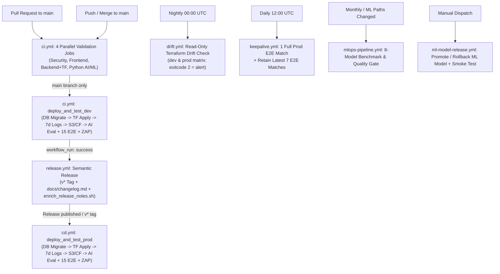

# ⚙️ GitHub Actions CI/CD Architecture

Reference guide for all 10 GitHub Actions workflows in `.github/workflows/`, their execution flow, jobs, secrets, variables, and CLI triggers (`~$1/month` combined AWS run rate across `dev` + `prod`).



---

## Workflow Inventory (`.github/workflows/`)

- **`ci.yml` — Continuous Integration & Dev Deployment (`dev` on `main`):**
  - **Triggers:** `push` (`main`), `pull_request` (`main`), `workflow_dispatch`.
  - Runs 4 parallel validation jobs (`376` unit tests total) on every PR and push.
  - On `main`, executes `deploy_and_test_dev` (`migrate.sh dev`, `terraform init -upgrade` & `apply`, 7-day log retention, S3/CloudFront sync, live AI evals, `15` Playwright E2E tests, and OWASP ZAP).
- **`release.yml` — Automated Semantic Release (`main`):**
  - **Triggers:** `workflow_run` (`CI` success on `main`), `workflow_dispatch`.
  - Resets to the exact tested commit SHA, runs `npx semantic-release` (`v*` tag + `docs/changelog.md`), and enriches release notes with the PR overview via `enrich_release_notes.sh`.
- **`cd.yml` — Production Continuous Deployment (`prod`):**
  - **Triggers:** `release` (`published`), `push` (`tags: v*`), `workflow_dispatch` (`tag`).
  - Checks out the release tag, runs `migrate.sh prod`, `terraform init -upgrade` & `apply`, enforces 7-day Lambda log retention, syncs S3/CloudFront, and runs AI evals, `15` Playwright E2E tests, and OWASP ZAP.
- **`drift.yml` — Nightly Infrastructure Drift Detection (`dev` & `prod` matrix):**
  - **Triggers:** `schedule` (`0 0 * * *` daily), `workflow_dispatch`.
  - Runs autonomous read-only `terraform init -upgrade` and `terraform plan -detailed-exitcode` across `dev` and `prod` without human environment gates; alerts immediately on exit code `2`.
- **`mlops-pipeline.yml` — ML Training, Benchmarking & Quality Gate:**
  - **Triggers:** `push`/`pull_request` (`cricket-data/**`, `apps/ml-engine/**`), `schedule` (`0 0 1 * *` monthly), `workflow_dispatch`.
  - Runs `pytest test_predict.py` and `compare_models.py` across 8 candidate models with MLflow, enforcing quality gates (`accuracy >= 0.60`, `roc_auc >= 0.65`, `approvalStatus == "approved"`) and uploading `XGBoost v2.2.0` artifacts.
- **`ml-model-release.yml` — ML Model Promotion & Rollback (`dev` or `prod`):**
  - **Triggers:** `workflow_dispatch` (`model_version`, `action: release|rollback`, `target_env: dev|prod`).
  - Verifies SHA-256 checksum against `model_manifest.json`, updates `<project>-ml-predict` Lambda `MODEL_VERSION` env var while preserving `MODEL_S3_BUCKET`, and runs a live `POST /match/predict` regression smoke test.
- **`codeql.yml` — GitHub CodeQL SAST Security Scan:**
  - **Triggers:** `push` & `pull_request` (`main`), `schedule` (`30 20 * * 4` Thu), `workflow_dispatch`.
  - Runs CodeQL static analysis (`security-extended,security-and-quality`) across `javascript-typescript` and `python`.
- **`sbom.yml` — Software Bill of Materials Generation:**
  - **Triggers:** `push` (`main`), `schedule` (`0 0 * * 0` Sun), `workflow_dispatch`.
  - Generates an SPDX JSON SBOM (`cricscore-sbom.spdx.json`) using Anchore Syft and uploads it as a 30-day artifact.
- **`keepalive.yml` — Daily Production E2E Match & Aiven PostgreSQL Keep-Alive:**
  - **Triggers:** `schedule` (`0 12 * * *` daily), `workflow_dispatch`.
  - Runs 1 full 2-over Playwright E2E match (`tests/user-journey.spec.ts`) against Production (`cricscore.venkateshsingamsetty.com`) to generate real WAL write activity (`INSERT`/`UPDATE`/`DELETE`) in Aiven Free Tier PostgreSQL while verifying live production health, and prunes older E2E test matches in `prod` (`OFFSET 7`) so only the **latest 7 E2E test matches** are retained.
- **`terraform-unlock.yml` — Emergency State Force-Unlock (`dev` or `prod`):**
  - **Triggers:** `workflow_dispatch` (`environment: dev|prod`, `lock_id`).
  - Runs `terraform init` and `terraform force-unlock -force "<lock_id>"` to clear a stale `.tflock` object in S3.

> [!NOTE]
> Automated dependency updates are configured separately in `.github/dependabot.yml`.

---

## `ci.yml` Job Breakdown

- **`validate_security` (Runs on PR & `main`):**
  - Full-history **GitLeaks** secrets scan and **Checkov** Terraform IaC security audit (`infra/terraform`).
- **`validate_frontend` (Runs on PR & `main`):**
  - Node.js 24 setup, **Trivy** FS scan (`HIGH,CRITICAL`), TypeScript check (`npm run lint`), **Vitest** unit/component tests (`151` tests), and Vite production dry-run build.
- **`validate_backend` (Runs on PR & `main`):**
  - Node.js 24 Lambda unit tests (`121` tests), **Trivy** FS scan across `apps/backend/lambdas`, and Terraform `~1.10` `fmt -check -recursive`, `init -backend=false`, and `validate`.
- **`validate_python` (Runs on PR & `main`):**
  - Python 3.12 **AI Service** pytest (`75` tests), **ML Engine** pytest & `XGBoost v2.2.0` artifact verification (`29` tests), and **Trivy** FS scan on Python dependencies.
- **`deploy_and_test_dev` (Runs on `main` only):**
  - PostgreSQL `migrate.sh dev`, Lambda `npm install --omit=dev`, `terraform init -upgrade` & `apply` (ECR `xgboost-cpu ~309 MB`, `countNumber = 1`), and 7-day log retention.
  - S3/CloudFront sync, live AI evaluation suite, `15` Playwright E2E tests, and OWASP ZAP baseline scan.

---

## GitHub Secrets & Variables Inventory

Populated automatically for `dev` and `prod` environments by `./infra/scripts/setup_github_envs.sh`:

| Name                         | Type     | Scope               | Purpose                                               |
| :--------------------------- | :------- | :------------------ | :---------------------------------------------------- |
| `AWS_ACCESS_KEY_ID`          | Secret   | `dev`, `prod`, Repo | IAM access key ID for AWS deploy & drift              |
| `AWS_SECRET_ACCESS_KEY`      | Secret   | `dev`, `prod`, Repo | IAM secret access key                                 |
| `TF_DATABASE_URL`            | Secret   | `dev`, `prod`, Repo | Aiven PostgreSQL 16 URI (`?sslmode=require`)          |
| `TF_SES_SOURCE_EMAIL`        | Secret   | `dev`, `prod`, Repo | Verified Amazon SES sender email                      |
| `OPENAI_API_KEY`             | Secret   | `dev`, `prod`, Repo | OpenAI API key (`TF_VAR_llm_api_key`)                 |
| `GH_PAT`                     | Secret   | Repo                | Admin PAT for `release.yml` & MCP GitHub Agent        |
| `AWS_REGION`                 | Variable | `dev`, `prod`       | Target AWS region (`us-east-1`)                       |
| `TF_STATE_BUCKET`            | Variable | `dev`, `prod`       | S3 bucket for `cricscore/<env>/terraform.tfstate`     |
| `DOMAIN_NAME`                | Variable | `dev`, `prod`       | Environment domain (`cricscoredev.*` / `cricscore.*`) |
| `ZONE_DOMAIN`                | Variable | `dev`, `prod`       | Root Route 53 hosted zone domain                      |
| `SUBDOMAIN_PREFIX`           | Variable | `dev`, `prod`       | `cricscoredev` (`dev`) / `cricscore` (`prod`)         |
| `PROJECT_NAME`               | Variable | `dev`, `prod`       | `cricscoredev` (`dev`) / `cricscore` (`prod`)         |
| `ADMIN_EMAIL`                | Variable | `dev`, `prod`       | Recipient for SES BCC & `$5/mo` Budget alerts         |
| `LLM_BASE_URL` / `LLM_MODEL` | Variable | `dev`, `prod`       | Optional LLM endpoint & model (`gpt-4o-mini`)         |

---

## Useful `gh` CLI Commands

```bash
# 1. Provision and populate 'dev' and 'prod' GitHub Environments from .env.local
./infra/scripts/setup_github_envs.sh

# 2. Trigger CI workflow manually on main
gh workflow run ci.yml --ref main

# 3. Trigger Production CD deployment for a specific release tag
gh workflow run cd.yml -f tag=v4.19.2

# 4. Trigger on-demand Terraform drift check across dev and prod
gh workflow run drift.yml

# 5. Promote or roll back an ML model version in dev or prod
gh workflow run ml-model-release.yml -f model_version=v2.2.0 -f action=release -f target_env=dev

# 6. Force-unlock a stuck Terraform state lock
gh workflow run terraform-unlock.yml -f environment=dev -f lock_id=e-12345678-abcd
```
