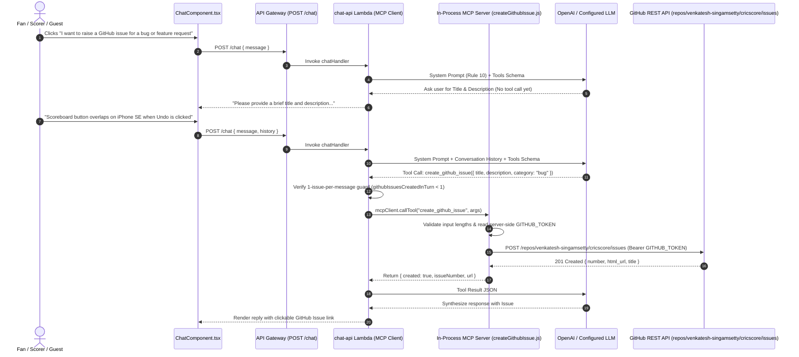

# 🐙 GitHub Issue Specialist Agent & MCP Setup Guide

CricScore includes a dedicated **GitHub Issue Specialist Agent** integrated into the AI Chat Assistant via the **Model Context Protocol (MCP)**. Fans, scorers, and guests can report application bugs, mobile/desktop UI issues, or feature requests directly from the Chat Bot, and the agent creates a labeled issue in the official GitHub repository (`venkatesh-singamsetty/cricscore`) without ever exposing credentials to the client or LLM.

---

## 🎯 1. Overview & User Flow

In the **AI Chat Assistant** (`ChatComponent.tsx`), users can either type a bug report / feature request directly or click the suggested prompt:

> **`7. "I want to report a bug or request a new feature"`**

### Two-Step Conversational Confirmation Flow

To prevent accidental or empty issues, the agent follows a strict **2-step conversational protocol** (`Rule 10: GITHUB ISSUE AGENT` in `chatHandler.js` and `github_issue_node` in `apps/ai-service/cricscore_ai/graph.py`):

1. **Step 1 — Prompt for Details (When Generic)**:
   - If a user clicks the default chip (`"I want to report a bug or request a new feature"`) or asks to report a bug/feature without providing details, the agent **does not** call `create_github_issue` yet.
   - Instead, it replies:
     > _"Please provide a brief title and description of the bug or feature request you'd like to raise on GitHub, and I'll assist you in creating the issue."_
2. **Step 2 — Issue Creation & Clickable Link (Once Details Are Provided)**:
   - Once the user replies with the title and description (or provides full details in their first message), the LLM invokes the `create_github_issue` MCP tool with `title`, `description`, and `category` (`bug` | `feature-request` | `feedback`).
   - The MCP server calls `POST https://api.github.com/repos/venkatesh-singamsetty/cricscore/issues`, attaches the `["via-cricscore-ai", category]` labels, and returns the created **Issue `#`** and **clickable GitHub URL** in the chat bubble.

---

## 🏗️ 2. Architecture & Sequence Flow



---

## 🔒 3. Security & Abuse Guardrails

Because `/chat` is open to both authenticated scorers and guests, the GitHub Issue Agent enforces multiple server-side security boundaries:

| Guardrail                                | Implementation                                                                                                              | Purpose                                                                                                                                             |
| :--------------------------------------- | :-------------------------------------------------------------------------------------------------------------------------- | :-------------------------------------------------------------------------------------------------------------------------------------------------- |
| **Zero Secret Exposure (MCP Isolation)** | `GITHUB_TOKEN` is read strictly inside `createGithubIssue.js` / `tools.py` on the server                                    | The LLM and browser client never see or receive the GitHub token.                                                                                   |
| **Fixed Repository Allowlist**           | `DEFAULT_GITHUB_REPO = "venkatesh-singamsetty/cricscore"` validated against `/^[A-Za-z0-9_.-]+\/[A-Za-z0-9_.-]+$/`          | Callers cannot supply an arbitrary repository URL (prevents SSRF and cross-repository spam).                                                        |
| **1-Issue-Per-Message Cap**              | `githubIssuesCreatedInTurn` counter in `chatHandler.js` tool execution loop                                                 | Even if a prompt-injected message tricks the LLM into emitting multiple `create_github_issue` tool calls in one turn, only the first call executes. |
| **Input Length & Category Validation**   | `validateGithubIssueInput()` requires `title >= 5 chars` (capped at `120`) and `description >= 10 chars` (capped at `2000`) | Rejects blank/noisy issues and bounds payload size.                                                                                                 |
| **Audit Labels & Metadata**              | Automatically applies `["via-cricscore-ai", category]` labels and prefixes title with `[AI Report]`                         | Every AI-created issue is clearly tagged with environment (`dev`/`prod`), category, and UTC timestamp.                                              |

---

## ⚙️ 4. Setup & Configuration Guide

### Step 1: Create a GitHub Personal Access Token (PAT)

1. Go to **GitHub → Settings → Developer settings → Personal access tokens → Fine-grained tokens** (recommended) or **Tokens (classic)**.
2. Scope the token to **`venkatesh-singamsetty/cricscore`** with:
   - **Repository permissions → Issues**: **Read and write**
   - (If using the same token for `semantic-release` in CI/CD, keep your existing `GH_PAT` scopes).

### Step 2: Configure Local Environment (`.env.local`)

Add `GITHUB_TOKEN` (and optional `GITHUB_REPO`) to your root `.env.local` file:

```bash
# GitHub Issue Agent (MCP)
GITHUB_TOKEN='ghp_your_personal_access_token_here'
# Optional (defaults to venkatesh-singamsetty/cricscore):
# GITHUB_REPO='venkatesh-singamsetty/cricscore'
```

When you run `./infra/scripts/deploy.sh --env dev --use-local-env` (or `./infra/scripts/terraform.sh`), the script automatically exports:

- `TF_VAR_github_token="$GITHUB_TOKEN"`
- `TF_VAR_github_repo="${GITHUB_REPO:-venkatesh-singamsetty/cricscore}"`

### Step 3: Terraform & GitHub Actions CI/CD Wiring

- **Terraform (`infra/terraform/variables.tf` & `infra/terraform/lambda.tf`)**:
  - Declares `variable "github_token" { sensitive = true, default = "" }` and `variable "github_repo" { default = "venkatesh-singamsetty/cricscore" }`.
  - Injects `GITHUB_TOKEN` and `GITHUB_REPO` into `module "chat_api"`'s Lambda environment variables.
- **GitHub Actions (`.github/workflows/ci.yml` & `.github/workflows/cd.yml`)**:
  - Maps the existing repository secret `secrets.GH_PAT` to `TF_VAR_github_token: ${{ secrets.GH_PAT }}` during both `dev` and `prod` deployments.

---

## 🧪 5. Key Files & Automated Tests

- **Node.js MCP Tool (`chat-api`)**:
  - Tool Implementation: [`apps/backend/lambdas/chat-api/mcp/tools/createGithubIssue.js`](../apps/backend/lambdas/chat-api/mcp/tools/createGithubIssue.js)
  - MCP Server Registration: [`apps/backend/lambdas/chat-api/mcp/server.js`](../apps/backend/lambdas/chat-api/mcp/server.js)
  - Routing & Rate-Limit Guard: [`apps/backend/lambdas/chat-api/handlers/chatHandler.js`](../apps/backend/lambdas/chat-api/handlers/chatHandler.js)
  - Unit Tests: [`apps/backend/lambdas/chat-api/mcp/tools/createGithubIssue.test.js`](../apps/backend/lambdas/chat-api/mcp/tools/createGithubIssue.test.js) & [`apps/backend/lambdas/chat-api/handlers/chatHandler.test.js`](../apps/backend/lambdas/chat-api/handlers/chatHandler.test.js)
- **Python LangGraph Multi-Agent Service (`apps/ai-service`)**:
  - Intent & Tool: [`apps/ai-service/cricscore_ai/router.py`](../apps/ai-service/cricscore_ai/router.py), [`apps/ai-service/cricscore_ai/tools.py`](../apps/ai-service/cricscore_ai/tools.py), [`apps/ai-service/cricscore_ai/graph.py`](../apps/ai-service/cricscore_ai/graph.py), [`apps/ai-service/cricscore_ai/mcp_server.py`](../apps/ai-service/cricscore_ai/mcp_server.py)
- **Frontend UI (`apps/frontend`)**:
  - Suggested Prompt & Clickable Link Renderer: [`apps/frontend/src/components/ChatComponent.tsx`](../apps/frontend/src/components/ChatComponent.tsx)

### Run Tests Locally

```bash
# Backend MCP tool & handler tests
npm --prefix apps/backend test -- --run

# Python LangGraph multi-agent tests
./apps/ai-service/.venv/bin/pytest apps/ai-service -q

# Frontend ChatComponent tests
npm --prefix apps/frontend test -- --run src/test/ChatComponent.test.tsx
```

---

## 🔗 Related Documentation

- [**AI Architecture (Agentic RAG & MCP)**](./ai_architecture.md)
- [**Weather Report Specialist Agent Guide**](./weather_report_agent.md)
- [**Full Deployment Guide**](./deployment.md)
- [**Testing Strategy**](./testing.md)
