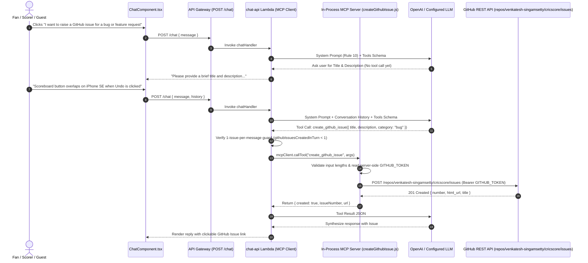

# 🐙 GitHub Issue Specialist Agent & MCP Setup Guide

CricScore includes a dedicated **GitHub Issue Specialist Agent** integrated into the AI Chat Assistant via the **Model Context Protocol (MCP)**. Fans, scorers, and guests can report bugs, UI issues, or feature requests directly from the Chat Bot, creating a labeled issue in `venkatesh-singamsetty/cricscore` without exposing credentials to the browser or LLM.

---

## 🎯 1. Overview & 2-Step Conversational Flow

In the **AI Chat Assistant** (`ChatComponent.tsx`), users can click the suggested prompt chip **`7. "I want to report a bug or request a new feature"`** or type a report directly. To prevent accidental or blank issues, `chatHandler.js` (`Rule 10`) and `apps/ai-service/cricscore_ai/graph.py` (`github_issue_node`) enforce a strict **2-step confirmation protocol**:

- **Step 1 — Generic Intent (No Details Provided Yet):**
  - **User Input:** Clicks chip _"I want to report a bug or request a new feature"_.
  - **Tool Invoked:** ❌ **No**.
  - **Agent Action & Outcome:** Prompts the user for a concrete **Title** and **Description** before calling any tool.
- **Step 2 — Concrete Bug or Feature Details Provided:**
  - **User Input:** e.g., _"Scoreboard button overlaps on iPhone SE when Undo is clicked"_.
  - **Tool Invoked:** ✅ **Yes** (`create_github_issue` via MCP server).
  - **Agent Action & Outcome:** Creates the GitHub issue with `["via-cricscore-ai", category]` labels and returns the **Issue `#`** and **clickable GitHub URL** in chat.

### Tool Input Schema (`create_github_issue`)

| Parameter     | Type     | Validation Rule                                | Purpose                                                 |
| :------------ | :------- | :--------------------------------------------- | :------------------------------------------------------ |
| `title`       | `string` | `5–120` chars (prefixed with `[AI Report]`)    | Concise summary of the bug or feature request           |
| `description` | `string` | `10–2,000` chars (trimmed)                     | Steps to reproduce or requested feature behavior        |
| `category`    | `string` | `"bug"` \| `"feature-request"` \| `"feedback"` | Attached as a GitHub label alongside `via-cricscore-ai` |
| `matchId`     | `string` | Optional UUID / identifier                     | Included in the issue metadata block when active        |

---

## 🏗️ 2. Architecture & Sequence Flow



---

## 🔒 3. Security & Abuse Guardrails

Because `POST /chat` is open to both authenticated scorers and guests, the GitHub Issue Agent enforces 5 server-side security guardrails:

- **1. Zero Secret Exposure (`createGithubIssue.js` / `tools.py`):**
  - `GITHUB_TOKEN` is read strictly on the server; the LLM and browser client never see or receive the GitHub token.
- **2. Fixed Repository Allowlist (`DEFAULT_GITHUB_REPO`):**
  - Locked to `"venkatesh-singamsetty/cricscore"` and validated against `/^[A-Za-z0-9_.-]+\/[A-Za-z0-9_.-]+$/` so callers cannot supply arbitrary URLs (preventing SSRF and cross-repo spam).
- **3. 1-Issue-Per-Message Cap (`githubIssuesCreatedInTurn` in `chatHandler.js`):**
  - Even if a prompt-injected message tricks the LLM into emitting multiple `create_github_issue` calls in one turn, only the first call executes.
- **4. Input Length Validation (`validateGithubIssueInput()`):**
  - Requires `title` (`5–120` chars) and `description` (`10–2,000` chars), rejecting blank or noisy issues and bounding GitHub API payload sizes.
- **5. Audit Labels & Metadata:**
  - Automatically applies `["via-cricscore-ai", category]` labels, prefixes the title with `[AI Report]`, and stamps environment (`dev`/`prod`) and UTC timestamp metadata.

---

## ⚙️ 4. Setup & Configuration Matrix

- **1. GitHub Fine-Grained PAT (`GITHUB_TOKEN` / `secrets.GH_PAT`):**
  - **Location:** GitHub → Settings → Developer settings → Fine-grained PAT.
  - **Permissions:** Scoped strictly to `venkatesh-singamsetty/cricscore` with **Issues: Read & Write**.
- **2. Local Development Environment (`.env.local`):**
  - **Variables:** `GITHUB_TOKEN` and optional `GITHUB_REPO`.
  - **Behavior:** Automatically exported as `TF_VAR_github_token` by `infra/scripts/deploy.sh`.
- **3. Terraform Infrastructure as Code (`infra/terraform/variables.tf`, `infra/terraform/lambda.tf`):**
  - **Variables:** `var.github_token` (`sensitive = true`) and `var.github_repo`.
  - **Behavior:** Injected into `module "chat_api"` Lambda environment variables.
- **4. GitHub Actions CI/CD (`.github/workflows/ci.yml`, `.github/workflows/cd.yml`):**
  - **Variables:** `TF_VAR_github_token: ${{ secrets.GH_PAT }}`.
  - **Behavior:** Hydrates the `chat-api` Lambda across both `dev` and `prod` deployments.

```bash
# Add GitHub Issue Agent token to local .env.local and deploy to dev
cat << 'EOF' >> .env.local
GITHUB_TOKEN='ghp_your_personal_access_token_here'
GITHUB_REPO='venkatesh-singamsetty/cricscore'
EOF

./infra/scripts/deploy.sh --env dev --use-local-env
```

---

## 🧪 5. Key Files & Verification Commands

- **1. Node.js MCP Tool ([`createGithubIssue.js`](../apps/backend/lambdas/chat-api/mcp/tools/createGithubIssue.js)):**
  - Input validation, length checks, GitHub REST API `POST`, and audit metadata block.
- **2. MCP Server Registry ([`server.js`](../apps/backend/lambdas/chat-api/mcp/server.js)):**
  - Registers the `create_github_issue` tool schema on the in-memory MCP server.
- **3. Supervisor & Rate Guard ([`chatHandler.js`](../apps/backend/lambdas/chat-api/handlers/chatHandler.js)):**
  - Enforces the `Rule 10` 2-step prompt and `githubIssuesCreatedInTurn` 1-issue-per-turn cap.
- **4. Python LangGraph Specialist ([`tools.py`](../apps/ai-service/cricscore_ai/tools.py), [`graph.py`](../apps/ai-service/cricscore_ai/graph.py)):**
  - Implements `create_github_issue` and runs the `github_issue_node` specialist agent.
- **5. Frontend Chat UI ([`ChatComponent.tsx`](../apps/frontend/src/components/ChatComponent.tsx)):**
  - Renders prompt chip `#7` and formats clickable GitHub issue links (`target="_blank"`).

```bash
# 1. Run Backend MCP tool & handler unit tests (part of 376 unit tests and 15 E2E tests)
npm --prefix apps/backend test -- --run

# 2. Run Python LangGraph multi-agent tests
./apps/ai-service/.venv/bin/pytest apps/ai-service -q

# 3. Run Frontend ChatComponent tests
npm --prefix apps/frontend test -- --run src/test/ChatComponent.test.tsx
```

---

## 🔗 Related Documentation

- [**AI Architecture (Agentic RAG & MCP)**](./ai_architecture.md) — End-to-end multi-agent MCP supervisor, `pgvector` RAG, and deterministic POTM engine.
- [**Weather Report Specialist Agent Guide**](./weather_report_agent.md) — Open-Meteo geocoding/forecast tool and automated Cricket/DLS interruption advisories.
- [**Architecture & AI/MLOps FAQ**](./architecture_faq.md) — Deep-dive Q&A on MCP security isolation, supervisor routing, and hybrid ML inference.
- [**Full Deployment Guide**](./deployment.md) — Configuring `GITHUB_TOKEN` (`GH_PAT`) in `.env.local` and GitHub Actions secrets.
